# 📊 Roadmap Sempro — Mode Recovery (16–27 Nov 2026)

> [!danger] Dokumen ini menggantikan timeline lama
> Timeline lama (Sprint 1: 1–7 Nov, Sprint 2: 8–14 Nov) **tidak dijalankan**. Per 16 Nov progres 0/17.
> Sumber tunggal: [[EMERGENCY-SEMPRO]] · Sheet: tab **🚨 EMERGENCY 16-25 NOV**.

**Batas keras:** pendaftaran sempro **sebelum 25 Nov** → submit berkas **24 Nov 13:00**.

---

## 🧭 Alur Sprint (Terpadat)

```mermaid
flowchart LR
    A["T-01/T-02/T-03<br/>Bab 1 + EDA<br/>16–18 Nov"] --> B["T-04<br/>Bimbingan 1<br/>18 Nov 14:00"]
    B --> C["T-05/T-06<br/>Bab 2<br/>18–19 Nov"]
    C --> D["T-09/T-10<br/>Diagram + Metrik<br/>19–20 Nov"]
    D --> E["T-12<br/>KIRIM v1<br/>20 Nov 21:45"]
    E --> F["T-07/T-11<br/>PoC GPU<br/>21–22 Nov"]
    F --> G["T-13/T-14<br/>Integrasi + Turnitin<br/>20–22 Nov"]
    G --> H["T-08<br/>ACC + TTD<br/>23 Nov"]
    H --> I["T-16<br/>SUBMIT<br/>24 Nov"]
    I --> J["T-17<br/>Dry-run<br/>25–26 Nov"]
    J --> K["SEMPRO<br/>27 Nov"]
```

---

## 🎯 Milestone Kritis

| # | Tanggal | Milestone | Bukti |
| :--- | :--- | :--- | :--- |
| 1 | **Rab 18 Nov 14:00** | Bimbingan 1 | Notulen di [[Notulensi-Bimbingan]] |
| 2 | **Jum 20 Nov 21:45** | Naskah utuh v1 terkirim | PDF + link Docs |
| 3 | **Sen 23 Nov 19:30** | ACC + TTD lembar pengesahan | TTD |
| 4 | **Sel 24 Nov 13:00** | Berkas pendaftaran disubmit | Bukti submit |
| 5 | Rab 25 Nov 10:15 | Status terdaftar | Nama di sistem |
| 6 | **Jum 27 Nov** | **SEMPRO** | — |

---

## 🗓️ Jadwal Harian

| Tanggal | Blok | Task | Output |
| :--- | :--- | :--- | :--- |
| **Sen 16** | 16:30–18:30 | T-01 | Latar belakang 1,5–2 hlm |
| | 19:30–21:45 | T-01 | Research gap + 3 rumusan masalah |
| **Sel 17** | 13:00–15:30 | T-02 | Scope + 3 batasan |
| | 16:30–18:30 | T-03 | EDA part 1 |
| | 19:30–21:45 | T-03 | Tabel + 2 grafik |
| **Rab 18** | 10:00–11:00 | T-05 | 5 paper |
| | **14:00–15:30** | **T-04** | **Bimbingan 1** |
| | 16:30–18:30 | T-05 | 10 paper + sintesis |
| | 19:30–21:45 | T-06 | Diagram arsitektur |
| **Kam 19** | 07:00–09:00 | T-05 | Matriks 15 + Bab 2 |
| | 17:30–19:30 | T-09 | Draft diagram |
| | 19:30–21:45 | T-09 | Diagram final |
| **Jum 20** | 10:00–11:00 | T-10 | Rumus metrik |
| | 13:00–15:30 | T-13 | Bab 1–2 utuh |
| | 16:30–18:30 | T-13 | Bab 3 v0 |
| | **19:30–21:45** | **T-12** | **KIRIM v1 (≤ 22:00)** |
| **Sab 21** | 07:00–11:00 | T-07 | Baseline setup |
| | 13:00–15:30 | T-07 | Sanity Run & Indeksasi Baseline Gaur |
| | 16:30–18:30 | T-11 | Validasi cluster |
| | 19:30–21:45 | T-11 | Dummy inference |
| **Min 22** | 07:00–11:00 | T-11 | Dokumentasi PoC |
| | 13:00–15:30 | T-13 | Revisi v2 |
| | 16:30–18:30 | T-14 | Turnitin |
| | 19:30–21:45 | T-14 | Parafrase < 15% |
| **Sen 23** | 08:00–10:30 | T-15 | Slide 15 halaman |
| | 13:00–15:45 | — | ASDOS (fixed) |
| | 16:30–18:30 | T-16 | Berkas siap |
| | **19:30–21:45** | **T-08** | **ACC + TTD** |
| **Sel 24** | 12:15–13:00 | — | Email Pak Hafiz |
| | **13:00–15:30** | **T-16** | **SUBMIT** ✅ |
| | 16:30–18:30 | T-15 | Slide visual |
| | 19:30–21:45 | T-17 | 10 Q&A + script |
| **Rab 25** | 10:15–12:00 | — | Checkpoint status |
| | 16:30–18:30 | T-17 | Dry-run 1× |
| **Kam 26** | 07:00–08:45 | T-17 | Latihan + revisi slide |
| | 17:30–19:30 | T-17 | Dry-run 2× |
| **Jum 27** | — | — | **SEMPRO** |

---

## ⚖️ Aturan Eksekusi

1. **1 blok = 1 deliverable.** Blok tanpa output = blok gagal.
2. **WIP ≤ 2** task aktif.
3. **Buka dashboard maks 15 menit/hari** (21:45).
4. **06:00–07:00 = menulis**, bukan membaca (baca maks 15 menit).
5. **Weekend 07:00–11:00 wajib** — dipakai PoC, bukan libur.

---

## 🚦 Go / No-Go — Jumat 20 Nov 21:45

| Kondisi | Keputusan |
| :--- | :--- |
| Bab 1 + Bab 2 ≥ 80%, Bab 3 ≥ 50% | **GO** — kirim v1 malam itu |
| Bab 1 selesai, Bab 2 ≥ 50% | **CONDITIONAL** — kirim Bab 1 + kerangka, minta bimbingan darurat |
| Bab 1 belum selesai | **NO-GO** — tunda sempro ke Desember |

---

## 📚 Tautan

- Sprint: [[Sprint-1-Bab1-EDA]] · [[Sprint-2-Bab2-Baseline]] · [[Sprint-3-Bab3-Metodologi]] · [[Sprint-4-Final-Sidang]]
- Naskah: [[Bab-1-Pendahuluan]] · [[Bab-2-Tinjauan-Pustaka]] · [[Bab-3-Metodologi]]
- Bimbingan: [[Notulensi-Bimbingan]] · [[Bank-Pertanyaan-Dosen]]
- Induk: [[EMERGENCY-SEMPRO]] · [[Master-Dashboard]]
