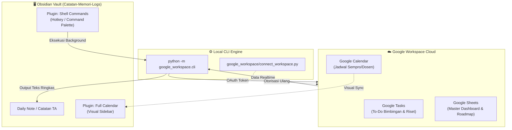

# 🚀 Panduan Fase-demi-Fase: Menghubungkan Obsidian ke Google Workspace CLI

Dokumen ini adalah panduan lengkap langkah demi langkah untuk mengintegrasikan **Obsidian** (khususnya vault `Catatan-Memori-Logs`) dengan perangkat otomatisasi lokal **Google Workspace Unified Toolkit & CLI** (`google_workspace.cli`).

Tujuan integrasi ini adalah menjadikan Obsidian sebagai **Mission Control (Pusat Komando)** untuk memantau Google Tasks, jadwal bimbingan di Google Calendar, hingga Master Dashboard Sempro di Google Sheets tanpa perlu membuka browser atau terminal secara manual.

---

## 🗺️ Arsitektur Alur Kerja



---

## 📌 Fase 1: Verifikasi & Autentikasi Google Workspace CLI

Sebelum menghubungkan ke Obsidian, pastikan mesin CLI lokal dapat berkomunikasi dengan Google API.

### 1.1. Cek Status Autentikasi
Buka terminal PowerShell di folder root TA (`D:\Kuliah\Semester 7\Tugas Akhir\Proposal Tugas Akhir`), lalu tes perintah berikut:

```powershell
python -m google_workspace.cli tasks list
```

> [!WARNING]
> **Jika muncul error `RefreshError: Token has been expired or revoked`:**
> Hal ini wajar terjadi jika OAuth App di Google Cloud Console masih berstatus **"Testing"** (token kedaluwarsa setiap 7 hari).
> 
> **Solusi Cepat:**
> Jalankan perintah otorisasi ulang berikut di terminal:
> ```powershell
> python google_workspace/connect_workspace.py
> ```
> Browser akan terbuka secara otomatis. Login dengan akun `andryano.produktivitas@gmail.com`, lalu izinkan akses. Setelah halaman sukses muncul, file `token.json` akan otomatis diperbarui.

### 1.2. Uji Coba Perintah Utama
Pastikan perintah berikut menghasilkan output bersih di terminal:
* **Google Tasks:** `python -m google_workspace.cli tasks list`
* **Google Calendar:** `python -m google_workspace.cli cal today`
* **Master Dashboard Sempro:** `python -m google_workspace.cli macro sprint-status`

---

## 🧩 Fase 2: Instalasi Plugin Komunitas di Obsidian

Integrasi ini membutuhkan plugin jembatan terminal di Obsidian.

### 2.1. Aktifkan Community Plugins
1. Buka aplikasi **Obsidian**.
2. Klik ikon **Settings** (gerigi di pojok kiri bawah) atau tekan `Ctrl + ,`.
3. Masuk ke tab **Community plugins**.
4. Jika opsi *"Restricted mode"* aktif, klik tombol **Turn on community plugins**.

### 2.2. Pasang Plugin Inti: **Shell Commands**
1. Di menu **Community plugins**, klik tombol **Browse**.
2. Ketik **`Shell Commands`** (dibuat oleh *Jarkko Malvinko*).
3. Klik **Install**, lalu klik **Enable**.

### 2.3. Pasang Plugin Pelengkap (Opsional tapi Direkomendasikan)
* **Full Calendar** (oleh *Davis Silverman*): Untuk melihat tampilan grid kalender langsung di sidebar.
* **Dataview** (oleh *blacksmithgu*): Untuk query tabel literatur dan catatan progress.

---

## ⚙️ Fase 3: Konfigurasi Shell Commands sebagai Jembatan CLI

Di fase ini, kita mendaftarkan perintah CLI `google_workspace` ke dalam Obsidian agar bisa dipanggil lewat *shortcut* keyboard atau *Command Palette*.

### 3.1. Buka Pengaturan Shell Commands
1. Di Obsidian, buka **Settings** $\rightarrow$ scroll ke bawah ke bagian **Community Plugins** $\rightarrow$ pilih **Shell Commands**.
2. Klik tombol **New shell command**.

---

### 3.2. Daftarkan Perintah-Perintah Penting

> [!SUCCESS]
> **STATUS: SUDAH DIKONFIGURASI OTOMATIS OLEH ANTIGRAVITY!**
> Anda **TIDAK PERLU** lagi memasukkan atau mengklik pengaturan di bawah ini satu per satu secara manual. File konfigurasi internal plugin (`data.json`) dan tombol pintas (`hotkeys.json`) sudah disuntikkan secara otomatis. 
> 
> Anda cukup **Reload Obsidian** (tekan `Ctrl + R` di Obsidian atau tutup lalu buka kembali aplikasi Obsidian) agar tombol pintasnya langsung aktif.
> 
> *Untuk panduan cara pakai tombolnya, baca: `tutorial-catatan.md`.*

Berikut adalah rincian 4 perintah yang telah otomatis disetel untuk Anda:

#### 🔹 Command 1: Tarik Google Tasks ke Catatan Hari Ini
* **Shell command:**
  ```cmd
  python -m google_workspace.cli tasks list
  ```
* **Alias (Nama Perintah):** `Google: Tarik Daftar Tasks Aktif`
* **Working Directory:**
  * Klik ikon gerigi (pengaturan perintah ini).
  * Pada opsi **Working directory**, pilih **Custom**, lalu masukkan:
    ```text
    D:\Kuliah\Semester 7\Tugas Akhir\Proposal Tugas Akhir
    ```
* **Output handling:**
  * Tab **Output** $\rightarrow$ **Output channel:** `Insert text into active file`
  * **Placement:** `At cursor position` (atau `At end of file`).

---

#### 🔹 Command 2: Ambil Jadwal Kalender Hari Ini
* **Shell command:**
  ```cmd
  python -m google_workspace.cli cal today
  ```
* **Alias:** `Google: Cek Agenda Hari Ini`
* **Working Directory:** `D:\Kuliah\Semester 7\Tugas Akhir\Proposal Tugas Akhir`
* **Output handling:**
  * **Output channel:** `Insert text into active file` $\rightarrow$ `At cursor position`

---

#### 🔹 Command 3: Cek Status Sprint / Master Dashboard TA
* **Shell command:**
  ```cmd
  python -m google_workspace.cli macro sprint-status
  ```
* **Alias:** `Google: Cek Status Sprint Sempro (Sheets)`
* **Working Directory:** `D:\Kuliah\Semester 7\Tugas Akhir\Proposal Tugas Akhir`
* **Output handling:**
  * **Output channel:** `Display notification balloon (toast)` atau `Display modal window` (karena Anda hanya ingin melihat status sekilas tanpa mengotori draf catatan).

---

#### 🔹 Command 4: Sinkronisasi Agenda Besok ke Google Tasks
* **Shell command:**
  ```cmd
  python -m google_workspace.cli macro sync-tomorrow
  ```
* **Alias:** `Google: Sync Jadwal Besok ke Tasks`
* **Working Directory:** `D:\Kuliah\Semester 7\Tugas Akhir\Proposal Tugas Akhir`
* **Output handling:** `Display notification balloon (toast)`

---

### 3.3. Menetapkan Tombol Pintas (*Hotkeys*)
1. Buka **Settings** $\rightarrow$ **Hotkeys**.
2. Di kolom pencarian, ketik `Shell Commands: Google`.
3. Atur pintasan favorit Anda:
   * `Alt + T` $\rightarrow$ `Google: Tarik Daftar Tasks Aktif`
   * `Alt + C` $\rightarrow$ `Google: Cek Agenda Hari Ini`
   * `Alt + S` $\rightarrow$ `Google: Cek Status Sprint Sempro (Sheets)`

---

## 📅 Fase 4: Integrasi Kalender Visual (Full Calendar)

Agar jadwal bimbingan dan sidang terjadwal rapi secara visual:

1. Buka **Settings** $\rightarrow$ **Full Calendar**.
2. Klik **Add Calendar** $\rightarrow$ pilih jenis **Google Calendar** atau **Remote (ICS)**.
3. Masukkan nama kalender (misal: `Jadwal TA & Dosen`).
4. Buka tab kalender di panel kanan Obsidian untuk melihat tampilan grid bulanan/mingguan yang sinkron dengan Google Calendar Anda.

---

## 📝 Fase 5: Praktik Alur Harian (*Daily Standup Workflow*)

Gunakan format ini di setiap **Daily Note** Anda di folder `Catatan-Memori-Logs`:

```markdown
# 📅 Log Harian - {{date}}

## 🎯 Fokus Hari Ini
- [ ] Eksperimen ekstraksi trajectory DEAM (Lagu ID: 1-100)
- [ ] Revisi Bab 1: Latar Belakang (Mood-arc Deezer)

## 🕒 Agenda Kalender (Google Calendar)
<!-- Tekan Alt + C di bawah ini -->

## 📋 To-Do Aktif (Google Tasks)
<!-- Tekan Alt + T di bawah ini -->

## 🔬 Log Eksperimen & Catatan Bimbingan
- Hasil diskusi dengan pembimbing:
  - Trajectory alignment dievaluasi dengan cosine similarity per segmen 0.5s.
```

---

## 🛠️ Ringkasan Troubleshooting

| Masalah / Error | Penyebab | Solusi |
| :--- | :--- | :--- |
| `invalid_grant: Token has been expired` | Token OAuth Google kedaluwarsa (masa aktif 7 hari status Testing). | Jalankan `python google_workspace/connect_workspace.py` di PowerShell untuk login ulang. |
| `No module named google_workspace` | Working directory di Obsidian Shell Commands belum diset dengan benar. | Pastikan Working Directory diatur ke: `D:\Kuliah\Semester 7\Tugas Akhir\Proposal Tugas Akhir`. |
| Output perintah tidak muncul di catatan | Pengaturan output channel salah. | Pastikan opsi Output diatur ke `Insert text into active file` dan kursor sedang aktif di halaman markdown. |
