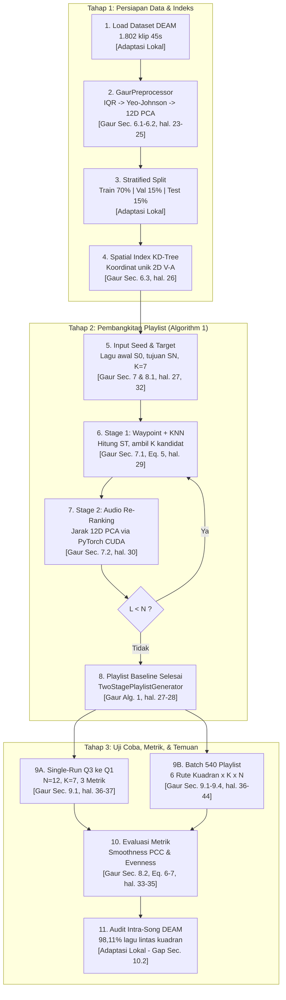

# Alur Uji Coba & Cara Baseline Dihasilkan

Dokumen ini memvisualisasikan alur *end-to-end* bagaimana baseline **Gaur & Donnelly (2023/2024)** dihasilkan dan diuji pada dataset **DEAM** di [`EXPERIMENT/Code/baseline_gaur/`](file:///D:/Kuliah/Semester%207/Tugas%20Akhir/Proposal%20Tugas%20Akhir/EXPERIMENT/Code/baseline_gaur/README.md).

> [!tip] Versi Node-Graph Interaktif (Obsidian Canvas)
> Buka **[[Alur-Uji-Coba-Baseline-Gaur.canvas]]** di Obsidian untuk tampilan *node-graph* interaktif yang dapat digeser dan diperbesar.

---

## 1. Diagram Alur Utama (Ringkas & Terbaca)

---

## 2. Rincian Setiap Tahap (Kartu Referensi)

> [!info] Tahap 1 — Persiapan Data & Preprocessing (`deam_loader.py`, `preprocessing.py`, `split_utils.py`, `dataset.py`)
> 1. **Load DEAM (`[Adaptasi Lokal]`):** Memuat **1.802 klip audio** (45s) dengan anotasi statis $(\bar{v}, \bar{a})$ dan dinamis 2 Hz; normalisasi $[1, 9] \to [-1, +1]$ (menggantikan DMDD/Spotify di *Gaur Sec. 5, hal. 13–22*).
> 2. **Preprocessing (`[Gaur 2023, Sec. 6.1–6.2, hal. 23–25]`):** `IQR Discretizer` (`5.5 × IQR`, `n_bins=20`) $\to$ `Yeo-Johnson PowerTransformer` $\to$ **12D PCA** $\to$ `MinMaxScaler [-1, 1]`.
> 3. **Stratified Split (`[Adaptasi Lokal]`):** Membagi 70% Train (**1.261**), 15% Val (**270**), 15% Test (**271**) per kuadran Q1–Q4; parameter fit hanya dari Train (anti *data leakage*).
> 4. **KD-Tree Index (`[Gaur 2023, Sec. 6.3, hal. 26]`):** `SongDatasetClass` mengindeks koordinat unik $(V, A)$ 2D.

> [!abstract] Tahap 2 — Pipeline Two-Stage KNN (`stage1_knn.py`, `stage2_selector.py`, `playlist_generator.py`)
> 5. **Input Seed & Target (`[Gaur 2023, Sec. 7 & 8.1, hal. 27, 32]`):** Tentukan lagu awal $S_0$, lagu tujuan $S_N$, panjang $N$, dan kandidat $K$ (default $K=7$).
> 6. **Stage 1 — Linear Waypoint + KNN (`[Gaur 2023, Sec. 7.1, Eq. 5, hal. 29]`):** Hitung target $S_T = S_L + \frac{S_N - S_L}{N - L}$, lalu query KD-Tree untuk mengambil $K$ kandidat terdekat.
> 7. **Stage 2 — Audio Re-Ranking CUDA (`[Gaur 2023, Sec. 7.2, hal. 30]`):** Hitung jarak fitur audio 12D PCA via PyTorch CUDA (`cosine`, `euclidean`, `manhattan`); pilih 1 lagu terdekat ke $S_L$.
> 8. **Iterasi (`[Gaur 2023, Algorithm 1, hal. 27–28]`):** Ulangi Stage 1 $\to$ Stage 2 sampai $N$ lagu tersusun.

> [!warning] Tahap 3 — Protokol Uji Coba, Metrik, & Temuan Kritis (`run_experiment.py`, `run_quadrant_experiments.py`, `metrics.py`, `analyze_intra_song_dynamics.py`)
> - **9A. Uji Single-Run (`[Gaur 2023, Sec. 8.1 & 9.1, hal. 32, 36–37]`):** Rute Q3 $\to$ Q1 ($N=12, K=7$), membandingkan Cosine vs Euclidean vs Manhattan. Output: [`metrics_comparison_deam.csv`](file:///D:/Kuliah/Semester%207/Tugas%20Akhir/Proposal%20Tugas%20Akhir/EXPERIMENT/Code/baseline_gaur/experiments/results/metrics_comparison_deam.csv).
> - **9B. Uji Batch 540 Playlist (`[Gaur 2023, Sec. 9.1–9.4, hal. 36–44]`):** 6 rute kuadran $\times$ $K \in \{5,7,15\}$ $\times$ $N \in \{5,12,19\}$ $\times$ 2 metrik $\times$ 5 trial = **540 evaluasi**. Output: [`batch_quadrant_experiments_deam.csv`](file:///D:/Kuliah/Semester%207/Tugas%20Akhir/Proposal%20Tugas%20Akhir/EXPERIMENT/Code/baseline_gaur/experiments/results/batch_quadrant_experiments_deam.csv).
> - **10. Evaluasi Metrik (`[Gaur 2023, Sec. 8.2.1–8.2.2, Eq. 6–7, hal. 33–35]`):** Smoothness PCC $\rho$ (Cosine `0.9781`, Euclidean `0.9876`, Manhattan `0.9762`) & Evenness $\text{Var}(\text{RMSE})$.
> - **11. Temuan Gap (`[Adaptasi Lokal — mengisi gap Sec. 10.2, hal. 50]`):** **98,11%** (1.768/1.802) lagu DEAM melintasi kuadran secara internal ($\Delta = 0.1937$), membuktikan baseline titik statis buta terhadap transisi *outro-intro*.

---

## 3. Tabel Pemetaan Sumber (Gaur 2023 vs Adaptasi Lokal)

| Node | Komponen di Canvas / Kode | Sumber Asli di Tesis Gaur (2023) | Keterangan |
| :--- | :--- | :--- | :--- |
| **1** | Load Dataset DEAM (`deam_loader.py`) | **Adaptasi Lokal** *(Gaur pakai DMDD/Spotify/MSD di Sec. 5, hal. 13–22)* | Mengganti DMDD dengan **DEAM** (1.802 klip, anotasi statis & 2 Hz) |
| **2** | Preprocessing: PCA 12D, Yeo-Johnson, `5.5 × IQR`, `MinMaxScaler` (`preprocessing.py`) | **Sec. 6.1–6.2, hal. 23–25** | Identik dengan pipeline Gaur (Tabel 10 hal. 23–24, `5.5 × IQR` & Yeo-Johnson hal. 24–25) |
| **3** | Stratified 4-Quadrant Split (`split_utils.py`) | **Adaptasi Lokal** *(tidak ada di Gaur 2023)* | Penguatan anti-*data leakage* (70/15/15) agar kelas kuadran Q1–Q4 seimbang |
| **4** | Spatial Index KD-Tree (`dataset.py` / `SongDatasetClass`) | **Sec. 6.3, hal. 26** | Nama kelas `SongDatasetClass` diambil langsung dari Sec. 6.3 hal. 26 |
| **5–8** | `TwoStagePlaylistGenerator`: Algorithm 1, Eq. 5 Waypoint + Stage 1 KNN + Stage 2 Audio Distance | **Sec. 7 (Algorithm 1), Sec. 7.1–7.2, hal. 27–30** | Eq. 5 Waypoint & $K=7$ di Sec. 7.1 (hal. 29); Stage 2 distance di Sec. 7.2 (hal. 30) |
| **9A–9B** | Uji Single-Run & Batch 6 Rute Kuadran (`run_experiment.py`, `run_quadrant_experiments.py`) | **Sec. 8.1 (hal. 32–33) & Sec. 9.1–9.4 (hal. 36–44)** | Variasi metrik jarak (Sec. 9.1 hal. 36), nilai $K$ (Sec. 9.3 hal. 42), panjang $N$ (Sec. 9.4 hal. 43) |
| **10** | Metrik Evaluasi: Smoothness PCC (Eq. 6) & Evenness $\text{Var}(\text{RMSE})$ (Eq. 7) | **Sec. 8.2.1–8.2.2, hal. 33–35** | Rumus Eq. 6 (hal. 33–34) & Eq. 7 (hal. 34–35) |
| **11** | Audit Dinamika Intra-Lagu 98,11% (`analyze_intra_song_dynamics.py`) | **Adaptasi Lokal** *(mengisi gap Sec. 10.2 Limitations, hal. 50)* | Bukti empiris lokal di DEAM untuk menguji limitasi titik statis Gaur |
