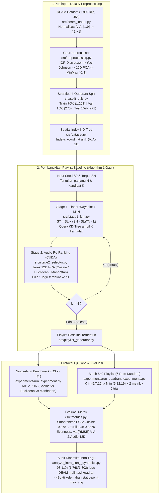

# Alur Uji Coba & Cara Baseline Dihasilkan

Dokumen ini memvisualisasikan alur *end-to-end* bagaimana baseline **Gaur & Donnelly (2023/2024)** dihasilkan dan diuji pada dataset **DEAM** di repositori [`EXPERIMENT/Code/baseline_gaur/`](file:///D:/Kuliah/Semester%207/Tugas%20Akhir/Proposal%20Tugas%20Akhir/EXPERIMENT/Code/baseline_gaur/README.md).

> [!tip] Versi Node-Graph Interaktif (Obsidian Canvas)
> Buka file **[[Alur-Uji-Coba-Baseline-Gaur.canvas]]** di Obsidian untuk tampilan *node-graph* yang bisa digeser, diperbesar, dan disunting langsung.

---

## Diagram Alur Pembangkitan & Uji Coba Baseline

---

## Ringkasan File Implementasi Terkait
- **Pipeline Utama:** [`run_experiment.py`](file:///D:/Kuliah/Semester%207/Tugas%20Akhir/Proposal%20Tugas%20Akhir/EXPERIMENT/Code/baseline_gaur/experiments/run_experiment.py) & [`run_quadrant_experiments.py`](file:///D:/Kuliah/Semester%207/Tugas%20Akhir/Proposal%20Tugas%20Akhir/EXPERIMENT/Code/baseline_gaur/experiments/run_quadrant_experiments.py)
- **Output Benchmark:** [`metrics_comparison_deam.csv`](file:///D:/Kuliah/Semester%207/Tugas%20Akhir/Proposal%20Tugas%20Akhir/EXPERIMENT/Code/baseline_gaur/experiments/results/metrics_comparison_deam.csv), [`batch_quadrant_experiments_deam.csv`](file:///D:/Kuliah/Semester%207/Tugas%20Akhir/Proposal%20Tugas%20Akhir/EXPERIMENT/Code/baseline_gaur/experiments/results/batch_quadrant_experiments_deam.csv), [`deam_intra_song_stats.json`](file:///D:/Kuliah/Semester%207/Tugas%20Akhir/Proposal%20Tugas%20Akhir/EXPERIMENT/Code/baseline_gaur/experiments/results/deam_intra_song_stats.json)
