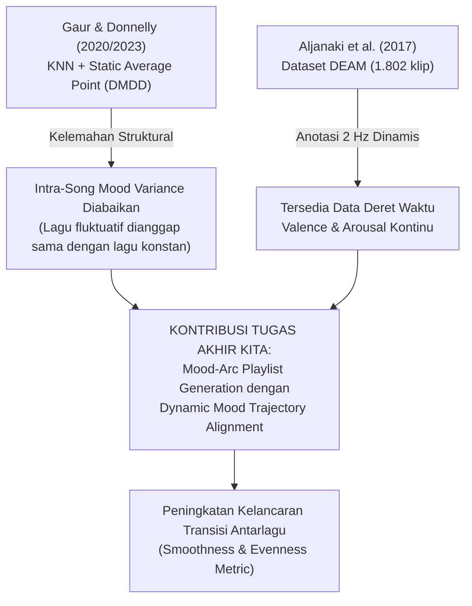

# 📚 Matriks Sintesis Literatur Review

Halaman ini secara dinamis merangkum seluruh koleksi literatur primer (21 paper dari Zotero & direktori `referensi/`) menggunakan plugin **Dataview**.

> [!tip] Kepatuhan Standar ITERA
> - **Total Sumber Primer:** 21 paper terindeks.
> - **Kebaruan Referensi:** 16 dari 21 paper (76.2%) dipublikasikan dalam 3 tahun terakhir (2023–2026), melampaui ambang batas minimum ITERA (≥ 70%).
> - **Citekey:** Seluruh entri terintegrasi dengan `references.bib` menggunakan gaya sitasi IEEE (`\cite{citekey}`).

---

## 📊 Tabel Komparasi Paper Otomatis (Dataview)

```dataview
TABLE author AS "Penulis", year AS "Tahun", dataset AS "Dataset", metode AS "Metode", file.link AS "Catatan Lengkap"
FROM #paper-review
SORT year DESC
```

---

## 🧭 Taksonomi & Klasterisasi Literatur

### 1. Klaster Playlist Generation & Mood Arc
Fokus pada algoritma pemilihan dan pengurutan (*sequencing*) trek musik berbasis preferensi emosional.
* [[Gaur2023-Mood-Dynamic]] (2023) — *Baseline primer*: Interpolasi lintasan emosi 2D dengan algoritma KNN pada dataset DMDD.
* [[Tomasi2023-Automatic-Playlist-RL]] (2023) — Pemodelan pembentukan playlist sebagai proses sekuensial interaktif dengan Reinforcement Learning di Spotify.
* [[Schweiger2025-Playlist-Coherence]] (2025) — Analisis empiris koherensi transisi lagu pada jutaan playlist kurasi pengguna.
* [[Cardoso2011-MOODetector-Prototype]] (2011) — Prototipe awal seleksi musik interaktif pada bidang energi-stres Thayer.

### 2. Klaster Dataset Benchmark & Anotasi Kontinu
Fokus pada korpus data audio musik dan metodologi penandaan emosi.
* [[Aljanaki2017-Developing-Benchmark-DEAM]] (2017) — *Dataset inti TA*: Anotasi dinamis kontinu 2 Hz pada 1.802 klip musik (45 detik).
* [[Delbouys2018-Music-Mood-Audio-Lyrics]] (2018) — Dataset DMDD (18k trek) berbasis fusi audio-lirik dengan label statis rata-rata.
* [[Bontempelli2022-Flow-Moods-Deezer]] (2022) — Implementasi industri skala besar radio mood diskrit di platform Deezer.
* [[Defferrard2017-FMA-Dataset]] (2017) — Korpus musik terbuka FMA (106k trek) untuk evaluasi representasi audio umum.

### 3. Klaster Representasi Audio & Pemodelan Emosi Mutakhir
Fokus pada teknik ekstraksi fitur, deep learning audio, dan survei perkembangan Music Emotion Recognition (MER).
* [[Eerola2026-Meta-Analysis-MER]] (2026) — Meta-analisis komprehensif 144 studi MER (Arousal lebih stabil dibanding Valence; perlunya mitigasi latency).
* [[Wen2025-Leakage-Audited-Dynamic-Arousal]] (2025) — Peramalan emosi dinamis kontinu pada DEAM dengan audit kebocoran data masa depan (*temporal leakage*).
* [[Kang2025-Unified-MER-Dimensional-Categorical]] (2025) — Unifikasi representasi dimensional 2D Russell dan tag kategori mood.
* [[Sun2025-HuBERT-Music-Mood]] (2025) — Pemanfaatan audio transformer HuBERT untuk regresi emosi dinamis kontinu pada DEAM.
* [[Li2024-MERT-Acoustic-Understanding]] (2024) — Self-supervised foundation model MERT untuk representasi akustik musik modern.
* [[Liu2024-LLM-Embeddings-Cross-Dataset]] (2024) — Penyelarasan label lintas dataset emosi musik menggunakan embedding teks LLM.
* [[Pyrovolakis2022-Multimodal-Song-Mood]] (2022) — Model multimodal audio-lirik dengan mekanisme cross-modal attention.
* [[Thome2022-Musical-Audio-Similarity]] (2022) — Pembelajaran kemiripan musik tanpa supervisi berbasis CNN kontrasif.
* [[Daikoku2022-Human-Automated-Similarity]] (2022) — Perbandingan kesepakatan metrik otomatis MIR dengan persepsi manusia.
* [[Russell1980-Circumplex-Model]] (1980) — Fondasi teoritis model dimensional afek 2D (Valence-Arousal).
* [[Yang2007-MER-Role-of-Individuality]] (2007) — Pemodelan variasi persepsi emosi musik antar-individu.

### 4. Klaster Optimasi Retrieval & Diversitas
Fokus pada algoritma pemilihan kandidat dan pencegahan keruntuhan klaster (*clustering collapse*).
* [[Divekar2023-Synthesizrr-Diverse-Datasets]] (2023) — Teknik density filtering untuk memaksimalkan diversitas hasil retrieval tetangga terdekat.
* [[Abdalla2024-Emotion-Manipulation-Music]] (2024) — Navigasi dan manipulasi koordinat emosi pada antarmuka visual interaktif.

---

## 📌 Ringkasan Gap Riset Utama & Dokumen Induk Bukti Empiris

> [!important] Dokumen Induk Analisis Bukti, Asumsi & Hipotesis
> Telah disusun analisis komprehensif berbasis bukti kuantitatif keras DEAM (1.802 lagu), hasil batch 540 eksperimen Gaur, Model Argumentasi Toulmin, Analisis SWOT, SMART, serta formulasi matematis **Boundary Jump Problem**:
> 👉 **[[Rencana-Penguatan-Latar-Belakang-Bukti-Asumsi-Hipotesis]]**


