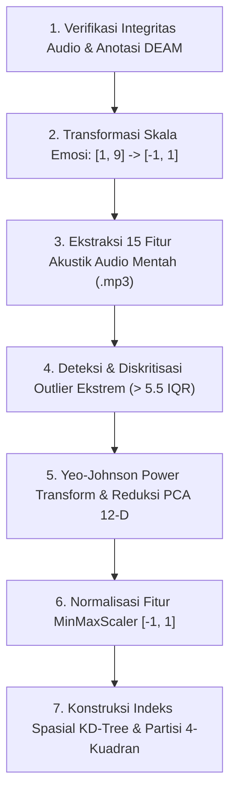

# 📖 Panduan Pra-Fitting, Ekstraksi Akustik & Pemanfaatan Dataset DEAM untuk Baseline KNN Gaur

> **Rujukan Utama:** Shaurya Gaur & Peter Donnelly (*"Mood-Dynamic Playlist: Interpolating a Path of Emotions Using a KNN Algorithm"*, University of Victoria 2023 / Springer EvoMUSART 2024).  
> **Dataset yang Dianalisis:** **DEAM (Database for Emotion Analysis in Music)** pada direktori lokal `EXPERIMENT/Dataset/DEAM/`.  
> **Tujuan Dokumen:** Menjelaskan secara konseptual dan teknis bagaimana Gaur menggunakan dataset musik dalam metodenya, bagaimana metode tersebut diadaptasikan pada korpus DEAM, serta merinci seluruh tahapan persiapan (*prerequisites & preprocessing*) yang **wajib dilakukan sebelum fitting indeks spasial baseline**.

---

## 🧠 1. Hakikat "Fitting / Indeksasi" dalam Metode Baseline Gaur (KNN + Audio Features)

Sebelum melangkah ke persiapan teknis, penting untuk memahami batasan akademik dari istilah **"training"** pada metode Gaur:

> [!NOTE] Klarifikasi Teoretis: Lazy Learning vs. Eager Learning
> Algoritma **K-Nearest Neighbors (KNN)** dan **KD-Tree** adalah model *Instance-Based Learning* (*Lazy Learner* non-parametrik). Model ini **tidak memiliki fase pelatihan bobot (weights optimization)** seperti Artificial Neural Network (tidak ada *loss function*, *gradient descent*, *backpropagation*, atau *epoch*).

Dalam konteks paper Gaur (2023), yang dimaksud dengan fase **"Training / Fitting"** adalah:
1. **Fitting Pipeline Preprocessing:** Menghitung parameter statistik distribusi data (kuartil IQR, parameter transformasi daya Yeo-Johnson $\lambda$, matriks kovariansi dan vektor bobot eigen PCA 12-dimensi, serta nilai min-max fitur).
2. **Fitting Indeks Spasial Ruang Emosi (KD-Tree):** Membangun struktur pohon biner partisi ruang (*k-dimensional tree*) di atas koordinat 2D Valence-Arousal unik untuk memungkinkan query pencarian tetangga terdekat dengan kompleksitas waktu $O(N \log N)$.
3. **Penyusunan Hash Table Pemetaan:** Mengelompokkan ID lagu ke dalam pasangan koordinat emosi yang sama (*multi-track coordinate mapping*).

---

## 🔍 2. Komparasi: Penggunaan Dataset Asli Gaur (DMDD) vs. Korpus DEAM

| Parameter Komparasi | Dataset Asli Gaur (DMDD + Spotify + MSD) | Adaptasi pada Korpus DEAM (`EXPERIMENT/Dataset/DEAM`) |
| :--- | :--- | :--- |
| **Sumber Korpus** | Deezer (18.644 lagu), Spotify (15 fitur), MSD (78 fitur) | **1.802 audio klip penuh (`.mp3` 45 detik) + Anotasi Statis & Dinamis** |
| **Representasi Emosi Lagu** | **Hanya 1 titik rata-rata statis $(\bar{V}, \bar{A})$** per lagu dari tag Last.fm | **Dua Lapisan:** Statis (1 nilai Likert per lagu) dan Dinamis (2 Hz per 500 ms) |
| **Resolusi Temporal Emosi** | 0 Hz (statis datar sepanjang lagu) | **2 Hz (anotasi tiap 500 ms dari detik ke-15 hingga detik ke-45)** |
| **Rentang Skala Nilai Emosi** | Rentang kontinu $[-1.0, +1.0]$ | **Skala Likert $[1.0, 9.0]$** (Wajib dikonversi ke $[-1.0, +1.0]$) |
| **Fitur Audio Akustik** | Pra-hitung dari API Spotify (danceability, loudness, dll.) | **Diekstrak langsung dari audio mentah `.mp3`** via Librosa / Torchaudio |
| **Koordinat Spasial Unik** | 2.762 titik unik dari 17.751 lagu | **1.113 titik unik dari 1.802 lagu** |

### Mengapa Gaur Menggunakan Representasi Statis?
Gaur terpaksa merepresentasikan satu lagu utuh sebagai satu titik statis semata $(\bar{V}, \bar{A})$ **bukan karena algoritma KNN tidak mampu menangani data dinamis, melainkan karena dataset DMDD hanya menyediakan satu nilai rata-rata per lagu**. 

Inilah celah ilmiah (*research gap*) utama Tugas Akhir Anda: dengan memanfaatkan dataset **DEAM**, kita dapat membuktikan bahwa di balik 1 titik statis tersebut, emosi lagu sebenarnya bergerak secara dinamis, sehingga metode usulan berbasis *Trajectory Alignment* akan jauh lebih unggul dalam menjaga kehalusan sambungan playlist.

---

## 🛠️ 3. Hal-Hal Wajib yang Harus Dilakukan SEBELUM Melakukan Training/Fitting Baseline

Untuk menjalankan baseline Gaur secara valid, reproducible, dan sesuai standar akademik UNESCO/ITERA, berikut adalah **7 langkah persiapan wajib** yang harus dieksekusi:



---

### 🔹 Langkah 1: Verifikasi Integritas Korpus Audio & Anotasi
* **Lokasi Data:**
  * Audio: `EXPERIMENT/Dataset/DEAM/DEAM_audio/MEMD_audio/` (memuat 1.802 berkas `.mp3`).
  * Anotasi Statis: `EXPERIMENT/Dataset/DEAM/DEAM_Annotations/annotations/annotations averaged per song/song_level/` (`static_annotations_averaged_songs_1_2000.csv` dan `songs_2000_2058.csv`).
* **Aksi Wajib:**
  1. Pastikan kedua file CSV anotasi statis digabungkan (*concatenated*) menghasilkan tepat **1.802 baris data** tanpa ada `song_id` yang hilang atau bernilai NaN.
  2. Lakukan pengecekan integritas header: kolom `song_id`, `valence_mean`, `valence_std`, `arousal_mean`, dan `arousal_std`.
  3. Verifikasi ketersediaan berkas MP3: pastikan file `{song_id}.mp3` dapat dibaca oleh pemutar/pustaka audio (`librosa.load` atau `soundfile.read`) dan berdurasi $\ge 45$ detik.

---

### 🔹 Langkah 2: Konversi & Penyelarasan Domain Skala Emosi
* **Masalah:** Anotasi statis DEAM menggunakan skala Likert / Self-Assessment Manikins (SAM) $[1.0, 9.0]$ dengan titik netral di $5.0$. Sedangkan model Gaur dan model Circumplex Russell beroperasi pada koordinat kartesius $[-1.0, +1.0]$ dengan titik netral di $(0.0, 0.0)$.
* **Formula Transformasi Linier Wajib:**
  $$V_{\text{norm}} = \frac{V_{\text{DEAM}} - 5.0}{4.0}, \quad A_{\text{norm}} = \frac{A_{\text{DEAM}} - 5.0}{4.0}$$
* **Hasil Distribusi Aktual DEAM Pasca-Normalisasi:**
  * Total lagu: **1.802 lagu**.
  * Rentang Valence: $[1.6, 8.4] \to [-0.85, +0.85]$ (Rata-rata: $4.904 \to -0.024$).
  * Rentang Arousal: $[1.6, 8.1] \to [-0.85, +0.775]$ (Rata-rata: $4.814 \to -0.046$).
  * Pusat persebaran data berada sangat dekat dengan titik netral ideal $(0, 0)$.

---

### 🔹 Langkah 3: Ekstraksi Fitur Akustik Audio Mentah
Karena DEAM tidak menyediakan file fitur audio pra-hitung, kita harus mengekstrak 15 representasi akustik yang setara dengan metodologi Gaur (kombinasi fitur Spotify + MSD) langsung dari 1.802 berkas audio MP3:

1. **Fitur Timbre / Tekstur Spektra:** MFCC (*Mel-Frequency Cepstral Coefficients*) koefisien 1 sampai 8.
2. **Fitur Kecerahan & Distribusi Frekuensi:** *Spectral Centroid*, *Spectral Rolloff*, dan *Spectral Flatness*.
3. **Fitur Temporal & Energi Sinyal:** *Zero Crossing Rate* (ZCR) dan *Root Mean Square Energy* (RMS Energy).
4. **Fitur Irama & Harmoni Musik:** *Tempo* (BPM) dan *Chroma Energy* (distribusi pitch class).

*Catatan Eksekusi:* Ekstraksi fitur ini dapat diakselerasi menggunakan GPU RTX 3070 Ti atau dijalankan satu kali secara batch dan disimpan permanen ke `data/processed/deam_extracted_features.csv`.

---

### 🔹 Langkah 4: Deteksi & Diskritisasi Outlier Ekstrem (Gaur IQR Rule)
Gaur (2023) menetapkan aturan ketat untuk menangani pencilan agar tidak merusak estimasi matriks kovariansi pada tahap PCA berikutnya:
* **Ambang Batas Pencilan:** Nilai fitur yang melampaui $5.5 \times \text{IQR}$ di atas Q3 atau di bawah Q1:
  $$\text{Upper Bound} = Q_3 + 5.5 \times (Q_3 - Q_1), \quad \text{Lower Bound} = Q_1 - 5.5 \times (Q_3 - Q_1)$$
* **Tindakan:** Fitur yang memiliki pencilan ekstrem dikelompokkan ke dalam 20 interval diskrit menggunakan `sklearn.preprocessing.KBinsDiscretizer(n_bins=20, encode='ordinal', strategy='uniform')`, lalu nilainya di-clip pada rentang batas aman.

---

### 🔹 Langkah 5: Transformasi Distribusi & Reduksi Dimensi PCA (12-D)
* **Peredaman Skewness:** Terapkan `sklearn.preprocessing.PowerTransformer(method='yeo-johnson')` pada seluruh 15 fitur audio akustik. Transformasi ini menormalkan sebaran fitur yang memiliki ekor tebal (*heavy-tailed*).
* **Reduksi Dimensi PCA:**
  * Latih model `sklearn.decomposition.PCA(n_components=12)` pada 15 fitur audio akustik hasil transformasi.
  * *Target Variansi:* Mempertahankan $\ge 80-95\%$ total variansi data.
  * **PENTING / PERINGATAN KERAS:** Kolom koordinat emosi $(V_{\text{norm}}, A_{\text{norm}})$ **DILARANG IKUT DI-PCA**. Reduksi PCA **hanya** diterapkan pada fitur audio akustik!
* **Penyelarasan Skala MinMax:** Skalakan ke-12 komponen PCA ke interval kompak $[-1.0, +1.0]$ menggunakan `MinMaxScaler(feature_range=(-1, 1))`.

---

### 🔹 Langkah 6: Konstruksi Indeks Spasial KD-Tree & Hash Mapping
* Dari 1.802 lagu DEAM yang telah dinormalisasi, terdapat **1.113 pasangan koordinat $(V, A)$ unik**.
* Latih model KD-Tree:
  ```python
  from sklearn.neighbors import NearestNeighbors
  kd_tree = NearestNeighbors(n_neighbors=50, algorithm='kd_tree', metric='euclidean')
  kd_tree.fit(unique_va_coords)
  ```
* Buat kamus pemetaan cepat (*hash mapping*):
  $$\text{coord\_to\_track\_ids}[(V_i, A_i)] \to [\text{DEAM\_0002}, \text{DEAM\_0145}, \dots]$$
  Struktur ini memungkinkan algoritma mengambil seluruh variasi lagu yang menempati titik emosi target secara instan.

---

### 🔹 Langkah 7: Partisi 4-Kuadran Russell untuk Protokol Uji
Untuk menjalankan protokol penjelajahan emosi Gaur (pengujian 6 konfigurasi rute melintasi ruang emosi), kelompokkan 1.802 lagu DEAM ke dalam 4 kuadran Russell:

```text
               Arousal (+)
                   |
     Kuadran II    |    Kuadran I
   Angry / Tense   |  Happy / Exuberant
     (229 lagu)    |    (594 lagu)
  -----------------+----------------- Valence (+)
     Kuadran III   |    Kuadran IV
   Sad / Depressed |  Calm / Relaxed
     (742 lagu)    |    (237 lagu)
                   |
```

* **Kuadran I ($V > 0, A > 0$):** 594 lagu (33.0%) — Musik gembira, energik, up-beat.
* **Kuadran II ($V \le 0, A > 0$):** 229 lagu (12.7%) — Musik agresif, tegang, distorsi tinggi.
* **Kuadran III ($V \le 0, A \le 0$):** 742 lagu (41.2%) — Musik sedih, melankolis, tempo lambat.
* **Kuadran IV ($V > 0, A \le 0$):** 237 lagu (13.2%) — Musik damai, tenang, relaksasi.

*Protokol Uji Gaur:* Mengharuskan pengambilan titik awal $S_0$ dan titik tujuan $S_N$ dari kuadran yang berbeda untuk menguji rute:
1. **Diagonal:** $Q_3 \to Q_1$ (Sad to Happy), $Q_2 \to Q_4$ (Angry to Calm).
2. **Horizontal:** $Q_1 \to Q_2$, $Q_3 \to Q_4$.
3. **Vertikal:** $Q_1 \to Q_4$, $Q_2 \to Q_3$.

---

## 🚀 4. Bagaimana Algoritma Gaur Berjalan Pasca-Fitting?

Setelah data siap dan KD-Tree terindeks, proses perakitan playlist $P = [S_0, S_1, \dots, S_{N-1}]$ berjalan melalui **Loop Dua Tahap (Two-Stage Pipeline)**:

```text
Untuk setiap langkah L = 1 hingga N - 2:
  1. Hitung Waypoint Target Emosi (Persamaan 5 Gaur):
     S_T = S_L + (S_N - S_L) / (N - L)
     
  2. Tahap 1 (Retrieval):
     Query KD-Tree untuk mencari koordinat emosi terdekat ke S_T.
     Ambil K = 7 lagu kandidat dari hash mapping.
     Filter: Buang lagu yang sudah ada di playlist dan buang lagu target S_N.
     
  3. Tahap 2 (Selection via PyTorch CUDA di RTX 3070 Ti):
     Hitung jarak kesamaan audio 12-D PCA antara lagu S_L dengan K kandidat:
     Dist_Cosine = 1.0 - CosineSimilarity(Audio_SL, Audio_Candidate)
     Pilih 1 lagu dengan jarak terkecil: S_{L+1} = argmin(Dist_Cosine).
     
  4. Tambahkan S_{L+1} ke playlist dan perbarui lagu saat ini.
Akhiri dengan menambahkan S_N pada posisi langkah ke-(N-1).
```

---

## 📊 5. Metrik Evaluasi Kuantitatif yang Dihitung

Setelah playlist terbentuk, Gaur mengukur kualitas playlist menggunakan 2 metrik objektif:

1. **Smoothness (Kehalusan Lintasan Emosi):**
   $$\rho = \left| \frac{\text{Cov}(V, A)}{\sigma_V \sigma_A} \right|$$
   Mengukur *Pearson Correlation Coefficient* antara deret Valence dan Arousal lagu-lagu terpilih. Nilai mendekati $1.0$ membuktikan bahwa playlist berhasil mengikuti garis lurus diagonal secara mulus.

2. **Evenness (Keteraturan Ukuran Langkah Transisi):**
   $$\text{RMSE}_k = \frac{\|S_{k+1} - S_k\|_2}{\sqrt{D}}, \quad \text{Evenness} = \text{Var}(\text{RMSE}_1, \dots, \text{RMSE}_{N-1})$$
   Mengukur variansi dari jarak transisi antarlagu bertetangga (dinormalisasi dimensi $\sqrt{D}$). Nilai variansi mendekati $0.0$ menunjukkan bahwa setiap sambungan lagu memiliki magnitude perubahan yang konsisten tanpa lonjakan drastis.

---

## ✂️ 6. Metodologi Pembagian Dataset DEAM (Stratified Split & Anti-Data Leakage)

Untuk menjamin integritas ilmiah dan menghindari kritik sidang terkait *class imbalance* dan *data leakage*, dataset DEAM (1.802 lagu) dikelola dengan strategi partisi terstratifikasi:

### A. Alasan Pemilihan Stratified Sampling 4 Kuadran
Distribusi 1.802 lagu DEAM sangat tidak seimbang di ruang Russell:
- **Q3 (Sad):** 742 lagu (**41,2%**)
- **Q1 (Happy):** 594 lagu (**33,0%**)
- **Q4 (Calm):** 237 lagu (**13,1%**)
- **Q2 (Angry):** 229 lagu (**12,7%**)

Jika dibagi secara acak tanpa stratifikasi, trek pada Q2 dan Q4 akan sangat sedikit di set uji, sehingga evaluasi rute transisi yang melintasi kedua kuadran tersebut tidak valid secara statistik. Stratified Split mengunci proporsi kuadran tetap identik pada seluruh subset.

### B. Konfigurasi Rasio (70% : 15% : 15%)
- **Train Set (70% = 1.261 lagu):** Basis estimasi distribusi data, fitting parameter Yeo-Johnson, dan penentuan bobot vektor eigen PCA 12-dimensi.
- **Validation Set (15% = 270 lagu):** Basis penyetelan hyperparameter (pencarian nilai $K \in \{5, 7, 10, 15, 20\}$ dan panjang playlist $N$).
- **Test Set (15% = 271 lagu):** Evaluasi akhir metrik Smoothness dan Evenness pada data yang belum pernah dilihat (*unseen tracks*).

### C. Protokol Zero Data Leakage
- **HANYA** data Train yang diproses dengan `.fit_transform()` pada modul `GaurPreprocessor`.
- Data Validation dan Test **WAJIB** diproses menggunakan metode baru `.transform()` (tersedia di `src/preprocessing.py`) menggunakan parameter terpelajar dari Train.

### D. File Manifest Tersimpan
Partisi telah dieksekusi dan disimpan permanen dalam direktori `EXPERIMENT/Code/baseline_gaur/experiments/splits/`:
- `deam_train_manifest.csv` (1.261 entri)
- `deam_val_manifest.csv` (270 entri)
- `deam_test_manifest.csv` (271 entri)
- `split_summary.json` (Ringkasan statistik)

---

## 🔗 Navigasi & File Terkait di Vault
- Dataset Utama: [[Dataset-DEAM]]
- Replikasi Baseline: [[Replikasi-Baseline-KNN]]
- Todolist Eksperimen: [[Experiment-Baseline-KNN-Gaur-Todolist]]
- Panduan Eksekusi CUDA: `EXPERIMENT/Code/baseline_gaur/TUTORIAL_RUN_CUDA.md`
- Kode Implementasi Lengkap: `EXPERIMENT/Code/baseline_gaur/`
