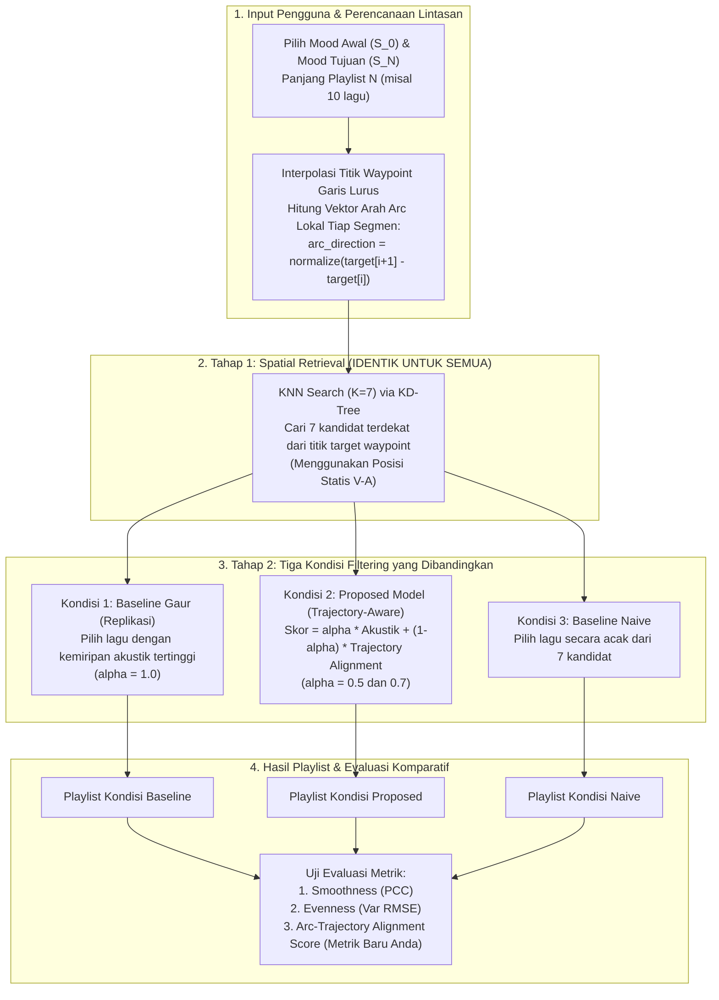

# 🧭 4_BLUEPRINT_ARAH_PENELITIAN_TA
## Panduan Komprehensif: Memahami Arah, Filosofi, Metodologi, & Peta Eksekusi Tugas Akhir

> **Dasar Naskah:** [Proposal Pengajuan TA.pdf](file:///D:/Kuliah/Semester%207/Tugas%20Akhir/Proposal%20Tugas%20Akhir/Proposal%20Pengajuan%20TA.pdf)  
> **Judul Resmi:** *Playlist Generation Berbasis Trajectory Mood-Arc*  
> **Mahasiswa:** Andryano Shevchenko Limbong (NIM: 123140205)  
> **Dosen Pembimbing:** I Wayan Wiprayoga Wisesa, S.Kom., M.Kom.  
> **Tujuan Dokumen:** Menjelaskan secara gamblang, utuh, dan mendalam ke mana arah penelitian ini bergerak, apa kontribusi ilmiahnya, bagaimana cara kerja sistemnya, dan bagaimana menghubungkan kode baseline yang telah selesai dengan model usulan *Trajectory-Aware*.

---

## 🌟 1. Gambaran Besar (The Big Picture): Apa Sebenarnya yang Ingin Anda Selesaikan?

Bayangkan Anda sedang mendengarkan musik di Spotify atau YouTube Music setelah seharian kuliah atau bekerja:
* Pikiran Anda sedang **lelah, cemas, atau stres (Tegang)**.
* Anda ingin playlist yang secara perlahan menuntun emosi Anda menjadi **tenang, fokus, lalu berenergi (Rileks $\to$ Fokus)**.

Perjalanan emosi yang terencana ini disebut sebagai **Mood Arc (Lengkung Emosi)**.

### Masalah Nyata di Industri Musik Saat Ini:
Mayoritas layanan streaming musik saat ini hanya menghasilkan playlist yang **statis dalam satu suasana hati** (misal: playlist *"Sad Songs"* yang isinya 100% lagu sedih dari awal sampai akhir, atau *"Workout Hits"* yang semuanya berenergi tinggi). 
* Padahal, kebutuhan psikologis pendengar musik adalah **transisi suasana hati yang mulus dan terkontrol**.
* Industri musik global (seperti fitur *Flow Moods* di Deezer) sedang berlomba-lomba memecahkan masalah ini. Jadi, penelitian Tugas Akhir Anda memecahkan **persoalan riil industri streaming**, bukan sekadar tugas akademis di atas kertas.

---

## 🔍 2. Celah Penelitian (Research Gap): Di Mana Letak Keterbatasan Penelitian Terdahulu?

Penelitian rintisan paling mutakhir yang mencoba memecahkan *mood arc* adalah paper karya **Shaurya Gaur & Peter Donnelly (2020 / EvoMUSART 2024)**.

### Pendekatan Gaur & Donnelly:
Gaur membuat sistem dua tahap:
1. **Tahap 1:** Menghitung titik garis lurus antara mood awal dan mood akhir, lalu mencari lagu-lagu di sekitar titik tersebut menggunakan K-Nearest Neighbors (KNN) pada model emosi 2D Russell (Valence & Arousal).
2. **Tahap 2:** Dari kandidat tersebut, Gaur memilih lagu yang fitur audio akustiknya (MFCC, tempo, energi) paling mirip dengan lagu sebelumnya.

### Keterbatasan Fatal Metode Gaur (*Static-Point Matching*):
Gaur menguji algoritmanya menggunakan **Deezer Mood Detection Dataset (DMDD)** yang berisi 18.644 lagu. Keterbatasan struktural dataset DMDD adalah: **DMDD hanya menyediakan SATU TITIK RATA-RATA STATIS per lagu**.

```
CONTOH MASALAH NYATA:
Ada dua lagu: Lagu A dan Lagu B.
Kedua lagu ini memiliki nilai rata-rata Valence = 0.5 dan Arousal = 0.5 (Secara statistik di atas kertas, keduanya identik!).

Namun kenyataan di dalam audionya:
- Lagu A: Awalnya sangat tenang (intro lambat), lalu perlahan meledak menjadi sangat enerjik di bagian akhir (Mood: Tenang -> Intens).
- Lagu B: Dari detik awal sampai detik akhir energinya datar dan konstan (Mood: Statis).

Algoritma Gaur TIDAK BISA membedakan Lagu A dan Lagu B, karena Gaur hanya melihat 1 titik rata-rata!
```

> [!IMPORTANT]
> **KALIMAT KUNCI RESEARCH GAP ANDA (Halaman 1 Proposal):**  
> *"Belum ada studi yang menguji apakah mempertimbangkan trajectory dinamis mood dalam lagu, bukan hanya titik rata-rata statis, menghasilkan transisi playlist mood-arc yang lebih koheren dibandingkan pendekatan static-point matching."*

---

## 🎯 3. Senjata Rahasia Anda: Korpus Dataset DEAM

Mengapa Anda bisa memecahkan masalah yang tidak bisa dipecahkan oleh Gaur?
Jawabannya: **Karena Anda menggunakan Dataset DEAM (*Database for Emotion Analysis in Music*)**.

| Karakteristik | Dataset Deezer DMDD (Dipakai Gaur 2020) | Dataset DEAM (Dipakai oleh Anda) |
| :--- | :--- | :--- |
| **Bentuk Data Emosi** | Hanya label statis tunggal ($\bar{V}, \bar{A}$) | **Lapisan Ganda: Statis + Dinamis** |
| **Frekuensi Anotasi** | 0 Hz (statis datar sepanjang lagu) | **2 Hz (Anotasi diambil tiap 0,5 detik sepanjang 45 detik!)** |
| **Sumber Anotasi** | Tebakan turunan tag Last.fm | **Rating manusia kontinu nyata** (5–10 annotator per lagu) |
| **Jumlah Korpus** | 18.644 trek teks (tanpa audio lokal) | **1.802 audio MP3 asli (tersimpan lokal di repositori Anda)** |
| **Kemampuan Analisis** | Hanya bisa melihat posisi rata-rata | **Mampu membaca ARAH PERGERAKAN EMOSI (Trajectory)** |

Dengan adanya anotasi 2 Hz pada DEAM, Anda bisa melihat apakah sebuah lagu sedang bergerak "naik" emosinya atau "turun", sehingga Anda bisa mencocokkan arah internal lagu tersebut dengan arah playlist yang Anda tuju!

---

## ⚙️ 4. Bagaimana Cara Kerja Sistem Usulan Anda? (Arsitektur Tri-Kondisi)

Berdasarkan Halaman 4–5 naskah proposal Anda, sistem yang Anda bangun adalah **Sistem Rekomendasi Musik Berbasis Konten Dua Tahap (*Two-Stage Content-Based Sequential Recommender System*)**.

Alur kerjanya dirancang dalam **tiga kondisi eksperimen komparatif (*Apple-to-Apple Head-to-Head Benchmark*)**:



---

## 🧮 5. Formulasi Matematis Inti Model Usulan Anda

Ada dua inovasi matematika utama yang Anda tawarkan di proposal Anda:

### 1. Ekstraksi Vektor Trajektori Lagu ($\vec{T}$)
Dari file anotasi dinamis 2 Hz (`valence.csv` dan `arousal.csv`), Anda mengambil rentang waktu **detik ke-15 hingga detik ke-45** (15 detik pertama dibuang karena manusia butuh waktu untuk merespons lagu/instabilitas awal).
Lalu Anda melakukan regresi linier sederhana terhadap waktu:
$$V(t) = \beta_V \cdot t + c_V, \quad A(t) = \beta_A \cdot t + c_A$$
* $\beta_V$ = laju kemiringan perubahan kebahagiaan lagu.
* $\beta_A$ = laju kemiringan perubahan energi lagu.
* Vektor trajektori lagu dibentuk menjadi *unit vector*:
  $$\vec{T}_{\text{kandidat}} = \text{normalize}(\beta_V, \beta_A)$$

### 2. Multi-Criteria Re-Ranking (Skor Gabungan)
Pada Tahap 2, model usulan Anda memilih kandidat lagu terbaik berdasarkan kombinasi harmonis dua dunia:
$$\text{Final Score} = \alpha \cdot \text{Acoustic Similarity} + (1 - \alpha) \cdot \text{Trajectory Alignment Score}$$

Di mana:
$$\text{Trajectory Alignment Score} = \cos(\vec{T}_{\text{kandidat}}, \vec{A}_{\text{segmen}})$$
* **Jika $\text{Alignment Score} \approx +1.0$:** Arah lagu internal searah sempurna dengan tujuan playlist (misal: playlist ingin naik energi, dan lagu yang dipilih memang sedang menaikkan energinya).
* **Jika $\text{Alignment Score} \approx -1.0$:** Arah lagu berlawanan dengan arah playlist (misal: playlist ingin menenangkan suasana, tetapi lagu tersebut malah meledak-ledak di akhir).

---

## 📊 6. Tiga Metrik Pengukur Keberhasilan (Evaluasi Kuantitatif)

Bagaimana membuktikan bahwa model Anda berhasil mengalahkan baseline Gaur?
Proposal Anda menetapkan **3 metrik kuantitatif**:

1. **Smoothness (Pearson Correlation Coefficient $|\rho|$):**  
   Mengukur seberapa linier dan teratur perpindahan emosi sepanjang runtunan playlist.
2. **Evenness ($Var(\text{RMSE}) / \sqrt{D}$):**  
   Mengukur seberapa seragam jarak lompatan antar-lagu (mencegah adanya dua lagu yang jarak emosinya melompat terlalu ekstrem).
3. **Arc-Trajectory Alignment Score (Metrik Baru Karya Anda):**  
   Rata-rata keselarasan antara vektor mikro-dinamika tiap lagu dengan makro-arah playlist.
   > **Hipotesis Utama Anda:** Model usulan Anda ($\alpha = 0.7$ atau $0.5$) akan menghasilkan *Arc-Trajectory Alignment Score* yang **jauh lebih tinggi secara signifikan** dibanding baseline Gaur ($\alpha = 1.0$), dengan tetap mempertahankan *Smoothness* dan *Evenness* yang kompetitif.

---

## 🗺️ 7. Di Mana Posisi Anda Sekarang? (Status Progres Nyata)

Agar Anda tidak merasa bingung atau tertinggal, berikut adalah rekam jejak posisi progres Anda:

```
[FASE 1: Persiapan Korpus DEAM] ───────────────> SELESAI 100% (1.802 MP3 Lokal Siap)
[FASE 2: Ekstraksi 15 Fitur Akustik Nyata] ─────> SELESAI 100% (Librosa Mode B CSV Siap)
[FASE 3: Preprocessing & PCA 12D] ─────────────> SELESAI 100% (Explained Variance 99.10%)
[FASE 4: Indeks Spasial KD-Tree 2D] ───────────> SELESAI 100% (1.113 Titik Unik Terindeks)
[FASE 5: Replikasi Baseline Gaur (alpha=1.0)] ──> SELESAI 100% (PCC 0.995, 540 Playlist Batch)
─────────────────────────────────────────────────────────────────────────────
[FASE 6: Ekstraksi Vektor Trajectory (Slope)] ─> LANGKAH BERIKUTNYA (Bulan 3-4)
[FASE 7: Implementasi Stage 2 Trajectory-Aware]> LANGKAH BERIKUTNYA
[FASE 8: Benchmark Tri-Kondisi & Analisis] ────> LANGKAH MENUJU SEMPRO/SIDANG
```

Pekerjaan yang baru saja Anda selesaikan di folder `EXPERIMENT/Code/baseline_gaur` adalah **Fase 1 sampai Fase 5 (Penyelesaian Baseline Pembanding)**. Anda sudah mengantongi angka kontrol pembanding yang valid!

---

## 💡 8. Tiga Rumusan Masalah yang Akan Anda Jawab di Naskah TA

Saat nanti Anda menulis Laporan Akhir (Bab IV dan Bab V), seluruh kesimpulan Anda akan menjawab 3 rumusan masalah ini:

1. **Jawaban RM 1:** *"Kami berhasil merancang pipeline modular dua tahap yang mengintegrasikan KD-Tree spatial retrieval pada posisi statis dengan multi-criteria filtering berbasis bobot $\alpha$."*
2. **Jawaban RM 2:** *"Playlist yang mempertimbangkan trajectory alignment menghasilkan Arc-Trajectory Alignment Score sebesar X.XX (meningkat sebesar Y% dibanding baseline Gaur), membuktikan transisi emosi yang lebih koheren."*
3. **Jawaban RM 3:** *"Analisis distribusi magnitude trajektori membuktikan bahwa mayoritas lagu DEAM memiliki magnitude slope signifikan ($> 0.05$), mengonfirmasi bahwa sinyal dinamika emosi cukup kuat untuk memandu pemilihan lagu."*

---

## 🎯 9. Ringkasan Sikap Mental untuk Menghadapi Dosen Pembimbing

Ketika Anda bertemu dengan Pak Wayan:
* Jangan pernah ragu atau minder seolah-olah Anda belum melatih model AI.
* Katakan dengan percaya diri dan bangga:
  > *"Pak, fondasi baseline pembanding Gaur sudah selesai kami replikasi secara penuh di atas korpus DEAM dan seluruh metrik kontrolnya sudah terekam rapi. Sekarang kami siap masuk ke inti orisinalitas riset kami: mengekstrak vektor slope dari anotasi dinamis 2 Hz dan menguji peningkatan Arc-Trajectory Alignment Score pada model usulan kami."*
