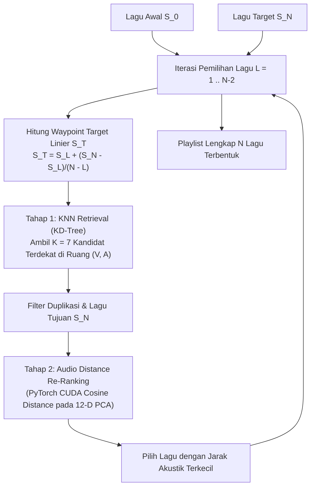

# 🧪 Replikasi Baseline Model Gaur & Donnelly (2020 / 2023 / 2024)

Dokumen ini mendokumentasikan implementasi dan evaluasi model acuan (*baseline*) berbasis *Two-Stage KNN Playlist Generator* yang diadaptasikan pada korpus utama **DEAM**.

---

## 🏗️ Alur Kerja Baseline (2-Stage Pipeline)

---

## 📌 Rincian Tahapan & Formula Matematis

1. **Tahap 1 (Retrieval):**
   * Menggunakan model pohon spasial KD-Tree (`scipy`/`scikit-learn`) pada koordinat rata-rata $(\bar{V}, \bar{A})$ lagu DEAM.
   * Mengambil $K = 7$ kandidat terdekat di sekitar target waypoint emosi linier:
     $$S_T = S_L + \frac{S_N - S_L}{N - L}$$
2. **Tahap 2 (Audio Re-ranking & Selection):**
   * Menghitung jarak akustik pada 12 komponen utama hasil PCA menggunakan metrik Cosine Distance:
     $$\text{Dist}_{\text{Cosine}}(u, v) = 1.0 - \frac{u \cdot v}{\|u\|_2 \|v\|_2}$$
   * Komputasi diakselerasi secara batch di GPU NVIDIA GeForce RTX 3070 Ti melalui tensor PyTorch (`torch.nn.functional.cosine_similarity`).
3. **Metrik Kuantitatif:**
   * **Smoothness:** Pearson Correlation Coefficient $|\rho|$ antara Valence dan Arousal lagu terpilih.
   * **Evenness:** Variansi dari deret ukuran langkah $\text{RMSE}_k = \frac{\|S_{k+1} - S_k\|_2}{\sqrt{D}}$.
4. **Partisi Dataset & Anti-Data Leakage:**
   * Stratified Split 70% Train (1.261), 15% Val (270), 15% Test (271) via `src/split_utils.py`.
   * Manifest tersimpan di `EXPERIMENT/Code/baseline_gaur/experiments/splits/`.
   * Preprocessor Yeo-Johnson & PCA di-fit hanya pada Train, lalu di-transform ke Val/Test.

---

## 🔗 Navigasi & File Terkait
- **Panduan Pra-Training & Pemrosesan DEAM:** [[04-Panduan-Pra-Training-DEAM-Baseline-Gaur|Panduan-Pra-Training-DEAM-Baseline-Gaur]]
- **Profil Detail Dataset DEAM:** [[01-Dataset-DEAM-dan-Eksplorasi|Dataset-DEAM]]
- **Checklist Todolist Eksekusi:** [[06-Task-Baseline-KNN-Gaur|Experiment-Baseline-KNN-Gaur-Todolist]]
- **Tutorial Eksekusi CUDA:** `EXPERIMENT/Code/baseline_gaur/TUTORIAL_RUN_CUDA.md`
- **Kode Sumber Baseline:** `EXPERIMENT/Code/baseline_gaur/`
