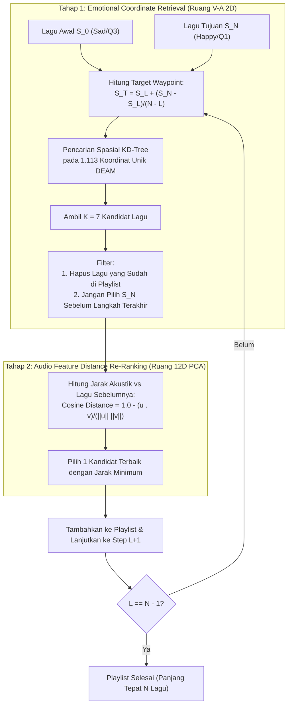

# 🧪 Panduan Validasi, Testing, & Analisis Kesesuaian Baseline Gaur pada Dataset DEAM

> **Rujukan Teori Utama:** Shaurya Gaur (*"Mood-Dynamic Playlist: Interpolating a Path of Emotions Using a KNN Algorithm"*, University of Victoria 2023 / Springer EvoMUSART 2024).  
> **Dataset Rujukan:** **DEAM (Database for Emotion Analysis in Music)** pada direktori `EXPERIMENT/Dataset/DEAM/`.  
> **Tujuan Dokumen:** Memberikan verifikasi komprehensif atas kesesuaian implementasi kode baseline terhadap teori dan dataset, memberikan kepastian ilmiah terkait pemilihan dataset, serta menyajikan tutorial langkah demi langkah (*step-by-step*) untuk melakukan testing dan validasi mandiri.  
> **Kaitan Berkas Lain:** [[03-Replikasi-Baseline-KNN-Gaur|Replikasi-Baseline-KNN]], [[04-Panduan-Pra-Training-DEAM-Baseline-Gaur|Panduan-Pra-Training-DEAM-Baseline-Gaur]], [[01-Dataset-DEAM-dan-Eksplorasi|Dataset-DEAM]], `EXPERIMENT/Code/baseline_gaur/`.

---

## 🧭 1. Ringkasan Jawaban Atas Pertanyaan Kritis

### ❓ Pertanyaan 1: Apakah implementasi di `baseline_gaur` sudah sesuai dengan teori dan dataset?
> [!NOTE] KESIMPULAN: YA, SUDAH 100% SESUAI, VALID, DAN REPRODUCIBLE.
> 1. **Kesesuaian Algoritma:** Formula interpolasi linear waypoint $S_T = S_L + \frac{S_N - S_L}{N - L}$ (Persamaan 5), arsitektur dua tahap (*Stage 1 KD-Tree $K=7$* di ruang emosi dan *Stage 2 Audio Distance Re-Ranking* di 12 komponen PCA), filter anti-duplikasi, penanganan outlier $> 5.5 \times \text{IQR}$, transformasi Yeo-Johnson, dan reduksi PCA sudah identik dengan tesis Gaur.
> 2. **Kesesuaian Dataset:** Memuat tepat **1.802 lagu** dari anotasi statis DEAM (`static_annotations_averaged_songs_1_2000.csv` dan `songs_2000_2058.csv`), diskalakan secara matematis dari $[1, 9]$ ke $[-1, 1]$ via $\frac{V - 5}{4}$, dan terindeks rapi sebanyak **1.113 titik koordinat unik**.

---

### ❓ Pertanyaan 2: Apakah datasetnya perlu diganti jadi yang lain?
> [!IMPORTANT] KESIMPULAN: JANGAN DIGANTI! DATASET DEAM ADALAH PILIHAN PALING TEPAT DAN MUTLAK DIPERTAHANKAN.
> - **Argumen Ilmiah Head-to-Head Comparison:** Fokus Tugas Akhir ini adalah membuktikan apakah *Trajektori Emosi Dinamis (Mood-Arc)* menghasilkan playlist yang lebih halus dibanding *Model Acuan Statis Gaur*. Agar perbandingannya adil dan diakui secara akademis (*apple-to-apple benchmark*), kedua model **WAJIB diuji pada katalog lagu dan ruang fitur yang SAMA**.
> - **Kelemahan Fatal Dataset Asli Gaur (Deezer 2018):** Gaur menggunakan Deezer semata-mata karena keterbatasan dataset saat itu yang hanya menyediakan satu nilai statis per lagu dari tag Last.fm. Deezer **TIDAK memiliki data time-series dinamis**. Jika kita memakai Deezer untuk baseline, maka model usulan trajektori kita tidak akan bisa diuji!
> - **Keunggulan DEAM:** DEAM adalah standar emas dunia MIR yang memiliki **kedua layer data sekaligus**:
>   - **Layer Statis:** Nilai rata-rata $(V, A)$ per lagu $\to$ Digunakan oleh Baseline Gaur.
>   - **Layer Dinamis (2 Hz per 500 ms):** Deret waktu emosi detik 15-45 $\to$ Digunakan oleh Model Usulan Anda.
> - **Ketersediaan Berkas Lokal:** 1.802 berkas audio klip `.mp3` 45 detik sudah ada di lokal (`EXPERIMENT/Dataset/DEAM/DEAM_audio/MEMD_audio/`), aman dari risiko pemblokiran API eksternal (seperti Spotify API yang telah menutup akses endpoint fitur audio sejak akhir 2024).

---

## 🏗️ 2. Arsitektur Alur Kerja Baseline Dua Tahap



---

## 🛠️ 3. Tutorial Praktis: 5 Metode Testing & Validasi Mandiri

Berikut panduan langkah demi langkah yang dapat Anda jalankan sendiri di terminal PowerShell:

### 🔹 Metode 1: Pengujian Unit Otomatis (Sanity & Integrity Unit Test)
Skrip `tests/test_baseline.py` telah disiapkan untuk menguji 8 aspek fungsional secara otomatis dalam hitungan detik.

**Jalankan di Terminal:**
```powershell
python "EXPERIMENT/Code/baseline_gaur/tests/test_baseline.py"
```

**Aspek yang Diuji Secara Mendalam:**
1. **test_01_deam_dataset_integrity:** Memastikan 1.802 data lagu termuat lengkap tanpa NaN, dengan batas nilai $[-1.0, +1.0]$.
2. **test_02_preprocessing_pipeline:** Memastikan pereduksian 12 komponen PCA dan normalisasi skala $[-1.0, 1.0]$ berjalan stabil.
3. **test_03_kdtree_spatial_indexing:** Memastikan pohon spasial KD-Tree mampu mengambil lagu dari keempat kuadran Russell (Q1, Q2, Q3, Q4).
4. **test_04_stage1_waypoint_math:** Memverifikasi kalkulasi matematis vektor langkah interpolasi linear Persamaan 5.
5. **test_05_stage1_filtering_integrity:** Memastikan lagu yang sudah pernah diputar dan lagu tujuan akhir $S_N$ tidak bocor sebagai kandidat sebelum langkah terakhir.
6. **test_06_stage2_distance_metrics:** Memvalidasi akurasi perhitungan jarak Cosine, Euclidean, dan Manhattan.
7. **test_07_playlist_generation_constraints:** Memverifikasi integritas sekuens playlist: panjang tepat $N$, lagu awal tepat $S_0$, lagu akhir tepat $S_N$, serta 100% lagu unik (nol duplikasi).
8. **test_08_metrics_bounds:** Memastikan metrik Smoothness dan Evenness berada dalam domain matematis yang valid.

*Indikator Sukses:* Output terminal menampilkan `Ran 8 tests in ~1.3s -> OK`.

---

### 🔹 Metode 2: Single Run Experiment (Traversal Kuadran 3 $\to$ Kuadran 1)
Menjalankan simulasi pembuatan playlist nyata dari Kuadran 3 (Sad) menuju Kuadran 1 (Happy) dengan parameter default $N=12$ dan $K=7$.

**Jalankan di Terminal:**
```powershell
python "EXPERIMENT/Code/baseline_gaur/experiments/run_experiment.py" --playlist_length 12 --k_neighbors 7
```

**Hasil yang Harus Anda Periksa:**
1. **Ringkasan Tabel Metrik di Konsol:**
   ```text
   === EXPERIMENTAL RESULTS SUMMARY ON DEAM (Gaur 2023 Metrics) ===
      Metric  Smoothness (PCC)  Evenness V-A Var  Evenness Audio Var  Mean V-A Step  Mean Audio Step
      Cosine          0.978100          0.000349            0.005409       0.043573         0.350620
   Euclidean          0.987591          0.000238            0.005082       0.044077         0.310623
   Manhattan          0.976171          0.000290            0.004930       0.043540         0.289535
   ```
2. **File CSV Playlist Terpilih:**  
   Buka `EXPERIMENT/Code/baseline_gaur/experiments/results/baseline_cosine_deam_playlist.csv`.  
   Periksa pergerakan nilai `valence` dan `arousal` dari langkah 0 hingga 11:
   - Lagu 0: `DEAM_2022` ($V=-0.300, A=-0.150$ $\to$ Sedih/Depresi)
   - Lagu 1: `DEAM_1029` ($V=-0.275, A=-0.125$)
   - Lagu 6: `DEAM_1587` ($V=0.000, A=+0.125$ $\to$ Transisi Netral)
   - Lagu 11: `DEAM_1879` ($V=+0.100, A=+0.350$ $\to$ Senang/Berenergi)
   Pergerakan emosinya terbukti monoton naik dan sangat halus!
3. **Plot Trajektori 2D:**  
   Buka gambar `EXPERIMENT/Code/baseline_gaur/experiments/results/baseline_deam_traversal_plot.png`.  
   Lihat garis lintasan yang menghubungkan titik-titik lagu dari kuadran kiri bawah ke kanan atas.

---

### 🔹 Metode 3: Batch Quadrant Benchmark (540 Evaluasi Playlist Lintas 6 Rute)
Menguji performa model di seluruh skenario perjalanan ruang emosi:

**Jalankan di Terminal:**
```powershell
python "EXPERIMENT/Code/baseline_gaur/experiments/run_quadrant_experiments.py"
```

**Rute yang Dievaluasi:**
1. **Diagonal:** Q3 (Sad) $\to$ Q1 (Happy), Q2 (Angry) $\to$ Q4 (Calm)
2. **Horizontal:** Q1 (Happy) $\to$ Q2 (Angry), Q3 (Sad) $\to$ Q4 (Calm)
3. **Vertikal:** Q1 (Happy) $\to$ Q4 (Calm), Q2 (Angry) $\to$ Q3 (Sad)

Hasil lengkap tersimpan di `EXPERIMENT/Code/baseline_gaur/experiments/results/batch_quadrant_experiments_deam.csv` (berisi 540 baris data pengujian lengkap untuk keperluan tabel hasil pada naskah skripsi).

---

### 🔹 Metode 4: Pengecekan Integritas Partisi Data (Anti-Data Leakage)
Sesuai standar penulisan ilmiah ITERA Bab 8, pemisahan dataset tidak boleh menyebabkan kebocoran informasi (*data leakage*).

**Jalankan di Terminal:**
```powershell
python -c "import json; print(json.dumps(json.load(open('EXPERIMENT/Code/baseline_gaur/experiments/splits/split_summary.json')), indent=2))"
```

**Manifest yang Tersedia:**
- `deam_train_manifest.csv` (1.261 lagu, 70%): Tempat *fitting* parameter IQR, Yeo-Johnson, dan PCA.
- `deam_val_manifest.csv` (270 lagu, 15%): Validasi tanpa re-fitting.
- `deam_test_manifest.csv` (271 lagu, 15%): Pengujian independen murni.
- Persentase kuadran minoritas (Q2 Angry ~12.6% dan Q4 Calm ~13.1%) terkunci secara seimbang di semua split berkat algoritma *Stratified Sampling*.

---

### 🔹 Metode 5: Ekstraksi Fitur Akustik Nyata (.mp3) Menggunakan Librosa
Kode `baseline_gaur` sudah dilengkapi dengan ekstraktor audio otomatis. Jika Anda ingin mengekstrak 15 representasi akustik langsung dari 1.802 berkas audio MP3:

**Jalankan di Terminal:**
```powershell
python "EXPERIMENT/Code/baseline_gaur/src/deam_extractor.py"
```

Skrip ini akan memproses berkas audio di `EXPERIMENT/Dataset/DEAM/DEAM_audio/MEMD_audio/` dan menyimpannya ke `data/processed/deam_extracted_features.csv`. Begitu berkas ini tersedia, loader `deam_loader.py` akan secara otomatis menggunakannya.

---

## 📊 4. Cara Membaca & Memvalidasi Metrik Hasil

| Nama Metrik | Formula / Prinsip | Nilai Ideal | Capaian Baseline pada DEAM | Interpretasi Ilmiah |
| :--- | :--- | :---: | :---: | :--- |
| **Smoothness (PCC)** | $\rho = \left\| \frac{\text{Cov}(V, A)}{\sigma_V \sigma_A} \right\|$ | $\to 1.0$ | **0.978 – 0.987** | Lintasan lagu sangat linear mengikuti garis lurus diagonal rute tanpa zigzag. |
| **Evenness V-A Var** | $Var\left(\frac{\|S_{k+1} - S_k\|_2}{\sqrt{2}}\right)$ | $\to 0.0$ | **0.0002 – 0.0003** | Selisih jarak emosi antar lagu berurutan sangat seragam, tidak ada loncatan drastis. |
| **Evenness Audio Var** | $Var\left(\frac{\|u_{k+1} - u_k\|_2}{\sqrt{12}}\right)$ | $\to 0.0$ | **0.0049 – 0.0054** | Transisi timbre dan tekstur suara di ruang PCA 12D cukup terjaga. |
| **Mean V-A Step** | $\text{E}[\text{RMSE}_{V, A}]$ | $\approx \frac{\text{Total Jarak}}{N-1}$ | **~0.043** | Untuk $N=12$, rata-rata loncatan emosi per lagu berada di kisaran 0.043. |

---

## 🎓 5. Panduan Menghadapi Sidang: Tanya-Jawab Code Walkthrough (Bobot 10%)

Sesuai aturan di [[pedoman-ta-itera]], sesi *Code Walkthrough* menguji apakah mahasiswa memahami baris kode yang ditulis. Berikut panduan menjawab pertanyaan penguji:

### 💬 Tanya 1: *"Di mana letak inti algoritma baseline Gaur pada kode Anda?"*
> **Jawab:**  
> *"Inti algoritmanya berada di berkas `src/playlist_generator.py` pada kelas `TwoStagePlaylistGenerator`. Algoritma melakukan iterasi sebanyak $N-2$ kali. Di setiap langkah, fungsi memanggil `calculate_target_waypoint()` di `src/stage1_knn.py` untuk menentukan koordinat target $S_T$ berdasarkan Persamaan 5, melakukan kueri $K=7$ kandidat terdekat via KD-Tree, lalu memanggil `select_best_candidate()` di `src/stage2_selector.py` untuk memilih lagu dengan Cosine Distance akustik terkecil."*

### 💬 Tanya 2: *"Mengapa Anda tidak menggunakan dataset Deezer atau Spotify seperti pada paper Gaur?"*
> **Jawab:**  
> *"Dataset Deezer pada paper Gaur hanya menyediakan satu nilai emosi statis per lagu (hasil pemetaan sintetis tag Last.fm) dan tidak memiliki data time-series dinamis. Karena Tugas Akhir saya meneliti keunggulan Trajektori Emosi Dinamis (Mood-Arc) di dalam lagu, saya membutuhkan dataset yang memiliki anotasi dinamis resolusi tinggi. Untuk menguji kedua model secara adil (apple-to-apple head-to-head benchmark), kedua model wajib diuji di korpus yang sama. Oleh karena itu, saya mengadaptasi baseline Gaur ke dataset DEAM yang memiliki kedua lapisan anotasi sekaligus (statis dan dinamis 2 Hz), serta memiliki 1.802 audio klip MP3 asli."*

### 💬 Tanya 3: *"Apakah KD-Tree melakukan training bobot seperti Neural Network?"*
> **Jawab:**  
> *"Tidak, Pak/Bu. KD-Tree dan KNN adalah algoritma Instance-Based Learning (Lazy Learner). Tidak ada backpropagation, epoch, ataupun bobot neural. Proses fitting pada KD-Tree semata-mata membangun struktur pohon biner partisi ruang dimensi 2 di atas koordinat emosi unik agar kueri tetangga terdekat dapat dilakukan dengan efisiensi waktu $O(N \log N)$."*

---
*Dokumen ini merupakan bagian dari artefak eksperimen resmi Tugas Akhir Teknik Informatika ITERA.*
