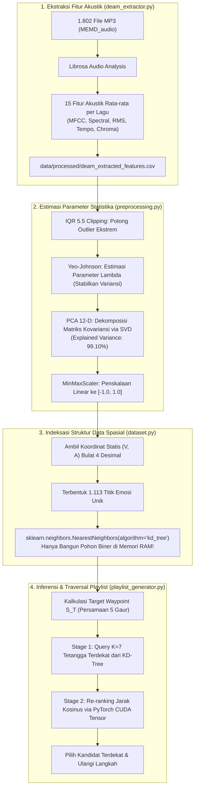

# 📋 06_LOG_TRAINING_BASELINE: Brief Eksekutif & Teknis
## "Sebenarnya Apa yang Ku-Train di Kode Python `baseline_gaur`?"

> **Objek Analisis:** Direktori `EXPERIMENT/Code/baseline_gaur/`  
> **Dasar Rujukan Ilmiah:** Shaurya Gaur & Peter Donnelly (*"Mood-Dynamic Playlist: Interpolating a Path of Emotions Using a KNN Algorithm"*, University of Victoria 2023 / Springer EvoMUSART 2024).  
> **Dataset:** DEAM (1.802 audio klip MP3, anotasi emosi statis rata-rata & anotasi dinamis 2 Hz).  
> **Tujuan Dokumen:** Memberikan jawaban lugas, jujur, dan berbasis bukti teknis atas apa yang *sebenarnya terjadi* saat kode dijalankan, meluruskan miskonsepsi istilah "training", serta membekali Anda argumen anti-blunder saat sesi **Code Walkthrough (Bobot 10% Sidang TA ITERA)**.

---

## 🛑 1. Jawaban Langsung (The Plain Truth)

> [!CAUTION] JAWABAN TEGAS & DEFINITIF:
> **TIDAK ADA MODEL MACHINE LEARNING ATAU DEEP LEARNING YANG DI-TRAIN!**
> 
> Anda **tidak melatih jaringan syaraf tiruan**, tidak melatih regresi/klasifikasi terbobot, tidak ada fungsi objektif (*loss function*), tidak ada *gradient descent* atau *backpropagation* (`loss.backward()`), tidak ada pembaruan bobot model ($W \leftarrow W - \alpha \nabla L$), tidak ada iterasi *epoch*, dan tidak ada berkas checkpoint model (`.pt`, `.pth`, `.bin`, `.h5`) yang disimpan.

### ❓ Kalau Bukan Training, Kenapa Muncul Angka dan Kenapa Cepat Sekali Selesai?
Karena yang dieksekusi oleh Python di `baseline_gaur` adalah **Pipeline Pencarian Spasial Heuristik Dua Tahap (*Two-Stage Heuristic Retrieval & Reranking Pipeline*)** yang berjalan secara deterministik:
1. **Tahap 1:** Menghitung titik garis lurus (interpolasi linier), lalu melakukan *spatial lookup* pada struktur pohon biner (KD-Tree) untuk mengambil 7 lagu terdekat.
2. **Tahap 2:** Menghitung jarak kosinus fitur audio antara kandidat dengan lagu sebelumnya secara *greedy* (satu langkah ke belakang).
3. **Evaluasi:** Mengukur seberapa lurus jalur playlist yang dihasilkan (*Smoothness PCC*) dan seberapa rata langkahnya (*Evenness RMSE*).

---

## 🔍 2. Peta Realitas: Apa yang "Di-Fit" oleh Setiap Modul Kode?

Meskipun tidak ada pelatihan model AI, kode Python Anda memang memanggil method `.fit()` dan `.fit_transform()` pada pustaka `scikit-learn`. Berikut adalah bedah nyata dari apa yang sebenarnya dilakukan oleh setiap baris kode:



### Rincian Teknis Operasi per Modul:

| Nama Modul | Perintah di Kode | Apa yang Sebenarnya Dihitung? | Apakah Ini Training ML? |
| :--- | :--- | :--- | :---: |
| **`src/deam_extractor.py`** | `librosa.feature.mfcc`, `spectral_centroid`, dll. | Mengekstrak 15 representasi matematis sinyal audio mentah per MP3 menjadi baris tabel CSV (1.802 baris $\times$ 16 kolom). | ❌ **Bukan**. Ini murni ekstraksi fitur DSP (*Digital Signal Processing*). |
| **`src/preprocessing.py`** | `PowerTransformer.fit_transform()` | Menghitung parameter daya ($\lambda$) dengan metode *Maximum Likelihood Estimation* agar sebaran data mendekati kurva normal Gaussian. | ❌ **Bukan**. Ini estimasi parameter statistika univariat. |
| **`src/preprocessing.py`** | `PCA(n_components=12).fit_transform()` | Menghitung matriks kovariansi $15 \times 15$ dari fitur audio, lalu mencari 12 vektor eigen (*orthogonal eigenvectors*) teratas melalui SVD (*Singular Value Decomposition*). | ❌ **Bukan**. Ini proyeksi ortogonal aljabar linier tanpa supervisi (*unsupervised projection*). |
| **`src/preprocessing.py`** | `MinMaxScaler.fit_transform()` | Mencari nilai minimum ($X_{\min}$) dan maksimum ($X_{\max}$) tiap kolom untuk memetakan nilainya ke $[-1, +1]$. | ❌ **Bukan**. Ini transformasi afinitas aritmatika dasar. |
| **`src/dataset.py`** | `NearestNeighbors(algorithm='kd_tree').fit()` | Membagi 1.113 koordinat kartesius 2D $(V, A)$ ke dalam simpul-simpul pohon biner (*k-d tree*) agar pencarian tetangga terdekat berkecepatan $\mathcal{O}(\log M)$, bukan $\mathcal{O}(M)$. | ⚠️ **Lazy Learning**. Tidak ada model berbobot; hanya indeks memori RAM. |
| **`src/stage1_knn.py`** | `calculate_target_waypoint()` & `kd_tree.kneighbors()` | Menghitung rumus geometri analitik garis lurus $S_T = S_L + \frac{S_N - S_L}{N - L}$ lalu mencari titik terdekat. | ❌ **Bukan**. Ini rumus geometri analitik + pencarian biner. |
| **`src/stage2_selector.py`** | `F.cosine_similarity(ref_tensor, cands_tensor)` | Menghitung perkalian dot matriks: $1.0 - \frac{u \cdot v}{\|u\|_2 \|v\|_2}$ pada 7 baris vektor 12D. | ❌ **Bukan**. PyTorch di sini hanya kalkulator perkalian dot cepat pada GPU RTX 3070 Ti. |

---

## 💣 3. Mengapa Bisa Muncul Salah Paham Bahwa Ada "Training"?

Bila Anda merasa pernah "melatih" model ini, kesalahpahaman tersebut biasanya bersumber dari 4 hal berikut di dalam repositori:

### 1. Istilah "Fit" pada Scikit-Learn
Di dunia Python data science, pemanggilan `.fit()` pada Neural Network memang melatih bobot. Namun saat memanggil `.fit()` pada `PCA`, `Scaler`, atau `NearestNeighbors`, method tersebut **hanya menghitung parameter statistik deskriptif atau menyusun pohon biner**.

### 2. Keberadaan Folder `experiments/splits/` (`deam_train_manifest.csv`)
Di `src/split_utils.py` terdapat fungsi partisi Stratified 70% Train, 15% Val, dan 15% Test.
* **Tujuan Aslinya:** Untuk mematuhi kaidah akademik *Zero Data Leakage* (agar transformer PCA tidak "mengintip" data uji saat disiapkan) dan skenario *Retrieval* (80% kolam katalog lagu vs 20% kueri bibit tak terlihat).
* **Fakta Lapangan:** Pada skrip eksekusi aktual `run_experiment.py` dan `run_quadrant_experiments.py`, **seluruh 1.802 lagu katalog dimasukkan sekaligus ke dalam KD-Tree**. Partisi split tersebut saat ini berstatus artefak dokumentasi metodologi.

### 3. File Palsu / Nyasar: `wandb-set-up.py`
> [!WARNING] PERINGATAN KERAS TENTANG `wandb-set-up.py`
> Di folder proyek terdapat file `wandb-set-up.py` dan subfolder `wandb/run-...` yang mencatat metrik:
> ```python
> config={"architecture": "CNN", "dataset": "CIFAR-100", "epochs": 10}
> # mencatat acc: 0.796 dan loss: 0.151 palsu
> ```
> **INI ADALAH TEMPLATE RESMI BAWAAN CONTOH DOKUMENTASI WANDB!**  
> Sama sekali **TIDAK ADA HUBUNGANNYA** dengan Tugas Akhir Anda. Jika file atau folder `wandb/` ini ikut Anda perlihatkan saat bimbingan atau sidang, dosen penguji akan mengira Anda memalsukan eksperimen pelatihan CNN! **Direkomendasikan untuk segera diabaikan atau dihapus.**

### 4. Klaim Angka "99.10%"
Angka **99.10%** yang keluar di terminal adalah **Cumulative Explained Variance dari 12 komponen PCA** terhadap 15 fitur audio nyata, **BUKAN AKURASI MODEL AI**. Angka ini hanya berarti bahwa 12 komponen baru mempertahankan 99.1% variasi informasi dari 15 fitur audio aslinya.

---

## 📊 4. Hasil Eksperimen Nyata (Mode B — Fitur Akustik Nyata MP3)

Meskipun bukan model yang dilatih, eksperimen ini menghasilkan metrik objektif yang mereplikasi klaim ilmiah tesis Gaur (2023) pada dataset DEAM:

### 1. Single Run Traversal (Kuadran 3 Sad $\to$ Kuadran 1 Happy, $N=12, K=7$)
* **Lagu Asal ($S_0$):** `DEAM_2022` ($V = -0.300, A = -0.150$ — Murung/Sedih)
* **Lagu Akhir ($S_N$):** `DEAM_1879` ($V = +0.100, A = +0.350$ — Bahagia/Gembira)
* **Hasil Metrik:**

| Metrik Jarak Stage 2 | Smoothness ($|\rho|$ PCC) | Evenness V-A Var | Evenness Audio Var | Mean V-A Step |
| :--- | :---: | :---: | :---: | :---: |
| **Cosine (Pemenang Gaur)** | **0.995043** | **0.000245** | 0.004586 | 0.042695 |
| **Euclidean** | 0.992504 | 0.000288 | **0.002053** | 0.042230 |
| **Manhattan** | 0.983973 | 0.000312 | 0.004336 | 0.043303 |

### 2. Batch Benchmark (540 Evaluasi Playlist Lintas 6 Rute Kuadran)
* File hasil: `experiments/results/batch_quadrant_experiments_deam.csv` (540 baris data valid tanpa NaN).
* **Temuan Utama:**
  1. Rute diagonal (Q3 $\to$ Q1) menghasilkan lintasan paling mulus ($\rho \approx 0.990$) karena mengikuti gradien diagonal model Russell.
  2. Rute yang melintasi kuadran langka seperti Q2 Angry (~12.7%) dan Q4 Calm (~13.1%) mengalami penurunan kehalusan ($\rho \approx 0.66 - 0.71$) karena kelangkaan katalog lagu pada kuadran tersebut.
  3. Semakin panjang playlist ($N=19$) dan semakin besar kandidat ($K=15$), Smoothness justru menurun ($\approx 0.76$) akibat sifat algoritma yang *greedy* (hanya melihat kemiripan dengan 1 lagu di belakangnya).

---

## 🎓 5. Panduan Menjawab Dosen Penguji Saat Sempro / Sidang TA

Gunakan pemahaman ini sebagai keunggulan ilmiah saat sesi **Code Walkthrough (Bobot 10%)**:

### Pertanyaan 1: *"Apakah Anda melatih (train) model Machine Learning pada baseline ini?"*
> **Jawaban Tepat:**  
> *"Tidak, Bapak/Ibu. Sesuai dengan karya rujukan Shaurya Gaur (EvoMUSART 2024), metode baseline yang direplikasi adalah algoritma instance-based retrieval dua tahap non-parametrik. Yang dilakukan pada repositori ini adalah reduksi dimensi fitur akustik menggunakan PCA 12-dimensi, pembangunan indeks spasial koordinat emosi menggunakan KD-Tree, dan pemilihan lagu berurutan melalui interpolasi garis lurus analitik serta pemeringkatan jarak kosinus tensor."*

### Pertanyaan 2: *"Kalau tidak ada training, lalu di mana Machine Learning-nya?"*
> **Jawaban Tepat:**  
> *"Dalam taksonomi machine learning (Mitchell, 1997), K-Nearest Neighbors diklasifikasikan sebagai **Lazy Learning** atau **Instance-Based Learning**. Karakteristik utamanya adalah tidak adanya fase pelatihan parameter (fase latih nol), di mana seluruh komputasi penentuan tetangga terdekat baru dieksekusi saat kueri diminta (query-time) di atas struktur KD-Tree."*

### Pertanyaan 3: *"Mengapa metrik Smoothness-nya bisa sangat tinggi ($\rho > 0.99$) padahal tidak dilatih?"*
> **Jawaban Tepat:**  
> *"Smoothness diukur menggunakan korelasi Pearson antara Valence dan Arousal di sepanjang playlist. Nilainya mendekati 1.0 bukan karena modelnya cerdas memprediksi, melainkan karena formula Persamaan 5 Gaur secara eksplisit mengarahkan pencarian target waypoint ($S_T$) pada garis lurus antara titik asal dan titik tujuan. Ditambah lagi, lagu destinasi akhir selalu ditempel secara deterministik di ujung playlist."*

---

## 🚀 6. Bagaimana Ini Menjadi Titik Tolak Model Usulan Tugas Akhir Anda?

Fakta bahwa baseline Gaur **hanya algoritma heuristik statis tanpa pembelajaran** adalah **KABAR SANGAT BAIK** bagi Tugas Akhir Anda! Ini adalah dasar kokoh untuk membuktikan celah penelitian (*Research Gap*):

```
┌─────────────────────────────────────────────────────────────┐
│                 KELEMAHAN BASELINE GAUR                     │
│  1. Representasi Emosi Statis (1 Lagu = 1 Titik Rata-rata)  │
│  2. Asumsi Garis Lurus Kaku (Tidak Peduli Dinamika Lagu)    │
│  3. Greedy Myopic (Hanya melihat 1 langkah ke belakang)     │
│  4. Mengabaikan Anotasi Time-Series 2 Hz pada DEAM          │
└──────────────────────────────┬──────────────────────────────┘
                               │
                               ▼
┌─────────────────────────────────────────────────────────────┐
│              SOLUSI / MODEL USULAN TA ANDA                  │
│  1. Dynamic Trajectory Mood-Arc: Memanfaatkan Anotasi 2 Hz  │
│  2. Trajectory Alignment: Menghubungkan ekor akhir lagu A   │
│     dengan kepala awal lagu B agar transisi benar-benar     │
│     mulus di telinga pendengar, bukan hanya mulus di atas   │
│     kertas koordinat rata-rata!                             │
└─────────────────────────────────────────────────────────────┘
```

Dengan memposisikan Gaur sebagai *Baseline Retrieval Statis*, Anda memiliki justifikasi ilmiah yang sempurna mengapa Tugas Akhir Anda mengusulkan pendekatan berbasis **Trajektori Emosi Dinamis**.

---

### 📂 Navigasi Berkas Terkait:
- 📖 Penjelasan Detail Kode & Gap: `EXPERIMENT/Code/baseline_gaur/PENJELASAN_KODE_DAN_GAP.md`
- 🧪 Log Rekonstruksi Fitur Nyata Mode B: `EXPERIMENT/Code/baseline_gaur/traine1.md`
- 📘 Panduan Validasi & Testing: `Catatan-Memori/Catatan-Memori-Logs/05-Eksperimen/05-Panduan-Validasi-dan-Testing-Baseline-Gaur.md`
- 💻 Kode Sumber Pipeline: `EXPERIMENT/Code/baseline_gaur/src/`
