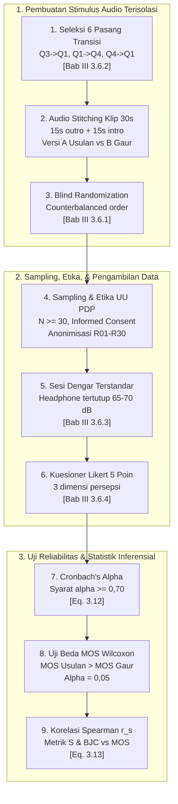

# Alur *Blind A/B Listening Test* (Uji Persepsi Manusia)

Mengacu pada **Bab III Subbab 3.6** ([chapter-3.tex](file:///D:/Kuliah/Semester%207/Tugas%20Akhir/Proposal%20Tugas%20Akhir/proposal-penelitian-andryano-123140205/chapters/chapter-3.tex)) untuk menjawab **Rumusan Masalah 3 (RM 3)**.

> [!tip] Versi Node-Graph Interaktif (Obsidian Canvas)
> Buka **[[Alur-Blind-AB-Listening-Test.canvas]]** di Obsidian untuk tampilan *node-graph* interaktif.

---

## 1. Diagram Alur Uji Dengar Manusia

---

## 2. Rincian Protokol Uji Dengar (Bab III 3.6)

> [!info] Stimulus & Kontrol Bias (`3.6.1`–`3.6.2`)
> - **6 Pasang Stimulus:** 2 pasang diagonal (**Q3 $\to$ Q1**), 2 pasang relaksasi (**Q1 $\to$ Q4**), 2 pasang naik energi (**Q4 $\to$ Q1**).
> - **Klip 30 Detik (Eq. 3.11):** `15s outro` $L_j$ + `15s intro` $L_{j+1}$, dibuat versi **A (Usulan)** dan **B (Gaur)** lalu diacak *counterbalanced* tanpa memberi tahu responden algoritma penghasilnya.

> [!abstract] Responden, Etika, & Instrumen (`3.6.3`–`3.6.4`, `3.6.6`)
> - **Sampel:** Minimal **$N \ge 30$** responden (usia 19–25 tahun, pendengar aktif $\ge 1$ jam/hari) di ruang tenang dengan *headphone* tertutup (**65–70 dB SPL**).
> - **Etika (UU PDP No. 27 Tahun 2022):** *Informed consent* tertulis (durasi 15–20 menit) dan anonimisasi kode `R01–R30`.
> - **Likert 5 Poin (3 Dimensi):** (1) *Transition smoothness*, (2) *Acoustic & energy continuity*, (3) *Emotional naturalness*.

> [!warning] Analisis Statistik (`3.6.5`)
> - **Reliabilitas:** *Cronbach's Alpha* $\alpha \ge 0{,}70$ (Eq. 3.12).
> - **Uji Beda:** *Wilcoxon Signed-Rank Test* ($\alpha = 0{,}05$) menguji $\mathrm{MOS}_{\mathrm{Usulan}} > \mathrm{MOS}_{\mathrm{Gaur}}$.
> - **Korelasi:** Korelasi peringkat *Spearman* ($r_s$, Eq. 3.13) antara metrik objektif ($\mathcal{S}$, $\mathcal{BJC}$) dan skor MOS manusia.

---

## 3. Kamus Istilah Teknis & Arti Rumus (Bahasa Sederhana)

> [!note] Panduan Membaca Istilah Teknis
> - **Blind A/B Test:** Responden mendengarkan 2 versi sambungan lagu (A dan B) tanpa tahu mana buatan model usulan dan mana buatan baseline, agar penilaiannya objektif tanpa bias.
> - **Counterbalanced Randomized Presentation:** Urutan putar A lalu B atau B lalu A dibalik-balik secara seimbang antar responden supaya tidak ada bias urutan (*order effect*).
> - **Audio Stitching:** Menyambung dua potongan lagu (15 detik akhir lagu 1 + 15 detik awal lagu 2) menjadi satu klip uji 30 detik agar responden fokus menilai sambungannya saja.
> - **Purposive Sampling ($N \ge 30$):** Memilih responden sesuai kriteria tertentu (usia 19–25, pendengaran normal, rutin dengar musik) minimal 30 orang agar analisis statistiknya kuat.
> - **65–70 dB SPL:** Standar tingkat kekerasan suara di headphone agar nyaman di telinga dan seragam bagi semua responden.
> - **Skala Likert 5 Poin:** Penilaian berjenjang dari angka 1 (sangat kasar/janggal) hingga 5 (sangat halus/alami).
> - **MOS (*Mean Opinion Score*):** Nilai rata-rata skor kenyamanan dari seluruh responden.
> - **Informed Consent & UU PDP No. 27/2022:** Lembar persetujuan sukarela responden serta kewajiban menyamarkan identitas asli responden menjadi kode `R01–R30`.

> [!tip] Arti Rumus Matematika
> - **Eq. 3.11 (Stimulus 30s):** Format klip uji gabungan 15 detik penutup lagu pertama + 15 detik pembuka lagu kedua.
> - **Eq. 3.12 (*Cronbach's Alpha*, $\alpha \ge 0{,}70$):** Mengukur apakah jawaban kuesioner cukup konsisten dan dapat dipercaya. Jika $\alpha \ge 0{,}70$, data layak dianalisis lanjut.
> - **Wilcoxon ($\mathrm{MOS}_{\mathrm{Usulan}} > \mathrm{MOS}_{\mathrm{Gaur}}$):** Uji statistik untuk membuktikan apakah skor kenyamanan responden pada model usulan benar-benar lebih tinggi secara signifikan ($p < 0{,}05$) dibanding baseline.
> - **Eq. 3.13 (*Spearman* $r_s$):** Mengukur seberapa cocok hitungan komputer ($\mathcal{S}$ dan $\mathcal{BJC}$) dengan penilaian telinga manusia (MOS).
