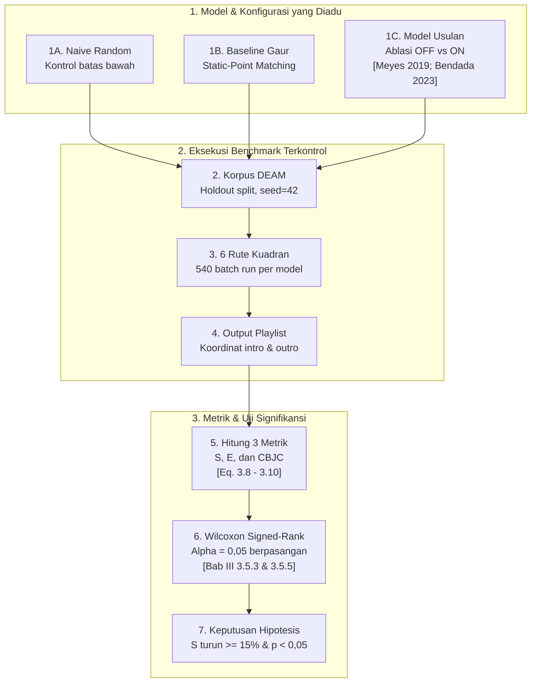

# Alur Evaluasi Komparatif, Uji Ablasi, & Uji Statistik

Mengacu pada **Bab III Subbab 3.5** ([chapter-3.tex](file:///D:/Kuliah/Semester%207/Tugas%20Akhir/Proposal%20Tugas%20Akhir/proposal-penelitian-andryano-123140205/chapters/chapter-3.tex)) untuk menjawab **Rumusan Masalah 2 (RM 2)**.

> [!tip] Versi Node-Graph Interaktif (Obsidian Canvas)
> Buka **[[Alur-Evaluasi-Komparatif-dan-Ablasi.canvas]]** di Obsidian untuk tampilan *node-graph* interaktif.

---

## 1. Diagram Alur Evaluasi & Ablasi

---

## 2. Rincian Komponen Evaluasi (Bab III 3.5)

> [!info] Komparasi 3 Model + Uji Ablasi (`3.5.2` & `3.5.5`)
> - **Naive Random:** Pemilihan acak sebagai batas bawah (*lower bound*).
> - **Baseline Gaur (2023/2024):** *Static-point matching* 2-tahap KNN + 12D PCA.
> - **Uji Ablasi Model Usulan (`meyes2019ablation`, `bendada2023scalable`):**
>   1. **Trajectory Filter OFF ($\lambda_{\mathrm{traj}} = 0$):** Hanya penyaringan titik statis tanpa arah trajektori & $\mathcal{BJC}$.
>   2. **Trajectory Filter ON ($\lambda_{\mathrm{traj}} > 0$):** *Pipeline* lengkap dengan penyelarasan *outro-intro* & $\mathcal{BJC}$.

> [!warning] Metrik Objektif & Uji Statistik (`3.5.1` & `3.5.3`)
> - **Boundary Smoothness ($\mathcal{S}$, Eq. 3.8):** Rata-rata jarak lonjakan $\|\mathbf{p}_{\mathrm{outro}}(L_j) - \mathbf{p}_{\mathrm{intro}}(L_{j+1})\|_2$ (target turun **$\ge 15\%$**).
> - **Evenness Index ($\mathcal{E}$, Eq. 3.9):** Variansi jarak langkah antar-waypoint.
> - **Cumulative BJC ($\mathcal{CBJC}$, Eq. 3.10):** Akumulasi total penalti lompatan batas sepanjang playlist.
> - **Wilcoxon Signed-Rank ($\alpha = 0{,}05$):** Menguji signifikansi selisih $\mathcal{S}$, $\mathcal{E}$, $\mathcal{CBJC}$ pada seluruh **540 *batch run***.

---

## 3. Kamus Istilah Teknis & Arti Rumus (Bahasa Sederhana)

> [!note] Panduan Membaca Istilah Teknis
> - **Naive Random:** Pemilih lagu acak tanpa aturan apa pun, dipakai sebagai batas bawah (*lower bound*) untuk memastikan model jauh lebih baik daripada menebak acak.
> - **Uji Ablasi (*Ablation Study*):** Pengujian dengan cara "mematikan" satu komponen (*Trajectory Filter OFF* vs *ON*) sementara hal lain dibuat sama persis, untuk membuktikan bahwa perbaikan hasil memang berasal dari komponen tersebut.
> - **Seed = 42:** Kunci pengacakan tetap supaya setiap kali eksperimen diulang, hasil pengacakannya sama persis (*reproducible*).
> - **Holdout Split:** Memisahkan data uji agar tidak pernah disentuh saat penyetelan model.
> - **Wilcoxon Signed-Rank Test ($\alpha = 0{,}05$):** Uji statistik berpasangan (tanpa syarat data harus berdistribusi normal) untuk membuktikan apakah selisih skor antara dua model benar-benar nyata ($p < 0{,}05$) atau sekadar kebetulan.

> [!tip] Arti Rumus Matematika
> - **Eq. 3.8 ($\mathcal{S}$, *Boundary Smoothness*):** Rata-rata besarnya lompatan mood di setiap sambungan antarlagu (*outro* ke *intro*). **Semakin kecil semakin halus** (target turun $\ge 15\%$).
> - **Eq. 3.9 ($\mathcal{E}$, *Evenness Index*):** Variansi jarak langkah antar-waypoint. Nilai mendekati $0$ berarti kecepatan perpindahan mood stabil dan seragam.
> - **Eq. 3.10 ($\mathcal{CBJC}$, *Cumulative BJC*):** Total penjumlahan seluruh lompatan batas dari lagu pertama sampai lagu terakhir dalam satu playlist.
