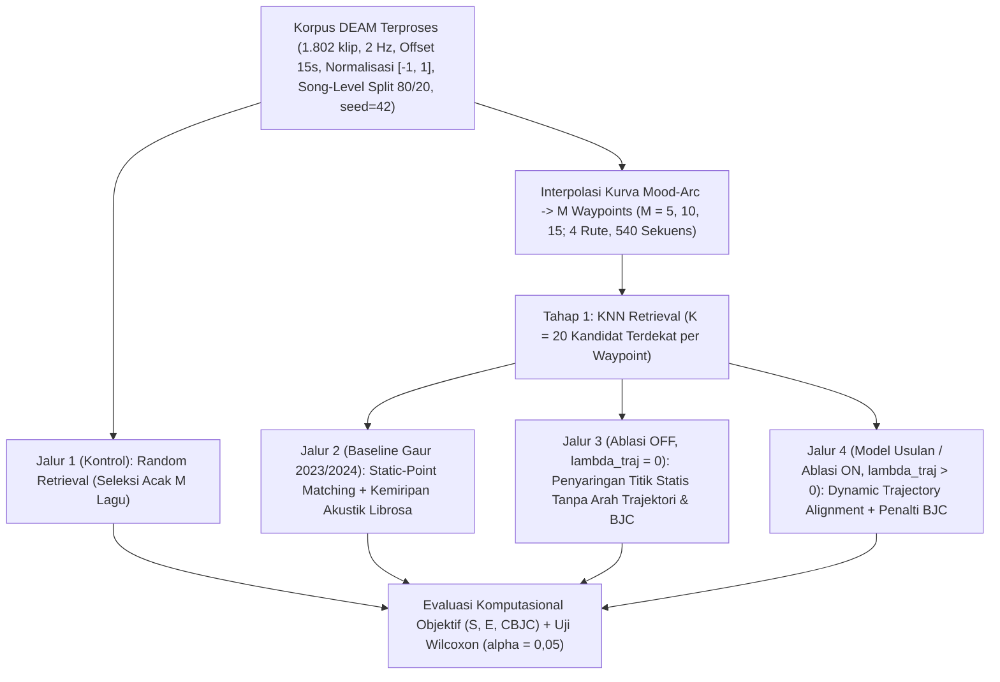

# Alur Komparatif 4 Jalur Model dan Uji Ablasi

Catatan ini menyatukan alur kerja keempat jalur pengujian pada **Bab III Subbab 3.3 dan 3.5** ([chapter-3.tex](file:///D:/Kuliah/Semester%207/Tugas%20Akhir/Proposal%20Tugas%20Akhir/proposal-penelitian-andryano-123140205/chapters/chapter-3.tex)) dalam satu diagram terpadu.

> [!tip] Tautan Diagram Terpisah yang Sudah Ada di `05-Eksperimen`
> - **Model Usulan:** [[Alur-Metode-Usulan-Trajectory-Alignment]] ([[Alur-Metode-Usulan-Trajectory-Alignment.canvas]])
> - **Baseline Gaur:** [[Alur-Uji-Coba-Baseline-Gaur]] ([[Alur-Uji-Coba-Baseline-Gaur.canvas]])
> - **Evaluasi & Ablasi:** [[Alur-Evaluasi-Komparatif-dan-Ablasi]] ([[Alur-Evaluasi-Komparatif-dan-Ablasi.canvas]])
> - **Uji Dengar Manusia:** [[Alur-Blind-AB-Listening-Test]] ([[Alur-Blind-AB-Listening-Test.canvas]])

---

## 1. Diagram Alur Terpadu (4 Jalur dari Input Identik)

---

## 2. Ringkasan Perbedaan Antarjalur

| Jalur | Tahap 1 (Kandidat) | Tahap 2 (Perankingan Ulang) | Fungsi dalam Pengujian |
| :--- | :--- | :--- | :--- |
| **1. Model Kontrol (*Random Retrieval*)** | Tidak memakai KNN; ambil $M$ lagu acak | Tidak ada | Batas bawah (*lower bound*) |
| **2. Model Acuan Gaur (2023/2024)** | KNN ($K=20$) pada titik rata-rata statis $\bar{\mathbf{p}}_k$ | *Static-Point Matching* + kemiripan fitur akustik Librosa | Pembanding *baseline* utama |
| **3. Uji Ablasi (*Trajectory Filter OFF*)** | KNN ($K=20$) identik (`seed=42`) | $\lambda_{\mathrm{traj}} = 0$ (tanpa arah trajektori & $\mathcal{BJC}$) | Mengisolasi efek tanpa modul trajektori |
| **4. Model Usulan (*Trajectory Filter ON*)** | KNN ($K=20$) identik (`seed=42`) | $\lambda_{\mathrm{traj}} > 0$ (*Cosine Alignment* $\mathrm{Sim}_{\mathrm{traj}}$ + penalti $\mathcal{BJC}$) | Membuktikan kontribusi kausal trajektori |
