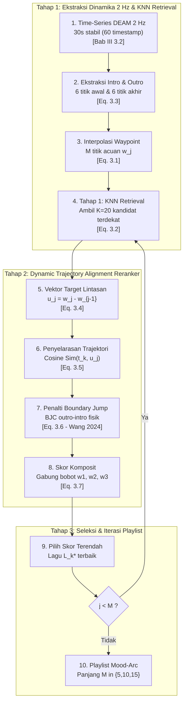

# Alur Metode Usulan (*Dynamic Trajectory Alignment* & $\mathcal{BJC}$)

Mengacu langsung pada **Bab III Subbab 3.3** ([chapter-3.tex](file:///D:/Kuliah/Semester%207/Tugas%20Akhir/Proposal%20Tugas%20Akhir/proposal-penelitian-andryano-123140205/chapters/chapter-3.tex)) untuk menjawab **Rumusan Masalah 1 (RM 1)**.

> [!tip] Versi Node-Graph Interaktif (Obsidian Canvas)
> Buka **[[Alur-Metode-Usulan-Trajectory-Alignment.canvas]]** di Obsidian untuk tampilan *node-graph* interaktif.
> Pembanding baseline: **[[Alur-Uji-Coba-Baseline-Gaur]]** ([[04-Literatur-Review/Alur-Uji-Coba-Baseline-Gaur.canvas]]).

---

## 1. Diagram Alur Pipeline Usulan

---

## 2. Rincian Formulasi Matematis (Bab III 3.3)

> [!info] Tahap 1 — Waypoint & Kandidat KNN (`3.3.1`)
> - **Waypoint ($\mathbf{w}_j$, Eq. 3.1):** $\mathbf{w}_j = \mathbf{p}_{\mathrm{start}} + \frac{j-1}{M-1}(\mathbf{p}_{\mathrm{target}} - \mathbf{p}_{\mathrm{start}})$
> - **KNN Euclidean (Eq. 3.2):** Mengambil **$K = 20$** kandidat terdekat di ruang 2D $V\text{-}A$ terhadap titik rata-rata $\bar{\mathbf{p}}_k$.

> [!abstract] Tahap 2 — Dynamic Trajectory Alignment & $\mathcal{BJC}$ (`3.3.2`)
> - **Vektor Internal Lagu (Eq. 3.3):** $\vec{\mathbf{t}}_k = \mathbf{p}_{\mathrm{outro}, k} - \mathbf{p}_{\mathrm{intro}, k}$, dengan *intro* = rata-rata 6 *timestamp* awal (15–18s) dan *outro* = rata-rata 6 *timestamp* akhir (42–45s).
> - **Keselarasan Arah (Eq. 3.5):** $\mathrm{Sim}_{\mathrm{traj}}(\vec{\mathbf{t}}_k, \vec{\mathbf{u}}_j) = \frac{\vec{\mathbf{t}}_k \cdot \vec{\mathbf{u}}_j}{\|\vec{\mathbf{t}}_k\|_2 \|\vec{\mathbf{u}}_j\|_2} \in [-1, +1]$.
> - **Boundary Jump Cost (Eq. 3.6):** $\mathcal{BJC}(L_{j-1}, L_k) = \|\mathbf{p}_{\mathrm{outro}}(L_{j-1}) - \mathbf{p}_{\mathrm{intro}}(L_k)\|_2$.
> - **Skor Komposit (Eq. 3.7):** $w_1 \frac{d_{\mathrm{target}}}{\max(d)} + w_2 \frac{1 - \mathrm{Sim}_{\mathrm{traj}}}{2} + w_3 \mathcal{BJC}$ ($w_1 + w_2 + w_3 = 1{,}0$), **skor terendah dipilih**.
