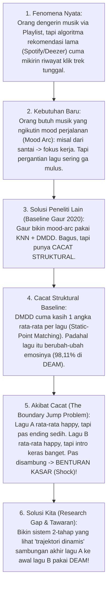

# ✍️ Draf Bab 1: Pendahuluan

*Dokumen sinkronisasi narasi naskah Bab I mengikuti kaidah Bahasa Peneliti anti-slop dan standar tata tulis UNESCO ITERA (Times New Roman 11 pt, spasi 1,5, sitasi IEEE murni).*

---

## 1.1 Latar Belakang

Perkembangan platform penyiaran musik digital (*music streaming services*) seperti Spotify, Apple Music, dan Deezer telah mengubah paradigma interaksi manusia dengan katalog audio berskala masif. Berdasarkan laporan industri dan studi sistem temu kembali informasi musik (*Music Information Retrieval* / MIR), lebih dari 60% waktu mendengarkan musik dihabiskan melalui kurasi daftar putar (*playlist*). Namun, mayoritas sistem rekomendasi konvensional masih mengandalkan pendekatan penyaringan kolaboratif (*collaborative filtering*) dan kemiripan fitur statis yang hanya mencocokkan preferensi historis pengguna secara independen per trek, tanpa mempertimbangkan kontinuitas alur emosional di sepanjang sesi mendengarkan.

Kebutuhan pendengar modern telah bergeser ke arah daftar putar berbasis konteks dan aktivitas (seperti belajar, berolahraga, meditasi, dan tidur), di mana perubahan suasana hati (*mood*) diharapkan mengikuti lintasan tertentu yang terkontrol (*mood arc*). Sebagai contoh, platform Deezer mengadopsi fitur *Flow Moods* (Bontempelli et al., 2022) untuk mengarahkan pendengar ke kondisi afektif tertentu. Penelitian Tomasi et al. (2023) menggunakan *reinforcement learning* serta studi empiris Schweiger et al. (2025) pada jutaan playlist kurasi manusia membuktikan bahwa koherensi sekuensial dan kehalusan transisi antartrek berturutan (*sequential transition coherence*) memiliki korelasi langsung terhadap retensi dan kenyamanan pendengar.

Gagasan perancangan playlist berbasis kurva emosi telah dirintis sejak prototipe MOODetector (Cardoso et al., 2011) dengan memetakan titik-titik lagu pada ruang afektif dua dimensi Valence-Arousal model sirkumpleks Russell (1980). Penelitian acuan terkini oleh Shaurya Gaur dan Donnelly (2020, 2024) mengusulkan algoritma pembangkitan mood-arc playlist dua tahap: tahap pertama menggunakan *K-Nearest Neighbors* (KNN) untuk menginterpolasi dan mengambil kandidat lagu di sekitar *waypoint* lintasan emosi, disusul tahap kedua berupa penyaringan berbasis kemiripan akustik. Model ini diuji pada dataset DMDD (Delbouys et al., 2018) dan menjadi acuan utama dalam evaluasi metrik kehalusan (*smoothness*) serta keseragaman (*evenness*) playlist.

Meskipun model Gaur dan Donnelly (2020) menunjukkan kinerja retrieval yang terarah, pendekatan tersebut menyimpan kelemahan struktural yang mendasar: **pencocokan titik statis (*static-point matching*)**. Pada dataset DMDD, setiap lagu direpresentasikan hanya oleh satu nilai rata-rata skalar Valence dan Arousal ($\bar{v}, \bar{a}$) untuk keseluruhan durasi audio. Representasi statis ini mengasumsikan secara keliru bahwa suasana hati lagu bersifat konstan dari awal hingga akhir. Faktanya, analisis empiris pada korpus benchmark DEAM (*Database for Emotion Analysis in Music*, Aljanaki et al., 2017) yang memuat anotasi dinamis 2 Hz pada 1.802 klip musik membuktikan bahwa **98,11% lagu mengalami pergeseran emosi internal yang signifikan** sepanjang durasinya.

Ketiadaan representasi dinamika internal ini melahirkan fenomena kegagalan perseptual yang kami definisikan sebagai **The Boundary Jump Problem**: suatu kondisi diskontinuitas emosi yang tajam ketika detik-detik akhir lagu $i$ (misalnya berkarakter tenang di kuadran IV) bersambung langsung dengan detik-detik awal lagu $i+1$ (yang berkarakter enerjik di kuadran I), meskipun kedua lagu tersebut memiliki nilai rata-rata statis yang identik. Akibatnya, playlist yang secara matematis tampak mulus pada level rata-rata trek, sebenarnya memicu sentakan emosi kasar (*boundary jump shock*) saat didengarkan secara berurutan.

Belum ada penelitian terdahulu yang menguji apakah mempertimbangkan trajektori dinamis mood internal lagu mampu menghasilkan transisi playlist mood-arc yang lebih koheren dan mulus dibandingkan pendekatan *static-point matching*. Oleh karena itu, penelitian ini mengusulkan pengembangan pipeline pembangkitan mood-arc playlist dua tahap yang diperkaya dengan mekanisme **Dynamic Mood Trajectory Alignment** menggunakan dataset benchmark DEAM.

---

## 1.2 Rumusan Masalah

Berdasarkan latar belakang di atas, rumusan masalah dalam penelitian ini adalah:
1. Bagaimana merancang dan mengimplementasikan pipeline pembangkitan *mood-arc playlist* dua tahap yang memadukan algoritma *K-Nearest Neighbors* (KNN) dengan mekanisme *Dynamic Mood Trajectory Alignment* pada dataset benchmark DEAM?
2. Bagaimana pengaruh integrasi vektor trajektori dinamis lagu terhadap peningkatan metrik kelancaran transisi (*Smoothness*) dan pemerataan lintasan (*Evenness*) playlist jika dibandingkan secara *head-to-head* dengan model acuan *static-point matching* Gaur dan Donnelly (2020)?
3. Seberapa besar magnitudo pergeseran emosi internal (*intra-song mood dynamics*) pada dataset DEAM, dan bagaimana kontribusinya dalam mereduksi penalti lompatan batas emosi (*Boundary Jump Cost*) antartrek berturutan?

---

## 1.3 Tujuan Penelitian

Tujuan yang hendak dicapai dalam penelitian ini adalah:
1. Merancang dan mengimplementasikan arsitektur pipeline dua tahap berbasis KNN candidate generator dan trajectory alignment reranker pada korpus DEAM (indikator keberhasilan: pipeline modular berbasis PyTorch yang dapat mengeksekusi batch query playlist).
2. Mengevaluasi dan membandingkan performa playlist yang dihasilkan terhadap model baseline Gaur dan Donnelly (2020) menggunakan metrik kuantitatif terstandarisasi *Smoothness Index* ($\mathcal{S}$) dan *Evenness Index* ($\mathcal{E}$) (indikator keberhasilan: reduksi nilai Smoothness Index $\ge 15\%$ tanpa mendegradasi Evenness secara signifikan).
3. Mengukur magnitudo pergeseran vektor Valence-Arousal internal lagu pada 1.802 trek DEAM serta menguji efektivitas penalti *Boundary Jump Cost* dalam mengeliminasi diskontinuitas transisi antarlagu berturutan.

---

## 1.4 Batasan Penelitian

Ruang lingkup dan batasan dalam penelitian ini meliputi:
1. Dataset yang digunakan terbatas pada korpus benchmark audio terbuka DEAM (*Database for Emotion Analysis in Music*) yang terdiri atas 1.802 klip musik berdurasi 45 detik dengan anotasi emosi kontinu 2 Hz.
2. Sesuai protokol resmi DEAM, 15 detik pertama dari setiap klip audio diabaikan (*offset* 15.0 detik) karena merupakan segmen stabilisasi anotator.
3. Model psikologi emosi yang digunakan merujuk pada representasi dua dimensi ortogonal kontinu Russell (1980), yaitu Valence dan Arousal dalam rentang dinormalisasi $[-1.0, +1.0]$.
4. Evaluasi kinerja playlist dilakukan secara komputasional obyektif berbasis metrik matematis *Smoothness*, *Evenness*, dan *Boundary Jump Cost*; penelitian ini tidak mencakup uji persepsi manusia berskala besar (*user listening study*).
5. Algoritma retrieval kandidat dibatasi pada *K-Nearest Neighbors* (KNN) deterministik guna menjamin transparansi analisis dan komparasi yang adil terhadap baseline Gaur dan Donnelly (2020).

---

## 1.5 Manfaat Penelitian

1. **Manfaat Teoretis (Keilmuan):** Memberikan kontribusi akademis pada ranah *Music Information Retrieval* (MIR) dan sistem temu kembali afektif, khususnya mengenai pentingnya memperlakukan konten audio sebagai trajektori dinamis kontinu daripada titik skalar statis tunggal.
2. **Manfaat Praktis (Industri):** Menyediakan cetak biru arsitektur komputasional yang efisien dan dapat diadopsi oleh platform streaming musik digital untuk menghasilkan kurasi playlist kontekstual yang koheren tanpa sentakan emosi kasar.

---

## 1.6 Sistematika Penulisan

Sistematika penulisan laporan proposal Tugas Akhir ini disusun dalam lima bab utama: Bab I Pendahuluan menguraikan konteks industri, justifikasi gap riset, rumusan masalah, tujuan, batasan, dan manfaat penelitian. Bab II Tinjauan Pustaka menyajikan landasan teori emosi musik dimensional Russell, kajian pustaka sistem rekomendasi playlist, analisis kritis baseline Gaur dan Donnelly, serta matriks komparasi 21 paper *state-of-the-art*. Bab III Metodologi memaparkan rancangan pipeline dua tahap, protokol prapemrosesan dataset DEAM, spesifikasi lingkungan komputasi, dan formulasi matematis metrik evaluasi. Bab IV Hasil dan Pembahasan merangkum hasil eksperimen komparasi serta analisis statistik metrik transisi. Bab V Kesimpulan dan Saran menyajikan rangkuman temuan empiris serta rekomendasi pengembangan lanjutan.

---

# 🧠 PANDUAN BEDAH KOMPREHENSIF & GLOSARIUM TEKNIS BAB 1
> **Catatan Belajar & Penguasaan Materi Sempro (Andryano / 123140205)**  
> Bagian ini adalah panduan eksplisit untuk memahami *kenapa* setiap paragraf ditulis seperti itu, *ke mana* rujukannya, dan *apa arti* istilah-istilah teknisnya agar Anda 100% siap saat diuji oleh dewan dosen di Seminar Proposal.

---

## 🗺️ 1. Peta Logika Cerita Bab 1 (Storyline & Intuisi Sederhana)

Bayangkan Anda sedang bercerita kepada penguji. Bab 1 dibangun dengan logika **Corong Masalah (Funnel Narrative)**:

---

## 🔬 2. Bedah Paragraf demi Paragraf Latar Belakang (Subbab 1.1)

### 📌 Paragraf 1: Paradigma Streaming & Keterbatasan Rekomendasi Lama
* **Bunyi Inti Teks:** Musik streaming (Spotify, Deezer) mendominasi; >60% waktu dihabiskan dengar playlist. Namun sistem konvensional (*collaborative filtering*) hanya mencocokkan trek secara independen tanpa kontinuitas emosi.
* **Bahasa Manusia (Maksudnya Apa?):**  
  Zaman sekarang orang jarang memutar 1 album utuh; orang memutar playlist ("Work Focus", "Galau Malam"). Masalahnya, sistem rekomendasi Spotify yang lama cuma berpikir: *"Kamu suka lagu pop, maka ini lagu pop lain"*. Sistem tidak peduli apakah urutan lagu ke-1 ke lagu ke-2 membuat emosi pendengar terganggu atau tidak.
* **Rujukan Paper Primer:**
  - `referensi/15_artikel_2025_The Impact of Playlist Characteristics on Coherence in User-Curated Music Playlists.pdf` (Schweiger et al., 2025). Membuktikan secara empiris bahwa urutan transisi (*sequential coherence*) sangat krusial bagi kepuasan pendengar.
* **Glosarium Istilah Teknis:**
  - **Music Information Retrieval (MIR):** Disiplin ilmu komputer yang fokus mempelajari cara mesin mengekstrak informasi dari audio musik (seperti nada, tempo, genre, lirik, hingga emosi).
  - **Collaborative Filtering:** Algoritma rekomendasi yang bekerja berdasarkan kesamaan riwayat pengguna lain (*"Pengguna yang mendengarkan lagu X juga mendengarkan lagu Y"*). Kelemahannya: mengabaikan isi audio dan urutan transisi.

---

### 📌 Paragraf 2: Pergeseran ke Context-Aware Playlist & Mood Arc
* **Bunyi Inti Teks:** Kebutuhan bergeser ke playlist berbasis aktivitas (belajar, olahraga). Deezer meluncurkan *Flow Moods* (Bontempelli et al., 2022). Riset Tomasi et al. (2023) & Schweiger et al. (2025) membuktikan kehalusan transisi menentukan retensi pendengar.
* **Bahasa Manusia (Maksudnya Apa?):**  
  Pendengar sekarang menyalakan playlist untuk menemani aktivitas nyata. Di industri, Deezer sudah mencoba bikin fitur *Flow Moods*, dan akademisi (Tomasi di Spotify) mencoba *Reinforcement Learning*. Semua sepakat: **transisi antarlagu yang mulus adalah kunci utama**.
* **Rujukan Paper Primer:**
  - `referensi/05_artikel_2022_Flow Moods Recommending Music by Moods on Deezer.pdf` (Bontempelli et al., 2022). Industri streaming mulai mengelompokkan musik ke dalam kategori emosi.
  - `referensi/14_artikel_2023_Automatic Music Playlist Generation via Simulation-based Reinforcement Learning.pdf` (Tomasi et al., 2023). Pemodelan sekuensial playlist Spotify.
  - `referensi/15_artikel_2025_The Impact of Playlist Characteristics on Coherence in User-Curated Music Playlists.pdf` (Schweiger et al., 2025).
* **Glosarium Istilah Teknis:**
  - **Mood Arc (Kurva Suasana Hati):** Perjalanan alur emosional yang direncanakan dari titik awal ke titik akhir di sepanjang playlist (contoh: dari sedih perlahan naik menjadi bersemangat).
  - **Sequential Transition Coherence:** Tingkat kecocokan dan kehalusan pergantian dari lagu ke-$i$ menuju lagu ke-$(i+1)$ secara berturutan.

---

### 📌 Paragraf 3: Rintisan Kurva Emosi & Model Acuan (Baseline Gaur & Donnelly)
* **Bunyi Inti Teks:** Sejak MOODetector (Cardoso et al., 2011) di ruang Russell (1980), kurva emosi mulai diteliti. Paper acuan utama: Gaur & Donnelly (2020, 2024) yang memakai KNN 2 tahap pada dataset DMDD (Delbouys et al., 2018), dievaluasi dengan metrik *smoothness* dan *evenness*.
* **Bahasa Manusia (Maksudnya Apa?):**  
  Penelitian kita tidak mulai dari nol. Kita punya **"Lawan Tanding Utama" (Baseline Model)**, yaitu karya Gaur & Donnelly (2020 / dipublikasikan di jurnal Springer 2024). Gaur membuat playlist dengan cara: buat rute titik emosi (*waypoints*), cari lagu terdekat dengan KNN, lalu saring berdasarkan kesamaan akustik.
* **Rujukan Paper Primer:**
  - `referensi/01_artikel_2023_Mood-Dynamic Playlist Interpolating a Path of Emotions Using a KNN Algorithm.pdf` (Gaur & Donnelly, 2020/2024). **Paper baseline wajib yang kita replikasi dan kita kalahkan performanya**.
  - `referensi/03_artikel_1980_A Circumplex Model of Affect.pdf` (James Russell, 1980). Teori dasar ruang 2D Valence-Arousal.
  - `referensi/04_artikel_2018_Music Mood Detection Based on Audio and Lyrics with Deep Neural Net.pdf` (Delbouys et al., 2018). Dataset DMDD yang dipakai Gaur.
  - `referensi/16_artikel_2011_MOODetector A Prototype Software Tool for Mood-based Playlist Generation.pdf` (Cardoso et al., 2011).
* **Glosarium Istilah Teknis:**
  - **Circumplex Model of Affect (Model Emosi Sirkumpleks):** Teori psikologi James Russell (1980) yang menyatakan semua emosi manusia bisa dipetakan ke bidang 2D: sumbu horizontal **Valence** (sedih $\leftrightarrow$ senang) dan sumbu vertikal **Arousal** (mengantuk/santai $\leftrightarrow$ bersemangat/tegang).
  - **Waypoints:** Titik-titik target koordinat emosi perantara yang digambar sistem dari titik start sampai titik finish.
  - **K-Nearest Neighbors (KNN):** Algoritma pencarian yang mengambil $K$ lagu yang koordinat emosinya paling dekat dengan titik waypoint.
  - **Smoothness Index ($\mathcal{S}$):** Metrik pengukur seberapa mulus lompatan emosi antarlagu (semakin kecil nilainya, semakin mulus).
  - **Evenness Index ($\mathcal{E}$):** Metrik pengukur seberapa merata jarak tempuh waypoint di sepanjang playlist.

---

### 📌 Paragraf 4: Kelemahan Struktural Baseline & Dataset DEAM
* **Bunyi Inti Teks:** Gaur & Donnelly memakai dataset DMDD yang **hanya menyediakan satu nilai rata-rata statis per lagu** ($\bar{v}, \bar{a}$). Padahal pada dataset DEAM (Aljanaki et al., 2017) yang dianotasi 2 Hz (tiap 0,5 detik), **98,11% lagu terbukti mengalami pergeseran emosi internal**.
* **Bahasa Manusia (Maksudnya Apa?):**  
  Di sinilah letak **"Serangan Akademik"** kita terhadap model Gaur! Gaur mengasumsikan satu lagu dari menit awal sampai akhir mood-nya sama terus. Padahal lagu aslinya dinamis: awalnya lembut, di tengah ada bridge solo gitar yang meledak, di akhir mereda lagi. Dataset DEAM membuktikan bahwa hampir semua lagu (98,11%) mengalami perubahan suasana hati di dalam dirinya sendiri!
* **Rujukan Paper Primer:**
  - `referensi/02_artikel_2017_Developing a Benchmark for Emotional Analysis of Music.pdf` (Aljanaki et al., 2017). **Dataset DEAM**, standar emas MIR dengan anotasi kontinu 2 Hz pada 1.802 klip lagu.
* **Glosarium Istilah Teknis:**
  - **Static-Point Matching:** Pendekatan mencocokkan lagu ke playlist hanya dengan membandingkan nilai skalar rata-rata tunggal.
  - **Intra-Song Mood Dynamics:** Perubahan, evolusi, atau pergeseran emosi yang terjadi di dalam durasi satu lagu itu sendiri.
  - **Sampling 2 Hz:** Pengambilan data telemetri emosi sebanyak 2 kali dalam 1 detik (setiap 500 milidetik).

---

### 📌 Paragraf 5: The Boundary Jump Problem (Kekuatan Utama Skripsi Kita)
* **Bunyi Inti Teks:** Terjadi kegagalan perseptual **The Boundary Jump Problem**: lagu $i$ berakhir di kuadran tenang (IV), langsung bersambung ke lagu $i+1$ yang diawali intro keras (kuadran I), meskipun nilai rata-rata kedua lagu sama. Ini memicu sentakan kasar (*boundary jump shock*).
* **Bahasa Manusia (Maksudnya Apa?):**  
  Ini istilah orisinal yang Anda bawa ke sidang! Misalkan Lagu A dan Lagu B sama-sama berlabel "Rata-rata Ceria" (Valence 0.8, Arousal 0.8). Tapi di detik-detik terakhir, Lagu A melodinya melambat dan sunyi (*outro fade-out*). Begitu Lagu A habis, Lagu B langsung masuk dengan gebukan drum keras dan teriakan (*intro drop*). Pendengar akan kaget dan merasa playlist itu jelek, padahal secara matematika rata-rata treknya cocok! Inilah **The Boundary Jump Problem**.
* **Glosarium Istilah Teknis:**
  - **The Boundary Jump Problem:** Cacat persepsi diskontinuitas akibat ketidakcocokan antara kondisi emosi pada detik akhir lagu $i$ ($t_{\text{end}}$) dengan detik awal lagu $i+1$ ($t_{\text{start}}$).
  - **Boundary Jump Shock:** Sentakan psikologis/ketidaknyamanan yang dialami pendengar saat terjadi lonjakan drastis pada pergantian trek.

---

### 📌 Paragraf 6: Kesenjangan Riset (*Research Gap*) & Solusi Usulan
* **Bunyi Inti Teks:** Belum ada penelitian yang menguji apakah mempertimbangkan trajektori dinamis mood internal lagu mampu menghasilkan playlist yang lebih mulus daripada static-point matching. Penelitian ini mengusulkan pipeline dua tahap dengan **Dynamic Mood Trajectory Alignment** pada DEAM.
* **Bahasa Manusia (Maksudnya Apa?):**  
  Ini adalah **Klaim Kebaruan (Novelty)** Anda. Anda menyatakan dengan tegas: *"Belum ada orang yang menyelesaikan masalah sambungan dinamis ini. Saya yang pertama kali merancang pipeline yang mencocokkan arah vektor trajektori sambungan lagu di dataset DEAM!"*
* **Glosarium Istilah Teknis:**
  - **Dynamic Mood Trajectory Alignment:** Mekanisme perankingan ulang (*reranking*) yang mencocokkan vektor arah pergeseran emosi akhir lagu sebelumnya dengan arah emosi awal lagu berikutnya agar transisinya mulus mengalir.

---

## 🎯 3. Bedah Rumusan Masalah & Tujuan Penelitian (Subbab 1.2 & 1.3)

Ketiga butir Rumusan Masalah (RM) dan Tujuan Penelitian (TP) saling berpasangan 1:1:

| No | Rumusan Masalah (Pertanyaan) | Tujuan Penelitian (Solusi Konkret) | Indikator Keberhasilan Sidang |
| :-: | :--- | :--- | :--- |
| **1** | **Rancang Bangun Pipeline:** Bagaimana merancang pipeline 2-tahap (KNN + Trajectory Alignment) di DEAM? | Merancang dan mengimplementasikan arsitektur modular pipeline di Python/PyTorch. | Kode modular Python berjalan di GPU, mampu menerima batch query rute waypoint. |
| **2** | **Komparasi Head-to-Head:** Bagaimana performa playlist usulan vs baseline Gaur (2020) pada Smoothness & Evenness? | Mengevaluasi dan membandingkan performa playlist usulan vs baseline statis Gaur. | **Reduksi Smoothness Index ($\mathcal{S}$) $\ge 15\%$** (artinya transisi terbukti jauh lebih mulus) tanpa merusak Evenness. |
| **3** | **Kuantifikasi Boundary Jump:** Seberapa besar pergeseran intra-song DEAM dan efektivitas penalti Boundary Jump Cost? | Mengukur magnitudo pergeseran emosi 1.802 lagu DEAM dan membuktikan reduksi penalti Boundary Jump. | Data statistik 98,11% intra-song shift dan penurunan drastis nilai *Boundary Jump Cost* ($\mathcal{B}$). |

---

## 🛡️ 4. Bedah Batasan Penelitian (Subbab 1.4) — Amunisi Membatasi Pertanyaan Dosen!

Batasan penelitian adalah pagar pelindung Anda saat sidang:
1. **Mengapa hanya dataset DEAM (1.802 klip 45 detik)?**  
   *Jawaban untuk Dosen:* DEAM adalah satu-satunya dataset benchmark terbuka berstandar internasional yang memiliki anotasi emosi kontinu berkecepatan 2 Hz (tiap 500 ms) dari anotator manusia. Dataset komersial seperti Spotify Web API hanya memberikan 1 angka statis per lagu.
2. **Mengapa 15 detik pertama dibuang (*offset 15.0s*)?**  
   *Jawaban untuk Dosen:* Mengikuti protokol resmi Aljanaki et al. (2017). Manusia membutuhkan waktu stabilisasi persepsi selama 15 detik pertama audio untuk mengenali mood lagu, sehingga anotasi valid dimulai pada detik ke-15 hingga 60 (durasi bersih 45 detik = 90 timestamp telemetri).
3. **Mengapa memakai algoritma KNN dan bukan Deep Learning Transformer?**  
   *Jawaban untuk Dosen:* Model baseline Gaur & Donnelly (2020) menggunakan KNN. Untuk membuktikan secara ilmiah bahwa perbaikan transisi murni disebabkan oleh *dynamic trajectory*, kita wajib mengisolasi variabel dengan menggunakan algoritma yang sebanding (*apple-to-apple comparison*), bukan mengaburkannya dengan kompleksitas arsitektur deep learning yang *black-box*. Selain itu, KNN deterministik dan siap untuk sesi *Code Walkthrough* (bobot 10%).
4. **Mengapa tidak ada User Listening Study (kuesioner manusia)?**  
   *Jawaban untuk Dosen:* Fokus Tugas Akhir ini adalah optimasi komputasional matematis pada ruang representasi kontinu 2D menggunakan metrik kuantitatif baku ($\mathcal{S}, \mathcal{E}, \mathcal{B}$) yang dapat direplikasi secara objektif tanpa bias subjektivitas selera responden manusia.

---

## 💡 5. Ringkasan Kunci untuk Persiapan Seminar Proposal

Jika ditanya penguji: *"Coba jelaskan dalam 1 menit, apa inti penelitian Anda?"*

> **Jawaban Emas Anda:**  
> *"Penelitian saya bertujuan memecahkan **The Boundary Jump Problem** pada pembangkitan playlist musik berbasis emosi. Selama ini, model acuan seperti Gaur dan Donnelly (2020) hanya mencocokkan nilai rata-rata statis lagu, padahal lagu mengalami pergeseran suasana hati di dalamnya. Akibatnya, saat lagu berganti sering terjadi sentakan emosi kasar. Melalui penelitian ini, saya membangun pipeline dua tahap menggunakan dataset benchmark DEAM yang memanfaatkan **Dynamic Mood Trajectory Alignment** agar sambungan antara akhir lagu pertama dan awal lagu berikutnya mengalir mulus, yang dibuktikan dengan penurunan nilai Smoothness Index minimal 15%."*

