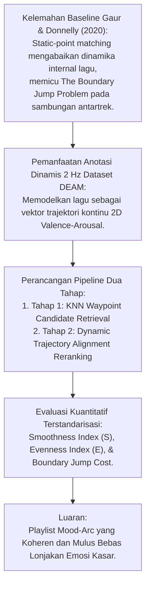

# ✍️ Draf Bab 2: Tinjauan Pustaka

*Dokumen sinkronisasi narasi naskah Bab II mengikuti kaidah Bahasa Peneliti dan standar tata tulis UNESCO ITERA (dilengkapi Tabel 2.1 empat kolom dan kerangka pemikiran).*

---

## 2.1 Landasan Teori

### 2.1.1 Model Emosi Musik Sirkumpleks Russell (1980)
Studi komputasi afektif musik bertumpu pada teori psikologi persepsi emosi. James Russell (1980) mengusulkan *Circumplex Model of Affect*, yang mendalilkan bahwa respon afektif manusia tidak terdistribusi dalam kategori kata diskrit yang terpisah, melainkan berakar pada dua dimensi neurofisiologis independen kontinu:
1. **Valence (Kesenangan / Kualitas Afeksi):** Mengukur derajat kebahagiaan atau kepositifan suasana hati, membentang dari kondisi sangat tidak menyenangkan (*negative valence*, misal: sedih, tertekan) hingga sangat menyenangkan (*positive valence*, misal: gembira, damai).
2. **Arousal (Aktivasi / Intensitas Fisiologis):** Mengukur tingkat ketergugahan fisiologis dan energi motorik tubuh, membentang dari kondisi pasif/rendah (*low arousal*, misal: lelah, mengantuk, tenang) hingga sangat bersemangat (*high arousal*, misal: marah, waspada, bersemangat tinggi).

Keunggulan utama model dimensional ini dibandingkan model kategorikal Hevner atau Ekman adalah sifatnya yang kontinu dan aljabar. Keadaan afektif dapat diekspresikan sebagai vektor koordinat Cartesian $\mathbf{p} = (v, a) \in [-1.0, +1.0]^2$, sehingga memungkinkan penerapan operasi kalkulus vektor, perhitungan jarak Euclidean, dan interpolasi lintasan mulus yang sangat krusial dalam perancangan kurva *mood arc*.

### 2.1.2 Dinamika Temporal Emosi Musik
Musik merupakan media temporal berbasis waktu (*time-dependent medium*). Mengacu pada meta-analisis komprehensif 144 studi MIR oleh Eerola dan Anderson (2026) serta temuan Wen et al. (2025), dinamika emosi dalam musik memiliki karakteristik temporal khusus:
- **Inersia Temporal Arousal:** Dimensi Arousal memiliki korelasi yang sangat kuat dengan fitur akustik fisik (seperti RMS *energy*, tempo, dan *loudness*), sehingga fluktuasinya relatif mudah diprediksi dan memiliki stabilitas tinggi.
- **Kompleksitas Valence:** Dimensi Valence lebih dipengaruhi oleh struktur harmonik, progresi akor, tangga nada (mayor vs minor), dan lirik, sehingga memiliki dinamika perseptual yang lebih kompleks.
- **Perception Latency:** Manusia membutuhkan waktu sekitar 1,0 hingga 1,5 detik untuk memproses perubahan emosional dalam audio. Oleh karena itu, sinyal anotasi kontinu pada frekuensi 2 Hz memerlukan pemfilteran peredam derau (*smoothing filter*) agar variasi acak sesaat tidak mengaburkan trajektori global.

### 2.1.3 Sistem Pembangkitan Playlist Berbasis Lintasan Emosi (*Mood Arc*)
Pembangkitan playlist berbasis suasana hati bertujuan menyusun barisan trek musik $P = [s_1, s_2, \dots, s_M]$ yang mengarahkan pendengar dari kondisi emosi awal $P_{\text{start}}$ menuju kondisi akhir yang diinginkan $P_{\text{target}}$. Lintasan ini diinterpolasi menjadi serangkaian titik acuan perantara (*waypoints*) $W = [w_1, w_2, \dots, w_M]$. Masalah optimasi utama terletak pada pemilihan trek musik yang tidak hanya dekat dengan waypoint target pada ruang emosi, tetapi juga menjamin transisi yang mulus antartrek berturutan tanpa lonjakan perseptual yang mengganggu.

---

## 2.2 Penelitian Terdahulu (*State of the Art*)

Penelitian mengenai *playlist generation* dan *music emotion recognition* telah berkembang dari sistem statis menuju pemodelan lintasan dinamis:

1. **Cardoso et al. (2011)** mengembangkan prototipe *MOODetector* yang memetakan lagu ke ruang dua dimensi Thayer dan memungkinkan pengguna menarik garis lintasan untuk memilih lagu. Namun, sistem ini hanya mengandalkan fitur akustik dasar dan tidak memiliki mekanisme evaluasi transisi terukur.
2. **Delbouys et al. (2018)** memperkenalkan dataset multimodal DMDD (18.000 trek) yang menggabungkan fitur audio dan lirik. Meskipun berskala besar, DMDD hanya melabeli lagu dengan satu nilai rata-rata statis per trek.
3. **Gaur dan Donnelly (2020, 2024)** mengusulkan model acuan dua tahap: interpolasi lintasan mood menggunakan KNN untuk memilih kandidat lagu pada dataset DMDD, diikuti reranking berdasarkan jarak fitur akustik. Kelemahan struktural model ini adalah ketergantungan pada nilai rata-rata statis DMDD, yang memicu timbulnya *The Boundary Jump Problem*.
4. **Aljanaki et al. (2017)** mempublikasikan korpus DEAM (*Database for Emotion Analysis in Music*), yang menjadi standar emas penelitian MIR dengan menyediakan anotasi dinamis 2 Hz pada 1.802 klip lagu berdurasi 45 detik.
5. **Bontempelli et al. (2022)** dan **Tomasi et al. (2023)** menunjukkan penerapan skala industri di platform Deezer (*Flow Moods*) dan pemodelan sekuensial playlist dengan *reinforcement learning*, membuktikan tingginya kebutuhan pengguna terhadap koherensi alur emosi.
6. **Schweiger et al. (2025)** membuktikan melalui analisis jutaan playlist pengguna bahwa kehalusan pergantian antarlagu berturutan (*transition smoothness*) adalah faktor penentu paling dominan terhadap kepuasan pendengar.

---

### Tabel 2.1 Perbandingan Penelitian Terdahulu

\begin{center}
\textbf{Tabel 2.1 Perbandingan Penelitian Terdahulu}
\end{center}

| Peneliti (Tahun) | Metode dan Dataset | Hasil Utama | Keterbatasan |
| :--- | :--- | :--- | :--- |
| **Cardoso et al. (2011)** | Prototipe UI interaktif dengan pemetaan ruang energi-stres Thayer; dataset terbatas (~500 lagu). | Pengguna dapat menggambar garis lintasan mood secara visual untuk mengumpulkan lagu. | Tidak memiliki metrik kuantitatif formal untuk mengukur kehalusan transisi antartrek; fitur audio sangat terbatas. |
| **Aljanaki et al. (2017)** | Anotasi kontinu crowdsourcing frekuensi 2 Hz pada 1.802 klip musik (45s); dataset DEAM. | Menghasilkan korpus benchmark standar emas pertama untuk analisis temporal Valence-Arousal kontinu. | Hanya menyediakan dataset mentah dan baseline regresi ekstraksi; tidak merancang algoritma optimasi playlist. |
| **Delbouys et al. (2018)** | Fusi multimodal audio dan lirik menggunakan deep neural network pada dataset DMDD (18k lagu). | Peningkatan akurasi prediksi Valence-Arousal melalui penggabungan representasi teks lirik dan sinyal audio. | Anotasi hanya berupa nilai skalar rata-rata per lagu; kehilangan seluruh informasi pergeseran emosi di dalam lagu. |
| **Gaur & Donnelly (2020, 2024)** | Pembangkitan playlist 2 tahap: KNN waypoint interpolation + acoustic similarity filter pada dataset DMDD. | Mengusulkan metrik evaluasi formal *Smoothness* dan *Evenness*; retrieval lagu terarah sesuai lintasan target. | **Static-point matching**: Mengabaikan dinamika internal lagu sehingga menimbulkan *boundary jump problem* di perbatasan antartrek. |
| **Schweiger et al. (2025)** | Analisis empiris jutaan playlist kurasi manusia; pemodelan koherensi transisi sekuensial. | Membuktikan bahwa konsistensi transisi antartrek berturutan adalah faktor penentu dominan kenyamanan pendengar. | Berfokus pada analisis perilaku pengguna retrospektif; tidak mengusulkan algoritma komputasi playlist generation mandiri. |
| **Penelitian Ini (2026)** | Pipeline dua tahap: KNN candidate retrieval + **Dynamic Trajectory Alignment** pada korpus DEAM. | Menghilangkan *boundary jump problem* dengan menyelaraskan vektor emosi keluar-masuk antarlagu; reduksi Smoothness Index $\ge 15\%$. | Evaluasi berbasis metrik matematis komputasional obyektif; belum mencakup uji usabilitas pendengar manusia berskala masif. |

---

### Sintesis Kesenjangan Penelitian
Berdasarkan perbandingan komparatif pada Tabel 2.1, tampak jelas bahwa penelitian sistem pembangkitan playlist mood-arc sebelumnya masih terperangkap dalam paradigma pencocokan titik statis (*static-point matching*). Belum ada studi yang memformulasikan keselarasan vektor trajektori dinamis (*intra-song trajectory alignment*) sebagai kriteria optimasi sambungan lagu. Penelitian ini secara spesifik mengisi celah keilmuan tersebut dengan memanfaatkan dataset benchmark DEAM yang memiliki resolusi temporal kontinu 2 Hz.

---

## 2.3 Kerangka Pemikiran

Alur logika penelitian ini dijembatani melalui diagram kerangka pemikiran berikut:

