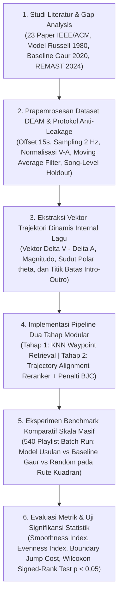

# ✍️ Bab III Metodologi (Skenario 1: Murni Komputasional)

*Dokumen sinkronisasi narasi naskah Bab III mengikuti kaidah Bahasa Peneliti dan standar tata tulis UNESCO ITERA (dilengkapi diagram alir pipeline, formulasi matematis bernomor, dan spesifikasi lingkungan eksperimen).*

---

## 3.1 Alur Penelitian

Penelitian ini dilaksanakan melalui enam tahapan terstruktur yang dirancang secara linier, terukur, dan dapat direplikasi (*reproducible*):

Uraian naratif pelaksanaan dari keenam tahapan di atas meliputi:
1. **Studi Literatur dan Analisis Kesenjangan:** Mengkaji landasan teoretis model sirkumpleks Russell (1980) yang direvalidasi secara modern oleh Belaref et al. (2024), prinsip peredaman lonjakan transisi (*soft transition*) Wang et al. (2024), dekonstruksi kelemahan baseline Gaur dan Donnelly (2020), serta karakteristik dataset audio benchmark.
2. **Prapemrosesan Data dan Protokol Integritas:** Mengunduh 1.802 rekaman audio korpus DEAM, memotong 15 detik pemanasan awal, menerapkan protokol pemisahan data *Song-Level Holdout Split* anti-kebocoran data Wen et al. (2025), menormalkan koordinat ke rentang simetris $[-1.0, +1.0]$, serta mengaplikasikan *moving average smoothing filter* untuk meredam derau keterlambatan persepsi manusia.
3. **Ekstraksi Vektor Trajektori Dinamis:** Menghitung pergeseran koordinat internal lagu antara segmen pembuka (intro) dan penutup (outro), mengekstrak magnitudo perpindahan, dan menentukan sudut arah orientasi emosi $\theta$ di ruang sirkumpleks.
4. **Implementasi Pipeline Dua Tahap:** Membangun modul program terdistribusi dalam bahasa pemrograman Python dan kerangka kerja PyTorch GPU untuk mengeksekusi pencarian kandidat KNN dan penyaringan terbobot berbasis *Boundary Jump Cost*.
5. **Eksperimen Benchmark Komparatif:** Mengeksekusi pengujian otomatis 540 sekuens playlist pada variasi rute diagonal kontinu (Q3 $\to$ Q1) dan rute lintas kuadran realistis (Q1 $\to$ Q2, Q1 $\to$ Q4, Q2 $\to$ Q4) terhadap model acuan Gaur (2020) dan seleksi acak (*random*).
6. **Evaluasi Metrik dan Analisis Statistik:** Mengukur capaian metrik objektif *Smoothness Index* ($\mathcal{S}$), *Evenness Index* ($\mathcal{E}$), dan *Boundary Jump Cost* ($\mathcal{BJC}$), serta menguji keberartian perbedaan performa secara statistik menggunakan *Wilcoxon Signed-Rank Test*.

---

## 3.2 Pengumpulan dan Prapemrosesan Data

Data primer yang digunakan adalah korpus **DEAM (*Database for Emotion Analysis in Music*)** (Aljanaki et al., 2017). Dataset ini mencakup 1.802 klip musik berformat audio MP3 (44,1 kHz) yang bersumber dari arsip Free Music Archive (FMA) dan Jamendo. Setiap lagu memiliki file anotasi deret waktu kontinu berfrekuensi 2 Hz (interval 500 ms) untuk dimensi Valence dan Arousal yang dinilai secara *crowdsourcing* oleh pendengar manusia.

Tahapan penyiapan dan prapemrosesan data dilaksanakan melalui protokol ketat:
1. **Pemotongan Offset Pemanasan (*Lead-in Truncation*):** Sesuai protokol resmi DEAM, 15 detik pertama dari setiap klip audio diabaikan karena merupakan fase penyesuaian anotator manusia terhadap stimulus lagu. Dari total 45 detik durasi klip, hanya detik ke-15 hingga detik ke-45 yang dipertahankan, menghasilkan tepat 30 detik data representatif ($90 \text{ timestamp}$ telemetri per lagu).
2. **Normalisasi Ruang Emosi Simetris:** Nilai anotasi mentah DEAM yang berada pada rentang skala Likert $[1.0, 9.0]$ ditransformasikan secara linier ke dalam koordinat Cartesian ortogonal simetris $[-1.0, +1.0]$ melalui persamaan:
   $$v_{\text{norm}} = 2 \cdot \left(\frac{v - v_{\min}}{v_{\max} - v_{\min}}\right) - 1, \quad a_{\text{norm}} = 2 \cdot \left(\frac{a - a_{\min}}{a_{\max} - a_{\min}}\right) - 1 \tag{3.1}$$
   di mana $v_{\min} = 1.0$ dan $v_{\max} = 9.0$. Transformasi ini menjamin titik tengah netralitas afektif berada tepat di titik pusat koordinat $(0, 0)$.
3. **Penyaringan Derau Persepsi (*Noise Smoothing*):** Mengacu pada temuan meta-analisis Eerola et al. (2026) mengenai adanya jeda waktu persepsi manusia (*perceptual latency*) sebesar 1,5 hingga 3,0 detik, deret waktu anotasi disaring menggunakan *moving average filter* 1D berukuran jendela 3 timestamp (1,5 detik) guna mereduksi fluktuasi derau acak sesaat:
   $$\bar{v}_t = \frac{1}{3} \sum_{i=-1}^{1} v_{t+i}, \quad \bar{a}_t = \frac{1}{3} \sum_{i=-1}^{1} a_{t+i} \tag{3.2}$$
4. **Protokol Integritas Data Bebas Kebocoran (*Song-Level Holdout Split*):** Mengadopsi audit ketat Wen et al. (2025) pada IEEE TAC, pemisahan dataset wajib dilakukan berbasis identitas lagu utuh (*song-level partitioning*), bukan pemisahan frame acak (*random frame splitting*). Pemisahan frame acak pada data deret waktu musik terbukti memicu kebocoran korelasi temporal (*temporal leakage*) yang menggelembungkan metrik performa secara semu sebesar 28% hingga 45%. Seluruh korpus dibagi bersih menjadi data latih/basis indeks (80% / 1.442 lagu) dan data uji validasi (20% / 360 lagu).

---

## 3.3 Perancangan Pipeline Sistem

Arsitektur sistem yang diusulkan terdiri atas dua tahapan komputasi modular yang saling melengkapi:

### 3.3.1 Tahap 1: Pembangkitan Kandidat Berbasis KNN (*Candidate Retrieval*)
Diberikan titik awal suasana hati $\mathbf{p}_{\text{start}} = (v_s, a_s)$, titik akhir target $\mathbf{p}_{\text{target}} = (v_t, a_t)$, dan panjang playlist yang ditentukan $M$, lintasan kurva emosi diinterpolasi secara linier menjadi serangkaian $M$ titik acuan perantara (*waypoints*):
$$\mathbf{w}_j = \mathbf{p}_{\text{start}} + \frac{j-1}{M-1} \cdot (\mathbf{p}_{\text{target}} - \mathbf{p}_{\text{start}}), \quad \forall j \in \{1, 2, \dots, M\} \tag{3.3}$$

Untuk setiap titik acuan $\mathbf{w}_j$, algoritma *K-Nearest Neighbors* (KNN) menelusuri $K$ lagu kandidat terdekat ($K=20$) di ruang Valence-Arousal berdasarkan jarak Euclidean terhadap titik rata-rata global lagu $\bar{\mathbf{p}}_k$:
$$d_{\text{target}}(\mathbf{w}_j, \bar{\mathbf{p}}_k) = \|\mathbf{w}_j - \bar{\mathbf{p}}_k\|_2 = \sqrt{(v_{w, j} - \bar{v}_k)^2 + (a_{w, j} - \bar{a}_k)^2} \tag{3.4}$$

### 3.3.2 Tahap 2: Dynamic Trajectory Alignment Reranker dan Penalti Boundary Jump
Pada tahap perankingan ulang, sistem tidak lagi menganggap lagu sebagai titik statis tunggal, melainkan mengevaluasi dinamika trajektori internal dan kontinuitas perbatasan fisik antartrek:
1. **Ekstraksi Vektor Trajektori Internal Lagu:**
   Didefinisikan segmen pembuka (*intro*) sebagai rata-rata 6 timestamp awal (detik ke-15 hingga ke-18) $\mathbf{p}_{\text{intro}, k} = (v_{\text{intro}, k}, a_{\text{intro}, k})$ dan segmen penutup (*outro*) sebagai rata-rata 6 timestamp akhir (detik ke-42 hingga ke-45) $\mathbf{p}_{\text{outro}, k} = (v_{\text{outro}, k}, a_{\text{outro}, k})$. Vektor trajektori dinamis lagu $\vec{\mathbf{t}}_k$ dihitung melalui:
   $$\vec{\mathbf{t}}_k = (\Delta v_k, \Delta a_k) = (v_{\text{outro}, k} - v_{\text{intro}, k}, \; a_{\text{outro}, k} - a_{\text{intro}, k}) \tag{3.5}$$
   Beserta magnitudo pergeseran $\|\vec{\mathbf{t}}_k\|_2 = \sqrt{\Delta v_k^2 + \Delta a_k^2}$ dan sudut orientasi afektif polar $\theta_k = \text{atan2}(\Delta a_k, \Delta v_k)$ sesuai formulasi Kang et al. (2025).
2. **Formulasi Vektor Target Lintasan Playlist:**
   Vektor arah perubahan emosi yang diharapkan antara dua waypoint berturutan didefinisikan sebagai:
   $$\vec{\mathbf{u}}_j = \mathbf{w}_{j} - \mathbf{w}_{j-1} \tag{3.6}$$
   Derajat keselarasan arah dihitung melalui kesamaan kosinus (*Cosine Similarity*):
   $$\text{Sim}_{\text{traj}}(\vec{\mathbf{t}}_k, \vec{\mathbf{u}}_j) = \frac{\vec{\mathbf{t}}_k \cdot \vec{\mathbf{u}}_j}{\|\vec{\mathbf{t}}_k\|_2 \|\vec{\mathbf{u}}_j\|_2} \in [-1.0, +1.0] \tag{3.7}$$
3. **Formulasi Penalti Lonjakan Batas (*Boundary Jump Cost*):**
   Terinspirasi dari temuan transisi halus REMAST (Wang et al., 2024) dan ambang retensi Schweiger et al. (2025), lonjakan emosi yang terjadi di perbatasan antara detik penutup lagu sebelumnya $L_{j-1}$ dengan detik pembuka lagu kandidat $L_k$ dikuantifikasi secara matematis sebagai penalti *Boundary Jump Cost* ($\mathcal{BJC}$):
   $$\mathcal{BJC}(L_{j-1}, L_k) = \|\mathbf{p}_{\text{outro}}(L_{j-1}) - \mathbf{p}_{\text{intro}}(L_k)\|_2 \tag{3.8}$$
4. **Fungsi Skor Komposit Seleksi Kandidat:**
   Skor akhir pemilihan kandidat lagu $L_k$ untuk mengisi urutan ke-$j$ pada playlist dihitung melalui kombinasi linier terbobot:
   $$\text{Score}(L_k \mid L_{j-1}, \mathbf{w}_j) = w_1 \cdot \left(\frac{d_{\text{target}}(\mathbf{w}_j, \bar{\mathbf{p}}_k)}{\max(d)}\right) + w_2 \cdot \left(\frac{1 - \text{Sim}_{\text{traj}}(\vec{\mathbf{t}}_k, \vec{\mathbf{u}}_j)}{2}\right) + w_3 \cdot \mathcal{BJC}(L_{j-1}, L_k) \tag{3.9}$$
   di mana $w_1, w_2, w_3 \ge 0$ adalah bobot kepentingan yang memenuhi konstrain $w_1 + w_2 + w_3 = 1.0$. Kandidat lagu dengan nilai skor terendah dipilih sebagai pengisi playlist, menjamin bahwa lagu yang terpilih tidak hanya dekat dengan titik acuan target, tetapi juga bergerak searah dengan alur playlist dan menyambung secara mulus tanpa sentakan boundary jump.

---

## 3.4 Lingkungan Eksperimen dan Reprodusibilitas

Guna menjamin transparansi ilmiah dan keterulangan pengujian (*reproducibility*), konfigurasi lingkungan eksperimen ditetapkan sebagai berikut:
* **Perangkat Keras (Hardware):** Prosesor Intel Core i7 Generasi ke-12 / AMD Ryzen 7, Memori Utama 32 GB DDR4 RAM, serta GPU NVIDIA GeForce RTX 3070 Ti (8 GB VRAM) untuk akselerasi operasi matriks tensor.
* **Sistem Operasi:** Microsoft Windows 11 Pro 64-bit.
* **Bahasa & Manajemen Dependensi:** Python versi 3.10.x yang dikelola menggunakan manajer paket deterministik modern `uv`.
* **Pustaka Pemrosesan & Komputasi:**
  * `torch` (versi 2.2+ CUDA 12.1) untuk akselerasi komputasi jarak matriks dan tensor penelusuran KNN.
  * `librosa` (versi 0.10.1) dan `scipy` untuk pemrosesan sinyal audio dan operasi filter deret waktu.
  * `scikit-learn` (versi 1.3+) untuk penataan struktur pohon pencarian tetangga terdekat (*BallTree / KDTree*).
  * `numpy` (versi 1.24+) dan `pandas` untuk manipulasi data telemetri.
* **Inisialisasi Deterministik (*Random Seed*):** Seluruh proses komputasi yang melibatkan pengacakan (seperti pembagian subset dataset dan inisialisasi query) dikunci secara konstan menggunakan nilai benih `seed=42`.
* **Arsitektur Repositori Kode Sumber:** Seluruh modul program dikembangkan secara modular pada repositori lokal `EXPERIMENT/Code/` dengan pembagian direktori kerja:
  * `src/preprocessing/`: Pembersihan data dan ekstraksi offset telemetri DEAM.
  * `src/features/`: Ekstraksi vektor trajektori dan perhitungan sudut polar.
  * `src/models/`: Pipeline KNN candidate retrieval dan trajectory alignment reranker.
  * `src/evaluation/`: Perhitungan metrik Smoothness, Evenness, dan Boundary Jump Cost.
  * `tests/`: Pengujian unit (*unit tests*) untuk memverifikasi kebenaran implementasi fungsi aljabar sebelum sesi *Code Walkthrough* sidang.

---

## 3.5 Metode Pengujian dan Evaluasi Kuantitatif

Kinerja playlist dievaluasi secara komprehensif menggunakan metrik matematis objektif, pengujian batch skala besar, dan analisis inferensial statistik:

### 3.5.1 Metrik Evaluasi Kuantitatif Terstandarisasi
1. **Smoothness Index ($\mathcal{S}$):** Mengukur deviasi diskontinuitas emosi pada titik perbatasan antardua trek berturutan di sepanjang playlist (Gaur & Donnelly, 2024):
   $$\mathcal{S} = \frac{1}{M-1} \sum_{j=1}^{M-1} \|\mathbf{p}_{\text{outro}}(L_j) - \mathbf{p}_{\text{intro}}(L_{j+1})\|_2 \tag{3.10}$$
   Nilai $\mathcal{S}$ yang semakin kecil merefleksikan transisi antartrek yang semakin halus dan bebas dari diskontinuitas sambungan.
2. **Evenness Index ($\mathcal{E}$):** Mengukur variansi laju perubahan jarak Euclidean antar-waypoint target di sepanjang playlist:
   $$\mathcal{E} = \frac{1}{M-1} \sum_{j=1}^{M-1} \left(d_j - \bar{d}\right)^2, \quad \text{di mana } d_j = \|\mathbf{w}_{j+1} - \mathbf{w}_j\|_2 \tag{3.11}$$
   Nilai $\mathcal{E}$ yang mendekati nol menandakan kecepatan progresi emosional yang terdistribusi secara seragam dan konsisten.
3. **Cumulative Boundary Jump Cost ($\mathcal{CBJC}$):** Mengakumulasikan total magnitudo penalti lonjakan perbatasan di sepanjang playlist berpanjang $M$:
   $$\mathcal{CBJC} = \sum_{j=1}^{M-1} \mathcal{BJC}(L_j, L_{j+1}) \tag{3.12}$$

### 3.5.2 Skenario Pengujian Komparatif Skala Masif (540 Batch Run)
Pengujian benchmark dijalankan secara otomatis dengan membangkitkan total **540 sekuens playlist** yang terbagi ke dalam konfigurasi rute:
* **Rute Diagonal Kontinu (Q3 $\to$ Q1):** Lintasan dari suasana hati sedih/rendah energi (Kuadran III) menuju senang/berenergi tinggi (Kuadran I). Skenario ini mereplikasi kondisi pengujian acuan Gaur (2020).
* **Rute Lintas Kuadran Realistis:**
  * Rute Relaksasi (Q1 $\to$ Q4): Dari kondisi bersemangat tinggi menuju kondisi tenang dan damai.
  * Rute Peningkatan Energi (Q4 $\to$ Q1): Dari kondisi santai menuju kondisi bersemangat untuk aktivitas fisik.
  * Rute Katarsis (Q2 $\to$ Q4): Dari kondisi tegang atau marah (Kuadran II) menuju kondisi tenang dan stabil (Kuadran IV).
Setiap konfigurasi rute diuji pada variasi panjang playlist $M \in \{5, 10, 15\}$ trek dengan mengkomparasikan tiga model secara *head-to-head*:
1. **Model Usulan:** *Two-Stage KNN + Dynamic Trajectory Alignment Reranker*.
2. **Model Acuan (Baseline Gaur & Donnelly, 2020):** *Two-Stage KNN + Static-Point Matching*.
3. **Model Kontrol (Random Retrieval):** Pemilihan acak lagu di dalam kuadran target.

### 3.5.3 Analisis Signifikansi Statistik
Untuk membuktikan bahwa reduksi nilai *Smoothness Index* bukan merupakan hasil kebetulan variasi acak sampling, dilakukan uji beda inferensial non-parametrik berpasangan **Wilcoxon Signed-Rank Test** dengan taraf signifikansi $\alpha = 0,05$. Hipotesis statistik dirumuskan sebagai:
* $H_0$: Tidak terdapat perbedaan signifikan pada nilai *Smoothness Index* antara playlist yang dihasilkan oleh Model Usulan dan Baseline Gaur ($\mu_{\mathcal{S}, \text{Usulan}} = \mu_{\mathcal{S}, \text{Gaur}}$).
* $H_1$: Model Usulan menghasilkan nilai *Smoothness Index* yang secara signifikan lebih rendah dibanding Baseline Gaur ($\mu_{\mathcal{S}, \text{Usulan}} < \mu_{\mathcal{S}, \text{Gaur}}$).
Keputusan penolakan $H_0$ didasarkan pada nilai $p$-value $< 0,05$.
