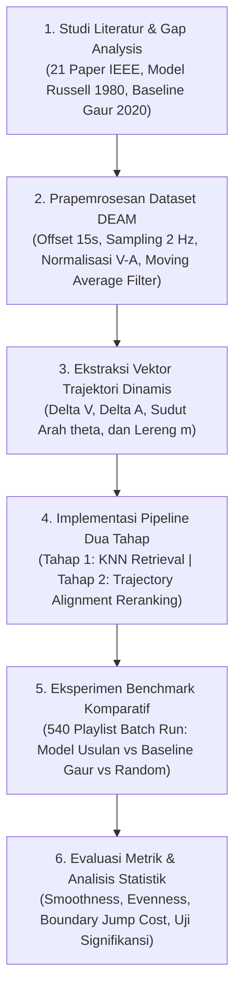

# ✍️ Draf Bab 3: Metodologi

*Dokumen sinkronisasi narasi naskah Bab III mengikuti kaidah Bahasa Peneliti dan standar tata tulis UNESCO ITERA (dilengkapi diagram alir pipeline, formulasi matematis bernomor, dan spesifikasi lingkungan eksperimen).*

---

## 3.1 Alur Penelitian

Penelitian ini dilaksanakan melalui enam tahapan terstruktur yang dirancang secara linier dan dapat direplikasi (*reproducible*):

1. **Studi Literatur:** Mengkaji landasan teoretis model sirkumpleks Russell (1980), arsitektur pembangkitan playlist Gaur dan Donnelly (2020), serta karakteristik dataset audio benchmark.
2. **Prapemrosesan Dataset:** Mengunduh 1.802 klip audio DEAM, mengeliminasi 15 detik pemanasan awal, menormalkan anotasi emosi ke rentang $[-1.0, +1.0]$, dan menerapkan filter peredam derau.
3. **Ekstraksi Trajektori:** Menghitung vektor dinamika emosi internal lagu dari deret waktu 90 titik sampel telemetri per lagu.
4. **Implementasi Sistem:** Membangun pipeline modular dalam bahasa pemrograman Python dengan memanfaatkan akselerasi GPU PyTorch.
5. **Eksperimen Komparasi:** Menjalankan pengujian playlist otomatis pada berbagai variasi lintasan target (*mood arc*) secara acak dan deterministik.
6. **Evaluasi dan Analisis:** Mengukur performa kehalusan transisi antartrek dan stabilitas lintasan menggunakan metrik formal.

---

## 3.2 Pengumpulan dan Prapemrosesan Data

Data primer yang digunakan adalah korpus **DEAM (*Database for Emotion Analysis in Music*)** (Aljanaki et al., 2017). Dataset ini mencakup 1.802 klip musik berformat audio MP3 (44,1 kHz) yang diekstrak dari korpus Free Music Archive (FMA) dan Jamendo. Setiap lagu memiliki file anotasi deret waktu kontinu berfrekuensi 2 Hz (interval 500 ms) untuk dimensi Valence dan Arousal.

Tahapan prapemrosesan data meliputi:
1. **Pemotongan Offset Pemanasan (*Lead-in Truncation*):** 15 detik awal sinyal audio dan anotasi dieliminasi sesuai protokol resmi anotator manusia, menyisakan tepat 45 detik rekaman representatif per lagu ($90 \text{ timestamp}$ telemetri).
2. **Normalisasi Ruang Emosi:** Nilai anotasi asli yang berskala $[1.0, 9.0]$ ditransformasikan secara linier ke dalam koordinat Cartesian simetris $[-1.0, +1.0]$ melalui persamaan:
   $$v_{\text{norm}} = 2 \cdot \left(\frac{v - v_{\min}}{v_{\max} - v_{\min}}\right) - 1, \quad a_{\text{norm}} = 2 \cdot \left(\frac{a - a_{\min}}{a_{\max} - a_{\min}}\right) - 1 \tag{3.1}$$
3. **Penyaringan Derau Persepsi (*Noise Smoothing*):** Untuk mengeliminasi fluktuasi sesaat akibat keterlambatan persepsi anotator manusia (*perception latency*), deret waktu anotasi disaring menggunakan *moving average filter* satu dimensi dengan ukuran jendela 3 timestamp (1,5 detik).

---

## 3.3 Perancangan Pipeline Sistem

Arsitektur sistem yang diusulkan terdiri atas dua tahapan terintegrasi:

### 3.3.1 Tahap 1: Pembangkitan Kandidat Berbasis KNN (*Candidate Retrieval*)
Diberikan titik awal emosi $\mathbf{p}_{\text{start}} = (v_s, a_s)$, titik akhir $\mathbf{p}_{\text{target}} = (v_t, a_t)$, dan jumlah lagu yang diinginkan $M$, lintasan ideal diinterpolasi menjadi $M$ titik acuan perantara (*waypoints*):
$$\mathbf{w}_j = \mathbf{p}_{\text{start}} + \frac{j-1}{M-1} \cdot (\mathbf{p}_{\text{target}} - \mathbf{p}_{\text{start}}), \quad \forall j \in \{1, 2, \dots, M\} \tag{3.2}$$

Untuk setiap waypoint $\mathbf{w}_j$, algoritma *K-Nearest Neighbors* (KNN) mengambil $K$ lagu kandidat terdekat berdasarkan jarak Euclidean terhadap titik rata-rata statis lagu $\bar{\mathbf{p}}_k$:
$$d(\mathbf{w}_j, \bar{\mathbf{p}}_k) = \|\mathbf{w}_j - \bar{\mathbf{p}}_k\|_2 = \sqrt{(v_w - \bar{v}_k)^2 + (a_w - \bar{a}_k)^2} \tag{3.3}$$

### 3.3.2 Tahap 2: Dynamic Trajectory Alignment Reranking
Pada tahap kedua, setiap lagu kandidat dimodelkan sebagai vektor pergerakan internal $\vec{\mathbf{v}}_k = \mathbf{p}_k(t_{\text{end}}) - \mathbf{p}_k(t_0)$, di mana $\mathbf{p}_k(t_0)$ adalah koordinat pada detik awal segmen (detik ke-15) dan $\mathbf{p}_k(t_{\text{end}})$ adalah koordinat pada detik akhir (detik ke-60). Vektor target transisi playlist didefinisikan sebagai $\vec{\mathbf{u}}_j = \mathbf{w}_{j+1} - \mathbf{w}_j$.

Skor keselarasan komposit dihitung melalui kombinasi linier terbobot antara kedekatan jarak statis dan keselarasan sudut trajektori kosinus:
$$\text{Score}(k, j) = (1 - \alpha) \cdot \frac{d(\mathbf{w}_j, \bar{\mathbf{p}}_k)}{\max(d)} + \alpha \cdot \left(\frac{1 - \cos(\vec{\mathbf{v}}_k, \vec{\mathbf{u}}_j)}{2}\right) \tag{3.4}$$
di mana parameter $\alpha \in [0.0, 1.0]$ adalah koefisien bobot yang mengontrol pengaruh trajektori dinamis terhadap pencocokan posisi statis. Kandidat dengan nilai skor terkecil dipilih sebagai trek pengisi playlist.

---

## 3.4 Lingkungan Eksperimen dan Reproduksibilitas

Guna menjamin prinsip keterulangan hasil riset (*reproducibility*), seluruh eksperimen dijalankan pada konfigurasi lingkungan komputasi terstandarisasi:
* **Perangkat Keras:** Prosesor Intel Core i7 Generasi ke-12 / AMD Ryzen 7, RAM 32 GB DDR4, GPU NVIDIA GeForce RTX 3070 Ti (8 GB VRAM).
* **Sistem Operasi:** Microsoft Windows 11 Pro 64-bit.
* **Bahasa & Lingkungan Pemrograman:** Python versi 3.10.x, dikelola melalui manajer paket modern `uv`.
* **Pustaka Utama:** PyTorch (versi 2.2+ dengan akselerasi CUDA 12.1), Librosa (versi 0.10.1) untuk pemrosesan sinyal audio, NumPy (1.24+), SciPy, dan Scikit-learn (1.3+).
* **Random Seed:** Seluruh proses pengacakan inisialisasi dan subsampling dikunci menggunakan *seed* konstan (`seed=42`).
* **Repositori Kode Sumber:** Repositori lokal `EXPERIMENT/Code/baseline_gaur` terstruktur secara modular (`src/`, `experiments/`, `tests/`) dan siap didemonstrasikan pada sesi *Code Walkthrough* sidang.

---

## 3.5 Metode Pengujian dan Evaluasi

Kinerja playlist dievaluasi secara kuantitatif menggunakan tiga metrik matematis baku:

### 1. Metrik Smoothness Index ($\mathcal{S}$)
Mengukur deviasi diskontinuitas emosi pada titik perbatasan antardua trek berturutan sepanjang playlist:
$$\mathcal{S} = \frac{1}{M-1} \sum_{k=1}^{M-1} \|\mathbf{p}_k(t_{\text{end}}) - \mathbf{p}_{k+1}(t_0)\|_2 \tag{3.5}$$
Nilai $\mathcal{S}$ yang semakin kecil mengindikasikan transisi antarlagu yang semakin mulus dan bebas dari sentakan emosi kasar.

### 2. Metrik Evenness Index ($\mathcal{E}$)
Mengukur keseragaman laju perubahan jarak Euclidean antar-waypoint di sepanjang playlist:
$$\mathcal{E} = \text{Var}\left(\left\{\|\mathbf{w}_{k+1} - \mathbf{w}_k\|_2\right\}_{k=1}^{M-1}\right) = \frac{1}{M-1} \sum_{k=1}^{M-1} \left(d_k - \bar{d}\right)^2 \tag{3.6}$$
Nilai $\mathcal{E}$ yang mendekati nol menunjukkan perpindahan suasana hati yang terdistribusi secara konsisten tanpa percepatan mendadak.

### 3. Metrik Boundary Jump Cost ($\mathcal{B}$)
Memberikan penalti eksplisit apabila jarak emosi pada titik pergantian lagu melampaui ambang batas toleransi persepsi pendengar ($\tau = 0.35$):
$$\mathcal{B} = \sum_{k=1}^{M-1} \max\left(0, \|\mathbf{p}_k(t_{\text{end}}) - \mathbf{p}_{k+1}(t_0)\|_2 - \tau\right) \tag{3.7}$$
