# Bab II Tinjauan Pustaka (Skenario 2: Dual Evaluation dengan User Study)

Dokumen draf naskah Bab II ini menyajikan landasan teoretis komputasional dan psikoakustik, sintesis komparatif 14 penelitian terdahulu standar UNESCO, analisis kesenjangan riset tiga lapis, dan diagram kerangka pemikiran terpadu yang memadukan evaluasi algoritmik dan pengujian perseptual manusia.

---

## 2.1 Landasan Teori

### 2.1.1 Model Emosi Musik Sirkumpleks Russell (1980) dan Revalidasi Modern
Studi komputasi afektif musik bertumpu pada teori psikologi persepsi emosi. James Russell (1980) mengusulkan *Circumplex Model of Affect*, yang mendalilkan bahwa respon afektif manusia tidak terdistribusi dalam kategori kata diskrit yang terpisah, melainkan berakar pada dua dimensi neurofisiologis independen kontinu:
1. **Valence (Kesenangan / Kualitas Afeksi):** Mengukur derajat kebahagiaan atau kepositifan suasana hati, membentang dari kondisi sangat tidak menyenangkan (*negative valence*, seperti sedih dan tertekan) hingga sangat menyenangkan (*positive valence*, seperti gembira dan damai).
2. **Arousal (Aktivasi / Intensitas Fisiologis):** Mengukur tingkat ketergugahan fisiologis dan energi motorik tubuh, membentang dari kondisi pasif atau rendah (*low arousal*, seperti mengantuk dan tenang) hingga sangat bersemangat (*high arousal*, seperti waspada, bersemangat, dan tegang).

Keunggulan utama model dimensional ini dibandingkan model kategorikal Hevner atau Ekman adalah sifatnya yang kontinu dan aljabar. Keadaan afektif dapat diekspresikan sebagai vektor koordinat Cartesian $\mathbf{p} = (v, a) \in [-1.0, +1.0]^2$, sehingga memungkinkan penerapan operasi kalkulus vektor, perhitungan jarak Euclidean, dan interpolasi lintasan mulus yang sangat krusial dalam perancangan kurva *mood arc*.

Meskipun dicetuskan pada tahun 1980, model ini memiliki validitas komputasional kontemporer yang sangat kokoh. Penelitian mutakhir oleh Belaref et al. (2024) yang melakukan *data-driven decoding* terhadap representasi laten jaringan syaraf tiruan multimodal (RoBERTa dan wav2vec 2.0) membuktikan bahwa model Transformer audio secara mandiri (*self-supervised*) mengorganisasikan afeksi manusia mengikuti topologi lingkaran sirkumpleks Russell. Hasil evaluasi membuktikan bahwa 75% dari 28 kata emosi granular terpetakan dalam deviasi sudut presisi ($\Delta \theta < 30^\circ$) terhadap data manusia asli Russell (1980) dengan korelasi angular $r > 0,82$. Kang et al. (2025) kemudian memformulasikan unifikasi matematis antara ruang kontinu dua dimensi ini dengan label kategori afektif modern melalui sudut polar $\theta = \text{atan2}(\Delta a, \Delta v)$, membuktikan bahwa pergerakan sudut vektor emosi merefleksikan pergeseran suasana hati pendengar secara konsisten.

### 2.1.2 Dinamika Temporal Emosi Musik dan Jeda Waktu Persepsi
Musik merupakan media temporal berbasis waktu (*time-dependent medium*). Karakteristik perubahan emosional di dalam musik memiliki sifat asimetri yang khas. Mengacu pada meta-analisis komprehensif 144 studi empiris Music Emotion Recognition (MER) oleh Eerola et al. (2026) pada IEEE Transactions on Affective Computing serta temuan Wen et al. (2025), terdapat dua prinsip temporal fundamental:
* **Asimetri Prediktabilitas Arousal vs Valence:** Dimensi Arousal memiliki korelasi yang sangat kuat dengan parameter akustik fisik audio (seperti RMS *energy*, dinamika spektral, dan tempo), sehingga menghasilkan akurasi prediksi model komputasi yang tinggi dan stabil ($r = 0,68 \pm 0,08$). Sebaliknya, dimensi Valence dipengaruhi oleh struktur harmonik, progresi akor, tangga nada mayor-minor, dan asosiasi kognitif yang lebih kompleks, menghasilkan variasi korelasi yang lebih moderat ($r = 0,42 \pm 0,12$).
* **Jeda Waktu Persepsi (*Perceptual Time Lag*):** Telinga dan otak manusia membutuhkan waktu antara 1,5 hingga 3,0 detik untuk mencerna perubahan dinamika akustik dan menginterpretasikannya sebagai pergeseran suasana hati. Oleh karena itu, sinyal anotasi telemetri kontinu berfrekuensi 2 Hz (interval 500 ms) memerlukan pemfilteran peredam derau (*moving average smoothing filter*) dengan ukuran jendela 3 timestamp (1,5 detik) agar fluktuasi mikro sesaat tidak mengaburkan trajektori makro lagu.

### 2.1.3 Representasi Fitur Akustik Audio Tradisional dan Kontemporer
Sistem temu kembali musik mengandalkan ekstraksi deskriptor akustik untuk menilai kesamaan konten audio antarlagu. Fitur akustik konvensional diekstraksi melalui pustaka pemrosesan sinyal seperti Librosa, mencakup:
1. **Timbral dan Tekstur Spektral:** *Mel-Frequency Cepstral Coefficients* (MFCC), *Spectral Centroid*, *Spectral Rolloff*, dan *Spectral Contrast* yang mengukur kecerahan dan warna suara instrumen.
2. **Ritmik dan Energi:** *Tempo (BPM)*, *Beat Strength*, dan *Root Mean Square (RMS) Energy* yang berbanding lurus dengan dimensi Arousal.
3. **Harmoni dan Nada:** *Chroma Feature* dan *Tonnetz* yang merefleksikan progresi tonalitas dan kunci lagu.

Perkembangan mutakhir sistem temu kembali audio telah melahirkan model fondasi berbasis *self-supervised learning* skala besar, seperti MERT (Li et al., 2024) dan adaptasi HuBERT musik (Sun et al., 2025). MERT membuktikan bahwa representasi *masked audio modeling* mampu menangkap ketergantungan harmoni jangka panjang. Namun, untuk kebutuhan sistem perekomendasi playlist berlatensi rendah pada lingkungan produksi, kombinasi fitur akustik kompak Librosa terstandarisasi tetap menjadi pilihan yang sangat efisien dan transparan untuk diinterpretasikan (*explainable features*).

### 2.1.4 Teori Transisi Halus (*Soft Transition*) dan Inersia Afektif
Dalam menyusun urutan stimulus musikal berkesinambungan, transisi mendadak antarsegmen yang memiliki karakter kontras memicu disonansi perseptual yang mengganggu kenyamanan pendengar. Studi mutakhir Wang et al. (2024) pada perancangan sistem penataan musik *REMAST* (IEEE Transactions on Affective Computing) membuktikan bahwa sistem yang hanya memprioritaskan kecocokan emosi seketika (*real-time emotion fit*) tanpa mengontrol laju perubahan antarsegmen selalu menghasilkan sentakan struktural (*jarring boundary transition*).

Wang et al. (2024) membuktikan bahwa dengan memperhitungkan inersia emosi keadaan sebelumnya melalui mekanisme fusi emosi:
$$\mathbf{e}_{\text{fused}, t} = \frac{\mathbf{e}_{\text{music}, t-1} + \mathbf{e}_{\text{target}, t}}{2}$$
kekacauan transisi akor (*Chord Entropy Coherence* / CEC) dapat direduksi hingga 50,6% (turun dari 7,51 menjadi $3,71 \pm 0,31$), serta menghasilkan peningkatan skor kehalusan transisi subjektif (*softness score*) manusia hingga 3,79 dari 5,00 ($p < 0,03$). Prinsip inersia afektif ini menjadi landasan teoretis bahwa transisi antara dua trek rekaman berurutan wajib mengendalikan jarak perbatasan outro ke intro agar lonjakan emosi tidak melampaui toleransi pendengaran.

### 2.1.5 Psikoakustik, Persepsi Transisi Musik, dan Evaluasi Pengguna (*User Study*)
Sistem rekomendasi dan temu kembali musik pada hakikatnya bermuara pada kepuasan pendengar manusia. Telinga manusia memiliki kepekaan psikoakustik tinggi terhadap diskontinuitas mendadak pada parameter energi, ritme, dan tekstur frekuensi pada titik pergantian lagu. Mengacu pada studi empiris Daikoku et al. (2022) mengenai korelasi antara metrik komputasional otomatis MIR dengan estimasi persepsi manusia, ditemukan bahwa koefisien keselarasan (*agreement rate*) hanya mencapai tingkat moderat ($r = 0,42$ hingga $0,58$). Temuan ini menegaskan bahwa metrik matematika objektif yang dihitung di atas komputer belum tentu sepenuhnya mencerminkan apa yang dirasakan oleh pendengar sebagai transisi yang "enak", "mulus", atau "alami".

Dua faktor krusial yang mempengaruhi persepsi transisi musik meliputi:
* **Disonansi Transisi Perbatasan (*Boundary Transition Dissonance*):** Studi Thome et al. (2022) membuktikan bahwa jarak emosi dan jarak kemiripan akustik tidak selalu berbanding lurus, sehingga lonjakan drastis pada detik-detik awal lagu baru menciptakan efek sentakan psikologis yang mengacaukan imersi pendengar. Studi skala industri oleh Schweiger et al. (2025) pada platform Spotify mengonfirmasi bahwa diskontinuitas emosi antartrek berturutan yang melompat melebihi ambang batas ($\Delta > 0,25$) merupakan pemicu utama pendengar melakukan interupsi atau pembatalan lagu (*skip*).
* **Metodologi Pengujian Dengar Buta (*Blind A/B Listening Test*):** Untuk mengukur persepsi transisi antarlagu secara ilmiah dan bebas dari bias subjektif (seperti bias genre atau bias artis favorit), pengujian harus dirancang menggunakan metode *blind A/B test*. Stimulus difokuskan pada klip sambungan terisolasi (*isolated boundary clips*) berdurasi 30 detik (15 detik penutup lagu $i$ disambung dengan 15 detik pembuka lagu $i+1$). Instrumen kuesioner psikometri skala Likert 5-poin yang mengevaluasi aspek kelancaran (*smoothness*), kontinuitas energi (*energy continuity*), dan kealamian emosi (*emotional naturalness*) wajib diuji keandalannya menggunakan uji reliabilitas *Cronbach's Alpha* ($\alpha \ge 0,70$).

### 2.1.6 Sistem Pembangkitan Playlist Berbasis Lintasan Emosi dan The Boundary Jump Problem
Pembangkitan playlist berbasis suasana hati bertujuan menyusun barisan trek musik $P = [s_1, s_2, \dots, s_M]$ yang mengarahkan pendengar dari kondisi awal $P_{\text{start}}$ menuju kondisi akhir $P_{\text{target}}$ melalui serangkaian titik acuan perantara (*waypoints*) $W = [\mathbf{w}_1, \dots, \mathbf{w}_M]$ pada ruang koordinat Valence-Arousal.

Model acuan Gaur dan Donnelly (2020, 2023, 2024) menggunakan pendekatan dua tahap: mengambil $K$ kandidat terdekat di sekitar waypoint menggunakan KNN, lalu melakukan perankingan berdasarkan jarak fitur akustik Spotify pada dataset DMDD. Namun, karena DMDD hanya menyediakan label rata-rata skalar statis ($\bar{v}, \bar{a}$), model Gaur mengabaikan dinamika internal lagu. Ketika lagu pertama yang berkarakter tenang di bagian akhirnya bersambung dengan lagu kedua yang berkarakter enerjik di bagian awalnya, timbul fenomena **The Boundary Jump Problem**. Ketiadaan validasi dengar manusia pada penelitian Gaur semakin memperlebar kesenjangan antara angka kehalusan algoritmik di atas kertas dengan pengalaman dengar nyata di telinga pengguna.

---

## 2.2 Penelitian Terdahulu (*State of the Art*)

Penelitian mengenai sistem pembangkitan playlist dan analisis afektif musik telah berkembang melalui berbagai tonggak penting yang dipetakan secara komprehensif pada Tabel 2.1.

\begin{center}
\textbf{Tabel 2.1 Perbandingan Penelitian Terdahulu}
\end{center}

| Peneliti (Tahun) | Metode dan Dataset | Hasil Utama | Keterbatasan |
| :--- | :--- | :--- | :--- |
| **Cardoso et al. (2011)** | Prototipe *MOODetector* berbasis antarmuka grafis ruang Thayer 2D; dataset audio kecil (~500 lagu). | Pengguna dapat menarik garis lintasan mood secara interaktif untuk mengambil lagu yang sesuai. | Tidak memiliki metrik evaluasi kehalusan formal; fitur audio sangat terbatas dan mengabaikan transisi sekuensial. |
| **Aljanaki et al. (2017)** | Anotasi crowdsourcing kontinu frekuensi 2 Hz pada 1.802 klip musik (45s); dataset benchmark DEAM. | Menghasilkan standar emas dataset MIR pertama dengan anotasi deret waktu Valence-Arousal dinamis. | Hanya mempublikasikan dataset dan model regresi ekstraksi; tidak merancang algoritma optimasi playlist. |
| **Delbouys et al. (2018)** | Fusi multimodal deep learning audio dan teks lirik pada dataset DMDD (18.644 lagu). | Peningkatan akurasi estimasi Valence-Arousal global melalui integrasi fitur multimodal audio-lirik. | Anotasi hanya menyediakan satu nilai rata-rata statis per lagu; kehilangan seluruh dinamika pergeseran internal. |
| **Gaur & Donnelly (2020, 2023)** | Two-Stage Pipeline: interpolasi waypoint KNN + penyaringan kemiripan akustik pada DMDD. | Menghasilkan algoritma pembangkitan mood-arc playlist terarah dengan metrik *Smoothness* dan *Evenness*. | **Static-point matching**: Mengabaikan dinamika intra-lagu sehingga memicu *The Boundary Jump Problem*; evaluasi murni matematis tanpa uji dengar manusia. |
| **Gaur & Donnelly (2024)** | Formalisasi metrik matematis *Smoothness Index* ($\mathcal{S}$) dan *Evenness Index* ($\mathcal{E}$) di forum evaluasi MIREX. | Menyediakan landasan metrik terstandarisasi untuk mengukur kehalusan transisi antartrek berurutan. | Pengujian masih berbasis representasi statis; nilai kehalusan tinggi pada rute diagonal adalah artefak penataan buatan. |
| **Bontempelli et al. (2022)** | Sistem rekomendasi industri *Flow Moods* pada platform Deezer berbasis radio suasana hati. | Mengimplementasikan pengelompokan katalog jutaan lagu ke dalam kuadran emosi komersial berskala masif. | Playlist terkunci pada kategori suasana hati tunggal yang seragam; belum mendukung lintasan dinamis kontinu (*mood arc*). |
| **Tomasi et al. (2023)** | *Reinforcement Learning* (RL) untuk kelanjutan playlist sekuensial otomatis pada katalog Spotify. | Agen RL mampu mengoptimalkan urutan trek sekuensial berdasarkan umpan balik koherensi sekuens. | Komputasi pelatihan RL sangat berat dan sulit diinterpretasikan; mengabaikan kurva koordinat emosi eksplisit. |
| **Thome et al. (2022)** | Analisis korelasi jarak kemiripan audio *self-supervised* CNN terhadap transisi persepsi emosi. | Menemukan bahwa jarak emosi dan jarak akustik tidak berkorelasi linier, menuntut integrasi fusi skor. | Tidak menguji pada perancangan algoritma sekuensial playlist; fokus murni pada analisis representasi audio. |
| **Daikoku et al. (2022)** | Analisis keselarasan metrik kemiripan otomatis MIR vs penilaian perseptual pendengar manusia (*MOS*). | Menemukan bahwa korelasi komputasi MIR dengan persepsi manusia berada pada tingkat moderat ($r = 0,42 - 0,58$). | Tidak merancang algoritma optimasi rute playlist; murni kajian korelasi evaluasi komparatif. |
| **Belaref et al. (2024)** | *Data-driven decoding* model sirkumpleks Russell menggunakan Transformer audio-teks (MSP-Podcast & TESS). | Membuktikan 75% istilah emosi sirkumpleks terpetakan dalam $\Delta \theta < 30^\circ$ ($r > 0,82$) secara alami pada representasi AI. | Evaluasi terbatas pada sinyal audio wicara pendek, belum diuji pada data polifonik musik berdurasi penuh. |
| **Wang et al. (2024)** | Model *REMAST* (IEEE TAC): Fusi inersia emosi masa lalu dan koreksi trajektori pada musik simbolik. | Mereduksi kekacauan transisi akor (CEC) hingga 50,6% dan meraih skor kelembutan transisi tertinggi 3,79/5,00 ($p < 0,03$). | Diterapkan pada sintesis musik simbolik MIDI generatif, tidak dapat diaplikasikan langsung pada trek rekaman audio utuh. |
| **Wen et al. (2025)** | Audit kebocoran data (*leakage audit*) pada regresi Arousal dinamis dataset DEAM (IEEE TAC). | Membuktikan pemisahan frame acak memicu inflasi $R^2$ semu 28%–45%; mewajibkan *Song-Level Holdout Split*. | Berfokus pada perbaikan metodologi prediksi deret waktu audio; tidak merancang sistem rekomendasi playlist. |
| **Schweiger et al. (2025)** | Analisis empiris jutaan playlist kurasi manusia Spotify/Deezer terhadap retensi pengguna. | Membuktikan transisi emosi antartrek $\Delta \le 0,25$ adalah syarat retensi dengar (*skip rate* naik 37% jika melompat kasar). | Kajian analitis retrospektif murni; tidak menyediakan algoritma optimasi kurasi playlist otomatis. |
| **Penelitian Ini (2026)** | Pipeline 2-tahap (KNN + **Dynamic Trajectory Alignment**) di DEAM + **Dual Evaluation** (Metrik GPU & User Study). | Mengeliminasi *The Boundary Jump Problem*; reduksi $\mathcal{S} \ge 15\%$; keunggulan transisi tervalidasi signifikan ($p < 0,05$) pada telinga manusia. | Uji persepsi manusia terbatas pada klip transisi laboratorium ($N \ge 30$) berdurasi 30 detik. |

---

### 2.2.1 Sintesis Kesenjangan Riset (*Three-Tier Research Gap*)
Berdasarkan telaah komprehensif pada Tabel 2.1, sintesis kesenjangan penelitian dirumuskan ke dalam tiga lapis:
1. **Lapis 1 (Celah Teoretis dan Desain Baseline):** Model acuan pembangkitan mood-arc Gaur dan Donnelly (2020, 2023) bertumpu pada dataset DMDD yang hanya menyediakan label statis tunggal per lagu. Akibatnya, sistem mengasumsikan suasana hati lagu bersifat konstan, mengabaikan fakta empiris DEAM bahwa 98,11% lagu mengalami pergeseran afektif internal nyata.
2. **Lapis 2 (Celah Metodologis Komparasi dan Evaluasi):** Penelitian terkini seperti REMAST (Wang et al., 2024) telah membuktikan pentingnya meredam sentakan transisi (*soft transition*) dengan memanfaatkan inersia emosi masa lalu pada komposisi simbolik MIDI generatif, namun belum pernah diadaptasi untuk kurasi rekaman audio gelombang utuh pada layanan streaming. Di samping itu, sebagaimana dibuktikan Daikoku et al. (2022), mayoritas penelitian MIR hanya mengandalkan evaluasi komputasional murni tanpa pernah menguji apakah perbaikan metrik matematis tersebut benar-benar dirasakan dan disukai oleh telinga manusia pendengar.
3. **Lapis 3 (Posisi Kebaruan Tugas Akhir):** Belum ada penelitian yang mengintegrasikan prinsip transisi halus ke dalam representasi trajektori dinamis 2 Hz korpus DEAM sekaligus memvalidasinya melalui kerangka evaluasi ganda (*Dual Evaluation Framework*). Tugas Akhir ini mengisi celah tersebut dengan merumuskan penalti *Boundary Jump Cost* $\mathcal{BJC}$ untuk menjamin kehalusan transisi antartrek berturutan, yang kinerjanya dibuktikan secara komputasional pada GPU dan dikonfirmasi secara psikoakustik melalui pengujian *user listening study* terhadap pendengar manusia.

---

## 2.3 Kerangka Pemikiran

Alur logika yang menghubungkan identifikasi kesenjangan literatur dengan perancangan metodologi penelitian dipetakan melalui diagram kerangka pemikiran berikut:

```mermaid
flowchart TD
    Masalah["Kelemahan Struktural Model Acuan (Gaur & Donnelly, 2020):<br/>1. Pencocokan titik statis mengabaikan dinamika internal lagu (The Boundary Jump Problem).<br/>2. Evaluasi murni matematis tanpa validasi langsung pada persepsi pendengar manusia."] --> Bukti["Bukti Empiris SOTA:<br/>1. DEAM: 98,11% trek mengalami pergeseran emosi internal nyata.<br/>2. Daikoku et al. (2022): Agreement metrik otomatis MIR dan manusia hanya moderat (r=0,42-0,58).<br/>3. Schweiger et al. (2025): Lompatan emosi transisi Delta > 0,25 menaikkan skip rate hingga 37%.<br/>4. Wang et al. (2024 / REMAST): Soft transition mereduksi kekacauan transisi harmoni hingga 50,6%."]
    
    Bukti --> Teori["Landasan Teoretis & Validitas Representasi:<br/>1. Russell (1980) & Belaref et al. (2024): Ruang 2D Valence-Arousal merupakan geometri alami AI.<br/>2. Eerola et al. (2026): Asimetri Arousal vs Valence serta jeda waktu persepsi 1,5-3,0 detik.<br/>3. Thome et al. (2022) & Psikoakustik: Kebutuhan integrasi kelancaran dan kontinuitas energi."]
    
    Teori --> Solusi["Solusi Terpadu yang Diusulkan (Tugas Akhir):<br/>Pipeline Dua Tahap Berbasis Dynamic Mood Trajectory Alignment pada Korpus DEAM:<br/>- Tahap 1: KNN Waypoint Candidate Retrieval di ruang V-A kontinu.<br/>- Tahap 2: Trajectory Alignment Reranker dengan pembobotan Boundary Jump Cost (BJC)."]
    
    Solusi --> DualEval["Kerangka Evaluasi Ganda (Dual Evaluation Framework):<br/>1. Evaluasi Komputasional Objektif (GPU Benchmark 540 Batch Run):<br/>   - Smoothness Index, Evenness Index, Boundary Jump Cost, Uji Wilcoxon p < 0,05.<br/>2. Evaluasi Perseptual Subjektif (User Listening Study):<br/>   - Blind A/B Testing pada 6 pasang klip 30 detik (N=30 responden, Skala Likert, Wilcoxon)."]
    
    DualEval --> Luaran["Target Luaran:<br/>Sistem pembangkitan playlist mood-arc yang terbukti mulus secara algoritmik dan diakui koheren oleh telinga manusia."]
```

Diagram kerangka pemikiran di atas menegaskan bahwa penelitian pada Skenario 2 ini tidak hanya menuntaskan kelemahan representasi data statis model acuan melalui penalti *Boundary Jump Cost*, melainkan juga memastikan bahwa hasil optimasi komputasional tersebut memiliki legitimasi perseptual nyata pada indra pendengaran manusia.
