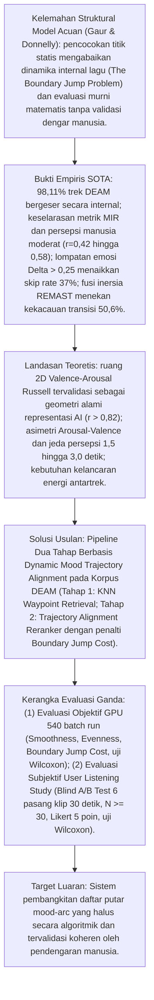

# Bab II Tinjauan Pustaka

## 2.1 Landasan Teori

### 2.1.1 Model Emosi Musik Sirkumpleks Russell (1980) dan Revalidasi Modern
Kajian komputasi afektif musik bertumpu pada teori psikologi persepsi emosi. Russell (1980) mengusulkan *Circumplex Model of Affect*, yang menyatakan bahwa respons afektif manusia terdistribusi dalam dua dimensi neurofisiologis independen yang kontinu:
1. *Valence* (kesenangan atau kualitas afeksi), mengukur derajat kepositifan suasana hati dari kondisi sangat tidak menyenangkan (seperti sedih dan tertekan) hingga sangat menyenangkan (seperti gembira dan damai).
2. *Arousal* (aktivasi atau intensitas fisiologis), mengukur tingkat ketergugahan energi motorik tubuh dari kondisi pasif (seperti mengantuk dan tenang) hingga kondisi berenergi tinggi (seperti waspada, bersemangat, dan tegang).

Keunggulan model dimensional ini dibandingkan model kategorikal diskrit terletak pada sifatnya yang kontinu dan aljabar. Keadaan afektif dapat diekspresikan sebagai vektor koordinat Cartesian $\mathbf{p} = (v, a) \in [-1{,}0, +1{,}0]^2$, sehingga operasi kalkulus vektor, perhitungan jarak Euclidean, dan interpolasi lintasan dapat diterapkan langsung dalam perancangan kurva *mood arc*.

Meskipun diperkenalkan pada tahun 1980, model ini memiliki validitas komputasional kontemporer yang kuat. Penelitian Belaref et al. (2024) melalui dekode berbasis data terhadap representasi laten jaringan saraf tiruan multimodal (RoBERTa dan wav2vec 2.0) membuktikan bahwa model Transformer audio secara mandiri mengorganisasikan afeksi manusia mengikuti topologi lingkaran sirkumpleks Russell. Sebanyak 75% dari 28 istilah emosi granular terpetakan dalam deviasi sudut $\Delta \theta < 30^\circ$ terhadap data manusia asli dengan korelasi angular $r > 0{,}82$. Kang et al. (2025) selanjutnya memformulasikan unifikasi matematis antara ruang kontinu dua dimensi ini dan label kategori afektif melalui sudut polar $\theta = \mathrm{atan2}(\Delta a, \Delta v)$, membuktikan bahwa pergeseran sudut vektor emosi merefleksikan perubahan suasana hati pendengar secara konsisten.

### 2.1.2 Dinamika Temporal Emosi Musik dan Jeda Waktu Persepsi
Musik merupakan media temporal yang bergantung pada waktu (*time-dependent medium*). Perubahan emosional di dalam musik memiliki asimetri yang khas. Mengacu pada meta-analisis 144 studi empiris *Music Emotion Recognition* (MER) oleh Eerola et al. (2026) serta temuan Wen et al. (2025), terdapat dua prinsip temporal utama.

Pertama, dimensi *Arousal* berkorelasi kuat dengan parameter akustik fisik audio seperti energi RMS, dinamika spektral, dan tempo, sehingga menghasilkan akurasi prediksi komputasi yang stabil ($r = 0{,}68 \pm 0{,}08$). Sebaliknya, dimensi *Valence* dipengaruhi oleh struktur harmonik, progresi akor, tangga nada mayor-minor, dan asosiasi kognitif, sehingga menghasilkan variasi korelasi yang lebih moderat ($r = 0{,}42 \pm 0{,}12$). Kedua, terdapat jeda waktu persepsi (*perceptual time lag*): pendengaran manusia membutuhkan waktu antara 1,5 hingga 3,0 detik untuk mencerna perubahan dinamika akustik dan menginterpretasikannya sebagai pergeseran suasana hati. Sinyal anotasi telemetri kontinu berfrekuensi 2 Hz (interval 500 ms) memerlukan penyaringan perata bergerak (*moving average smoothing filter*) dengan ukuran jendela 3 *timestamp* (1,5 detik) agar fluktuasi mikro sesaat tidak mengaburkan trajektori makro lagu.

### 2.1.3 Representasi Fitur Akustik Audio Tradisional dan Kontemporer
Sistem temu kembali musik mengandalkan ekstraksi deskriptor akustik untuk menilai kemiripan konten audio antarlagu (Muller, 2021; Knees & Schedl, 2016). Fitur akustik konvensional yang diekstraksi melalui pustaka pemrosesan sinyal seperti Librosa mencakup tiga kelompok:
1. Fitur timbral dan tekstur spektral, meliputi *Mel-Frequency Cepstral Coefficients* (MFCC), *Spectral Centroid*, *Spectral Rolloff*, dan *Spectral Contrast* yang mengukur kecerahan serta warna suara instrumen.
2. Fitur ritmik dan energi, meliputi tempo (BPM), kekuatan ketukan (*beat strength*), dan energi *Root Mean Square* (RMS) yang berbanding lurus dengan dimensi *Arousal*.
3. Fitur harmoni dan nada, meliputi *Chroma Feature* dan *Tonnetz* yang merefleksikan progresi tonalitas serta kunci lagu.

Perkembangan mutakhir sistem temu kembali audio melahirkan model fondasi berbasis pembelajaran swa-supervisi (*self-supervised learning*) berskala besar, seperti MERT (Li et al., 2024) dan adaptasi HuBERT musik (Sun et al., 2025). Model tersebut mampu menangkap ketergantungan harmoni jangka panjang. Pada sistem perekomendasi daftar putar berlatensi rendah, kombinasi fitur akustik Librosa terstandarisasi tetap unggul karena efisiensi komputasi serta keterjelasannya (*explainable features*).

### 2.1.4 Teori Transisi Halus dan Inersia Afektif
Dalam penyusunan urutan stimulus musikal berkesinambungan, transisi mendadak antarsegmen yang kontras memicu disonansi perseptual. Studi Wang et al. (2024) pada sistem penataan musik REMAST membuktikan bahwa pengoptimalan kecocokan emosi seketika tanpa mengendalikan laju perubahan antarsegmen selalu menghasilkan sentakan struktural (*jarring boundary transition*). Wang et al. (2024) memperhitungkan inersia emosi keadaan sebelumnya melalui mekanisme fusi emosi yang dirumuskan pada Persamaan (2.1):
$$\mathbf{e}_{\mathrm{fused}, t} = \frac{\mathbf{e}_{\mathrm{music}, t-1} + \mathbf{e}_{\mathrm{target}, t}}{2} \tag{2.1}$$
Penerapan fusi pada Persamaan (2.1) mereduksi kekacauan transisi akor (*Chord Entropy Coherence* / CEC) hingga 50,6%, dari 7,51 menjadi $3{,}71 \pm 0{,}31$, serta meningkatkan skor kehalusan transisi subjektif manusia menjadi 3,79 dari 5,00 ($p < 0{,}03$). Prinsip inersia afektif ini mendasari aturan bahwa perpindahan antara dua trek rekaman berturutan wajib mengendalikan jarak perbatasan *outro* ke *intro*.

### 2.1.5 Psikoakustik, Persepsi Transisi Musik, dan Evaluasi Pengguna
Sistem rekomendasi musik pada akhirnya bermuara pada kepuasan pendengar (Ricci et al., 2022; Yang & Chen, 2011). Pendengaran manusia memiliki kepekaan psikoakustik tinggi terhadap diskontinuitas mendadak pada parameter energi, ritme, dan tekstur frekuensi di titik pergantian lagu. Studi empiris Daikoku et al. (2022) menunjukkan bahwa keselarasan antara metrik komputasional otomatis MIR dan estimasi persepsi manusia hanya mencapai tingkat moderat ($r = 0{,}42$ hingga $0{,}58$).

Dua aspek utama memengaruhi persepsi transisi musik. Pertama, disonansi transisi perbatasan (*boundary transition dissonance*): Thome et al. (2022) membuktikan bahwa jarak emosi dan jarak kemiripan akustik tidak selalu berbanding lurus, sehingga lonjakan drastis di awal lagu baru menciptakan sentakan psikologis. Studi Schweiger et al. (2025) pada katalog Spotify mengonfirmasi bahwa diskontinuitas emosi antartrek yang melampaui ambang $\Delta > 0{,}25$ memicu peningkatan pembatalan dengar (*skip*) hingga 37%. Kedua, metodologi pengujian dengar buta (*blind A/B listening test*): untuk mengukur persepsi transisi secara objektif dan bebas dari bias genre atau artis, stimulus difokuskan pada klip sambungan terisolasi berdurasi 30 detik (15 detik penutup lagu $i$ disambung 15 detik pembuka lagu $i+1$). Instrumen kuesioner psikometri skala Likert 5 poin yang menilai kelancaran, kontinuitas energi, dan kealamian emosi diuji konsistensi internalnya melalui *Cronbach's Alpha* ($\alpha \ge 0{,}70$).

### 2.1.6 Pembangkitan Daftar Putar Berbasis Lintasan Emosi dan The Boundary Jump Problem
Pembangkitan daftar putar berbasis suasana hati menyusun barisan trek musik $P = [s_1, s_2, \dots, s_M]$ yang mengarahkan pendengar dari kondisi awal $P_{\mathrm{start}}$ menuju kondisi akhir $P_{\mathrm{target}}$ melalui serangkaian titik acuan perantara (*waypoints*) $W = [\mathbf{w}_1, \dots, \mathbf{w}_M]$ pada ruang koordinat *Valence-Arousal*.

Model acuan Gaur dan Donnelly (2023, 2024) menggunakan pendekatan dua tahap: mengambil $K$ kandidat terdekat di sekitar titik acuan menggunakan KNN, lalu menyaring kandidat berdasarkan jarak fitur akustik pada dataset DMDD (Delbouys et al., 2018). Karena DMDD hanya menyediakan label rata-rata skalar statis ($\bar{v}, \bar{a}$), model tersebut mengabaikan dinamika internal lagu. Ketika lagu pertama yang berkarakter tenang di bagian akhir bersambung dengan lagu kedua yang berkarakter enerjik di bagian awal, muncul fenomena *The Boundary Jump Problem*. Ketiadaan validasi dengar manusia pada penelitian terdahulu semakin memperlebar jarak antara skor matematis dan kenyamanan dengar nyata.

---

## 2.2 Penelitian Terdahulu (*State of the Art*)

Perkembangan penelitian mengenai pembangkitan daftar putar dan analisis afektif musik dirangkum pada Tabel 2.1. Pengurutan disusun secara kronologis dan tematik untuk memperlihatkan evolusi metode dari pemetaan statis menuju optimasi trajektori dinamis dan evaluasi perseptual.

Tabel 2.1 Perbandingan Penelitian Terdahulu

| Peneliti (Tahun) | Metode dan Dataset | Hasil Utama | Keterbatasan |
| :--- | :--- | :--- | :--- |
| Cardoso et al. (2011) | Prototipe MOODetector berbasis antarmuka ruang Thayer 2D; dataset sekitar 500 lagu. | Penarikan garis lintasan *mood* secara interaktif untuk mengambil lagu sesuai kurva. | Tidak memiliki metrik evaluasi kehalusan formal; fitur terbatas dan mengabaikan transisi sekuensial. |
| Aljanaki et al. (2017) | Anotasi kontinu frekuensi 2 Hz pada 1.802 klip musik (45 s); dataset DEAM. | Menghasilkan standar emas korpus MIR dengan anotasi deret waktu *Valence-Arousal*. | Hanya menyediakan korpus dan model regresi ekstraksi; tidak merancang algoritma daftar putar. |
| Delbouys et al. (2018) | Fusi multimodal *deep learning* audio dan lirik pada dataset DMDD (18.644 lagu). | Peningkatan akurasi estimasi *Valence-Arousal* global melalui fitur multimodal. | Anotasi hanya berupa satu nilai rata-rata statis per lagu tanpa informasi pergeseran internal. |
| Gaur & Donnelly (2023) | *Two-Stage Pipeline*: interpolasi titik acuan KNN dan penyaringan akustik pada DMDD. | Algoritma pembangkitan daftar putar *mood-arc* terarah dengan metrik *Smoothness* dan *Evenness*. | Pencocokan titik statis mengabaikan dinamika intra-lagu dan tidak menyertakan uji dengar manusia. |
| Gaur & Donnelly (2024) | Formalisasi metrik matematis *Smoothness Index* ($\mathcal{S}$) dan *Evenness Index* ($\mathcal{E}$). | Menyediakan landasan metrik terstandarisasi untuk mengukur kehalusan transisi antartrek. | Pengujian berbasis representasi statis; skor tinggi pada rute diagonal merupakan artefak rute buatan. |
| Bontempelli et al. (2022) | Sistem rekomendasi industri *Flow Moods* pada platform Deezer berbasis radio afektif. | Pengelompokan katalog jutaan lagu ke dalam kuadran emosi berskala komersial. | Daftar putar terkunci pada satu kategori suasana hati tunggal; belum mendukung lintasan dinamis kontinu. |
| Tomasi et al. (2023) | Pembelajaran penguatan (RL) untuk kelanjutan daftar putar sekuensial pada katalog Spotify. | Agen RL mampu mengoptimalkan urutan trek sekuensial berdasarkan koherensi urutan. | Biaya pelatihan komputasi tinggi dan sulit diinterpretasikan; tidak mengikuti kurva koordinat emosi eksplisit. |
| Thome et al. (2022) | Analisis korelasi jarak kemiripan audio CNN swa-supervisi terhadap persepsi emosi. | Membuktikan jarak emosi dan jarak akustik tidak berkorelasi linier. | Tidak menguji perancangan algoritma sekuensial daftar putar; fokus pada analisis representasi audio. |
| Daikoku et al. (2022) | Analisis keselarasan metrik otomatis MIR terhadap penilaian perseptual pendengar. | Korelasi komputasi MIR dengan persepsi manusia hanya berada pada tingkat moderat ($r = 0{,}42$ hingga $0{,}58$). | Tidak merancang algoritma optimasi rute daftar putar; sebatas kajian korelasi komparatif. |
| Belaref et al. (2024) | Dekode berbasis data model sirkumpleks Russell dengan Transformer audio-teks. | Sebanyak 75% istilah emosi terpetakan dalam $\Delta\theta < 30^\circ$ ($r > 0{,}82$) pada representasi AI. | Evaluasi terbatas pada sinyal audio wicara pendek; belum diuji pada musik polifonik penuh. |
| Wang et al. (2024) | Model REMAST: fusi inersia emosi dan koreksi trajektori pada musik simbolik. | Mereduksi kekacauan transisi akor hingga 50,6% dan meraih skor kelembutan 3,79/5,00 ($p < 0{,}03$). | Diterapkan pada sintesis musik simbolik MIDI generatif; tidak langsung berlaku pada trek rekaman audio utuh. |
| Wen et al. (2025) | Audit kebocoran data pada regresi *Arousal* dinamis dataset DEAM. | Membuktikan pemisahan frame acak memicu inflasi $R^2$ semu 28% hingga 45%; mewajibkan *Song-Level Holdout Split*. | Berfokus pada metodologi prediksi deret waktu audio; tidak merancang sistem rekomendasi daftar putar. |
| Schweiger et al. (2025) | Analisis empiris jutaan daftar putar kurasi pengguna Spotify dan Deezer. | Transisi emosi $\Delta \le 0{,}25$ menjaga retensi dengar; lompatan kasar menaikkan *skip rate* 37%. | Kajian analitis retrospektif tanpa algoritma optimasi kurasi daftar putar otomatis. |
| Penelitian Ini (2026) | *Pipeline* 2 tahap (KNN dan penyelarasan trajektori) pada DEAM dengan evaluasi ganda. | Mengatasi *The Boundary Jump Problem*; reduksi $\mathcal{S} \ge 15\%$ dan validasi persepsi manusia ($p < 0{,}05$). | Uji persepsi manusia terbatas pada klip transisi skala laboratorium ($N \ge 30$) berdurasi 30 detik. |

<small><i>Sumber: Sintesis tinjauan pustaka penelitian terdahulu (2026).</i></small>

### 2.2.1 Sintesis Kesenjangan Riset
Berdasarkan pemetaan pada Tabel 2.1, kesenjangan penelitian dirumuskan ke dalam tiga lapis. Pada lapis pertama (celah teoretis dan desain model acuan), model Gaur dan Donnelly (2023, 2024) bertumpu pada dataset DMDD yang hanya menyediakan label statis tunggal per lagu, sehingga mengabaikan pergeseran afektif internal yang terjadi pada 98,11% lagu di korpus DEAM (Aljanaki et al., 2017).

Pada lapis kedua (celah metodologis dan evaluasi), penelitian REMAST (Wang et al., 2024) telah membuktikan efektivitas peredaman lonjakan transisi menggunakan inersia emosi pada komposisi simbolik MIDI generatif, namun belum pernah diadaptasi untuk kurasi rekaman audio utuh. Di samping itu, temuan Daikoku et al. (2022) menunjukkan bahwa evaluasi komputasional murni belum memadai untuk mewakili persepsi pendengar.

Pada lapis ketiga (posisi kebaruan), penelitian ini mengisi celah tersebut dengan mengintegrasikan prinsip transisi halus ke dalam representasi trajektori dinamis 2 Hz korpus DEAM melalui formulasi penalti *Boundary Jump Cost*, lalu mengujinya melalui kerangka evaluasi ganda berupa simulasi komputasional GPU dan pengujian dengar manusia.

---

## 2.3 Kerangka Pemikiran

Alur logika yang menjembatani kesenjangan literatur dengan perancangan metodologi penelitian disajikan pada Gambar 2.1. Diagram tersebut memetakan keterkaitan antara keterbatasan model acuan, bukti empiris terkini, landasan teori, arsitektur solusi dua tahap, dan evaluasi ganda yang mengonfirmasi kualitas transisi secara algoritmik maupun perseptual.

*Gambar 2.1 Kerangka Pemikiran Penelitian*
