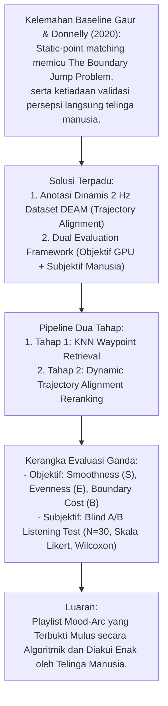

# ✍️ Bab II Tinjauan Pustaka (Skenario 2: Dual Evaluation dengan User Study)

---

## 2.1 Landasan Teori

### 2.1.1 Model Emosi Musik Sirkumpleks Russell (1980)
Studi komputasi afektif musik bertumpu pada teori psikologi persepsi emosi. James Russell (1980) mengusulkan *Circumplex Model of Affect*, yang mendalilkan bahwa respon afektif manusia berakar pada dua dimensi neurofisiologis independen kontinu:
1. **Valence (Kesenangan / Kualitas Afeksi):** Mengukur derajat kebahagiaan afektif dari kondisi sangat tidak menyenangkan (*negative valence*) hingga sangat menyenangkan (*positive valence*).
2. **Arousal (Aktivasi / Intensitas Fisiologis):** Mengukur ketergugahan fisiologis dari kondisi pasif/rendah (*low arousal*) hingga bersemangat tinggi (*high arousal*).

Keadaan afektif diekspresikan sebagai vektor koordinat Cartesian $\mathbf{p} = (v, a) \in [-1.0, +1.0]^2$.

### 2.1.2 Dinamika Temporal Emosi Musik
Musik merupakan media temporal berbasis waktu (*time-dependent medium*). Mengacu pada meta-analisis komprehensif 144 studi MIR oleh Eerola dan Anderson (2026) serta temuan Wen et al. (2025):
- **Inersia Temporal Arousal:** Dimensi Arousal memiliki korelasi yang sangat kuat dengan fitur akustik fisik (seperti RMS *energy*, tempo, dan *loudness*).
- **Kompleksitas Valence:** Dimensi Valence lebih dipengaruhi oleh struktur harmonik, progresi akor, tangga nada, dan lirik.
- **Perception Latency:** Manusia membutuhkan waktu 1,0 hingga 1,5 detik untuk memproses perubahan emosional dalam audio, sehingga diperlukan *moving average filter* pada anotasi kontinu 2 Hz.

### 2.1.3 Sistem Pembangkitan Playlist Berbasis Lintasan Emosi (*Mood Arc*)
Pembangkitan playlist berbasis suasana hati bertujuan menyusun barisan trek musik $P = [s_1, s_2, \dots, s_M]$ yang mengarahkan pendengar dari kondisi emosi awal $P_{\text{start}}$ menuju kondisi akhir $P_{\text{target}}$ melalui serangkaian titik acuan perantara (*waypoints*) $W = [w_1, w_2, \dots, w_M]$.

### 2.1.4 Evaluasi Perseptual Musik dan Uji Dengar Manusia (*Psychoacoustics*)
Sistem temu kembali musik tidak dapat dipisahkan dari persepsi pendengar manusia. Studi Daikoku et al. (2022) mengenai kesepakatan antara metrik komputasional dan estimasi manusia menunjukkan bahwa metrik matematis murni rentan kehilangan nuansa perseptual bila tidak divalidasi melalui pengujian subjektif. Schweiger et al. (2025) menegaskan bahwa transisi antartrek yang mendadak menimbulkan disonansi afektif yang langsung terdeteksi oleh telinga manusia. Oleh karena itu, pengujian kuesioner berbasis stimulus pendek terisolasi (*boundary transition test*) sangat dianjurkan untuk mengevaluasi koherensi playlist secara bebas dari bias selera genre.

---

## 2.2 Penelitian Terdahulu (*State of the Art*)

Penelitian sistem rekomendasi dan temu kembali musik berbasis emosi telah berkembang melalui kontribusi kunci berikut:
1. **Cardoso et al. (2011):** Prototipe *MOODetector* berbasis antarmuka grafis ruang Thayer 2D.
2. **Delbouys et al. (2018):** Korpus multimodal DMDD (18k lagu) dengan label rata-rata statis per trek.
3. **Gaur dan Donnelly (2020, 2024):** Model acuan pembangkitan mood-arc dua tahap (KNN waypoint retrieval + acoustic filter) dengan metrik *Smoothness* dan *Evenness*. Memiliki kelemahan struktural *static-point matching*.
4. **Aljanaki et al. (2017):** Korpus DEAM, standar emas MIR dengan anotasi dinamis 2 Hz pada 1.802 klip lagu berdurasi 45 detik.
5. **Bontempelli et al. (2022) & Tomasi et al. (2023):** Implementasi industri radio mood Deezer (*Flow Moods*) dan pemodelan RL sekuensial Spotify.
6. **Schweiger et al. (2025):** Pembuktian empiris bahwa konsistensi transisi sekuensial antartrek adalah penentu paling dominan terhadap kenyamanan pendengar.
7. **Daikoku et al. (2022):** Analisis keselarasan metrik kemiripan otomatis MIR dengan estimasi perseptual manusia (*Mean Opinion Score*).

---

### Tabel 2.1 Perbandingan Penelitian Terdahulu

| Peneliti (Tahun) | Metode dan Dataset | Hasil Utama | Keterbatasan |
| :--- | :--- | :--- | :--- |
| **Cardoso et al. (2011)** | Prototipe UI interaktif ruang Thayer 2D; dataset ~500 lagu. | Seleksi lagu visual interaktif sepanjang kurva mood. | Tanpa metrik formal; fitur audio terbatas; tanpa validasi statistik manusia. |
| **Aljanaki et al. (2017)** | Anotasi kontinu 2 Hz pada 1.802 klip musik (45s); dataset DEAM. | Benchmark standar emas analisis temporal Valence-Arousal kontinu. | Hanya menyediakan dataset mentah; tidak merancang algoritma playlist. |
| **Delbouys et al. (2018)** | Fusi multimodal audio-lirik deep learning pada dataset DMDD (18k trek). | Peningkatan akurasi prediksi emosi berbasis kombinasi teks dan audio. | Anotasi skalar rata-rata tunggal; mengabaikan dinamika intra-lagu. |
| **Gaur & Donnelly (2020, 2024)** | KNN waypoint interpolation + acoustic filter pada DMDD. | Mengusulkan metrik *Smoothness* dan *Evenness*; retrieval lagu terarah. | **Static-point matching**: Memicu *boundary jump problem*; evaluasi murni matematis tanpa uji dengar manusia. |
| **Daikoku et al. (2022)** | Studi komparasi metrik otomatis MIR vs penilaian pendengar manusia. | Membuktikan perlunya kalibrasi metrik matematis terhadap persepsi pendengar. | Tidak merancang algoritma optimasi rute playlist. |
| **Schweiger et al. (2025)** | Analisis empiris jutaan playlist pengguna Spotify. | Membuktikan transisi sekuensial antarlagu adalah penentu utama kepuasan. | Analisis retrospektif tanpa algoritma pembangkitan otomatis. |
| **Penelitian Ini (2026)** | Pipeline 2 tahap (KNN + **Dynamic Trajectory Alignment**) di DEAM + **Dual Evaluation** (Metrik + User Study). | Mengeliminasi *boundary jump*; reduksi $\mathcal{S} \ge 15\%$; keunggulan transisi tervalidasi signifikan ($p < 0.05$) pada telinga manusia. | Uji persepsi manusia terbatas pada klip transisi laboratorium ($N \ge 30$). |

---

## 2.3 Kerangka Pemikiran

