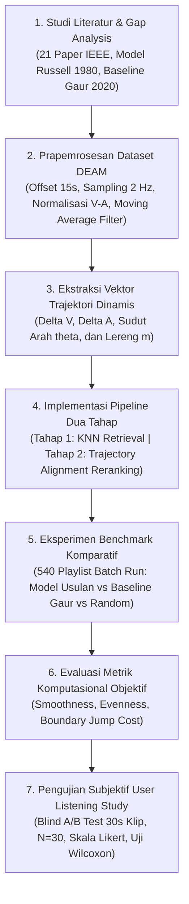

# ✍️ Bab III Metodologi (Skenario 2: Dual Evaluation dengan User Study)

---

## 3.1 Alur Penelitian

Penelitian ini dilaksanakan melalui tujuh tahapan terstruktur yang dirancang linier dan dapat direplikasi (*reproducible*):

---

## 3.2 Pengumpulan dan Prapemrosesan Data

Data primer yang digunakan adalah korpus **DEAM (*Database for Emotion Analysis in Music*)** (Aljanaki et al., 2017) yang mencakup 1.802 klip musik MP3 (44,1 kHz) dengan anotasi deret waktu kontinu 2 Hz (per 500 ms) pada dimensi Valence dan Arousal:
1. **Pemotongan Offset Pemanasan (*Lead-in Truncation*):** 15 detik awal sinyal audio dan anotasi dieliminasi sesuai protokol resmi, menyisakan tepat 45 detik rekaman representatif per lagu ($90 \text{ timestamp}$ telemetri).
2. **Normalisasi Ruang Emosi:** Nilai anotasi asli $[1.0, 9.0]$ ditransformasikan secara linier ke koordinat simetris $[-1.0, +1.0]$:
   $$v_{\text{norm}} = 2 \cdot \left(\frac{v - v_{\min}}{v_{\max} - v_{\min}}\right) - 1, \quad a_{\text{norm}} = 2 \cdot \left(\frac{a - a_{\min}}{a_{\max} - a_{\min}}\right) - 1 \tag{3.1}$$
3. **Penyaringan Derau Persepsi (*Noise Smoothing*):** Sinyal deret waktu disaring menggunakan *moving average filter* 1D berukuran jendela 3 timestamp (1,5 detik) guna meredam efek keterlambatan persepsi manusia (*perception latency*).

---

## 3.3 Perancangan Pipeline Sistem

### 3.3.1 Tahap 1: Pembangkitan Kandidat Berbasis KNN (*Candidate Retrieval*)
Diberikan titik awal emosi $\mathbf{p}_{\text{start}} = (v_s, a_s)$, titik target $\mathbf{p}_{\text{target}} = (v_t, a_t)$, dan panjang playlist $M$, rute diinterpolasi menjadi $M$ titik acuan perantara (*waypoints*):
$$\mathbf{w}_j = \mathbf{p}_{\text{start}} + \frac{j-1}{M-1} \cdot (\mathbf{p}_{\text{target}} - \mathbf{p}_{\text{start}}), \quad \forall j \in \{1, 2, \dots, M\} \tag{3.2}$$

Untuk setiap waypoint $\mathbf{w}_j$, algoritma KNN mengambil $K$ lagu kandidat terdekat berdasarkan jarak Euclidean terhadap titik rata-rata statis $\bar{\mathbf{p}}_k$:
$$d(\mathbf{w}_j, \bar{\mathbf{p}}_k) = \|\mathbf{w}_j - \bar{\mathbf{p}}_k\|_2 = \sqrt{(v_w - \bar{v}_k)^2 + (a_w - \bar{a}_k)^2} \tag{3.3}$$

### 3.3.2 Tahap 2: Dynamic Trajectory Alignment Reranking
Setiap kandidat dimodelkan sebagai vektor pergerakan internal $\vec{\mathbf{v}}_k = \mathbf{p}_k(t_{\text{end}}) - \mathbf{p}_k(t_0)$, sedangkan vektor target transisi didefinisikan sebagai $\vec{\mathbf{u}}_j = \mathbf{w}_{j+1} - \mathbf{w}_j$. Skor keselarasan komposit dihitung melalui:
$$\text{Score}(k, j) = (1 - \alpha) \cdot \frac{d(\mathbf{w}_j, \bar{\mathbf{p}}_k)}{\max(d)} + \alpha \cdot \left(\frac{1 - \cos(\vec{\mathbf{v}}_k, \vec{\mathbf{u}}_j)}{2}\right) \tag{3.4}$$
dengan parameter bobot $\alpha \in [0.0, 1.0]$. Lagu dengan nilai skor terkecil dipilih sebagai trek pengisi playlist.

---

## 3.4 Lingkungan Eksperimen dan Reproduksibilitas

* **Perangkat Keras:** Intel Core i7 Generasi ke-12 / AMD Ryzen 7, RAM 32 GB, GPU NVIDIA GeForce RTX 3070 Ti (8 GB VRAM).
* **Perangkat Lunak:** Windows 11 Pro 64-bit, Python 3.10, PyTorch (CUDA 12.1), Librosa 0.10.1, Scikit-learn 1.3+.
* **Random Seed:** Ditetapkan konstan `seed=42`.
* **Struktur Kode:** Tersimpan modular di `EXPERIMENT/Code/baseline_gaur` (`src/`, `experiments/`, `tests/`) dan siap didemonstrasikan pada sesi *Code Walkthrough* sidang (bobot 10%).

---

## 3.5 Metode Pengujian dan Evaluasi Komputasional Objektif

Kinerja playlist dievaluasi secara kuantitatif objektif menggunakan tiga metrik matematis:

1. **Metrik Smoothness Index ($\mathcal{S}$):** Mengukur deviasi diskontinuitas emosi pada sambungan antarlagu berturutan:
   $$\mathcal{S} = \frac{1}{M-1} \sum_{k=1}^{M-1} \|\mathbf{p}_k(t_{\text{end}}) - \mathbf{p}_{k+1}(t_0)\|_2 \tag{3.5}$$
2. **Metrik Evenness Index ($\mathcal{E}$):** Mengukur varians jarak Euclidean antartitik waypoint sepanjang playlist:
   $$\mathcal{E} = \frac{1}{M-1} \sum_{k=1}^{M-1} \left(d_k - \bar{d}\right)^2 \tag{3.6}$$
3. **Metrik Boundary Jump Cost ($\mathcal{B}$):** Memberikan penalti eksesif bila lonjakan batas emosi melampaui toleransi perseptual ($\tau = 0.35$):
   $$\mathcal{B} = \sum_{k=1}^{M-1} \max\left(0, \|\mathbf{p}_k(t_{\text{end}}) - \mathbf{p}_{k+1}(t_0)\|_2 - \tau\right) \tag{3.7}$$

---

## 3.6 Metode Pengujian Subjektif (User Listening Study)

Guna memvalidasi apakah perbaikan metrik matematis diakui oleh telinga manusia, penelitian ini merancang pengujian persepsi subjektif (*User Listening Study*). Protokol ini dirancang pada tahap proposal (TA 1) dan dieksekusi secara penuh pada tahap implementasi (TA 2).

### 3.6.1 Desain Eksperimen Blind A/B Listening Test
Pengujian dilakukan menggunakan metode *blind A/B test* di mana partisipan mendengarkan dua versi sambungan audio untuk pasangan lagu yang sama secara acak tanpa mengetahui algoritma pembuatnya:
- **Versi A (Baseline):** Sambungan transisi yang dihasilkan oleh model *static-point matching* Gaur dan Donnelly (2020).
- **Versi B (Usulan):** Sambungan transisi yang dihasilkan oleh pipeline *Dynamic Mood Trajectory Alignment*.

### 3.6.2 Stimulus Audio Sambungan Batas (Boundary Jump Clip)
Guna mengeliminasi kelelahan mendengar (*listener fatigue*) dan bias selera musik genre tertentu, stimulus yang diuji difokuskan tepat pada segmen pergantian lagu berdurasi **30 detik**:
$$\text{Clip} = [\text{Audio } s_i \text{ (15 detik akhir)}] + [\text{Audio } s_{i+1} \text{ (15 detik awal)}]$$
Empat pasang transisi lintas kuadran diuji, mencakup pergeseran emosi ekstrem (Kuadran IV Tenang menuju Kuadran I Enerjik, dan Kuadran III Sedih menuju Kuadran I Gembira).

### 3.6.3 Partisipan dan Kriteria Sampling
Pengujian melibatkan minimal $N = 30$ responden (memenuhi batas kecukupan ukuran sampel teorema limit pusat). Responden dipilih menggunakan teknik *purposive sampling* dengan kriteria inklusi:
1. Mahasiswa aktif Program Studi Teknik Informatika ITERA.
2. Pendengar aktif platform penyiaran musik digital (Spotify, Apple Music, YouTube Music) dengan durasi minimal 3 jam per minggu.

### 3.6.4 Instrumen Kuesioner Evaluasi
Setiap responden menilai masing-masing pasangan stimulus audio menggunakan kuesioner berbasis skala Likert 5 poin:
1. **Perceived Transition Smoothness ($Q_1$):** *"Seberapa mulus pergantian antarlagu yang Anda dengarkan pada titik transisi?"* (1 = Sangat kasar/menyentak, 5 = Sangat mulus/alami).
2. **Acoustic Continuity ($Q_2$):** *"Seberapa nyaman kesinambungan energi dan tempo saat lagu berganti?"* (1 = Sangat terputus, 5 = Sangat berkesinambungan).
3. **Direct Preference ($Q_3$):** *"Versi mana yang lebih Anda sukai untuk playlist perjalanan suasana hati?"* (Pilihan biner: Versi A / Versi B).

### 3.6.5 Prosedur Analisis Statistik
Data kuesioner dianalisis menggunakan perangkat lunak statistik Python (`scipy.stats`):
1. **Uji Hipotesis Beda Nyata:** Karena data skala ordinal Likert tidak berdistribusi normal, perbedaan skor antara Baseline dan Model Usulan diuji menggunakan uji non-parametrik **Wilcoxon Signed-Rank Test** berpasangan dengan taraf signifikansi $\alpha = 0.05$.
2. **Korelasi Metrik Objektif vs. Subjektif:** Menghitung koefisien korelasi peringkat Spearman ($\rho$) antara nilai penurunan *Smoothness Index* ($\mathcal{S}$) dan peningkatan skor *Mean Opinion Score* (MOS) responden:
$$\rho = 1 - \frac{6 \sum d_i^2}{n(n^2 - 1)} \tag{3.8}$$
Korelasi negatif yang kuat ($\rho \le -0.6, p < 0.05$) membuktikan bahwa penurunan indeks kekasaran matematis benar-benar dirasakan sebagai peningkatan kelancaran oleh telinga manusia.
