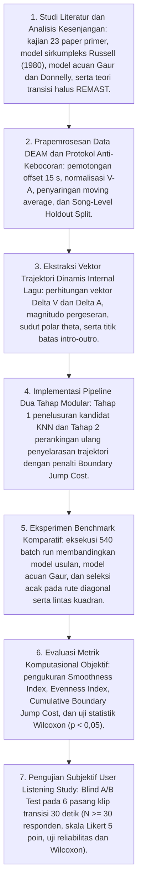

# Bab III Metodologi

## 3.1 Alur Penelitian

Penelitian ini dilaksanakan melalui tujuh tahapan berurutan yang dirancang agar dapat direplikasi secara penuh, sebagaimana digambarkan pada Gambar 3.1.

*Gambar 3.1 Diagram Alir Tahapan Penelitian*

Pelaksanaan ketujuh tahapan pada Gambar 3.1 mencakup:
1. Studi literatur dan analisis kesenjangan: mengkaji landasan teoretis model sirkumpleks Russell (1980) beserta revalidasi modern Belaref et al. (2024), prinsip peredaman lonjakan transisi Wang et al. (2024), keterbatasan model acuan Gaur dan Donnelly (2023, 2024), serta korelasi metrik otomatis MIR terhadap persepsi manusia (Daikoku et al., 2022).
2. Prapemrosesan data dan protokol integritas: mengunduh 1.802 rekaman audio korpus DEAM (Aljanaki et al., 2017), memotong 15 detik awal, menerapkan protokol pemisahan data *Song-Level Holdout Split* (Wen et al., 2025), menormalkan koordinat ke rentang $[-1{,}0, +1{,}0]$, serta menerapkan penyaringan perata bergerak.
3. Ekstraksi vektor trajektori dinamis: menghitung pergeseran koordinat internal lagu antara segmen pembuka (*intro*) dan penutup (*outro*), mengekstrak magnitudo perpindahan, serta menentukan sudut arah orientasi emosi $\theta$ di ruang sirkumpleks.
4. Implementasi *pipeline* dua tahap: membangun modul program modular dalam bahasa Python dan kerangka kerja PyTorch GPU untuk penelusuran kandidat KNN serta penyaringan ulang terbobot berbasis *Boundary Jump Cost*.
5. Eksperimen benchmark komparatif: mengeksekusi pengujian otomatis 540 sekuens daftar putar pada variasi rute diagonal kontinu (Q3 ke Q1) dan rute lintas kuadran realistis (Q1 ke Q2, Q1 ke Q4, Q2 ke Q4) terhadap model acuan dan seleksi acak.
6. Evaluasi metrik komputasional objektif: mengukur capaian *Smoothness Index* ($\mathcal{S}$), *Evenness Index* ($\mathcal{E}$), dan *Boundary Jump Cost* ($\mathcal{BJC}$), lalu menguji keberartian perbedaan performa menggunakan *Wilcoxon Signed-Rank Test*.
7. Pengujian subjektif *user listening study*: melaksanakan uji dengar buta pada skala laboratorium dengan memperdengarkan 6 pasang stimulus sambungan audio 30 detik kepada minimal 30 responden, mengevaluasi respons melalui skala Likert 5 poin, menguji reliabilitas instrumen dengan *Cronbach's Alpha*, dan menguji signifikansi preferensi dengan uji Wilcoxon.

---

## 3.2 Pengumpulan dan Prapemrosesan Data

Data primer penelitian ini menggunakan korpus terbuka DEAM (*Database for Emotion Analysis in Music*) (Aljanaki et al., 2017). Dataset tersebut memuat 1.802 klip musik berformat audio MP3 (44,1 kHz) dari arsip Free Music Archive dan Jamendo. Setiap klip dilengkapi anotasi deret waktu kontinu berfrekuensi 2 Hz (interval 500 ms) pada dimensi *Valence* dan *Arousal* yang dinilai secara urun daya oleh pendengar manusia.

Tahapan penyiapan dan prapemrosesan data dijalankan melalui empat prosedur:
1. Pemotongan *offset* pemanasan (*lead-in truncation*): sesuai protokol resmi DEAM, 15 detik pertama dari setiap klip audio diabaikan karena merupakan fase penyesuaian anotator manusia terhadap stimulus lagu. Dari total 45 detik durasi klip, segmen detik ke-15 hingga detik ke-45 dipertahankan, menghasilkan tepat 30 detik data representatif (90 *timestamp* telemetri per lagu).
2. Normalisasi ruang emosi simetris: nilai anotasi mentah DEAM pada rentang skala $[1{,}0, 9{,}0]$ ditransformasikan secara linier ke koordinat Cartesian simetris $[-1{,}0, +1{,}0]$ melalui Persamaan (3.1):
   $$v_{\mathrm{norm}} = 2 \cdot \left(\frac{v - v_{\min}}{v_{\max} - v_{\min}}\right) - 1, \quad a_{\mathrm{norm}} = 2 \cdot \left(\frac{a - a_{\min}}{a_{\max} - a_{\min}}\right) - 1 \tag{3.1}$$
   dengan $v_{\min} = 1{,}0$ dan $v_{\max} = 9{,}0$. Transformasi ini menempatkan titik netralitas afektif tepat pada pusat koordinat $(0, 0)$.
3. Penyaringan derau persepsi (*noise smoothing*): mengacu pada jeda waktu persepsi manusia sebesar 1,5 hingga 3,0 detik (Eerola et al., 2026), deret waktu anotasi disaring menggunakan *moving average filter* 1D berukuran jendela 3 *timestamp* (1,5 detik) pada Persamaan (3.2):
   $$\bar{v}_t = \frac{1}{3} \sum_{i=-1}^{1} v_{t+i}, \quad \bar{a}_t = \frac{1}{3} \sum_{i=-1}^{1} a_{t+i} \tag{3.2}$$
4. Protokol integritas data bebas kebocoran (*song-level holdout split*): mengadopsi audit kebocoran data Wen et al. (2025), pemisahan dataset dilakukan berbasis identitas lagu utuh, bukan pemisahan *frame* acak. Pemisahan *frame* acak pada data deret waktu musik terbukti memicu kebocoran korelasi temporal yang menggelembungkan metrik performa secara semu sebesar 28% hingga 45%. Korpus dibagi menjadi himpunan indeks basis sebesar 80% (1.442 lagu) dan himpunan uji validasi sebesar 20% (360 lagu).

---

## 3.3 Perancangan Sistem/Model

Arsitektur model usulan terdiri atas dua tahapan komputasi modular yang bekerja secara berurutan.

### 3.3.1 Tahap 1: Pembangkitan Kandidat Berbasis KNN
Diberikan titik awal suasana hati $\mathbf{p}_{\mathrm{start}} = (v_s, a_s)$, titik akhir target $\mathbf{p}_{\mathrm{target}} = (v_t, a_t)$, dan panjang daftar putar $M$, lintasan kurva emosi diinterpolasi secara linier menjadi $M$ titik acuan perantara (*waypoints*) menggunakan Persamaan (3.3):
$$\mathbf{w}_j = \mathbf{p}_{\mathrm{start}} + \frac{j-1}{M-1} \cdot (\mathbf{p}_{\mathrm{target}} - \mathbf{p}_{\mathrm{start}}), \quad \forall j \in \{1, 2, \dots, M\} \tag{3.3}$$
Untuk setiap titik acuan $\mathbf{w}_j$, algoritma KNN menelusuri $K$ lagu kandidat terdekat ($K=20$) di ruang *Valence-Arousal* berdasarkan jarak Euclidean terhadap titik rata-rata global lagu $\bar{\mathbf{p}}_k$ sesuai Persamaan (3.4):
$$d_{\mathrm{target}}(\mathbf{w}_j, \bar{\mathbf{p}}_k) = \|\mathbf{w}_j - \bar{\mathbf{p}}_k\|_2 = \sqrt{(v_{w, j} - \bar{v}_k)^2 + (a_{w, j} - \bar{a}_k)^2} \tag{3.4}$$

### 3.3.2 Tahap 2: Dynamic Trajectory Alignment Reranker dan Penalti Boundary Jump
Pada tahap perankingan ulang, sistem mengevaluasi dinamika trajektori internal serta kontinuitas perbatasan fisik antartrek melalui empat langkah formulasi matematis.

Pertama, ekstraksi vektor trajektori internal lagu: segmen pembuka (*intro*) didefinisikan sebagai rata-rata 6 *timestamp* awal (detik ke-15 hingga ke-18) $\mathbf{p}_{\mathrm{intro}, k} = (v_{\mathrm{intro}, k}, a_{\mathrm{intro}, k})$, sedangkan segmen penutup (*outro*) didefinisikan sebagai rata-rata 6 *timestamp* akhir (detik ke-42 hingga ke-45) $\mathbf{p}_{\mathrm{outro}, k} = (v_{\mathrm{outro}, k}, a_{\mathrm{outro}, k})$. Vektor trajektori dinamis lagu $\vec{\mathbf{t}}_k$ dihitung melalui Persamaan (3.5):
$$\vec{\mathbf{t}}_k = (\Delta v_k, \Delta a_k) = (v_{\mathrm{outro}, k} - v_{\mathrm{intro}, k}, \; a_{\mathrm{outro}, k} - a_{\mathrm{intro}, k}) \tag{3.5}$$
beserta magnitudo pergeseran $\|\vec{\mathbf{t}}_k\|_2 = \sqrt{\Delta v_k^2 + \Delta a_k^2}$ dan sudut orientasi afektif polar $\theta_k = \mathrm{atan2}(\Delta a_k, \Delta v_k)$ (Kang et al., 2025).

Kedua, formulasi vektor target lintasan daftar putar: vektor arah perubahan emosi yang diharapkan antara dua titik acuan berturutan dirumuskan pada Persamaan (3.6):
$$\vec{\mathbf{u}}_j = \mathbf{w}_{j} - \mathbf{w}_{j-1} \tag{3.6}$$
Derajat keselarasan arah antara trajektori internal lagu kandidat dan arah lintasan daftar putar dihitung menggunakan kesamaan kosinus pada Persamaan (3.7):
$$\mathrm{Sim}_{\mathrm{traj}}(\vec{\mathbf{t}}_k, \vec{\mathbf{u}}_j) = \frac{\vec{\mathbf{t}}_k \cdot \vec{\mathbf{u}}_j}{\|\vec{\mathbf{t}}_k\|_2 \|\vec{\mathbf{u}}_j\|_2} \in [-1{,}0, +1{,}0] \tag{3.7}$$

Ketiga, formulasi penalti lompatan batas (*Boundary Jump Cost*): terinspirasi oleh prinsip transisi halus REMAST (Wang et al., 2024) dan ambang retensi pendengar Schweiger et al. (2025), lonjakan emosi di perbatasan antara bagian penutup lagu sebelumnya $L_{j-1}$ dan bagian pembuka lagu kandidat $L_k$ dikuantifikasi melalui Persamaan (3.8):
$$\mathcal{BJC}(L_{j-1}, L_k) = \|\mathbf{p}_{\mathrm{outro}}(L_{j-1}) - \mathbf{p}_{\mathrm{intro}}(L_k)\|_2 \tag{3.8}$$

Keempat, fungsi skor komposit seleksi kandidat: skor akhir pemilihan kandidat lagu $L_k$ untuk mengisi posisi ke-$j$ dihitung melalui kombinasi linier terbobot pada Persamaan (3.9):
$$\mathrm{Score}(L_k \mid L_{j-1}, \mathbf{w}_j) = w_1 \left(\frac{d_{\mathrm{target}}(\mathbf{w}_j, \bar{\mathbf{p}}_k)}{\max(d)}\right) + w_2 \left(\frac{1 - \mathrm{Sim}_{\mathrm{traj}}(\vec{\mathbf{t}}_k, \vec{\mathbf{u}}_j)}{2}\right) + w_3 \, \mathcal{BJC}(L_{j-1}, L_k) \tag{3.9}$$
dengan bobot kepentingan $w_1, w_2, w_3 \ge 0$ yang memenuhi kendala $w_1 + w_2 + w_3 = 1{,}0$. Kandidat dengan skor terendah dipilih sebagai pengisi daftar putar, sehingga lagu terpilih dekat dengan titik acuan target, bergerak searah dengan alur lintasan, dan tersambung halus tanpa sentakan lompatan batas.

---

## 3.4 Lingkungan Eksperimen

Untuk menjamin keterulangan eksperimen (*reproducibility*), lingkungan komputasi dan perangkat lunak ditetapkan secara spesifik sebagai berikut:
1. Perangkat keras: prosesor kelas desktop/workstation multi-inti (Intel Core i7 / AMD Ryzen 7), memori utama 32 GB DDR4 RAM, dan GPU NVIDIA GeForce RTX 3070 Ti (8 GB VRAM) untuk akselerasi operasi tensor.
2. Sistem operasi: Microsoft Windows 11 Pro 64-bit.
3. Bahasa pemrograman dan manajemen dependensi: Python 3.10.x dengan manajer paket deterministik `uv`.
4. Pustaka komputasi: `torch` (versi 2.2+ dengan dukungan CUDA 12.1) untuk komputasi jarak matriks dan penelusuran KNN, `librosa` (0.10.1) dan `scipy` untuk pemrosesan sinyal audio dan filter deret waktu, `scikit-learn` (1.3+) untuk struktur pencarian tetangga terdekat, serta `numpy` (1.24+) dan `pandas` untuk manipulasi data telemetri.
5. Penguncian benih acak: seluruh proses stokastik dikunci menggunakan `seed=42`.
6. Struktur repositori kode sumber: modul dibangun secara terpisah pada direktori `EXPERIMENT/Code/` meliputi `src/preprocessing/` (pembersihan data DEAM), `src/features/` (ekstraksi trajektori dan sudut polar), `src/models/` (*pipeline* KNN dan perankingan ulang), `src/evaluation/` (perhitungan metrik $\mathcal{S}$, $\mathcal{E}$, dan $\mathcal{BJC}$), serta `tests/` (uji unit sebelum sesi *code walkthrough* sidang).

---

## 3.5 Metode Pengujian dan Evaluasi Komputasional Objektif

### 3.5.1 Metrik Evaluasi Kuantitatif Terstandarisasi
Kinerja daftar putar dievaluasi menggunakan tiga metrik kuantitatif objektif. Pertama, *Boundary Smoothness* ($\mathcal{S}$) yang mengukur rata-rata jarak diskontinuitas emosi pada titik perbatasan antardua trek berturutan (Gaur & Donnelly, 2024) sebagaimana dirumuskan pada Persamaan (3.10):
$$\mathcal{S} = \frac{1}{M-1} \sum_{j=1}^{M-1} \|\mathbf{p}_{\mathrm{outro}}(L_j) - \mathbf{p}_{\mathrm{intro}}(L_{j+1})\|_2 \tag{3.10}$$
Nilai $\mathcal{S}$ yang semakin kecil menunjukkan transisi antartrek yang semakin halus. Kedua, *Evenness Index* ($\mathcal{E}$) yang mengukur variansi laju perubahan jarak Euclidean antar-waypoint pada Persamaan (3.11):
$$\mathcal{E} = \frac{1}{M-1} \sum_{j=1}^{M-1} \left(d_j - \bar{d}\right)^2, \quad d_j = \|\mathbf{w}_{j+1} - \mathbf{w}_j\|_2 \tag{3.11}$$
Nilai $\mathcal{E}$ yang mendekati nol menandakan kecepatan progresi emosi yang seragam. Ketiga, *Cumulative Boundary Jump Cost* ($\mathcal{CBJC}$) yang mengakumulasikan total penalti lompatan perbatasan di sepanjang daftar putar melalui Persamaan (3.12):
$$\mathcal{CBJC} = \sum_{j=1}^{M-1} \mathcal{BJC}(L_j, L_{j+1}) \tag{3.12}$$

### 3.5.2 Skenario Pengujian Komparatif Skala Masif
Pengujian benchmark dijalankan secara otomatis dengan membangkitkan 540 sekuens daftar putar pada empat konfigurasi rute: rute diagonal kontinu (Q3 ke Q1) yang mereplikasi pengujian model acuan Gaur (2023), rute relaksasi (Q1 ke Q4), rute peningkatan energi (Q4 ke Q1), dan rute katarsis (Q2 ke Q4). Setiap konfigurasi diuji pada panjang daftar putar $M \in \{5, 10, 15\}$ trek dengan membandingkan Model Usulan (*Two-Stage KNN + Dynamic Trajectory Alignment Reranker*), Model Acuan Gaur (*Two-Stage KNN + Static-Point Matching*), dan Model Kontrol (*Random Retrieval*).

### 3.5.3 Analisis Signifikansi Statistik Komputasional
Untuk membuktikan bahwa penurunan nilai *Smoothness Index* bukan merupakan variasi acak, dilakukan uji beda non-parametrik berpasangan *Wilcoxon Signed-Rank Test* dengan taraf signifikansi $\alpha = 0{,}05$. Hipotesis nol ($H_0$) menyatakan tidak terdapat perbedaan nilai $\mathcal{S}$ antara Model Usulan dan Model Acuan ($\mu_{\mathcal{S}, \mathrm{Usulan}} = \mu_{\mathcal{S}, \mathrm{Gaur}}$), sedangkan hipotesis alternatif ($H_1$) menyatakan Model Usulan menghasilkan nilai $\mathcal{S}$ yang lebih rendah ($\mu_{\mathcal{S}, \mathrm{Usulan}} < \mu_{\mathcal{S}, \mathrm{Gaur}}$). Penolakan $H_0$ ditetapkan pada nilai $p < 0{,}05$.

### 3.5.4 Hasil Awal Replikasi Model Acuan
Sebagai pembuktian kelayakan teknis sebelum tahap implementasi penuh, algoritma model acuan Gaur dan Donnelly (2023, 2024) telah direplikasi pada keseluruhan 1.802 klip korpus DEAM untuk mengevaluasi kinerja penelusuran kandidat menggunakan tiga metrik jarak. Hasil komputasi awal disajikan pada Tabel 3.1.

Tabel 3.1 Hasil Pengujian Awal Replikasi Model Acuan pada Korpus DEAM

| Metrik Jarak | Linearity Smoothness (PCC) | Evenness V-A | Evenness Audio | Langkah V-A | Langkah Audio |
| :--- | :---: | :---: | :---: | :---: | :---: |
| Cosine | 0,9781 | 0,000349 | 0,005409 | 0,0436 | 0,3506 |
| Euclidean | 0,9876 | 0,000238 | 0,005082 | 0,0441 | 0,3106 |
| Manhattan | 0,9762 | 0,000290 | 0,004930 | 0,0435 | 0,2895 |

<small><i>Sumber: Hasil komputasi pengujian awal replikasi model acuan pada repositori lokal (2026).</i></small>

Berdasarkan Tabel 3.1, ketiga konfigurasi jarak menghasilkan nilai korelasi kelurusan titik statis (*Linearity Smoothness* PCC) di atas $0{,}97$. Tingginya angka korelasi tersebut merupakan artefak dari pencocokan titik statis yang mereduksi setiap lagu menjadi satu titik rata-rata dan mengabaikan lonjakan emosi pada batas *intro-outro*. Nilai rata-rata langkah audio yang berkisar antara $0{,}2895$ hingga $0{,}3506$ mengindikasikan ketimpangan tekstur suara antartrek berturutan. Data pada Tabel 3.1 ditetapkan sebagai titik tolak pembandingan terhadap model usulan pada tahap implementasi lanjutan menggunakan metrik jarak *Boundary Smoothness* ($\mathcal{S}$).

### 3.5.5 Desain Uji Ablasi (*Trajectory Filter ON vs OFF*)
Untuk membuktikan bahwa perbaikan kelancaran transisi ($\mathcal{S}$) dan penurunan akumulasi penalti ($\mathcal{CBJC}$) berasal secara kausal dari komponen penyelarasan *trajectory* dinamis, penelitian ini menerapkan uji ablasi terkontrol (*ablation study*) sebagaimana diformalkan oleh Meyes et al. (2019) dan dipraktikkan pada arsitektur *playlist continuation* dua tahap oleh Bendada et al. (2023). Pengujian ablasi membandingkan dua konfigurasi identik pada seluruh 540 *batch run* dengan *seed*, korpus DEAM, jumlah kandidat $k$, dan bobot jarak KNN yang sama:
1. **Konfigurasi *Trajectory Filter OFF* ($\lambda_{\text{traj}} = 0$):** Tahap kedua hanya mempertahankan penyaringan titik statis tanpa memperhitungkan arah vektor *trajectory* internal dan penalti *Boundary Jump Cost*.
2. **Konfigurasi *Trajectory Filter ON* ($\lambda_{\text{traj}} > 0$):** Pipeline lengkap dengan penyelarasan vektor *outro-intro* serta penalti $\mathcal{BJC}$.

Selisih skor $\mathcal{S}$, $\mathcal{E}$, dan $\mathcal{CBJC}$ antara kedua konfigurasi diuji signifikansinya menggunakan *Wilcoxon Signed-Rank Test* ($\alpha = 0{,}05$) guna mengisolasi kontribusi riil modul *trajectory* terhadap kinerja keseluruhan sistem.

---

## 3.6 Desain Protokol Pengujian Subjektif (User Listening Study)

Untuk memvalidasi keselarasan metrik komputasional dengan persepsi pendengar manusia, penelitian ini merancang protokol pengujian persepsi subjektif pada tahap proposal dan mengeksekusinya pada tahap implementasi.

### 3.6.1 Desain Eksperimen Blind A/B Listening Test
Pengujian menggunakan metode *blind A/B test*. Partisipan diperdengarkan dua versi sambungan audio untuk pasangan lagu yang sama tanpa mengetahui algoritma penghasilnya: Versi A (Model Usulan berbasis *Dynamic Trajectory Alignment*) dan Versi B (Model Acuan berbasis *Static-Point Matching*). Untuk mencegah bias konfirmasi dan efek urutan, urutan pemutaran Versi A dan Versi B diacak secara seimbang (*counterbalanced randomized presentation*).

### 3.6.2 Desain Stimulus Audio Terisolasi
Mendengarkan daftar putar penuh berdurasi puluhan menit rentan memicu kelelahan pendengar dan bias selera genre atau lirik. Stimulus uji difokuskan tepat pada titik pergantian lagu berdurasi total 30 detik sesuai Persamaan (3.13):
$$\text{Stimulus} = [\text{Audio } L_j \text{ (15 detik outro)}] + [\text{Audio } L_{j+1} \text{ (15 detik intro)}] \tag{3.13}$$
Sebanyak 6 pasang stimulus terisolasi dipilih untuk mewakili tiga skenario rute perpindahan emosi: pasangan 1 dan 2 pada rute diagonal kontinu (Q3 ke Q1), pasangan 3 dan 4 pada rute relaksasi (Q1 ke Q4), serta pasangan 5 dan 6 pada rute peningkatan energi (Q4 ke Q1).

### 3.6.3 Partisipan dan Kriteria Sampling
Pengujian melibatkan minimal $N = 30$ responden yang memenuhi batas kecukupan sampel Teorema Limit Pusat untuk analisis inferensial. Pemilihan sampel menggunakan teknik *purposive sampling* dengan kriteria inklusi: mahasiswa atau dewasa muda berusia 19 hingga 25 tahun, memiliki fungsi pendengaran normal tanpa gangguan psikoakustik, serta merupakan pendengar aktif layanan penyiaran musik digital minimal 1 jam per hari. Pengujian dilaksanakan di ruang laboratorium tenang menggunakan penyuara telinga tertutup terstandarisasi pada tingkat kekerasan suara 65 hingga 70 dB SPL.

### 3.6.4 Instrumen Kuesioner Skala Likert 5 Poin
Setelah mendengarkan setiap pasangan klip (Versi A dan Versi B), partisipan mengisi kuesioner skala Likert 5 poin yang menilai tiga parameter persepsi:
1. Kehalusan transisi (*transition smoothness*): mengukur seberapa halus pergantian dari lagu pertama ke lagu kedua terdengar (1 = sangat kasar/tersentak, 5 = sangat halus dan mengalir).
2. Kontinuitas energi dan akustik (*acoustic and energy continuity*): mengukur kesinambungan energi ritme dan tempo saat musik berpindah antartrek (1 = melompat drastis, 5 = menyatu tanpa sentakan).
3. Kealamian emosi (*emotional naturalness*): mengukur kewajaran pergeseran suasana hati dari lagu pertama ke lagu kedua (1 = sangat janggal, 5 = sangat alami dan harmonis).

### 3.6.5 Uji Reliabilitas dan Analisis Inferensial Statistik
Data ordinal kuesioner dianalisis melalui tiga tahapan statistik. Pertama, uji reliabilitas instrumen menggunakan koefisien *Cronbach's Alpha* pada Persamaan (3.14), dengan ambang batas kelayakan $\alpha \ge 0{,}70$:
$$\alpha = \frac{K}{K-1} \left(1 - \frac{\sum \sigma_i^2}{\sigma_t^2}\right) \ge 0{,}70 \tag{3.14}$$
Kedua, uji beda perseptual menggunakan *Wilcoxon Signed-Rank Test* ($\alpha = 0{,}05$) untuk menguji apakah skor rata-rata persepsi kenyamanan (*Mean Opinion Score* / MOS) Model Usulan lebih tinggi daripada Model Acuan ($\mathrm{MOS}_{\mathrm{Usulan}} > \mathrm{MOS}_{\mathrm{Gaur}}$). Ketiga, analisis korelasi metrik dengan persepsi menggunakan koefisien korelasi peringkat Spearman ($r_s$) pada Persamaan (3.15) untuk menguji keselarasan antara $\mathcal{S}$ serta $\mathcal{BJC}$ dengan nilai MOS manusia:
$$r_s = 1 - \frac{6 \sum d_i^2}{n(n^2 - 1)} \tag{3.15}$$

### 3.6.6 Kepatuhan Etika Penelitian dan Kerahasiaan Data
Pelaksanaan pengujian pengguna mematuhi dua prinsip etika penelitian. Pertama, setiap responden menerima penjelasan tertulis mengenai tujuan, durasi pengujian (15 hingga 20 menit), dan ketiadaan risiko fisiologis sebelum menandatangani lembar persetujuan sadar (*informed consent*) secara sukarela. Kedua, seluruh data demografi dan penilaian responden dianonimkan menggunakan kode unik (misal R01 hingga R30) tanpa mempublikasikan informasi identitas pribadi sesuai amanat Undang-Undang Republik Indonesia Nomor 27 Tahun 2022 tentang Perlindungan Data Pribadi.

---

## 3.7 Validitas Penelitian dan Keterbatasan Data (*Threats to Validity*)

Untuk menjaga akurasi interpretasi hasil eksperimen, ancaman terhadap validitas penelitian diidentifikasi dalam dua kategori:
1. **Validitas Internal (*Internal Validity*):** Kinerja *pipeline* dipengaruhi oleh pemilihan *hyperparameter* seperti jumlah tetangga $k$, bobot penalti $\lambda$, dan ukuran jendela *smoothing* pada deret waktu 2 Hz. Risiko kebocoran evaluasi dikendalikan melalui pemisahan *song-level holdout split*, penguncian *random seed*, serta uji ablasi (*Trajectory Filter ON vs OFF*).
2. **Validitas Eksternal (*External Validity*):** Korpus DEAM memiliki jumlah lagu terbatas (1.802 klip) dengan durasi potongan pendek 45 detik (30 detik segmen stabil) serta label yang berasal dari anotasi *crowd* sehingga berpotensi mengandung bias subjektivitas anotator maupun ketidakseimbangan genre. Dengan demikian, generalisasi hasil penelitian dibatasi pada segmen audio berdurasi 30 detik dalam korpus DEAM dan belum mencakup lagu utuh berdurasi penuh (3 hingga 5 menit) pada katalog layanan komersial.
