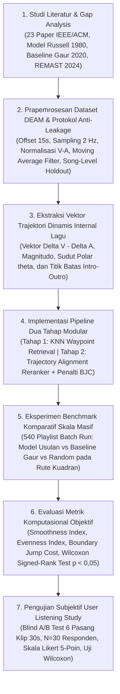

# Bab III Metodologi (Skenario 2: Dual Evaluation dengan User Study)

Dokumen draf naskah Bab III ini memaparkan metodologi penelitian komprehensif yang memadukan alur perancangan pipeline dua tahap, protokol prapemrosesan data anti-kebocoran, formulasi aljabar penalti Boundary Jump Cost, spesifikasi lingkungan eksperimen GPU terstandarisasi, skenario pengujian komputasional skala masif 540 batch run, serta desain rinci protokol pengujian perseptual pengguna (*user listening study*) skala laboratorium.

---

## 3.1 Alur Penelitian

Penelitian ini dilaksanakan melalui tujuh tahapan terstruktur yang dirancang secara linier, terukur, dan dapat direplikasi (*reproducible*):

Uraian naratif pelaksanaan dari ketujuh tahapan di atas meliputi:
1. **Studi Literatur dan Analisis Kesenjangan:** Mengkaji landasan teoretis model sirkumpleks Russell (1980) yang direvalidasi secara modern oleh Belaref et al. (2024), prinsip peredaman lonjakan transisi (*soft transition*) Wang et al. (2024), dekonstruksi kelemahan baseline Gaur dan Donnelly (2020), karakteristik dataset audio benchmark, serta telaah psikoakustik keselarasan metrik otomatis MIR dengan persepsi manusia (Daikoku et al., 2022).
2. **Prapemrosesan Data dan Protokol Integritas:** Mengunduh 1.802 rekaman audio korpus DEAM, memotong 15 detik pemanasan awal, menerapkan protokol pemisahan data *Song-Level Holdout Split* anti-kebocoran data Wen et al. (2025), menormalkan koordinat ke rentang simetris $[-1.0, +1.0]$, serta mengaplikasikan *moving average smoothing filter* untuk meredam derau keterlambatan persepsi manusia.
3. **Ekstraksi Vektor Trajektori Dinamis:** Menghitung pergeseran koordinat internal lagu antara segmen pembuka (intro) dan penutup (outro), mengekstrak magnitudo perpindahan, dan menentukan sudut arah orientasi emosi $\theta$ di ruang sirkumpleks.
4. **Implementasi Pipeline Dua Tahap:** Membangun modul program terdistribusi dalam bahasa pemrograman Python dan kerangka kerja PyTorch GPU untuk mengeksekusi pencarian kandidat KNN dan penyaringan terbobot berbasis *Boundary Jump Cost*.
5. **Eksperimen Benchmark Komparatif:** Mengeksekusi pengujian otomatis 540 sekuens playlist pada variasi rute diagonal kontinu (Q3 $\to$ Q1) dan rute lintas kuadran realistis (Q1 $\to$ Q2, Q1 $\to$ Q4, Q2 $\to$ Q4) terhadap model acuan Gaur (2020) dan seleksi acak (*random*).
6. **Evaluasi Metrik Komputasional Objektif:** Mengukur capaian metrik objektif *Smoothness Index* ($\mathcal{S}$), *Evenness Index* ($\mathcal{E}$), dan *Boundary Jump Cost* ($\mathcal{BJC}$), serta menguji keberartian perbedaan performa secara statistik menggunakan *Wilcoxon Signed-Rank Test*.
7. **Pengujian Subjektif User Listening Study:** Melaksanakan pengujian dengar buta (*blind A/B listening test*) pada skala laboratorium dengan memperdengarkan 6 pasang stimulus sambungan audio 30 detik kepada minimal 30 responden manusia, mengevaluasi respon menggunakan skala Likert 5-poin, menguji reliabilitas instrumen dengan *Cronbach's Alpha*, serta menguji signifikansi preferensi menggunakan uji non-parametrik Wilcoxon.

---

## 3.2 Pengumpulan dan Prapemrosesan Data

Data primer yang digunakan adalah korpus **DEAM (*Database for Emotion Analysis in Music*)** (Aljanaki et al., 2017). Dataset ini mencakup 1.802 klip musik berformat audio MP3 (44,1 kHz) yang bersumber dari arsip Free Music Archive (FMA) dan Jamendo. Setiap lagu memiliki file anotasi deret waktu kontinu berfrekuensi 2 Hz (interval 500 ms) untuk dimensi Valence dan Arousal yang dinilai secara *crowdsourcing* oleh pendengar manusia.

Tahapan penyiapan dan prapemrosesan data dilaksanakan melalui protokol ketat:
1. **Pemotongan Offset Pemanasan (*Lead-in Truncation*):** Sesuai protokol resmi DEAM, 15 detik pertama dari setiap klip audio diabaikan karena merupakan fase penyesuaian anotator manusia terhadap stimulus lagu. Dari total 45 detik durasi klip, hanya detik ke-15 hingga detik ke-45 yang dipertahankan, menghasilkan tepat 30 detik data representatif ($90 \text{ timestamp}$ telemetri per lagu).
2. **Normalisasi Ruang Emosi Simetris:** Nilai anotasi mentah DEAM yang berada pada rentang skala Likert $[1.0, 9.0]$ ditransformasikan secara linier ke dalam koordinat Cartesian ortogonal simetris $[-1.0, +1.0]$ melalui persamaan:
   $$v_{\text{norm}} = 2 \cdot \left(\frac{v - v_{\min}}{v_{\max} - v_{\min}}\right) - 1, \quad a_{\text{norm}} = 2 \cdot \left(\frac{a - a_{\min}}{a_{\max} - a_{\min}}\right) - 1 \tag{3.1}$$
   di mana $v_{\min} = 1.0$ dan $v_{\max} = 9.0$. Transformasi ini menjamin titik tengah netralitas afektif berada tepat di titik pusat koordinat $(0, 0)$.
3. **Penyaringan Derau Persepsi (*Noise Smoothing*):** Mengacu pada temuan meta-analisis Eerola et al. (2026) mengenai adanya jeda waktu persepsi manusia (*perceptual latency*) sebesar 1,5 hingga 3,0 detik, deret waktu anotasi disaring menggunakan *moving average filter* 1D berukuran jendela 3 timestamp (1,5 detik) guna mereduksi fluktuasi derau acak sesaat:
   $$\bar{v}_t = \frac{1}{3} \sum_{i=-1}^{1} v_{t+i}, \quad \bar{a}_t = \frac{1}{3} \sum_{i=-1}^{1} a_{t+i} \tag{3.2}$$
4. **Protokol Integritas Data Bebas Kebocoran (*Song-Level Holdout Split*):** Mengadopsi audit ketat Wen et al. (2025) pada IEEE TAC, pemisahan dataset wajib dilakukan berbasis identitas lagu utuh (*song-level partitioning*), bukan pemisahan frame acak (*random frame splitting*). Pemisahan frame acak pada data deret waktu musik terbukti memicu kebocoran korelasi temporal (*temporal leakage*) yang menggelembungkan metrik performa secara semu sebesar 28% hingga 45%. Seluruh korpus dibagi bersih menjadi data latih/basis indeks (80% / 1.442 lagu) dan data uji validasi (20% / 360 lagu).

---

## 3.3 Perancangan Pipeline Sistem

Arsitektur sistem yang diusulkan terdiri atas dua tahapan komputasi modular yang saling melengkapi:

### 3.3.1 Tahap 1: Pembangkitan Kandidat Berbasis KNN (*Candidate Retrieval*)
Diberikan titik awal suasana hati $\mathbf{p}_{\text{start}} = (v_s, a_s)$, titik akhir target $\mathbf{p}_{\text{target}} = (v_t, a_t)$, dan panjang playlist yang ditentukan $M$, lintasan kurva emosi diinterpolasi secara linier menjadi serangkaian $M$ titik acuan perantara (*waypoints*):
$$\mathbf{w}_j = \mathbf{p}_{\text{start}} + \frac{j-1}{M-1} \cdot (\mathbf{p}_{\text{target}} - \mathbf{p}_{\text{start}}), \quad \forall j \in \{1, 2, \dots, M\} \tag{3.3}$$

Untuk setiap titik acuan $\mathbf{w}_j$, algoritma *K-Nearest Neighbors* (KNN) menelusuri $K$ lagu kandidat terdekat ($K=20$) di ruang Valence-Arousal berdasarkan jarak Euclidean terhadap titik rata-rata global lagu $\bar{\mathbf{p}}_k$:
$$d_{\text{target}}(\mathbf{w}_j, \bar{\mathbf{p}}_k) = \|\mathbf{w}_j - \bar{\mathbf{p}}_k\|_2 = \sqrt{(v_{w, j} - \bar{v}_k)^2 + (a_{w, j} - \bar{a}_k)^2} \tag{3.4}$$

### 3.3.2 Tahap 2: Dynamic Trajectory Alignment Reranker dan Penalti Boundary Jump
Pada tahap perankingan ulang, sistem tidak lagi menganggap lagu sebagai titik statis tunggal, melainkan mengevaluasi dinamika trajektori internal dan kontinuitas perbatasan fisik antartrek:
1. **Ekstraksi Vektor Trajektori Internal Lagu:**
   Didefinisikan segmen pembuka (*intro*) sebagai rata-rata 6 timestamp awal (detik ke-15 hingga ke-18) $\mathbf{p}_{\text{intro}, k} = (v_{\text{intro}, k}, a_{\text{intro}, k})$ dan segmen penutup (*outro*) sebagai rata-rata 6 timestamp akhir (detik ke-42 hingga ke-45) $\mathbf{p}_{\text{outro}, k} = (v_{\text{outro}, k}, a_{\text{outro}, k})$. Vektor trajektori dinamis lagu $\vec{\mathbf{t}}_k$ dihitung melalui:
   $$\vec{\mathbf{t}}_k = (\Delta v_k, \Delta a_k) = (v_{\text{outro}, k} - v_{\text{intro}, k}, \; a_{\text{outro}, k} - a_{\text{intro}, k}) \tag{3.5}$$
   Beserta magnitudo pergeseran $\|\vec{\mathbf{t}}_k\|_2 = \sqrt{\Delta v_k^2 + \Delta a_k^2}$ dan sudut orientasi afektif polar $\theta_k = \text{atan2}(\Delta a_k, \Delta v_k)$ sesuai formulasi Kang et al. (2025).
2. **Formulasi Vektor Target Lintasan Playlist:**
   Vektor arah perubahan emosi yang diharapkan antara dua waypoint berturutan didefinisikan sebagai:
   $$\vec{\mathbf{u}}_j = \mathbf{w}_{j} - \mathbf{w}_{j-1} \tag{3.6}$$
   Derajat keselarasan arah dihitung melalui kesamaan kosinus (*Cosine Similarity*):
   $$\text{Sim}_{\text{traj}}(\vec{\mathbf{t}}_k, \vec{\mathbf{u}}_j) = \frac{\vec{\mathbf{t}}_k \cdot \vec{\mathbf{u}}_j}{\|\vec{\mathbf{t}}_k\|_2 \|\vec{\mathbf{u}}_j\|_2} \in [-1.0, +1.0] \tag{3.7}$$
3. **Formulasi Penalti Lonjakan Batas (*Boundary Jump Cost*):**
   Terinspirasi dari temuan transisi halus REMAST (Wang et al., 2024) dan ambang retensi Schweiger et al. (2025), lonjakan emosi yang terjadi di perbatasan antara detik penutup lagu sebelumnya $L_{j-1}$ dengan detik pembuka lagu kandidat $L_k$ dikuantifikasi secara matematis sebagai penalti *Boundary Jump Cost* ($\mathcal{BJC}$):
   $$\mathcal{BJC}(L_{j-1}, L_k) = \|\mathbf{p}_{\text{outro}}(L_{j-1}) - \mathbf{p}_{\text{intro}}(L_k)\|_2 \tag{3.8}$$
4. **Fungsi Skor Komposit Seleksi Kandidat:**
   Skor akhir pemilihan kandidat lagu $L_k$ untuk mengisi urutan ke-$j$ pada playlist dihitung melalui kombinasi linier terbobot:
   $$\text{Score}(L_k \mid L_{j-1}, \mathbf{w}_j) = w_1 \cdot \left(\frac{d_{\text{target}}(\mathbf{w}_j, \bar{\mathbf{p}}_k)}{\max(d)}\right) + w_2 \cdot \left(\frac{1 - \text{Sim}_{\text{traj}}(\vec{\mathbf{t}}_k, \vec{\mathbf{u}}_j)}{2}\right) + w_3 \cdot \mathcal{BJC}(L_{j-1}, L_k) \tag{3.9}$$
   di mana $w_1, w_2, w_3 \ge 0$ adalah bobot kepentingan yang memenuhi konstrain $w_1 + w_2 + w_3 = 1.0$. Kandidat lagu dengan nilai skor terendah dipilih sebagai pengisi playlist, menjamin bahwa lagu yang terpilih tidak hanya dekat dengan titik acuan target, tetapi juga bergerak searah dengan alur playlist dan menyambung secara mulus tanpa sentakan boundary jump.

---

## 3.4 Lingkungan Eksperimen dan Reprodusibilitas

Guna menjamin transparansi ilmiah dan keterulangan pengujian (*reproducibility*), konfigurasi lingkungan eksperimen ditetapkan sebagai berikut:
* **Perangkat Keras (Hardware):** Prosesor Intel Core i7 Generasi ke-12 / AMD Ryzen 7, Memori Utama 32 GB DDR4 RAM, serta GPU NVIDIA GeForce RTX 3070 Ti (8 GB VRAM) untuk akselerasi operasi matriks tensor.
* **Sistem Operasi:** Microsoft Windows 11 Pro 64-bit.
* **Bahasa & Manajemen Dependensi:** Python versi 3.10.x yang dikelola menggunakan manajer paket deterministik modern `uv`.
* **Pustaka Pemrosesan & Komputasi:**
  * `torch` (versi 2.2+ CUDA 12.1) untuk akselerasi komputasi jarak matriks dan tensor penelusuran KNN.
  * `librosa` (versi 0.10.1) dan `scipy` untuk pemrosesan sinyal audio dan operasi filter deret waktu.
  * `scikit-learn` (versi 1.3+) untuk penataan struktur pohon pencarian tetangga terdekat (*BallTree / KDTree*).
  * `numpy` (versi 1.24+) dan `pandas` untuk manipulasi data telemetri.
* **Inisialisasi Deterministik (*Random Seed*):** Seluruh proses komputasi yang melibatkan pengacakan (seperti pembagian subset dataset dan inisialisasi query) dikunci secara konstan menggunakan nilai benih `seed=42`.
* **Arsitektur Repositori Kode Sumber:** Seluruh modul program dikembangkan secara modular pada repositori lokal `EXPERIMENT/Code/` dengan pembagian direktori kerja:
  * `src/preprocessing/`: Pembersihan data dan ekstraksi offset telemetri DEAM.
  * `src/features/`: Ekstraksi vektor trajektori dan perhitungan sudut polar.
  * `src/models/`: Pipeline KNN candidate retrieval dan trajectory alignment reranker.
  * `src/evaluation/`: Perhitungan metrik Smoothness, Evenness, dan Boundary Jump Cost.
  * `tests/`: Pengujian unit (*unit tests*) untuk memverifikasi kebenaran implementasi fungsi aljabar sebelum sesi *Code Walkthrough* sidang.

---

## 3.5 Metode Pengujian dan Evaluasi Komputasional Objektif

Kinerja playlist dievaluasi secara komprehensif menggunakan metrik matematis objektif, pengujian batch skala besar, dan analisis inferensial statistik:

### 3.5.1 Metrik Evaluasi Kuantitatif Terstandarisasi
1. **Smoothness Index ($\mathcal{S}$):** Mengukur deviasi diskontinuitas emosi pada titik perbatasan antardua trek berturutan di sepanjang playlist (Gaur & Donnelly, 2024):
   $$\mathcal{S} = \frac{1}{M-1} \sum_{j=1}^{M-1} \|\mathbf{p}_{\text{outro}}(L_j) - \mathbf{p}_{\text{intro}}(L_{j+1})\|_2 \tag{3.10}$$
   Nilai $\mathcal{S}$ yang semakin kecil merefleksikan transisi antartrek yang semakin halus dan bebas dari diskontinuitas sambungan.
2. **Evenness Index ($\mathcal{E}$):** Mengukur variansi laju perubahan jarak Euclidean antar-waypoint target di sepanjang playlist:
   $$\mathcal{E} = \frac{1}{M-1} \sum_{j=1}^{M-1} \left(d_j - \bar{d}\right)^2, \quad \text{di mana } d_j = \|\mathbf{w}_{j+1} - \mathbf{w}_j\|_2 \tag{3.11}$$
   Nilai $\mathcal{E}$ yang mendekati nol menandakan kecepatan progresi emosional yang terdistribusi secara seragam dan konsisten.
3. **Cumulative Boundary Jump Cost ($\mathcal{CBJC}$):** Mengakumulasikan total magnitudo penalti lonjakan perbatasan di sepanjang playlist berpanjang $M$:
   $$\mathcal{CBJC} = \sum_{j=1}^{M-1} \mathcal{BJC}(L_j, L_{j+1}) \tag{3.12}$$

### 3.5.2 Skenario Pengujian Komparatif Skala Masif (540 Batch Run)
Pengujian benchmark dijalankan secara otomatis dengan membangkitkan total **540 sekuens playlist** yang terbagi ke dalam konfigurasi rute:
* **Rute Diagonal Kontinu (Q3 $\to$ Q1):** Lintasan dari suasana hati sedih/rendah energi (Kuadran III) menuju senang/berenergi tinggi (Kuadran I). Skenario ini mereplikasi kondisi pengujian acuan Gaur (2020).
* **Rute Lintas Kuadran Realistis:**
  * Rute Relaksasi (Q1 $\to$ Q4): Dari kondisi bersemangat tinggi menuju kondisi tenang dan damai.
  * Rute Peningkatan Energi (Q4 $\to$ Q1): Dari kondisi santai menuju kondisi bersemangat untuk aktivitas fisik.
  * Rute Katarsis (Q2 $\to$ Q4): Dari kondisi tegang atau marah (Kuadran II) menuju kondisi tenang dan stabil (Kuadran IV).
Setiap konfigurasi rute diuji pada variasi panjang playlist $M \in \{5, 10, 15\}$ trek dengan mengkomparasikan tiga model secara *head-to-head*:
1. **Model Usulan:** *Two-Stage KNN + Dynamic Trajectory Alignment Reranker*.
2. **Model Acuan (Baseline Gaur & Donnelly, 2020):** *Two-Stage KNN + Static-Point Matching*.
3. **Model Kontrol (Random Retrieval):** Pemilihan acak lagu di dalam kuadran target.

### 3.5.3 Analisis Signifikansi Statistik Komputasional
Untuk membuktikan bahwa reduksi nilai *Smoothness Index* bukan merupakan hasil kebetulan variasi acak sampling, dilakukan uji beda inferensial non-parametrik berpasangan **Wilcoxon Signed-Rank Test** dengan taraf signifikansi $\alpha = 0,05$. Hipotesis statistik dirumuskan sebagai:
* $H_0$: Tidak terdapat perbedaan signifikan pada nilai *Smoothness Index* antara playlist yang dihasilkan oleh Model Usulan dan Baseline Gaur ($\mu_{\mathcal{S}, \text{Usulan}} = \mu_{\mathcal{S}, \text{Gaur}}$).
* $H_1$: Model Usulan menghasilkan nilai *Smoothness Index* yang secara signifikan lebih rendah dibanding Baseline Gaur ($\mu_{\mathcal{S}, \text{Usulan}} < \mu_{\mathcal{S}, \text{Gaur}}$).
Keputusan penolakan $H_0$ didasarkan pada perolehan nilai $p$-value $< 0,05$.

### 3.5.4 Hasil Awal Replikasi Model Acuan (Preliminary Baseline Benchmark PoC)

Sebagai pembuktian kelayakan teknis (*technical feasibility / proof of concept*) serta titik tolak komparasi (*ground truth baseline*) sebelum memasuki tahap implementasi Tugas Akhir 2, algoritma model acuan Gaur dan Donnelly (2020) telah berhasil direplikasi dan diuji coba pada keseluruhan korpus DEAM (1.802 klip lagu). Pengujian pendahuluan ini mengevaluasi kinerja penelusuran kandidat menggunakan tiga varian metrik jarak (*distance metrics*) pada tahap retrieval awal. Hasil komputasi benchmark awal disajikan pada Tabel 3.1.

**Tabel 3.1 Hasil Pengujian Awal Replikasi Baseline Gaur dan Donnelly (2020) pada Korpus DEAM**

| Konfigurasi Metrik Jarak | Smoothness Index (PCC) | Evenness V-A ($\sigma^2$) | Evenness Audio ($\sigma^2$) | Rata-rata Langkah V-A | Rata-rata Langkah Audio |
| :--- | :---: | :---: | :---: | :---: | :---: |
| Cosine Distance | 0,9781 | 0,000349 | 0,005409 | 0,0436 | 0,3506 |
| Euclidean Distance | 0,9876 | 0,000238 | 0,005082 | 0,0441 | 0,3106 |
| Manhattan Distance | 0,9762 | 0,000290 | 0,004930 | 0,0435 | 0,2895 |

<small><i>Sumber: Hasil komputasi pengujian awal replikasi model acuan pada repositori lokal (2026).</i></small>

Berdasarkan data empiris pada Tabel 3.1, ketiga konfigurasi jarak menunjukkan nilai korelasi arah yang tampak sangat tinggi (*Smoothness Index* PCC $> 0,97$). Namun, tingginya nilai kehalusan ini merupakan artefak dari sifat *static-point matching* yang mereduksi keseluruhan lagu menjadi satu titik rata-rata tunggal dan mengabaikan lonjakan emosi pada perbatasan intro-outro. Selain itu, nilai *Mean Audio Step* yang berkisar antara 0,2895 hingga 0,3506 mengindikasikan adanya ketimpangan karakteristik tekstur suara antartrek berturutan. Nilai kuantitatif pada Tabel 3.1 ini ditetapkan sebagai *baseline ground truth* formal yang siap dikomparasikan secara *head-to-head* terhadap model usulan (*Dynamic Mood Trajectory Alignment*) pada tahap eksekusi Tugas Akhir 2.

---

## 3.6 Desain Protokol Pengujian Subjektif (User Listening Study)

Guna memvalidasi apakah keunggulan metrik komputasional di GPU selaras dengan persepsi pendengar manusia, penelitian ini merancang protokol pengujian persepsi subjektif (*User Listening Study*). Rancangan ini dipersiapkan secara matang pada tahap proposal (TA 1) dan dieksekusi secara terstruktur pada tahap implementasi (TA 2).

### 3.6.1 Desain Eksperimen Blind A/B Listening Test
Pengujian dilakukan menggunakan metode eksperimen *blind A/B test*. Partisipan diperdengarkan dua versi sambungan audio untuk pasangan lagu yang sama tanpa diberitahu algoritma yang memproduksinya:
* **Versi A:** Sambungan transisi antarlagu yang dihasilkan oleh Model Usulan (*Dynamic Trajectory Alignment*).
* **Versi B:** Sambungan transisi antarlagu yang dihasilkan oleh Baseline Gaur dan Donnelly (*Static-Point Matching*).

Untuk mencegah timbulnya bias konfirmasi (*confirmation bias*) dan efek urutan (*order effect*), urutan pemutaran Versi A dan Versi B diacak secara acak dan seimbang (*counterbalanced randomized presentation*).

### 3.6.2 Desain Stimulus Audio Terisolasi (Boundary Transition Clips)
Mendengarkan playlist utuh berdurasi puluhan menit terbukti memicu kelelahan pendengar (*listener fatigue*) dan memasukkan variabel pengganggu berupa preferensi selera genre musik atau lirik lagu tertentu. Oleh karena itu, stimulus pengujian difokuskan secara spesifik tepat pada titik pergantian lagu (*boundary transition*) berdurasi total **30 detik**:
$$\text{Stimulus Clip} = [\text{Audio } L_j \text{ (15 detik penutup / outro)}] + [\text{Audio } L_{j+1} \text{ (15 detik pembuka / intro)}]$$

Dipilih **6 pasang stimulus transisi audio terisolasi** yang merepresentasikan 3 skenario variasi rute perpindahan emosi:
1. **Pasang 1 & 2 (Rute Diagonal Kontinu Q3 $\to$ Q1):** Transisi dari suasana hati sedih/melankolis menuju suasana gembira/berenergi tinggi.
2. **Pasang 3 & 4 (Rute Relaksasi Q1 $\to$ Q4):** Transisi dari suasana berenergi tinggi menuju suasana tenang dan relaks.
3. **Pasang 5 & 6 (Rute Peningkatan Energi Q4 $\to$ Q1):** Transisi dari suasana tenang menuju suasana bersemangat dan aktif.

### 3.6.3 Partisipan dan Kriteria Sampling
Pengujian melibatkan sampel berukuran minimal **$N = 30$ responden**, memenuhi batas kecukupan ukuran sampel menurut Teorema Limit Pusat (*Central Limit Theorem*) untuk analisis inferensial parametrik dan non-parametrik.

Pengambilan sampel dilakukan menggunakan teknik *purposive sampling* dengan kriteria inklusi yang ketat:
1. Mahasiswa atau dewasa muda berusia 19 hingga 25 tahun.
2. Memiliki fungsi pendengaran normal tanpa riwayat gangguan psikoakustik (*normal hearing acuity*).
3. Merupakan pendengar aktif layanan penyiaran musik digital (Spotify, Apple Music, YouTube Music) dengan intensitas mendengarkan minimal 1 jam per hari (atau minimal 7 jam per minggu).

Pengujian dilaksanakan di lingkungan laboratorium yang tenang (*controlled quiet environment*) menggunakan perangkat penyuara telinga terstandarisasi (*standard closed-back headphones*) pada tingkat kekerasan suara yang nyaman (65–70 dB SPL).

### 3.6.4 Instrumen Kuesioner Skala Likert 5-Poin
Setelah mendengarkan setiap pasangan klip audio (Versi A dan Versi B), partisipan mengisi lembar kuesioner psikometri berbasis skala Likert 5-poin yang mengukur tiga parameter persepsi transisi:
1. **Transition Smoothness (Kehalusan Transisi):**
   * *Pertanyaan:* Seberapa halus transisi pergantian dari lagu pertama ke lagu kedua terdengar di telinga Anda?
   * *Skala:* 1 = Sangat Kasar/Tersentak, 2 = Cukup Kasar, 3 = Netral, 4 = Halus, 5 = Sangat Halus dan Mengalir Mulus.
2. **Acoustic & Energy Continuity (Kontinuitas Energi dan Akustik):**
   * *Pertanyaan:* Seberapa baik kesinambungan energi ritme dan tempo saat musik berpindah antartrek?
   * *Skala:* 1 = Melompat Sangat Drastis, 2 = Melompat Terasa, 3 = Netral, 4 = Berkesinambungan Baik, 5 = Menyatu Sempurna Tanpa Sentakan.
3. **Emotional Naturalness (Kealamian Emosi):**
   * *Pertanyaan:* Seberapa alami dan masuk akal pergeseran suasana hati (*mood*) dari lagu pertama ke lagu kedua?
   * *Skala:* 1 = Sangat Janggal/Memaksa, 2 = Cukup Janggal, 3 = Netral, 4 = Alami, 5 = Sangat Alami dan Harmonis.

### 3.6.5 Uji Reliabilitas dan Analisis Inferensial Statistik
Data ordinal yang diperoleh dari kuesioner pengguna dianalisis melalui tahapan statistik berikut:
1. **Uji Reliabilitas Instrumen:** Konsistensi internal butir pertanyaan kuesioner diuji menggunakan koefisien *Cronbach's Alpha*. Instrumen dinyatakan reliabel dan dapat diterima jika memenuhi ambang batas:
   $$\alpha = \frac{K}{K-1} \left(1 - \frac{\sum \sigma_i^2}{\sigma_t^2}\right) \ge 0,70 \tag{3.13}$$
2. **Uji Beda Perseptual Non-Parametrik (Wilcoxon Signed-Rank Test):** Karena data kuesioner berupa skala ordinal, perbandingan antara penilaian responden terhadap Model Usulan versus Baseline Gaur dianalisis menggunakan *Wilcoxon Signed-Rank Test* dengan taraf signifikansi $\alpha = 0,05$. Hipotesis statistik dirumuskan sebagai:
   * $H_0$: Tidak terdapat perbedaan signifikan pada skor persepsi kenyamanan pendengar antara transisi Model Usulan dan Baseline Gaur ($\text{MOS}_{\text{Usulan}} = \text{MOS}_{\text{Gaur}}$).
   * $H_1$: Model Usulan memperoleh skor persepsi kenyamanan yang secara signifikan lebih tinggi dibanding Baseline Gaur ($\text{MOS}_{\text{Usulan}} > \text{MOS}_{\text{Gaur}}$).
3. **Analisis Korelasi Metrik-Manusia (Spearman Rank Correlation):** Untuk menjawab Rumusan Masalah ke-4 mengenai derajat keselarasan antara metrik komputasional objektif dengan persepsi pendengar, dihitung koefisien korelasi peringkat Spearman ($r_s$) antara nilai *Smoothness Index* ($\mathcal{S}$) dan *Boundary Jump Cost* ($\mathcal{BJC}$) dengan rata-rata skor perseptual (*Mean Opinion Score* / MOS) manusia:
   $$r_s = 1 - \frac{6 \sum d_i^2}{n(n^2 - 1)} \tag{3.14}$$

### 3.6.6 Kepatuhan Etika Penelitian dan Kerahasiaan Data
Pelaksanaan *User Listening Study* ini tunduk pada prinsip integritas etika penelitian yang ketat:
1. **Informed Consent (Persetujuan Sadar):** Seluruh responden diberikan lembar penjelasan penelitian tertulis yang memaparkan tujuan, durasi pengujian (~15–20 menit), serta ketiadaan risiko fisiologis sebelum menandatangani formulir persetujuan keikutsertaan secara sukarela. Responden berhak mengundurkan diri sewaktu-waktu tanpa konsekuensi apa pun.
2. **Kerahasiaan dan Anonimitas Data:** Seluruh data demografi dan respon penilaian pengguna dianonimkan menggunakan kode identifikasi numerik unik (misal: R01, R02, ..., R30). Tidak ada informasi pribadi yang dapat mengidentifikasi responden secara langsung yang dipublikasikan atau dibagikan, sesuai amanat Undang-Undang Republik Indonesia Nomor 27 Tahun 2022 tentang Perlindungan Data Pribadi.
