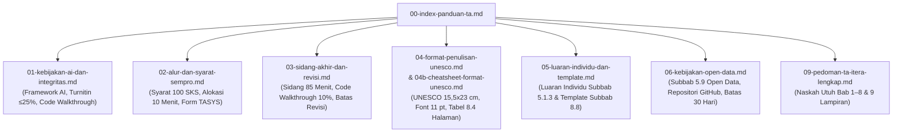

# 📚 Direktori & Indeks Panduan Tugas Akhir IF ITERA (Changelog 1.2.0)

Selamat datang di repositori modul pengetahuan akademik Tugas Akhir Program Studi Teknik Informatika ITERA. Koleksi ini telah disinkronkan 100% dengan rilis resmi **Changelog [1.2.0] - 2026-11-02** dari situs [Pedoman TA IF ITERA](https://informatika-itera.github.io/panduan-ta/pedoman.html).

---

## 🧭 Peta Navigasi Modul Pengetahuan

---

## 📑 Daftar Berkas & Cakupan Modul

| Berkas Modul | Bab Acuan | Topik Kunci |
| :--- | :--- | :--- |
| **[[01-kebijakan-ai-dan-integritas]]** | Bab 2 & Bab 4 | Framework 5 Level AI, batas Turnitin $\le 25\%$, log sesi AI, anti-fabrikasi. |
| **[[02-alur-dan-syarat-sempro]]** | Bab 3 & Bab 5 | Syarat 100 SKS, hadir 2 sempro, 4 bimbingan TASYS, alokasi 10 min presentasi. |
| **[[03-sidang-akhir-dan-revisi]]** | Bab 5 & Bab 6 | Sidang 85 min, code walkthrough 10%, batas revisi minor/sedang/mayor. |
| **[[04-format-penulisan-unesco]]** | Bab 8 | Dimensi UNESCO (15,5 × 23 cm), font TNR 11 pt, **Tabel 8.4 Penomoran Halaman**, draf 1 sisi. |
| **[[05-luaran-individu-dan-template]]** | Subbab 5.1.3 & 8.8 | Kewajiban Laporan Individu semua bentuk TA, judul beda, template Word/PPTX/LaTeX. |
| **[[06-kebijakan-open-data]]** | Subbab 5.9 | Kewajiban unggah dataset & kode publik maksimal 30 hari pasca-sidang. |
| **[[04b-cheatsheet-format-unesco|format-penulisan-unesco]]** | Bab 8 | *Cheat sheet* ringkas penulisan UNESCO dan tata letak visual. |
| **[[07-format-isi-naskah-ta|format-isi-ta]]** | Bab 7 | Ringkasan struktur konten Bab I s/d Bab V naskah laporan TA. |
| **[[08-checklist-dokumen-wajib|dokumen-wajib]]** | Lampiran & Form | *Checklist* berkas administratif pendaftaran Sempro & Sidang Akhir. |
| **[[09-pedoman-ta-itera-lengkap|pedoman-ta-itera-lengkap]]** | Bab 1–8 Lengkap | Naskah teks lengkap pedoman resmi Teknik Informatika ITERA (155 KB). |

---

## 🔗 Tautan Terkait Lainnya
- [[09-Task-Audit-Pedoman-TA-Changelog-1-2-0]]: Todolist pelacakan update sistem.
- [[00-Index-Todolist]]: Peta rencana fase penyusunan Tugas Akhir Andryano Kadarisman.
- [[05-Phase-05-Finalisasi-Sempro-Administrasi]]: Panduan finalisasi dokumen Sempro.
