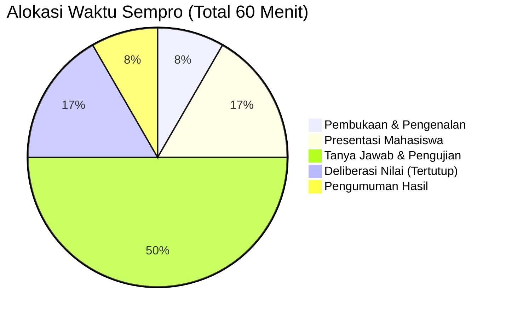

# 🎯 Alur & Persyaratan Seminar Proposal (Sempro - TA 1)

> **Tujuan Sempro (Bab 3.1):** Menguji kesiapan kelayakan akademik rencana penelitian mahasiswa, ketepatan metodologi, kejelasan rumusan masalah, kebaruan (*gap* riset), serta pemahaman mahasiswa terhadap pustaka rujukan.

---

## 📌 1. Persyaratan Pendaftaran Sempro (Tabel 5.4)

| Kategori Syarat | Ketentuan Wajib | Mekanisme Pembuktian |
| :--- | :--- | :--- |
| **Akademik** | • Telah menyelesaikan **minimal 100 SKS** • IPK minimal **$\ge 2,00$** • **Tidak ada nilai E** • Nilai D **$< 10\%$** dari total SKS • Terdaftar di KRS semester berjalan | Transkrip Akademik Resmi & Bukti KRS SIAKAD |
| **Naskah Proposal** | Proposal Lengkap berisi **Bab I (Pendahuluan), Bab II (Tinjauan Pustaka), dan Bab III (Metodologi)** standar UNESCO | Disetujui Dosen Pembimbing (tanda tangan naskah) |
| **Persetujuan Pembimbing** | Persetujuan resmi bahwa proposal layak diseminarkan | PDF bertanda tangan **atau** persetujuan digital via akun **TASYS** |
| **Kartu Kendali Bimbingan** | Telah melaksanakan **minimal 4 kali bimbingan intensif** | PDF bertanda tangan pembimbing **atau** log bimbingan digital di **TASYS** |
| **Presensi Hadir Sempro** | Telah menghadiri **minimal 2 kali seminar proposal mahasiswa lain** | Presensi otomatis via QR/OTP di **TASYS** atau lembar presensi kertas |
| **TA Kelompok (Bila ada)** | Telah menetapkan **Judul Laporan Individu** dan pembagian tugas | Lampiran 6 (Surat Pembagian Kerja Tim) bertanda tangan anggota & pembimbing |

---

## ⏱️ 2. Tata Kelola & Format Alokasi Waktu Sempro (60 Menit)

* **Sifat Ujian:** **TERBUKA** (dapat dihadiri oleh mahasiswa lain sebagai audiens).
* **Susunan Majelis:** 1 Dosen Pembimbing + 2 Dosen Penguji (ditugaskan oleh Koordinator TA).
* **Kewajiban Reminder Mahasiswa:** Wajib mengingatkan jadwal dan mengirim draf naskah kepada seluruh dosen penguji & pembimbing paling lambat **H-3** dan konfirmasi ulang pada **H-1**.

### 🎯 Panduan Presentasi 10 Menit:
1. **Menit 0–2:** Latar belakang & urgensi industri/komputasi (mengapa topik ini penting?).
2. **Menit 2–4:** Masalah nyata, rumusan masalah, dan gap riset terhadap baseline (*Gaur & Donnelly 2020*).
3. **Menit 4–8:** Metodologi penelitian (arsitektur pipeline, formulasi matematika, sampling dataset DEAM, metrik smoothness/evenness).
4. **Menit 8–10:** Rencana jadwal eksekusi, target publikasi/luaran, dan penutup.

---

## 📊 3. Rubrik & Standar Kelulusan Sempro (Tabel 5.1)

* **Komposisi Bobot Nilai:**
  1. Kualitas Naskah Proposal: **40%**
  2. Pertahanan dalam Presentasi & Tanya Jawab: **30%**
  3. Proses Bimbingan & Kedisiplinan: **30%**
* **Standar Kelulusan:** Nilai minimal Grade **"B"** ($\ge 65$).
* **Masa Berlaku Hasil Sempro:** **3 semester aktif** terhitung sejak tanggal pelaksanaan seminar. Jika lewat 3 semester belum sidang akhir, mahasiswa wajib memperbarui/mengulang proposal.
