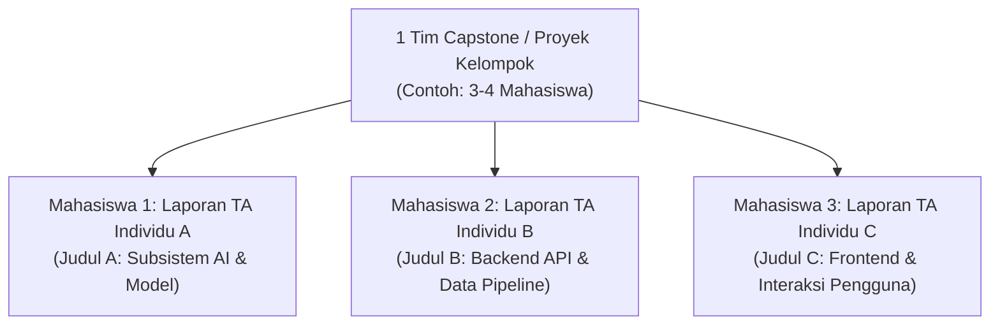

# 📑 Laporan TA sebagai Luaran Individu & Ketersediaan Template Resmi

> **Prinsip Revolusioner (Changelog 1.1.0 & 1.2.0 / Subbab 5.1.3):** Tugas Akhir adalah **Laporan TA Individu** yang diserahkan setiap mahasiswa ke institusi. Ketentuan ini berlaku untuk **seluruh 6 bentuk TA**, termasuk yang dikerjakan berkelompok (*Capstone Design*). Tidak ada lagi laporan bersama satu kelompok!

---

## 👥 1. Ketentuan Laporan TA sebagai Luaran Individu (Subbab 5.1.3)

Proyek, produk perangkat lunak, purwarupa, atau buku boleh dikerjakan secara tim, namun kelulusan akademik setiap mahasiswa didasarkan pada naskah **Laporan TA atas namanya sendiri**.

### 🔹 Aturan Wajib Luaran Individu:
1. **Satu Laporan per Anggota:** Tim beranggotakan 4 orang wajib menghasilkan 4 naskah Laporan TA terpisah.
2. **Judul Berbeda:** Setiap laporan membahas bagian proyek/produk yang menjadi tanggung jawab mandirinya dan memiliki judul yang spesifik.
3. **Penetapan Judul Sejak Sempro:** Judul laporan individu **wajib sudah ditetapkan saat Seminar Proposal** dan dicantumkan secara resmi dalam **Surat Pembagian Kerja Tim (Lampiran 6)**.
4. **Irisan Isi yang Diperbolehkan:**
   - **Boleh Sama:** Bagian konteks proyek bersama (latar belakang mitra, deskripsi masalah umum, gambaran umum arsitektur sistem, tinjauan pustaka umum).
   - **Wajib Berbeda:** Metodologi spesifik modul, implementasi algoritma/fitur individu, hasil eksperimen/pengujian fitur individu, analisis pembahasan, dan kesimpulan.
5. **Uji Kemiripan (Turnitin) Per Laporan:** Uji Turnitin dilakukan per laporan individu. Kemiripan dengan laporan rekan satu tim pada bagian konteks proyek bersama dapat dieksklusikan atas persetujuan pembimbing.

---

## 📂 2. Ketersediaan Template Resmi 6 Bentuk TA (Subbab 8.8)

Prodi Teknik Informatika menyediakan berkas template siap pakai yang dapat diunduh di halaman **Formulir** situs pedoman:

| Jenis Bentuk TA | Template Dokumen Naskah | Template Slide Presentasi | Format Luaran |
| :--- | :--- | :--- | :--- |
| **Bentuk 1: Penelitian Konvensional** | Word (`.docx`) & LaTeX (`.tex`) | PowerPoint (`.pptx`) | Laporan TA Individu (Format UNESCO) |
| **Bentuk 2: Capstone Design / Proyek** | Word (`.docx`) Template Bentuk 2 | PowerPoint (`.pptx`) | Laporan TA Individu per Anggota |
| **Bentuk 3: Artikel Ilmiah** | Format Jurnal Target + Naskah Bentuk 1 | PowerPoint (`.pptx`) | Naskah Laporan TA + Draft Manuskrip |
| **Bentuk 4: Purwarupa / HKI / Paten** | Word (`.docx`) Template Bentuk 4 | PowerPoint (`.pptx`) | Laporan TA Individu + Dokumen HKI |
| **Bentuk 5: Teknologi Tepat Guna (TTG)** | Word (`.docx`) Template Bentuk 5 | PowerPoint (`.pptx`) | Laporan TA Individu + Berita Acara Mitra |
| **Bentuk 6: Buku Ber-ISBN** | Word (`.docx`) Template Bentuk 6 | PowerPoint (`.pptx`) | Laporan TA Individu + Draf Buku |

### 🛠️ Fitur Bawaan Template Word & PPTX:
* **Style Heading & Geometri:** Ukuran kertas UNESCO (15,5 × 23 cm) dan margin cermin sudah terkonfigurasi.
* **Aturan Penomoran Halaman (Tabel 8.4):** Header/footer angka Arab pojok luar dan Romawi front matter sudah terpasang.
* **Peta Kewajiban & Petunjuk Pengisian:** Komentar panduan bab demi bab yang memudahkan penulisan.
* **Slide Presentasi 10 Menit:** Struktur slide Sempro (10–14 slide) sudah disesuaikan dengan alokasi waktu resmi prodi.
