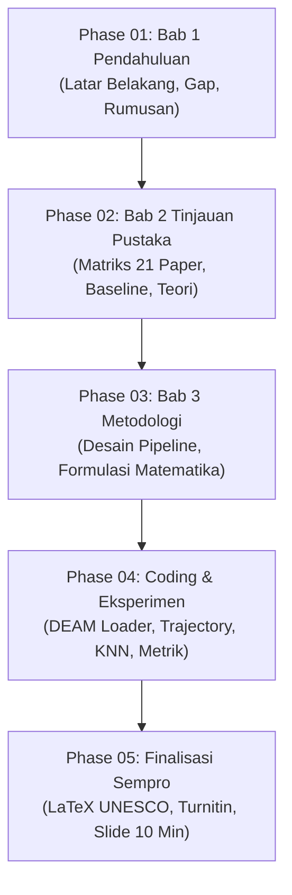

# 📋 Sistem Eksekusi Modular & Panduan Fase (09-Todolist)

Folder ini adalah **Mission Engine** yang membagi seluruh rangkaian pekerjaan Tugas Akhir (penulisan naskah, eksperimen coding, hingga administrasi Sempro) ke dalam **fase-fase mikro yang sangat terperinci**. 

Setiap langkah dirancang dengan kriteria input yang jelas, tindakan teknis spesifik, dan luaran (*Definition of Done*) yang terukur agar dapat dieksekusi secara instan baik oleh **AI Coding Agent** maupun oleh **Andryano (Mahasiswa)**.

---

## 🗺️ Peta Navigasi Fase Kerja



---

## 📑 Daftar Berkas Panduan Fase

| Berkas Panduan | Cakupan Utama | Target Deliverable | Estimasi Waktu |
| :--- | :--- | :--- | :--- |
| **[[01-Phase-01-Bab-1-Pendahuluan]]** | Penulisan Bab 1 lengkap | Draf Bab 1 (≥ 3 hlm) + 5 sitasi IEEE | 3–4 Jam |
| **[[02-Phase-02-Bab-2-Tinjauan-Pustaka]]** | Sintesis 21 paper & teori | Draf Bab 2 (≥ 8 hlm) + komparasi baseline | 5–6 Jam |
| **[[03-Phase-03-Bab-3-Metodologi-Desain]]** | Arsitektur & matematika | Draf Bab 3 (≥ 6 hlm) + flowchart + rumus | 4–5 Jam |
| **[[04-Phase-04-Coding-Eksperimen-DEAM]]** | Implementasi kode & metrik | Script modular + notebook validasi EDA & baseline | 6–8 Jam |
| **[[05-Phase-05-Finalisasi-Sempro-Administrasi]]** | UNESCO, Turnitin, Slide | PDF Sempro siap daftar + Slide 15 hlm | 4–5 Jam |
| **[[06-Task-Baseline-KNN-Gaur]]** | Replikasi baseline KNN Gaur | Script modular baseline Gaur + matriks evaluasi | 4–5 Jam |
| **[[07-Task-Setup-Slide-Typst-Touying]]** | Setup Typst + Touying Slide | Toolchain Typst & starter slides.typ (14 slide) | 1–2 Jam |
| **[[08-Task-Setup-GDrive-dan-Backup]]** | Arsitektur GDrive, Naming SOP & Backup | Struktur GDrive 8-Folder + skrip backup 1-command | 1 Jam |
| **[[09-Task-Audit-Pedoman-TA-Changelog-1-2-0]]** | Update Skills & Translasi Web Pedoman TA ke Obsidian | Koleksi Markdown 07-panduan-ta + Sinkronisasi SKILL/AGENTS/GEMINI | 1–2 Jam |
| **[[10-Task-Migrasi-Template-UNESCO-Bentuk1]]** | Migrasi & Refaktor Templat UNESCO 2026 | Berkas config/, chapters/, thesis.tex 100% selaras Bentuk 1 | 2–3 Jam |
| **[[11-Task-Bedah-Paper-Referensi-Riset]]** | Bedah Forensik 21 Paper Referensi (Framework 11 Langkah) | Review terstruktur Tier 1–3 + Matriks Sintesis + Gap 3 Lapis | 6–8 Jam |

---

## 📌 Checklist Status Global (Dataview)

```dataview
TASK
FROM "09-todolist"
WHERE !completed
GROUP BY file.link
```
