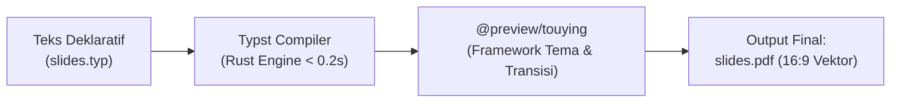

# 🚀 Panduan & Todolist Instalasi Typst + Touying untuk Slide Sempro

> **Tujuan Dokumen:** Menjadi panduan operasional lengkap untuk menginstalasi ekosistem **Typst**, framework presentasi **Touying**, serta mengaktifkan ekstensi dan *skills* pendukung di VS Code, Obsidian, dan AI Agent guna mengotomasi pembuatan slide presentasi Seminar Proposal (Sempro IF ITERA).

---

## 🧠 1. Apa Itu Typst & Touying dan Mengapa Digunakan?



### 🔹 Apa itu Typst?
**Typst** adalah bahasa *typesetting* dokumen dan compiler modern berbasis bahasa Rust yang dirancang sebagai penerus LaTeX. 
- **Fungsi Utama:** Mengompilasi naskah dan slide akademik dengan tipografi tingkat tinggi, rumus matematika berpresisi tinggi, dan layout dinamis.
- **Keunggulan Dibanding LaTeX Beamer:**
  1. **Kecepatan Kompilasi Ekstrem:** Mengompilasi dalam waktu kurang dari **0,2 detik** (LaTeX sering membutuhkan 5–15 detik).
  2. **Feedback Instan (*Live Watch*):** Perubahan teks langsung ter-render di layar seketika saat disimpan.
  3. **Sintaks Sangat Bersih:** Tidak ada lagi tumpukan tag verbos seperti `\begin{frame}`, `\begin{columns}`, atau `\end{itemize}`.
  4. **Pesan Kesalahan Manusiawi:** Jika ada typo atau error, Typst memberikan penunjuk baris yang jelas dan mudah diperbaiki.

### 🔹 Apa itu Touying?
**Touying** (dibaca: *tóu yǐng*, bermakna "proyeksi" / slide dalam bahasa Mandarin) adalah paket framework presentasi paling populer dan canggih di ekosistem **Typst Universe**.
- **Fungsi Utama:** Menyediakan infrastruktur slide presentation setara LaTeX Beamer di Typst.
- **Fitur-Fitur Kunci Touying:**
  - **Dukungan Tema Modern:** Dilengkapi tema bawaan seperti *Metropolis* (standar emas estetika minimalis ilmu komputer), *Dewdrop*, *University*, dan *Aqua*.
  - **Animasi & Transisi Bertahap (*Incremental Steps*):** Mendukung fungsi `#uncover()`, `#only()`, dan `#alternatives()` untuk memunculkan poin per klik/halaman.
  - **Tata Letak Multi-Kolom Instan:** Membagi slide menjadi kolom teks dan diagram/grafik secara simetris tanpa kode rumit.
  - **Speaker Notes:** Mendukung catatan pemateri khusus presenter.
  - **Zero-Setup Package Management:** Touying diunduh **secara otomatis** dari Typst Universe begitu baris `#import "@preview/touying:0.5.5": *` diketik dan dikompilasi!

---

## 🧰 2. Daftar Skill, Plugin, & Ekstensi yang Bisa Diinstal

Untuk membangun lingkungan kerja automasi yang nyaman, berikut alat bantu (*tooling*) yang direkomendasikan:

| Kategori | Nama Ekstensi / Tool | Lokasi Pasang | Fungsi Utama |
| :--- | :--- | :--- | :--- |
| **Compiler Inti** | `typst-cli` | Sistem Windows (PATH) | Compiler biner utama untuk kompilasi via CLI / Terminal / Script. |
| **VS Code Extension** | **Tinymist Typst** (`myriad-dreamin.tinymist`) | VS Code Marketplace | **WAJIB DIINSTAL.** Bahasa LSP terlengkap: autocomplete, live webview preview, go to definition, export PDF 1 klik. |
| **VS Code Extension** | **Typst Preview** (`mgt19937.typst-preview`) | VS Code Marketplace | Alternatif webview preview interaktif yang sangat responsif. |
| **Obsidian Plugin** | **Typst Renderer** | Obsidian Community Plugins | Merender blok kode Typst (`#typst`) langsung di dalam catatan Obsidian. |
| **Obsidian Plugin** | **Shell Commands** | Obsidian Community Plugins | *(Sudah terinstal)* Eksekusi perintah `typst compile` langsung via shortcut hotkey Obsidian. |
| **CLI Formatter** | **Typstyle** (`typstyle`) | Terminal / Cargo / Choco | Formatter otomatis kode Typst (seperti Prettier/Black) agar kode selalu rapi. |
| **Agent / AI Skill** | **SeaSlides Typst Skill** (`seaslides-typst-slides-skill`) | `.agents/skills/seaslides-typst-slides-skill` | **SUDAH TERPASANG.** Skill resmi ekosistem Touying untuk generate slide PDF bebas AI-slop, dilengkapi 180+ theme, quality gates, dan visual layout specs. |
| **Agent / AI Skill** | **Frontend Slides** (`frontend-slides`) | `.agents/skills/frontend-slides` | **SUDAH TERPASANG.** Skill Anti-AI-Slop presentasi HTML interaktif berbasis 1920×1080 fixed stage, CSS animations, dan zero-dependency visual styling (oleh Zara Zhang). |

---

## 📋 3. Checklist Langkah Eksekusi (Todolist)

### 🎯 Langkah 1: Instalasi Typst Compiler pada Windows
Pilih salah satu metode instalasi berikut:

- [ ] **Opsi A — Menggunakan Chocolatey (Rekomendasi Cepat jika ada hak Admin):**
  1. Buka PowerShell sebagai **Administrator**.
  2. Jalankan perintah instalasi:
     ```powershell
     choco install typst -y
     ```
  3. Tutup dan buka kembali terminal PowerShell biasa.

- [x] **Opsi B — Menggunakan Direct Binary GitHub (Portabel / Tanpa Akses Admin):**
  1. Kunjungi halaman [GitHub Typst Releases](https://github.com/typst/typst/releases/latest).
  2. Unduh berkas ZIP: `typst-x86_64-pc-windows-msvc.zip`.
  3. Ekstrak berkas `typst.exe` ke dalam folder utilitas (misal: `C:\tools\typst\` atau letakkan di dalam folder repo).
  4. Tambahkan path folder tersebut ke *Environment Variables (User PATH)*.

- [x] **Verifikasi Instalasi CLI:**
  Jalankan di terminal:
  ```powershell
  typst --version
  ```
  *(Terverifikasi: `typst 0.15.1` terpasang di `D:\Typst\typst-x86_64-pc-windows-msvc\typst.exe`).*

---

### 🎯 Langkah Tambahan: Pemasangan SeaSlides Typst Skill (Anti-Slop AI Slide Engine)

- [x] **Clone & Pasang SeaSlides Skill ke Repositori:**
  Skill resmi `touying-typ/seaslides` telah diinstal ke:
  `[[.agents/skills/seaslides-typst-slides-skill/SKILL.md]]`
  * Menyediakan library spesifikasi desain anti-slop (`content_design_spec_reference.md`).
  * Mendukung visual layout patterns, typography ratios, dan evaluasi mechanical quality checks.
  * Siap digunakan langsung oleh agen AI untuk merancang slide presentasi Sempro.

---

### 🎯 Langkah 2: Instalasi Ekstensi VS Code (Tinymist Typst)

- [x] **Pasang Ekstensi Tinymist Typst:**
  1. Buka VS Code.
  2. Buka tab Extensions (`Ctrl + Shift + X`).
  3. Cari `Tinymist Typst` oleh *Myriad-Dreamin*.
  4. Klik **Install**.
- [ ] **Aktivasi Fitur Auto Preview:**
  - Buka berkas `.typ` apa pun, lalu tekan tombol ikon *Preview* di pojok kanan atas editor atau gunakan shortcut `Ctrl + K, V`.
  - Preview interaktif akan muncul berdampingan di panel kanan.

---

### 🎯 Langkah 3: Menyiapkan Folder Presentasi & Mengunduh Paket Touying

Dalam Typst, paket tidak perlu diunduh manual melalui npm/pip. Begitu dokumen memanggil `@preview/touying`, compiler akan mengunduh dan menyimpannya di cache lokal Windows secara otomatis (`%APPDATA%\typst\packages\`).

- [ ] **Buat Direktori Khusus Presentasi di Repositori:**
  ```powershell
  New-Item -ItemType Directory -Path "proposal-penelitian-andryano-123140205\presentation" -Force
  ```
- [ ] **Buat File Starter `slides.typ`:**
  Buat file `proposal-penelitian-andryano-123140205\presentation\slides.typ` dengan template Sempro ITERA.

---

### 🎯 Langkah 4: Template Kode Starter `slides.typ` (Metropolis Theme)

Salin kode starter berikut ke dalam `presentation/slides.typ`:

```typst
#import "@preview/touying:0.5.5": *
#import themes.metropolis: *

#show: metropolis-theme.with(
  aspect-ratio: "16-9",
  config-info(
    title: [Rancang Bangun Playlist Musik Dinamis Berbasis Trajectory Alignment Emosi 2D],
    subtitle: [Seminar Proposal Tugas Akhir — Program Studi Teknik Informatika],
    author: [Andryano (NIM: 121140205)],
    date: datetime.today().display("[day] [month repr:long] [year]"),
    institution: [Institut Teknologi Sumatera (ITERA)],
  ),
  config-colors(
    primary: rgb("#8B0000"), // Merah Marun Akademik ITERA
    secondary: rgb("#D4AF37"), // Emas ITERA
    neutral-light: rgb("#FAFAFA"),
    neutral-dark: rgb("#222222"),
  )
)

#title-slide()

== Daftar Isi Presentasi
#outline(title: none, indent: 1.5em)

= Pendahuluan & Urgensi Masalah

== Fenomena Industri Streaming Musik
- Layanan streaming modern (Spotify, Apple Music) mengandalkan playlist konteks.
- Transisi lagu saat ini umumnya hanya berbasis kecocokan genre atau *static acoustic point*.
- Fluktuasi mood pendengar sering kali tidak linear, membutuhkan kurva emosi (*mood-arc*).

== Akar Masalah Riset: Kelemahan Baseline Gaur & Donnelly (2020)
#grid(
  columns: (3fr, 2fr),
  gutter: 1.5em,
  [
    - *Gaur & Donnelly (2020)* menggunakan algoritma KNN untuk mencari lagu terdekat dari garis interpolasi mood.
    - *Kelemahan Struktural:* Dataset DMDD hanya menyediakan **1 nilai rata-rata statis** (Valence & Arousal) per lagu.
    - Akibatnya, dinamika perubahan emosi di dalam lagu diabaikan, menyebabkan *jarring transition* antar lagu.
  ],
  [
    #block(
      fill: rgb("#FFF3CD"),
      inset: 1em,
      radius: 0.5em,
      stroke: 1pt + rgb("#FFEBAA"),
      [
        *Research Gap:*
        Belum ada studi yang menguji apakah mempertimbangkan *trajectory* dinamis dalam lagu menghasilkan transisi mood-arc yang lebih mulus dibanding *static-point matching*.
      ]
    )
  ]
)

= Metodologi & Arsitektur Sistem

== Dataset Utama: DEAM (High Temporal Resolution)
- Dataset: **DEAM (Database for Emotion Analysis in Music)**.
- Jumlah Data: **1.802 audio klip musik** (durasi 45 detik, sample rate 44.1 kHz).
- Resolusi Temporal: Sampling kontinu **2 Hz** (1 data per 500 ms) untuk dimensi *Valence* dan *Arousal*.

== Formulasi Trajectory Alignment
Jarak lintasan emosi dinamis antara dua lagu $A$ dan $B$ dirumuskan dengan bobot temporal:

$ D(A, B) = sum_(t=1)^(T) w_t dot sqrt((V_(A, t) - V_(B, t))^2 + (A_(A, t) - A_(B, t))^2) $

= Metrik Evaluasi & Rencana Kerja

== Metrik Evaluasi Kuantitatif
1. *Smoothness Metric:* Deviasi perubahan kuadratik antar-transisi lintasan emosi.
2. *Evenness Metric:* Distribusi pemerataan interval emosi sepanjang playlist.
3. *Cosine Trajectory Similarity:* Derajat keselarasan arah perubahan emosi relatif terhadap rute interpolasi ideal.

== Terima Kasih
#align(center + horizon)[
  #text(size: 1.5em, weight: "bold")[Sesi Tanya Jawab (Q&A)] \
  \
  *Andryano — 121140205* \
  Teknik Informatika ITERA
]
```

---

### 🎯 Langkah 5: Otomasi Kompilasi & Live Preview

- [ ] **Menjalankan Kompilasi Manual:**
  ```powershell
  cd "proposal-penelitian-andryano-123140205\presentation"
  typst compile slides.typ slides.pdf
  ```
- [ ] **Menjalankan Mode Live Auto-Reload (*Watch Mode*):**
  ```powershell
  typst watch slides.typ slides.pdf
  ```
  *(Setiap kali berkas `slides.typ` disimpan, berkas `slides.pdf` langsung diperbarui secara instan dalam milidetik).*

---

## 🔗 Rujukan Terkait
- [[05-Phase-05-Finalisasi-Sempro-Administrasi|Phase-05-Finalisasi-Sempro-Administrasi]] — Syarat & durasi presentasi 10 menit Sempro ITERA.
- [[06-Task-Baseline-KNN-Gaur|Experiment-Baseline-KNN-Gaur-Todolist]] — Sumber metrik evaluasi dan dataset DEAM.
- Dokumentasi Resmi Touying: `https://touying-typ.github.io/`
- Typst Universe: `https://typst.app/universe/package/touying/`
