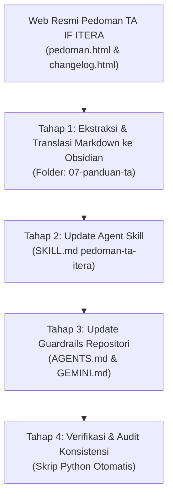

# 📋 Todolist: Update Skills & Translasi Pedoman TA ITERA (Changelog 1.2.0) ke Obsidian

> **Tujuan Dokumen:** Memandu eksekusi bertahap penyelarasan aturan akademik Tugas Akhir Program Studi Teknik Informatika ITERA versi terbaru (**Changelog [1.2.0] - 2026-11-02** dan **[1.1.0]**) ke dalam:
> 1. **Obsidian Vault** di folder `Catatan-Memori/Catatan-Memori-Logs/07-panduan-ta/` (dalam bentuk dokumen markdown terstruktur, modular, dan terhubung melalui *wikilinks*).
> 2. **Agent Skills** di `.agents/skills/pedoman-ta-itera/SKILL.md`.
> 3. **Guardrails & Constraints** di `AGENTS.md` dan `GEMINI.md`.

---

## 🗺️ Peta Alur Eksekusi

---

## 🔍 Ringkasan Perubahan Kunci Changelog [1.2.0] & [1.1.0]

| Komponen Pedoman | Ketentuan Baru (Changelog 1.2.0 & 1.1.0) | Catatan Implementasi |
| :--- | :--- | :--- |
| **Aturan Penomoran Halaman (Tabel 8.4)** | • Front Matter: Romawi kecil (i, ii, ...) di tengah bawah (*center-footer*). • Isi & Akhir: Angka Arab di pojok atas sisi luar (kanan atas ganjil, kiri atas genap). • **Awal Bab: Angka Arab di tengah bawah (*center-footer*)**. | Wajib diterapkan pada template LaTeX dan panduan penulisan. |
| **Pencetakan Naskah (Tabel 8.2)** | • Versi Final: Wajib dicetak bolak-balik (*mirror margins*). • **Draf Sempro & Sidang: Boleh dicetak satu sisi (*single-sided*)**. | Memberikan fleksibilitas biaya & revisi bagi mahasiswa. |
| **Luaran Individu (Subbab 5.1.3)** | Seluruh bentuk TA (1 s.d. 6, termasuk Capstone kelompok) adalah **Laporan TA Individu** dengan **judul berbeda** yang ditetapkan sejak Sempro. | Menghapus aturan laporan bersama kelompok. Irisan hanya boleh pada konteks proyek. |
| **Template Resmi (Subbab 8.8)** | Ketersediaan template resmi Word (.docx), slide presentasi (.pptx), dan LaTeX (.tex) untuk keenam bentuk TA di halaman Formulir. | Rujukan resmi untuk persiapan berkas dan presentasi. |
| **Ukuran Font (Tabel 8.3 / 1.1.1)** | Body teks dan sub-bab diubah menjadi **11 pt** (Times New Roman), spasi 1,5. Judul bab tetap 14 pt bold. | Diseragamkan dengan format buku UNESCO. |

---

## 🎯 Rincian Checklist Pekerjaan (Actionable Todolist)

### 📌 Tahap 1: Translasi & Restrukturisasi Obsidian (`07-panduan-ta/`)
- [x] **1.1 Unduh & Sinkronisasi Dokumen Induk Lengkap**
  - Mengambil data teks markdown asli dari `pedoman.html` dan `changelog.html`.
  - Memperbarui berkas [[pedoman-ta-itera-lengkap.md]] agar 100% identik dengan versi web terbaru.
- [x] **1.2 Buat / Perbarui Modul Ringkasan Tematik (Modular Obsidian)**
  - [x] [[01-kebijakan-ai-dan-integritas.md]] — Framework 5 Level AI, batas Turnitin $\le 25\%$, log sesi AI, dan kesiapan *code walkthrough*.
  - [x] [[02-alur-dan-syarat-sempro.md]] — Syarat 100 SKS, hadir 2 sempro, 4 bimbingan, form bimbingan via TASYS, alokasi waktu 10 min presentasi + 30 min tanya jawab.
  - [x] [[03-sidang-akhir-dan-revisi.md]] — Alokasi sidang 85 min, code walkthrough 10%, batas revisi minor (14 hari kerja), sedang (30 hari kalender), mayor (60 hari kalender).
  - [x] [[04-format-penulisan-unesco.md]] — Dimensi UNESCO (15,5 × 23 cm), kertas 75 gsm, margin (2 cm atas/bawah/luar, 2,5 cm jilid), font TNR 11 pt, **Tabel 8.4 Penomoran Halaman**, dan fleksibilitas cetak draf 1 sisi.
  - [x] [[05-luaran-individu-dan-template.md]] — Subbab 5.1.3 Laporan TA individu semua bentuk, judul berbeda sejak sempro, aturan irisan tim, dan Subbab 8.8 template resmi (.docx, .pptx, .tex).
  - [x] [[06-kebijakan-open-data.md]] — Subbab 5.9 kewajiban unggah dataset & kode publik maksimal 30 hari pasca-sidang.
- [x] **1.3 Perbarui Dokumen Pendukung Eksisting**
  - [x] Perbarui [[format-penulisan-unesco.md]] dengan Tabel 8.4 dan aturan cetak draf 1 sisi.
  - [x] Perbarui [[dokumen-wajib.md]] dengan integrasi verifikasi digital TASYS (Changelog 1.0.1) & surat pembagian kerja tim (Lampiran 6).
  - [x] Buat/Perbarui [[00-index-panduan-ta.md]] sebagai direktori utama di folder `07-panduan-ta`.

---

### 📌 Tahap 2: Pembaruan Agent Skill (`.agents/skills/pedoman-ta-itera/SKILL.md`)
- [x] **2.1 Integrasikan Tabel 8.4 (Aturan Penomoran Halaman)** ke dalam Bagian 4.1 & 4.2.
- [x] **2.2 Tambahkan Ketentuan Pencetakan Draf vs Final** (draf boleh 1 sisi, final wajib bolak-balik).
- [x] **2.3 Tambahkan Klausul Subbab 5.1.3** (Laporan TA sebagai Luaran Individu, kewajiban judul berbeda sejak Sempro, irisan tim).
- [x] **2.4 Tambahkan Referensi Subbab 8.8** (Template resmi Word .docx, PPTX slide 10 min, dan LaTeX .tex).
- [x] **2.5 Validasi Metadata YAML Frontmatter** pada `SKILL.md`.

---

### 📌 Tahap 3: Pembaruan Guardrails Repositori (`AGENTS.md` & `GEMINI.md`)
- [x] **3.1 Perbarui Bagian 2 `AGENTS.md`**:
  - Cantumkan aturan penomoran halaman (Tabel 8.4).
  - Cantumkan aturan draf sempro/sidang boleh 1 sisi.
- [x] **3.2 Tambahkan Subbab Luaran Individu pada Bagian 3 & 4 `AGENTS.md`**:
  - Penegasan bahwa setiap naskah laporan TA wajib bersifat individu dan memiliki judul unik sejak Sempro.
- [x] **3.3 Sinkronkan `GEMINI.md`**:
  - Pastikan seluruh *hard constraints* di `GEMINI.md` selaras dengan `AGENTS.md` dan Changelog 1.2.0.

---

### 📌 Tahap 4: Verifikasi & Audit Konsistensi
- [x] **4.1 Audit Konsistensi Teks**:
  - Berhasil divalidasi dengan skrip audit otomatis Python.
- [x] **4.2 Verifikasi Wikilinks Obsidian**:
  - Seluruh *wikilinks* internal terverifikasi dan aktif.

---

## 🏁 Definition of Done (DoD)

1. [x] Seluruh berkas di `Catatan-Memori/Catatan-Memori-Logs/07-panduan-ta/` telah mencerminkan Pedoman TA IF ITERA versi Changelog [1.2.0] secara lengkap dan rapi.
2. [x] `SKILL.md`, `AGENTS.md`, dan `GEMINI.md` telah disinkronkan dan lulus audit skrip verifikasi otomatis.
3. [x] Berkas todolist ini telah terdaftar di [[00-Index-Todolist.md]].
