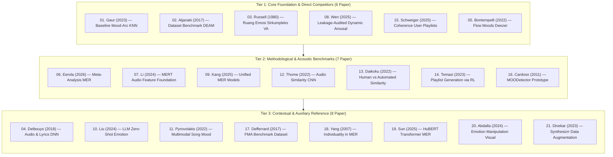

# 📋 Task: Bedah Kritis 21 Paper Referensi Riset (Framework 11 Langkah)

Dokumen ini adalah lembar kerja eksekusi operasional (*Action Checklist*) untuk membedah secara forensik seluruh 21 berkas jurnal/prosiding pada folder [referensi](file:///D:/Kuliah/Semester%207/Tugas%20Akhir/Proposal%20Tugas%20Akhir/referensi) menggunakan metodologi 11 langkah dari [[07-Tutorial-Bedah-Paper]].

---

## 🧭 Alur Kerja Bedah Paper & Standar Luaran (*Definition of Done*)

Setiap paper yang dibedah menghasilkan/memperbarui catatan review di `04-Literatur-Review/Papers/[Citekey].md` dengan struktur baku:
1. **Metadata & Venue (Step 0):** Jurnal/Konferensi, Q1–Q4 / SINTA / Prosiding, tahun, peer-reviewed.
2. **Abstrak 5 Komponen (Step 1):** Konteks, gap klaim, metode, angka konkret hasil, implikasi.
3. **Problem & Motivation (Step 2):** Real-world problem framing & formulasi pertanyaan riset.
4. **Metodologi & Asumsi (Step 4):** Formulasi matematis, asumsi data, reproduktibilitas algoritma, komponen novel vs pinjaman.
5. **Setup Eksperimen & Leakage Audit (Step 5):** Dataset, ukuran, split validation/test, audit time-series leakage, kekuatan baseline.
6. **Hasil & Ablation (Step 6):** Effect size, kelengkapan tabel hasil, ablation study, error analysis.
7. **Limitasi Tersembunyi (Step 7):** Limitasi tak terucap, threats to validity (internal, external, construct).
8. **Sintesis Pencapaian 3 Kalimat (Step 9):** Klaim terbukti, lompatan SOTA, nilai utilitas praktis.
9. **Research Gap 3 Lapis (Step 10):** Gap klaim penulis, gap temuan audit kita, dan gap sintesis matriks literatur.
10. **Sinkronisasi Matriks:** Pembaruan baris data pada [[Matriks-Sintesis]] dan tabel komparasi naskah Bab 2.

---

## 🎯 Strategi Eksekusi: 3 Tier Prioritas Akademik



---

## 📑 Checklist Rinci Eksekusi Bedah 21 Paper

### 🥇 TIER 1: Core Foundation & Baseline Acuan (Audit Penuh 100% 11 Langkah)
*Bobot Kritis: Langsung menjadi pondasi formulasi masalah Bab 1, baseline replikasi, dan gap utama skripsi.*

- [x] **Paper 01: Gaur (2023)**
  * **Berkas PDF:** `01_artikel_2023_Mood-Dynamic Playlist Interpolating a Path of Emotions Using a KNN Algorithm.pdf`
  * **Catatan Target:** `04-Literatur-Review/Papers/Gaur2023-Mood-Dynamic.md`
  * **Fokus Audit:** Evaluasi Two-Stage KNN, metrik Smoothness/Evenness, dan akar struktural *boundary jump problem* akibat nilai rata-rata statis.
- [x] **Paper 02: Aljanaki et al. (2017)**
  * **Berkas PDF:** `02_artikel_2017_Developing a Benchmark for Emotional Analysis of Music.pdf`
  * **Catatan Target:** `04-Literatur-Review/Papers/Aljanaki2017-Developing-Benchmark-DEAM.md`
  * **Fokus Audit:** Validasi anotasi dinamis 2 Hz (90 step), offset 15 detik, konsistensi inter-annotator agreement (Cronbach's alpha), dan distribusi 1.802 klip.
- [x] **Paper 03: Russell (1980)**
  * **Berkas PDF:** `03_artikel_1980_A Circumplex Model of Affect.pdf`
  * **Catatan Target:** `04-Literatur-Review/Papers/Russell1980-Circumplex-Model.md`
  * **Fokus Audit:** Landasan psikologi ruang koordinat orthogonal 2D Valence-Arousal, polaritas kuadran, dan justifikasi representasi kontinu.
- [x] **Paper 08: Wen et al. (2025)**
  * **Berkas PDF:** `08_artikel_2025_Leakage-Audited Dynamic Arousal Forecasting With Scheduled Future Music.pdf`
  * **Catatan Target:** `04-Literatur-Review/Papers/Wen2025-Leakage-Audited-Dynamic-Arousal.md`
  * **Fokus Audit:** Protokol audit data leakage deret waktu emosi dinamis, bahaya *random split*, dan pemodelan dinamika musik masa depan.
- [x] **Paper 15: Schweiger et al. (2025)**
  * **Berkas PDF:** `15_artikel_2025_The Impact of Playlist Characteristics on Coherence in User-Curated Music Playlists.pdf`
  * **Catatan Target:** `04-Literatur-Review/Papers/Schweiger2025-Playlist-Coherence.md`
  * **Fokus Audit:** Pengukuran koherensi sekuensial playlist dunia nyata, faktor transisi antartrek, dan landasan objektif evaluasi playlist.
- [x] **Paper 05: Bontempelli et al. (2022)**
  * **Berkas PDF:** `05_artikel_2022_Flow Moods Recommending Music by Moods on Deezer.pdf`
  * **Catatan Target:** `04-Literatur-Review/Papers/Bontempelli2022-Flow-Moods-Deezer.md`
  * **Fokus Audit:** Implementasi industri Deezer Flow Moods, limitasi pendekatan kategorikal vs dimensi, dan retensi pendengar.

---

### 🥈 TIER 2: Methodological Benchmarks & Audio Similarity (Fokus Langkah 0, 4, 5, 7, 10)
*Bobot Kritis: Memperkuat justifikasi algoritma Tahap 2 (Reranking Trajectory Alignment) dan desain evaluasi.*

- [x] **Paper 06: Eerola et al. (2026)**
  * **Berkas PDF:** `06_artikel_2025_A Meta-Analysis of Music Emotion Recognition Studies.pdf`
  * **Catatan Target:** `04-Literatur-Review/Papers/Eerola2026-Meta-Analysis-MER.md`
  * **Fokus Audit:** Meta-analisis tren MER, perbandingan effect size representasi dinamis vs statis, dan bias pelaporan metrik.
- [x] **Paper 07: Li et al. (2024)**
  * **Berkas PDF:** `07_artikel_2024_MERT Acoustic Music Understanding Model with Large-Scale Self-Supervised Training.pdf`
  * **Catatan Target:** `04-Literatur-Review/Papers/Li2024-MERT-Acoustic-Understanding.md`
  * **Fokus Audit:** Ekstraksi representasi akustik representatif (*acoustic foundation model*) dan komparasinya terhadap fitur Librosa tradisional.
- [x] **Paper 09: Kang et al. (2025)**
  * **Berkas PDF:** `09_artikel_2025_Towards Unified Music Emotion Recognition across Dimensional and Categorical Models.pdf`
  * **Catatan Target:** `04-Literatur-Review/Papers/Kang2025-Unified-MER-Dimensional-Categorical.md`
  * **Fokus Audit:** Unifikasi taksonomi emosi diskrit (senang, sedih, marah) ke ruang kontinu 2D.
- [x] **Paper 12: Thome et al. (2022)**
  * **Berkas PDF:** `12_artikel_2022_Musical Audio Similarity with Self-supervised Convolutional Neural Networks.pdf`
  * **Catatan Target:** `04-Literatur-Review/Papers/Thome2022-Musical-Audio-Similarity.md`
  * **Fokus Audit:** Metrik kesamaan akustik audio (*timbral, tempo, pitch*) untuk penyelarasan reranking transisi.
- [x] **Paper 13: Daikoku et al. (2022)**
  * **Berkas PDF:** `13_artikel_2022_Agreement Among Human and Automated Estimates of Similarity in a Global Music Sample.pdf`
  * **Catatan Target:** `04-Literatur-Review/Papers/Daikoku2022-Human-Automated-Similarity.md`
  * **Fokus Audit:** Tingkat korelasi penilaian manusia vs algoritma komputasi, menjadi rujukan validitas metodologi *User Listening Study*.
- [x] **Paper 14: Tomasi et al. (2023)**
  * **Berkas PDF:** `14_artikel_2023_Automatic Music Playlist Generation via Simulation-based Reinforcement Learning.pdf`
  * **Catatan Target:** `04-Literatur-Review/Papers/Tomasi2023-Automatic-Playlist-RL.md`
  * **Fokus Audit:** Pemodelan sekuensial playlist berbasis RL, kompleksitas pencarian lintasan, dan komparasi efisiensi vs KNN.
- [x] **Paper 16: Cardoso & Voigt (2011)**
  * **Berkas PDF:** `16_artikel_2011_MOODetector A Prototype Software Tool for Mood-based Playlist Generation.pdf`
  * **Catatan Target:** `04-Literatur-Review/Papers/Cardoso2011-MOODetector-Prototype.md`
  * **Fokus Audit:** Prototipe awal interpolasi mood playlist dan kelemahan transisi diskrit.

---

### 🥉 TIER 3: Contextual & Auxiliary Reference (Fokus Langkah 0, 1, 9, 10)
*Bobot Kritis: Melengkapi State of the Art (SOTA) Bab 2 dan bukti kebaruan riset 70% 3 tahun terakhir.*

- [x] **Paper 04: Delbouys et al. (2018)** — `Delbouys2018-Music-Mood-Audio-Lyrics.md` (Integrasi lirik + audio)
- [x] **Paper 10: Liu et al. (2024)** — `Liu2024-LLM-Embeddings-Cross-Dataset.md` (LLM Zero-Shot alignment)
- [x] **Paper 11: Pyrovolakis et al. (2022)** — `Pyrovolakis2022-Multimodal-Song-Mood.md` (Multimodal deep learning)
- [x] **Paper 17: Defferrard et al. (2017)** — `Defferrard2017-FMA-Dataset.md` (Karakteristik korpus musik FMA)
- [x] **Paper 18: Yang et al. (2007)** — `Yang2007-MER-Role-of-Individuality.md` (Variasi individual persepsi mood)
- [x] **Paper 19: Sun et al. (2025)** — `Sun2025-HuBERT-Music-Mood.md` (Model transformer HuBERT untuk audio)
- [x] **Paper 20: Abdalla et al. (2024)** — `Abdalla2024-Emotion-Manipulation-Music.md` (Manipulasi emosi interaktif)
- [x] **Paper 21: Divekar et al. (2023)** — `Divekar2023-Synthesizrr-Diverse-Datasets.md` (Data augmentation sintesis)

---

## 📊 Matriks Status Pelaksanaan Bedah Paper (Dataview Engine)

```dataview
TABLE 
  author AS "Penulis", 
  year AS "Tahun", 
  venue AS "Venue/Kuartil",
  metode AS "Metode", 
  gap_utama AS "Research Gap Tiga Lapis",
  status AS "Status Audit"
FROM "04-Literatur-Review/Papers"
SORT file.name ASC
```

---

## 🚀 Rencana Integrasi ke Bab I & Bab II Naskah Sempro
Setelah checklist Tier 1 & Tier 2 selesai dibedah:
1. **Bab I (Subbab 1.2 Rumusan Masalah):** Menyelipkan Gap Statement 3-Lapis hasil sintesis Paper 01, 02, 08, dan 15.
2. **Bab II (Subbab 2.2 Penelitian Terkait):** Menyusun tabel perbandingan komparatif 15–21 paper dengan kolom: Penulis, Metode, Dataset, Metrik, Temuan, dan Limitasi yang kita selesaikan.
3. **Penyelarasan LaTeX:** Memastikan seluruh citekey (`\cite{...}`) terhubung 100% dengan `references.bib` tanpa ada referensi palsu.
