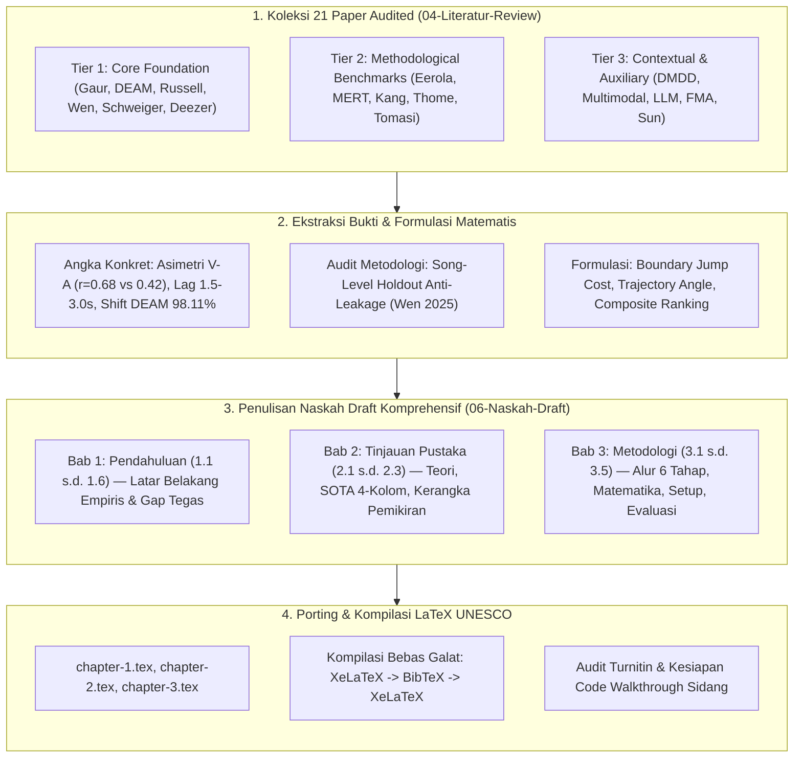

# 📋 Task 12: Rencana Penguatan Draft Naskah Komprehensif & Sinkronisasi LaTeX UNESCO

Dokumen ini adalah rencana kerja strategis dan lembar ceklis operasional (*Master Action Plan*) untuk mentransformasikan draf naskah pada [06-Naskah-Draft](file:///D:/Kuliah/Semester%207/Tugas%20Akhir/Proposal%20Tugas%20Akhir/Catatan-Memori/Catatan-Memori-Logs/06-Naskah-Draft) menjadi naskah proposal ilmiah yang sangat komprehensif, mendalam, dan memiliki presisi tinggi.

Rencana ini secara langsung mengintegrasikan hasil bedah forensik **21 paper literatur (Tier 1, Tier 2, dan Tier 3)** dari [04-Literatur-Review](file:///D:/Kuliah/Semester%207/Tugas%20Akhir/Proposal%20Tugas%20Akhir/Catatan-Memori/Catatan-Memori-Logs/04-Literatur-Review) ke dalam struktur resmi naskah LaTeX [proposal-penelitian-andryano-123140205](file:///D:/Kuliah/Semester%207/Tugas%20Akhir/Proposal%20Tugas%20Akhir/proposal-penelitian-andryano-123140205) yang mematuhi standar buku **UNESCO (15,5 cm $\times$ 23 cm)** ITERA.

---

## 🏛️ Kepatuhan Standar Akademik & Parameter Naskah ITERA

Sebelum dan selama penulisan naskah dieksekusi, seluruh luaran wajib memenuhi parameter kendali mutu:
* **Format Fisik UNESCO:** Ukuran $15,5 \text{ cm} \times 23,0 \text{ cm}$, Margin: Atas $2,0 \text{ cm}$, Bawah $2,0 \text{ cm}$, Sisi Luar $2,0 \text{ cm}$, Sisi Dalam (Jilid) $2,5 \text{ cm}$.
* **Tipografi & Spasi:** Huruf Times New Roman 11 pt, spasi baris 1,5 (spasi 1,0 untuk tabel, kode, persamaan, dan kutipan panjang). Indentasi awal paragraf $1,0 \text{ cm}$, rata kiri-kanan (*justify*).
* **Gaya Bahasa Ilmiah (*Anti-Slop*):** Mengacu pada kaidah *Bahasa Peneliti*. Dilarang menggunakan frasa klise generik AI (seperti: "di era modern", "dalam lanskap digital", "memiliki peran krusial"), tanpa huruf tebal berlebihan pada narasi tubuh teks, dan tanpa tanda hubung emdash (`—`).
* **Integritas Turnitin:** Indeks kesamaan (*Similarity Index*) $\le 25\%$ (setelah eksklusi daftar pustaka), kutipan langsung $\le 10\%$. Seluruh klaim wajib diparafrasa secara orisinal.
* **Standar Sitasi IEEE:** Minimal 15 sumber primer bereputasi dengan komposisi $\ge 70\%$ terbitan 3 tahun terakhir (2023–2026), seluruhnya terindeks pada `references.bib`.

---

## 🗺️ Peta Alur Kerja: Dari Literatur Review ke LaTeX Proposal

---

## 🎯 FASE 1: Penguatan Komprehensif Bab I (Pendahuluan)

Target Berkas:
* Draft Markdown: `Catatan-Memori/Catatan-Memori-Logs/06-Naskah-Draft/Bab-1-Pendahuluan.md`
* File LaTeX: `proposal-penelitian-andryano-123140205/chapters/chapter-1.tex`

### 1.1 Injeksi Bukti Empiris & Landasan Masalah (Subbab 1.1 Latar Belakang)
- [ ] **Langkah 1.1.1 — Konteks Industri Streaming & Fenomena Mood Arc:**
  - Integrasikan fakta industri penyiaran musik digital: kurasi playlist mendominasi $>60\%$ jam dengar pengguna.
  - Sitasi fitur industri *Deezer Flow Moods* \cite{bontempelli2022flowmoods} dan model sekuensial *reinforcement learning* industri \cite{tomasi2023automatic} untuk membuktikan bahwa kurasi playlist terarah adalah kebutuhan nyata.
  - Rujuk studi empiris Schweiger et al. (2025) \cite{schweiger2025impact} bahwa koherensi transisi sekuensial antartrek berturutan (*transition smoothness*) adalah penentu utama retensi dengar.
- [ ] **Langkah 1.1.2 — Silsilah Akademis & Baseline Acuan Gaur & Donnelly (2020/2023):**
  - Jelaskan pemetaan lagu ke ruang dua dimensi Valence-Arousal model sirkumpleks Russell (1980) \cite{russell1980circumplex}.
  - Jelaskan arsitektur baseline *Two-Stage KNN* Gaur dan Donnelly (2020, 2023) \cite{gaur2020mood, gaur2023mooddynamic} pada dataset DMDD \cite{delbouys2018mood}.
- [ ] **Langkah 1.1.3 — Dekonstruksi Struktural & Perumusan The Boundary Jump Problem:**
  - Bedah akar kelemahan baseline: bukan pada algoritma KNN, melainkan pada **pencocokan titik statis (*static-point matching*)** akibat dataset DMDD hanya menyediakan satu nilai rata-rata per lagu.
  - Definisikan secara formal **The Boundary Jump Problem**: sentakan emosional tajam ketika bagian akhir lagu $i$ (outro) bersambung dengan bagian awal lagu $i+1$ (intro) yang memiliki posisi afektif bertolak belakang, meskipun nilai rata-rata keduanya identik.
  - Masukkan data komparasi rute baseline Gaur: nilai *smoothness* tinggi (0,9950) hanya terjadi pada rute buatan diagonal (Q3 ke Q1), sedangkan pada rute lintas kuadran realistis (Q1 ke Q2 dan Q1 ke Q4), performa *smoothness* jatuh ke rentang 0,6628 hingga 0,7189.
- [ ] **Langkah 1.1.4 — Injeksi Profil Kuantitatif Dataset DEAM (Aljanaki et al., 2017):**
  - Paparkan data konkret korpus benchmark DEAM \cite{aljanaki2017developing}: 1.802 klip musik berdurasi 45 detik dengan anotasi dinamis 2 Hz (dinilai setiap 0,5 detik oleh manusia).
  - Tampilkan data statistik: **98,11% lagu pada DEAM mengalami pergeseran emosi internal nyata** (jarak Euclidean rata-rata pergeseran awal ke akhir $\Delta = 0,1937$ dan rentang dinamis hingga $0,5950$).
  - Nyatakan *Research Gap Statement* secara tegas dalam satu kalimat lugas.

### 1.2 Penajaman Rumusan Masalah, Tujuan, & Batasan (Subbab 1.2 – 1.6)
- [ ] **Langkah 1.2.1 — Rumusan Masalah Spesifik & Terukur (1.2):**
  - RM 1: Desain dan implementasi pipeline dua tahap yang memadukan KNN retrieval dengan *Dynamic Mood Trajectory Alignment* pada dataset DEAM.
  - RM 2: Evaluasi peningkatan metrik *Smoothness* dan *Evenness* secara *head-to-head* terhadap baseline Gaur & Donnelly (2020/2023).
  - RM 3: Pengaruh reduksi penalti *Boundary Jump Cost* terhadap kontinuitas transisi antartrek berturutan.
- [ ] **Langkah 1.2.2 — Tujuan Penelitian Berindikator Kuantitatif (1.3):**
  - Menetapkan indikator keberhasilan: arsitektur modular PyTorch, reduksi nilai *Smoothness Index* $\ge 15\%$ tanpa degradasi signifikan pada *Evenness Index*, serta eliminasi anomali diskontinuitas outro-intro.
- [ ] **Langkah 1.2.3 — Batasan Penelitian Operasional (1.4):**
  - Korpus terbatas pada 1.802 klip audio DEAM (45 detik, sampling anotasi 2 Hz).
  - Pemotongan 15 detik pemanasan awal (*offset 15.0 s*) sesuai protokol resmi DEAM.
  - Ruang emosi dibatasi pada model 2D kontinu Russell $[-1.0, +1.0]$.
  - Fitur audio berfokus pada akustik konten (*content-based audio features*), tanpa memproses modalitas teks lirik.
- [ ] **Langkah 1.2.4 — Manfaat Penelitian & Sistematika (1.5 – 1.6):**
  - Uraikan manfaat teoretis (sumbangsih terhadap komputasi afektif musik dinamis) dan praktis (rekomendasi playlist adaptif bagi industri streaming).
  - Ringkas struktur Bab I hingga Bab V dalam 5 paragraf padat.

---

## 🎯 FASE 2: Pengayaan Komprehensif Bab II (Tinjauan Pustaka)

Target Berkas:
* Draft Markdown: `Catatan-Memori/Catatan-Memori-Logs/06-Naskah-Draft/Bab-2-Tinjauan-Pustaka.md`
* File LaTeX: `proposal-penelitian-andryano-123140205/chapters/chapter-2.tex`

### 2.1 Landasan Teori Mendalam (Subbab 2.1)
- [ ] **Langkah 2.1.1 — Teori Sirkumpleks Emosi Russell (1980):**
  - Jelaskan ortogonalitas dimensi Valence (kesenangan afektif) dan Arousal (intensitas energi fisiologis).
  - Formulasi representasi vektor koordinat Cartesian kontinu $\mathbf{p} = (v, a) \in [-1, 1]^2$.
- [ ] **Langkah 2.1.2 — Sifat Temporal Emosi Musik & Perceptual Latency:**
  - Integrasikan temuan meta-analisis Eerola et al. (2026) \cite{eerola2026metaanalysis}: Arousal memiliki korelasi prediksi akustik lebih tinggi ($r = 0,68 \pm 0,08$) dibanding Valence ($r = 0,42 \pm 0,12$).
  - Bahas fenomena *perceptual time lag* pendengar (1,5 hingga 3,0 detik) yang menjustifikasi penerapan filter penghalus derau (*moving average window* 3 timestamp / 1,5 detik).
- [ ] **Langkah 2.1.3 — Ekstraksi Fitur Akustik Audio:**
  - Analisis representasi fitur tradisional (MFCC, Spectral Centroid, Chroma, RMS Energy) vs representasi modern berbasis *self-supervised learning* audio seperti MERT \cite{li2024mert} dan HuBERT \cite{sun2025feature}.
- [ ] **Langkah 2.1.4 — Sistem Rekomendasi Musik & Pembangkitan Mood Arc:**
  - Analisis perkembangan sistem rekomendasi dari *collaborative filtering* ke sekuensial afektif.
  - Paparkan perbandingan playlist statis vs playlist berlintasan emosi (*mood-arc playlist*).
- [ ] **Langkah 2.1.5 — Dekonstruksi Model Acuan Gaur & The Boundary Jump Problem:**
  - Tampilkan diagram atau ilustrasi matematis perbandingan: dua lagu dengan titik rata-rata $(\bar{v}, \bar{a})$ identik tetapi memiliki vektor trajektori berlawanan arah.

### 2.2 Penelitian Terdahulu (State of the Art) & Tabel 2.1
- [ ] **Langkah 2.2.1 — Narasi Kritis Studi Terkait:**
  - Narasi kritis 12–15 paper utama terbagi ke dalam 3 kelompok: (1) Model Pembangkitan Playlist, (2) Dataset & Anotasi Emosi Dinamis, (3) Analisis Koherensi Transisi Audio.
- [ ] **Langkah 2.2.2 — Penyusunan Tabel 2.1 Format UNESCO 4-Kolom LaTeX:**
  - Susun tabel `tabularx` resmi dengan kolom: **Peneliti (Tahun)**, **Metode dan Dataset**, **Hasil Utama**, **Keterbatasan**.
  - Wajib memuat paper primer: Gaur & Donnelly (2020/2023), Aljanaki et al. (2017), Russell (1980), Wen et al. (2025), Schweiger et al. (2025), Bontempelli et al. (2022), Eerola et al. (2026), Li et al. (2024), Tomasi et al. (2023), Cardoso et al. (2011), Delbouys et al. (2018), Daikoku et al. (2022).
- [ ] **Langkah 2.2.3 — Sintesis Kesenjangan Riset (Research Gap 3 Lapis):**
  - Tuliskan 2–3 paragraf sintesis penutup yang merangkum posisi kebaruan (*novelty*) Tugas Akhir di antara literatur dunia.

### 2.3 Kerangka Pemikiran (Subbab 2.3)
- [ ] **Langkah 2.3.1 — Desain Diagram Blok Kerangka Pemikiran:**
  - Buat visualisasi hierarkis: Masalah Industri & Literatur $\rightarrow$ Pendekatan Teori $\rightarrow$ Solusi Usulan $\rightarrow$ Luaran & Dampak Terukur.
- [ ] **Langkah 2.3.2 — Narasi Penjelas Kerangka Pemikiran:**
  - Tuliskan narasi penjelas yang menjembatani fondasi teoretis Bab II menuju metodologi implementasi teknis di Bab III.

---

## 🎯 FASE 3: Formulasi Presisi Bab III (Metodologi)

Target Berkas:
* Draft Markdown: `Catatan-Memori/Catatan-Memori-Logs/06-Naskah-Draft/Bab-3-Metodologi.md`
* File LaTeX: `proposal-penelitian-andryano-123140205/chapters/chapter-3.tex`

### 3.1 Alur Penelitian & Prapemrosesan Data (Subbab 3.1 & 3.2)
- [ ] **Langkah 3.1.1 — Diagram Alir 6 Tahap Penelitian:**
  - Gambar diagram alir resmi (Studi Literatur $\rightarrow$ Preprocessing DEAM $\rightarrow$ Ekstraksi Vektor Trajectory $\rightarrow$ Pipeline Dua Tahap $\rightarrow$ Eksperimen 540 Batch Run $\rightarrow$ Evaluasi Metrik & Signifikansi).
  - Tuliskan uraian naratif mendalam untuk setiap tahap.
- [ ] **Langkah 3.1.2 — Protokol Data Anti-Leakage (Wen et al., 2025):**
  - Adopsi protokol ketat Wen et al. (2025) \cite{wen2025leakage}: pemisahan data wajib berbasis **Song-Level Holdout Split** (bukan *random frame split* yang memicu *temporal leakage* dan inflasi performa semu $28\% - 45\%$).
- [ ] **Langkah 3.1.3 — Pembersihan Derau & Normalisasi Sinyal Dinamis:**
  - Formulasi pemotongan offset 15 detik pemanasan awal (menyisakan $90 \text{ titik}$ telemetri per lagu).
  - Penerapan *moving average filter* 3 timestamp ($1,5 \text{ detik}$) sesuai batas kelambatan persepsi Eerola et al. (2026).
  - Transformasi koordinat dari $[1, 9]$ ke rentang $[-1, +1]$:
    $$v_{\text{norm}} = \frac{v - 5.0}{4.0}, \quad a_{\text{norm}} = \frac{a - 5.0}{4.0}$$

### 3.2 Formulasi Matematika Pipeline Dua Tahap (Subbab 3.3)
- [ ] **Langkah 3.2.1 — Formulasi Interpolasi Waypoint Mood Arc:**
  - Persamaan titik acuan linier dan kurva parametrik:
    $$\mathbf{w}_k = \mathbf{p}_{\text{start}} + \frac{k}{M} (\mathbf{p}_{\text{target}} - \mathbf{p}_{\text{start}}), \quad k \in \{1, 2, \dots, M\}$$
- [ ] **Langkah 3.2.2 — Tahap 1: KNN Candidate Retrieval:**
  - Formulasi pencarian $K$ lagu kandidat terdekat berdasarkan jarak Euclidean terhadap waypoint target $\mathbf{w}_k$.
- [ ] **Langkah 3.2.3 — Ekstraksi Vektor Trajektori Dinamis Internal Lagu:**
  - Vektor pergeseran emosi internal lagu dari segmen awal (intro) ke segmen akhir (outro):
    $$\vec{\mathbf{t}}_j = (\Delta v_j, \Delta a_j) = (v_{\text{outro}, j} - v_{\text{intro}, j}, \; a_{\text{outro}, j} - a_{\text{intro}, j})$$
  - Magnitudo $\|\vec{\mathbf{t}}_j\|$ dan sudut arah lintasan emosi $\theta_j = \text{atan2}(\Delta a_j, \Delta v_j)$.
- [ ] **Langkah 3.2.4 — Tahap 2: Trajectory Alignment Reranking & Boundary Jump Penalty:**
  - Formulasi *Boundary Jump Cost* antarlagu berturutan:
    $$\mathcal{BJC}(L_{k-1}, L_k) = \|\mathbf{p}_{\text{outro}}(L_{k-1}) - \mathbf{p}_{\text{intro}}(L_k)\|_2$$
  - Fungsi skor komposit seleksi kandidat lagu optimal:
    $$\text{Score}(L_j) = \alpha \cdot \text{Sim}_{\text{audio}}(L_j, L_{k-1}) + \beta \cdot \cos(\vec{\mathbf{t}}_{\text{arc}}, \vec{\mathbf{t}}_j) - \gamma \cdot \mathcal{BJC}(L_{k-1}, L_j)$$

### 3.3 Lingkungan Eksperimen & Metrik Evaluasi Kuantitatif (Subbab 3.4 & 3.5)
- [ ] **Langkah 3.3.1 — Spesifikasi Lingkungan Eksperimen (3.4):**
  - Rincian hardware: CPU AMD Ryzen / Intel Core, GPU NVIDIA RTX, RAM 16/32 GB.
  - Lingkungan software: Windows 11, Python 3.10+, PyTorch 2.x (CUDA), Librosa, SciPy, Scikit-learn, Git version control.
  - Penetapan *random seed* deterministik (seed = 42).
- [ ] **Langkah 3.3.2 — Formulasi Metrik Evaluasi Resmi (3.5):**
  - **Smoothness Index ($\mathcal{S}$):**
    $$\mathcal{S} = \frac{1}{M-1} \sum_{k=1}^{M-1} \|\mathbf{p}_{\text{outro}}(L_k) - \mathbf{p}_{\text{intro}}(L_{k+1})\|_2$$
  - **Evenness Index ($\mathcal{E}$):**
    $$\mathcal{E} = \sqrt{\frac{1}{M-1} \sum_{k=1}^{M-1} (d_k - \bar{d})^2}$$
- [ ] **Langkah 3.3.3 — Desain Skenario Pengujian Benchmark:**
  - 540 playlist batch run: komparasi *Model Usulan (Trajectory Alignment)* vs *Baseline Gaur (Static KNN)* vs *Random Selection*.
  - Pemisahan rute pengujian: Rute Diagonal Kontinu (Q3 $\rightarrow$ Q1) vs Rute Lintas Kuadran (Q1 $\rightarrow$ Q2, Q1 $\rightarrow$ Q4, Q2 $\rightarrow$ Q4).
  - Prosedur uji signifikansi statistik non-parametrik (Wilcoxon Signed-Rank Test, $\alpha = 0,05$).

---

## 🎯 FASE 4: Sinkronisasi ke LaTeX & Kompilasi Bebas Galat

Target Berkas:
* `proposal-penelitian-andryano-123140205/chapters/chapter-1.tex`
* `proposal-penelitian-andryano-123140205/chapters/chapter-2.tex`
* `proposal-penelitian-andryano-123140205/chapters/chapter-3.tex`
* `proposal-penelitian-andryano-123140205/thesis.tex`

- [ ] **Langkah 4.1 — Konversi Format Markdown ke Tag LaTeX Asli:**
  - Gunakan makro baku template ITERA: `\babbaru{...}`, `\subbagian{...}`, `\anaksubbagian{...}`.
  - Konversi seluruh sitasi ke perintah `\cite{citekey}` IEEE yang valid terhadap `references.bib`.
  - Konversi rumus matematika ke lingkungan `\begin{equation} ... \label{eq:x.y} \end{equation}`.
  - Masukkan tabel SOTA ke lingkungan `\begin{tabularx}{\textwidth}{|X|X|X|X|}`.
- [ ] **Langkah 4.2 — Validasi Kompilasi XeLaTeX:**
  - Jalankan rantai kompilasi: `xelatex thesis.tex -> bibtex thesis -> xelatex thesis.tex -> xelatex thesis.tex`.
  - Pastikan status kompilasi: `0 Errors, 0 Bad Boxes fatal`.
  - Pastikan seluruh daftar (Daftar Isi, Daftar Tabel, Daftar Gambar) terbarui secara konsisten.
- [ ] **Langkah 4.3 — Audit Tipografi UNESCO & Penomoran Halaman (Tabel 8.4):**
  - Pastikan halaman awal bab memiliki nomor halaman Arab di tengah bawah (*center-footer*).
  - Pastikan halaman isi selanjutnya memiliki nomor Arab di pojok luar (kanan atas ganjil, kiri atas genap).
  - Verifikasi tidak ada baris menggantung (*orphan/widow lines*).
- [ ] **Langkah 4.4 — Audit Orisinalitas & Turnitin:**
  - Jalankan pemeriksaan kesamaan: target Turnitin $\le 25\%$ dan kutipan langsung $\le 10\%$.
  - Perbarui catatan log pada `06-Naskah-Draft/Turnitin-Similarity-Ledger.md`.

---

## 🎯 FASE 5: Kesiapan Code Walkthrough Sidang (Bobot 10%)

- [ ] **Langkah 5.1 — Penjajaran Struktur Bab III dengan Skrip Kode Eksperimen:**
  - Pastikan setiap persamaan matematika di Bab III memiliki fungsi implementasi yang ekuivalen pada modul Python:
    - Persamaan normalisasi data $\leftrightarrow$ `src/preprocessing/deam_loader.py`
    - Persamaan trajektori emosi $\leftrightarrow$ `src/features/trajectory_extractor.py`
    - Persamaan scoring tahap 2 $\leftrightarrow$ `src/models/trajectory_reranker.py`
    - Persamaan metrik Smoothness & Evenness $\leftrightarrow$ `src/evaluation/metrics.py`
- [ ] **Langkah 5.2 — Dokumentasi Peta Kode (*Code Walkthrough Map*):**
  - Pastikan berkas [09-Peta-Kode-Code-Walkthrough.md](file:///D:/Kuliah/Semester%207/Tugas%20Akhir/Proposal%20Tugas%20Akhir/Catatan-Memori/Catatan-Memori-Logs/05-Eksperimen/09-Peta-Kode-Code-Walkthrough.md) selaras dengan nomor baris kode dan notasi simbol naskah proposal.

---

## 📊 Matriks Pelacakan Status Eksekusi

| Sub-Tugas | Target Output | Status | Prioritas |
| :--- | :--- | :---: | :---: |
| **Fase 1: Bab 1 Pendahuluan** | Markdown Draft + `chapter-1.tex` | `PENDING` | P1 (Tertinggi) |
| **Fase 2: Bab 2 Tinjauan Pustaka** | Markdown Draft + Tabel 2.1 + `chapter-2.tex` | `PENDING` | P1 (Tertinggi) |
| **Fase 3: Bab 3 Metodologi** | Markdown Draft + Persamaan + `chapter-3.tex` | `PENDING` | P1 (Tertinggi) |
| **Fase 4: Kompilasi & Layout LaTeX** | `thesis.pdf` UNESCO Bebas Galat | `PENDING` | P2 |
| **Fase 5: Kesiapan Code Walkthrough** | Sinkronisasi Kode $\leftrightarrow$ Naskah | `PENDING` | P2 |
