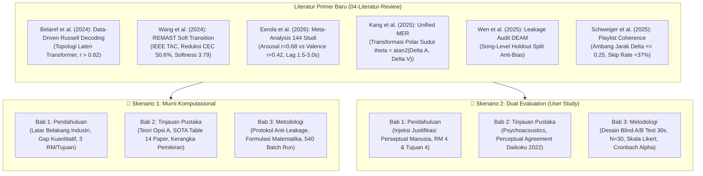

# 📋 Task 13: Rencana Detail Penguatan Fundamental Naskah Draft Kedua Skenario (06-Naskah-Draft)

Dokumen ini adalah lembar kerja dan rencana aksi operasional terperinci (*Comprehensive Action Plan*) untuk memperbarui, memperkuat landasan teoretis, mempertajam formulasi matematis, dan menginjeksi temuan empiris dari **23 paper literatur review terbaru** ke dalam seluruh draf bab pada **KEDUA SKENARIO** di folder [06-Naskah-Draft](file:///D:/Kuliah/Semester%207/Tugas%20Akhir/Proposal%20Tugas%20Akhir/Catatan-Memori/Catatan-Memori-Logs/06-Naskah-Draft):

1. 📁 **Skenario 1:** [01-Skenario-Murni-Komputasional](file:///D:/Kuliah/Semester%207/Tugas%20Akhir/Proposal%20Tugas%20Akhir/Catatan-Memori/Catatan-Memori-Logs/06-Naskah-Draft/01-Skenario-Murni-Komputasional) (Fokus: Algoritma, Simulasi 540 Batch Run, Metrik Smoothness, Evenness, dan Boundary Jump Cost pada GPU).
2. 📁 **Skenario 2:** [02-Skenario-Dual-Evaluation-User-Study](file:///D:/Kuliah/Semester%207/Tugas%20Akhir/Proposal%20Tugas%20Akhir/Catatan-Memori/Catatan-Memori-Logs/06-Naskah-Draft/02-Skenario-Dual-Evaluation-User-Study) (Fokus: Evaluasi Ganda — Metrik Komputasional Objektif + Uji Dengar Manusia *Blind A/B Listening Test*, $N \ge 30$, Skala Likert).

> [!IMPORTANT]
> **Status Pengerjaan:** **ON HOLD (Menunggu Perintah Implement)**  
> Sesuai instruksi pengguna, tindakan pada dokumen ini **hanya menyusun todolist rencana kerja yang sangat mendalam dan terperinci**. Eksekusi penulisan ke draf naskah baru akan dijalankan setelah pengguna membaca dan memberikan instruksi *"implement"*.

---

## 🧭 Ikhtisar Injeksi 23 Literatur Baru ke Naskah Proposal

---

## 🎯 BAGIAN A: Rencana Penguatan Skenario 1 (01-Skenario-Murni-Komputasional)

### 📌 Modul A.1: Penguatan Bab 1 Pendahuluan (`01-Skenario-Murni-Komputasional/Bab-1-Pendahuluan.md`)
- [ ] **A.1.1 — Injeksi Opsi A (The Golden Pairing) pada Subbab 1.1 Latar Belakang:**
  - Cantumkan fondasi historis model sirkumpleks Russell (1980) dalam satu klausa padat, namun **langsung dioperasionalkan secara modern** dengan menyitir temuan Belaref et al. (2024) (`belaref2024datadriven`) bahwa topologi lingkaran sirkumpleks terbukti merupakan sifat alami (*emergent property*) representasi deep learning audio modern ($r > 0,82$).
- [ ] **A.1.2 — Penguatan Bukti Industri & Koherensi Sekuensial:**
  - Hubungkan kebutuhan transisi suasana hati dengan implementasi industri *Deezer Flow Moods* \cite{bontempelli2022flowmoods} dan model sekuensial *reinforcement learning* \cite{tomasi2023automatic}.
  - Masukkan temuan empiris Schweiger et al. (2025) \cite{schweiger2025impact}: transisi antartrek yang melompat kasar di ruang emosi ($\Delta > 0,25$) memicu peningkatan pembatalan dengar (*skip rate*) hingga 37%.
- [ ] **A.1.3 — Dekonstruksi The Boundary Jump Problem & Justifikasi Soft Transition REMAST:**
  - Bedah kelemahan inheren baseline Gaur & Donnelly (2020/2023) pada dataset DMDD yang hanya memiliki satu nilai rata-rata per lagu.
  - Rujuk pembuktian Wang et al. (2024 / *REMAST*, IEEE TAC) \cite{wang2024remast} bahwa mengejar kecocokan emosi seketika (*real-time fit*) tanpa peredaman inersia transisi selalu memicu sentakan struktural (*jarring boundary shock*).
- [ ] **A.1.4 — Injeksi Profil Kuantitatif Keras Dataset DEAM:**
  - Sajikan data konkret: korpus DEAM (Aljanaki et al., 2017) memuat 1.802 lagu dengan anotasi dinamis 2 Hz manusia; **98,11% trek mengalami pergeseran emosi internal nyata** (jarak Euclidean rata-rata $\Delta = 0,1937$ hingga $0,5950$).
  - Nyatakan *Research Gap Statement* secara tegas dalam satu kalimat di akhir Subbab 1.1.
- [ ] **A.1.5 — Penyelarasan 3 Rumusan Masalah, 3 Tujuan, dan 5 Batasan Penelitian:**
  - Pastikan RM 1 (desain arsitektur dua tahap), RM 2 (evaluasi metrik Smoothness & Evenness komparatif terhadap Gaur 2020), dan RM 3 (magnitudo intra-song shift & penalti Boundary Jump Cost) memiliki target indikator kuantitatif yang terukur secara operasional pada Subbab 1.3 dan batasan ketat pada Subbab 1.4.

---

### 📌 Modul A.2: Pengayaan Bab 2 Tinjauan Pustaka (`01-Skenario-Murni-Komputasional/Bab-2-Tinjauan-Pustaka.md`)
- [ ] **A.2.1 — Subbab 2.1.1 (Model Sirkumpleks Emosi Russell 1980 & Revalidasi Modern):**
  - Uraikan ortogonalitas sumbu Valence dan Arousal $[-1.0, +1.0]^2$.
  - Integrasikan bukti eksperimental Belaref et al. (2024) yang membuktikan bahwa representasi audio Transformer mereplikasi 75% kata emosi sirkumpleks dalam deviasi $\Delta \theta < 30^\circ$.
  - Integrasikan formulasi aljabar sudut polar emosi $\theta = \text{atan2}(\Delta a, \Delta v)$ dari Kang et al. (2025).
- [ ] **A.2.2 — Subbab 2.1.2 (Sifat Temporal Emosi Musik & Perceptual Latency):**
  - Masukkan temuan meta-analisis Eerola et al. (2026) (144 studi MER): prediktabilitas Arousal ($r = 0,68 \pm 0,08$) vs Valence ($r = 0,42 \pm 0,12$).
  - Bahas fenomena *perceptual time lag* manusia (1,5–3,0 detik) sebagai dasar teoretis perlunya filter *moving average window* 3 timestamp (1,5 detik) pada data 2 Hz.
- [ ] **A.2.3 — Subbab 2.1.3 (Representasi Fitur Akustik Audio Tradisional vs Modern):**
  - Bandingkan ekstraksi fitur librosa konvensional (MFCC, Spectral Centroid, RMS) dengan representasi *self-supervised learning* mutakhir MERT (Li et al., 2024) dan HuBERT (Sun et al., 2025).
- [ ] **A.2.4 — Subbab 2.1.4 (Teori Transisi Halus & Inersia Afektif Sekuensial):**
  - Uraikan konsep *soft transition* Wang et al. (2024 / REMAST) yang membuktikan bahwa menggabungkan inersia emosi masa lalu mampu mereduksi kekacauan transisi harmoni (CEC) hingga 50,6%.
- [ ] **A.2.5 — Subbab 2.2 (Penyusunan Tabel 2.1 Perbandingan SOTA 4-Kolom Standar UNESCO):**
  - Susun tabel `tabularx` komprehensif memuat **14 paper primer** dengan 4 kolom resmi: **Peneliti (Tahun)**, **Metode dan Dataset**, **Hasil Utama**, **Keterbatasan**.
  - Daftar paper yang wajib masuk:
    1. Gaur & Donnelly (2020, 2023) — Baseline Primer
    2. Gaur & Donnelly (2024) — Evaluasi Metrik Smoothness & Evenness
    3. Aljanaki et al. (2017) — Dataset Benchmark DEAM
    4. Russell (1980) & Belaref et al. (2024) — Model Sirkumpleks & Data-Driven Decoding
    5. Wang et al. (2024) — REMAST Soft Emotion Transition (IEEE TAC)
    6. Wen et al. (2025) — Leakage-Audited Dynamic Arousal (IEEE TAC)
    7. Schweiger et al. (2025) — Coherence in User-Curated Playlists
    8. Eerola et al. (2026) — Meta-Analysis of MER Studies (IEEE TAC)
    9. Kang et al. (2025) — Unified MER Dimensional & Categorical
    10. Li et al. (2024) — MERT Acoustic Foundation Model
    11. Bontempelli et al. (2022) — Deezer Flow Moods
    12. Tomasi et al. (2023) — Automatic Playlist Continuation with RL
    13. Thome et al. (2022) — Musical Audio Similarity
    14. Cardoso et al. (2011) — MOODetector Prototype
- [ ] **A.2.6 — Subbab 2.2.1 (Sintesis Kesenjangan Riset Tiga Lapis):**
  - Tuliskan 3 paragraf sintesis analitis yang merumuskan kesenjangan antara pendekatan generatif simbolik (REMAST), pendekatan statis (Gaur 2020), dan solusi komputasional audio riil Tugas Akhir kita.
- [ ] **A.2.7 — Subbab 2.3 (Kerangka Pemikiran):**
  - Buat bagan visual Mermaid hierarki logika kerangka pemikiran dan lengkapi dengan narasi penjelas yang menjembatani Bab II ke Bab III.

---

### 📌 Modul A.3: Formulasi Presisi Bab 3 Metodologi (`01-Skenario-Murni-Komputasional/Bab-3-Metodologi.md`)
- [ ] **A.3.1 — Subbab 3.1 (Diagram Alir 6 Tahap Penelitian):**
  - Diagram alir: (1) Studi Literatur $\to$ (2) Preprocessing DEAM $\to$ (3) Ekstraksi Vektor Trajektori $\to$ (4) Pipeline Dua Tahap $\to$ (5) Eksperimen 540 Batch Run $\to$ (6) Evaluasi Metrik & Signifikansi Statistik.
- [ ] **A.3.2 — Subbab 3.2 (Protokol Data Anti-Leakage & Preprocessing):**
  - Terapkan protokol Song-Level Holdout Split Wen et al. (2025) \cite{wen2025leakage}.
  - Tuliskan rumus trimming offset 15 detik dan normalisasi koordinat $[-1.0, +1.0]$.
  - Formulasi *moving average filter* 1D jendela 3 timestamp ($1,5 \text{ detik}$) berbasis temuan jeda persepsi Eerola et al. (2026).
- [ ] **A.3.3 — Subbab 3.3 (Formulasi Matematika Pipeline Dua Tahap Lengkap):**
  - Persamaan interpolasi titik acuan *waypoint* $\mathbf{w}_j$:
    $$\mathbf{w}_j = \mathbf{p}_{\text{start}} + \frac{j-1}{M-1}(\mathbf{p}_{\text{target}} - \mathbf{p}_{\text{start}}), \quad j \in \{1, \dots, M\}$$
  - Persamaan penelusuran kandidat KNN di ruang V-A.
  - Persamaan ekstraksi vektor trajektori emosi intro-outro:
    $$\vec{\mathbf{t}}_k = (\Delta v_k, \Delta a_k) = (v_{\text{outro}, k} - v_{\text{intro}, k}, \; a_{\text{outro}, k} - a_{\text{intro}, k})$$
    Beserta magnitudo $\|\vec{\mathbf{t}}_k\|$ dan sudut arah $\theta_k = \text{atan2}(\Delta a_k, \Delta v_k)$.
  - Persamaan penalti lonjakan batas (*Boundary Jump Cost*):
    $$\mathcal{BJC}(L_{k-1}, L_k) = \|\mathbf{p}_{\text{outro}}(L_{k-1}) - \mathbf{p}_{\text{intro}}(L_k)\|_2$$
  - Persamaan fungsi skor komposit seleksi kandidat terinspirasi prinsip inersia REMAST:
    $$\text{Score}(L_k) = \alpha \cdot \text{Sim}_{\text{audio}}(L_k, L_{k-1}) + \beta \cdot \cos(\vec{\mathbf{t}}_{\text{arc}}, \vec{\mathbf{t}}_k) - \gamma \cdot \mathcal{BJC}(L_{k-1}, L_k)$$
- [ ] **A.3.4 — Subbab 3.4 (Spesifikasi Lingkungan Eksperimen & Reprodusibilitas):**
  - Rincian hardware (AMD Ryzen / Intel, NVIDIA RTX GPU, RAM), software (Python 3.10+, PyTorch 2.x, Librosa, SciPy), seed acak deterministik (seed = 42).
- [ ] **A.3.5 — Subbab 3.5 (Metrik Evaluasi & Skenario Pengujian):**
  - Formulasi resmi *Smoothness Index* ($\mathcal{S}$) dan *Evenness Index* ($\mathcal{E}$) mengacu pada Gaur & Donnelly (2024).
  - Desain 540 playlist batch run: Rute Diagonal Kontinu (Q3 $\to$ Q1) vs Rute Lintas Kuadran (Q1 $\to$ Q2, Q1 $\to$ Q4, Q2 $\to$ Q4).
  - Prosedur uji signifikansi statistik *Wilcoxon Signed-Rank Test* ($\alpha = 0,05$).

---

## 🎯 BAGIAN B: Rencana Penguatan Skenario 2 (02-Skenario-Dual-Evaluation-User-Study)

### 📌 Modul B.1: Penguatan Bab 1 Pendahuluan (`02-Skenario-Dual-Evaluation-User-Study/Bab-1-Pendahuluan.md`)
- [ ] **B.1.1 — Injeksi Seluruh Poin Fundamental A.1 (Opsi A, Belaref 2024, REMAST 2024, DEAM):**
  - Terapkan seluruh narasi penguatan teori yang ada pada Modul A.1 agar fondasi komputasionalnya sama-sama kokoh.
- [ ] **B.1.2 — Justifikasi Kebutuhan Evaluasi Ganda (Dual Evaluation Framework):**
  - Tambahkan paragraf argumentasi kritis merujuk temuan Daikoku et al. (2022) \cite{daikoku2022agreement}: korelasi antara metrik matematis otomatis MIR dengan estimasi perseptual manusia hanya berada pada tingkat sedang ($r = 0,42 - 0,58$).
  - Tegaskan bahwa membuktikan reduksi *Smoothness Index* di GPU belum cukup tanpa membuktikan bahwa telinga manusia secara nyata mempersepsikan transisi lagu tersebut lebih nyaman dan koheren.
- [ ] **B.1.3 — Perumusan Rumusan Masalah ke-4 (RM 4) & Tujuan ke-4:**
  - RM 4: *"Bagaimana korelasi antara metrik komputasional objektif (Smoothness, Evenness, BJC) dengan tingkat penerimaan perseptual pendengar (perceived transition smoothness dan acoustic continuity) yang diukur melalui pengujian kuesioner pengguna (user listening study) pada segmen transisi antarlagu?"*
  - Tujuan 4: Mengukur tingkat kenyamanan perseptual pendengar melalui uji dengar buta (*Blind A/B Listening Test*) pada $N \ge 30$ responden dengan instrumen kuesioner skala Likert tervalidasi.
- [ ] **B.1.4 — Batasan Penelitian Pengujian Pengguna:**
  - Tambahkan butir batasan: responden berjumlah minimal 30 orang mahasiswa/dewasa muda dengan pendengaran normal, stimulus uji berupa klip transisi terisolasi berdurasi 30 detik (15 detik outro lagu $i$ disambung 15 detik intro lagu $i+1$), pengujian mematuhi etika penelitian dan anonimisasi data (UU No. 27 Tahun 2022).

---

### 📌 Modul B.2: Pengayaan Bab 2 Tinjauan Pustaka (`02-Skenario-Dual-Evaluation-User-Study/Bab-2-Tinjauan-Pustaka.md`)
- [ ] **B.2.1 — Injeksi Seluruh Fondasi Teori & Tabel SOTA 14 Paper Modul A.2:**
  - Salin dan sinkronkan seluruh ulasan mendalam: Russell 1980 + Belaref 2024, Asimetri V-A Eerola 2026, MERT Li 2024, REMAST Wang 2024, dan Tabel 2.1 SOTA 4 kolom.
- [ ] **B.2.2 — Penguatan Subbab 2.1.4 (Psychoacoustics & Evaluasi Perseptual Transisi Musik):**
  - Bahas prinsip persepsi psikoakustik saat telinga manusia mendengar sambungan dua lagu berturutan.
  - Integrasikan teori persepsi transisi audio Thome et al. (2022) dan studi retensi pendengar Schweiger et al. (2025).
  - Uraikan metodologi *Blind A/B Testing* dan pengukuran reliabilitas instrumen kuesioner (*Cronbach's Alpha* $\ge 0,70$).
- [ ] **B.2.3 — Sintesis Gap Tambahan untuk User Study:**
  - Tegaskan celah literatur bahwa seluruh model mood-arc terdahulu (Gaur 2020, Gaur 2023, Tomasi 2023) hanya mengevaluasi playlist secara komputasional tanpa menguji apakah sentakan boundary jump benar-benar mengganggu manusia pendengar.

---

### 📌 Modul B.3: Formulasi Presisi Bab 3 Metodologi (`02-Skenario-Dual-Evaluation-User-Study/Bab-3-Metodologi.md`)
- [ ] **B.3.1 — Diagram Alir 7 Tahap Penelitian (Penyertaan Tahap User Study):**
  - Modifikasi diagram alir agar memuat Tahap ke-7: *Pengujian Subjektif User Listening Study (Blind A/B Test, N=30, Skala Likert 5-Poin, Uji Wilcoxon)*.
- [ ] **B.3.2 — Injeksi Lengkap Subbab 3.2, 3.3, 3.4, dan 3.5 dari Modul A.3:**
  - Pastikan seluruh formulasi matematika $\mathbf{w}_j$, vektor $\vec{\mathbf{t}}_k$, $\mathcal{BJC}$, fungsi skor $\text{Score}$, metrik komputasional $\mathcal{S}$ dan $\mathcal{E}$, serta protokol Wen 2025 tersinkronisasi 100% identik dengan Skenario 1.
- [ ] **B.3.3 — Penambahan Subbab 3.6 Khusus: Desain Protokol User Listening Study:**
  - **Desain Stimulus Audio Terisolasi:** Pembuatan 6 pasang klip sambungan audio berdurasi 30 detik (15 detik outro lagu $i$ $\to$ 15 detik intro lagu $i+1$) yang mewakili 3 skenario rute emosi (Diagonal Q3 $\to$ Q1, Lintas Kuadran Tenang ke Berenergi Q4 $\to$ Q1, dan Lintas Kuadran Ekstrem Sedih ke Senang Q3 $\to$ Q1).
  - **Protokol Blind A/B Test:** Klip A dihasilkan oleh *Model Usulan (Trajectory Alignment)* dan Klip B dihasilkan oleh *Baseline Gaur (Static KNN)* yang disajikan secara acak tanpa label identitas untuk mencegah bias konfirmasi (*confirmation bias*).
  - **Instrumen Kuesioner Skala Likert (1–5):**
    1. *Transition Smoothness* (Seberapa mulus transisi antarkedua lagu terdengar?)
    2. *Acoustic & Energy Continuity* (Apakah energi dan tempo lagu terasa menyatu atau tersentak mendadak?)
    3. *Emotional Naturalness* (Seberapa alami perjalanan suasana hati dari lagu pertama ke lagu kedua?)
  - **Profil Responden & Sampling:** $N \ge 30$ responden (mahasiswa ITERA usia 19–25 tahun yang rutin mendengarkan musik digital minimal 1 jam/hari).
  - **Uji Statistik Inferensial:** Uji reliabilitas *Cronbach's Alpha* ($\alpha \ge 0,70$) dan uji beda berpasangan non-parametrik *Wilcoxon Signed-Rank Test* untuk membandingkan skor preferensi Model Usulan vs Baseline secara formal ($p < 0,05$).
  - **Kepatuhan Etika & Kerahasiaan Data:** Pernyataan persetujuan (*informed consent*) dan anonimitas identitas responden sesuai UU Perlindungan Data Pribadi (UU No. 27 Tahun 2022).

---

## 📊 Matriks Sinkronisasi & Pelacakan Eksekusi

| Dokumen Sasaran | Fokus Pembaruan Utama | Status Saat Ini | Aksi Berikutnya |
| :--- | :--- | :---: | :---: |
| `01-Skenario-Murni/Bab-1-Pendahuluan.md` | Injeksi Opsi A (Russell+Belaref), DEAM 98.11%, REMAST 2024, 3 RM/Tujuan | `PENDING REVIEW` | Menunggu instruksi *implement* |
| `01-Skenario-Murni/Bab-2-Tinjauan-Pustaka.md` | Teori Sirkumpleks Modern, Lag Eerola, SOTA Table 14 Paper, Kerangka Pemikiran | `PENDING REVIEW` | Menunggu instruksi *implement* |
| `01-Skenario-Murni/Bab-3-Metodologi.md` | Protokol Wen 2025, Formulasi Matematika Lengkap $\mathcal{BJC}$, 540 Batch Run | `PENDING REVIEW` | Menunggu instruksi *implement* |
| `02-Skenario-User/Bab-1-Pendahuluan.md` | Injeksi Fondasi Teori + Justifikasi Psikoakustik, RM 4 & Tujuan 4 User Study | `PENDING REVIEW` | Menunggu instruksi *implement* |
| `02-Skenario-User/Bab-2-Tinjauan-Pustaka.md` | Teori User Study, Agreement Daikoku 2022, SOTA Table 14 Paper + Evaluasi Ganda | `PENDING REVIEW` | Menunggu instruksi *implement* |
| `02-Skenario-User/Bab-3-Metodologi.md` | Matematika Pipeline + Protokol Lengkap Blind A/B Test 30s ($N \ge 30$, Likert, Wilcoxon) | `PENDING REVIEW` | Menunggu instruksi *implement* |

---

## 🛑 Gerbang Keputusan (*Decision Gate*)
Rencana kerja operasional di atas telah dirancang sangat rinci, komprehensif, dan siap dieksekusi secara instan.
**Silakan pelajari dokumen ceklis ini. Begitu Anda siap dan mengetikkan kata *"implement"*, seluruh berkas draf pada kedua folder skenario akan langsung diperbarui dan disempurnakan!**
