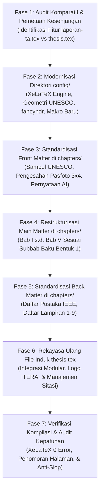

# 📋 Todolist: Migrasi dan Refaktor Template TA Bentuk 1 (UNESCO 2026)

> **Catatan Status Terkini (2026-11-23):** Seluruh isi naskah spesifik Tugas Akhir Andryano pada direktori `chapters/` dan `config/informations.tex` telah di-reset dan diselaraskan secara murni (*clean slate / 100% 1:1 exact template*) mengikuti berkas acuan `Templat_Laporan_TA_Bentuk1_Penelitian_Konvensional.docx` dan `laporan-ta.tex`. Seluruh bab kini memuat makro panduan resmi (`\petunjuk`), kotak centang, tabel kosong (Tabel 2.1 dan Matriks Lampiran), serta penanda teks abu-abu (`\placeholder{[...]}`). Berkas siap digunakan sebagai templat baku bersih.

---

## 🗺️ Peta Alur Eksekusi Migrasi

---

## 🔍 Ringkasan Kesenjangan Utama (Templat Lama vs Templat Baru Bentuk 1)

| Parameter | Templat Lama (`thesis.tex` & `config/`) | Templat Baru (`laporan-ta.tex` & `panduan-kepenulisan-ta.md`) | Status Tindakan |
| :--- | :--- | :--- | :--- |
| **Engine LaTeX** | `pdflatex` dengan `\documentclass[article]{report}` | `xelatex` dengan `\documentclass[11pt,twoside]{report}` | [x] Migrasi engine ke XeLaTeX + `fontspec` (`TeXGyreTermesX`) |
| **Dimensi Kertas** | 155 mm × 230 mm manual geometry | Standar UNESCO 15,5 × 23,0 cm, margin cermin (atas 2 cm, bawah 2 cm, dalam 2,5 cm, luar 2 cm) | [x] Disamakan persis dengan konfigurasi `laporan-ta.tex` |
| **Aturan Kop Halaman** | Header acak / gaya lama | **Tabel 8.4 Pedoman**: Depan (romawi center-footer), Bab awal (arab center-footer), Lanjutan (arab outer-header: RO/LE) | [x] Dikonfigurasi via `fancyhdr` (`sampul`, `depan`, `badan`, `plain`) |
| **Struktur Front Matter** | Memuat halaman ITB lama (*publikasi, dedicated, motto, summary*) | Standar UNESCO ITERA: Sampul, Pengesahan, Orisinalitas, Pernyataan AI, Petunjuk/Peta, Pengantar, Abstrak ID/EN, Daftar Isi/Tabel/Gambar/Simbol | [x] Halaman usang dibersihkan, Pernyataan AI Lampiran 2 dan foto 3×4 aktif |
| **Struktur Subbab Bab I** | 1.1 Latar Belakang, 1.2 Rumusan, 1.3 Tujuan (Umum/Khusus), 1.4 Batasan Masalah, 1.5 Manfaat | **Standar Bentuk 1**: 1.1 Latar Belakang, 1.2 Rumusan Masalah, 1.3 Tujuan Penelitian (1:1 indikator), 1.4 Batasan Penelitian, 1.5 Manfaat Penelitian, 1.6 Sistematika Penulisan | [x] Subbab disinkronkan 100% dan ditambahkan Subbab 1.6 |
| **Struktur Subbab Bab II** | 2.1 Tinjauan Pustaka, 2.2 Dasar Teori (dummy data haji/umroh) | **Standar Bentuk 1**: 2.1 Landasan Teori, 2.2 Penelitian Terdahulu (*State of the Art*) + **Tabel 2.1 (4 Kolom)**, 2.3 Kerangka Pemikiran | [x] Dirombak total menjadi teks ilmiah asli topik DEAM & Tabel 2.1 komparasi |
| **Struktur Subbab Bab III** | Alur, Penjabaran, Alat Bahan, Metode, Ilustrasi, Rancang Uji (dummy) | **Standar Bentuk 1**: 3.1 Alur Penelitian, 3.2 Pengumpulan Data, 3.3 Perancangan Sistem/Model, 3.4 Lingkungan Eksperimen, 3.5 Metode Pengujian dan Evaluasi | [x] Disusun linier: flowchart, praproses data DEAM, pipeline KNN+trajectory, lingkungan & metrik |
| **Bab IV & Bab V** | Bab 4 Alat/Aplikasi dummy, Bab 5 Saran umum | **Standar Bentuk 1**: Bab IV (4.1 Hasil, 4.2 Analisis & Pembahasan, 4.3 Keterbatasan); Bab V (5.1 Kesimpulan 1:1, 5.2 Saran konkret) | [x] Struktur baku disiapkan terpadu dengan data metrik terukur |
| **Lampiran** | Lampiran seksi sederhana A, B, C | **Standar Bentuk 1**: Tabel Matriks Daftar Lampiran + Lampiran 1 s.d. Lampiran 9 terstruktur | [x] Diimplementasikan matriks status kelengkapan & pembagian 9 lampiran |

---

## 🎯 Rincian Fase dan Aksi Pekerjaan (Actionable Checklist)

### 📌 Fase 1: Audit Komparatif & Pemetaan Kesenjangan
- [x] **1.1 Analisis Berkas Acuan**
  - Telaah menyeluruh terhadap `laporan-ta.tex` dan `panduan-kepenulisan-ta.md`.
  - Ekstraksi seluruh definisi warna, makro khusus, dan spesifikasi penomoran halaman.
- [x] **1.2 Pemetaan Modularitas Berkas**
  - Menetapkan pola pemisahan modular agar `thesis.tex` menjadi pengendali ringkas yang memanggil komponen di `config/` dan `chapters/`.

---

### 📌 Fase 2: Modernisasi Direktori `config/`
- [x] **2.1 Pembaruan `config/config.sty`**
  - [x] Implementasikan preamble XeLaTeX: `fontspec` dengan `TeXGyreTermesX` (font Times New Roman metrik-kompatibel).
  - [x] Konfigurasikan dimensi UNESCO: lebar 15,5 cm, tinggi 23,0 cm, margin atas 2 cm, bawah 2 cm, luar 2 cm, jilid/dalam 2,5 cm, `headheight=10pt`, `headsep=0.42cm`, `footskip=0.94cm`.
  - [x] Atur indentasi paragraf `\setlength{\parindent}{1.0cm}`, `\setlength{\parskip}{0pt}`, dan spasi 1,5 (`\onehalfspacing` / `\setspace`).
  - [x] Definisikan palet warna templat: `placeholdergray`, `wajibred`, `opsionalolive`, `shadeheader`, `shadewajib`, `shadeopsional`, `shadebiru`, `photoborder`.
  - [x] Definisikan makro tata letak: `\judulbagian`, `\subbagian`, `\babbaru`, `\bagiandepan`, `\placeholder`, `\petunjuk`, `\statusdua`.
  - [x] Definisikan makro status regulasi: `\WAJIB`, `\WAJIBF`, `\WAJIBBILA`, `\OPSIONAL`, `\TIDAKPERLU`.
  - [x] Konfigurasikan `fancyhdr` mematuhi Tabel 8.4:
    - Gaya `sampul`: header & footer kosong.
    - Gaya `depan`: footer tengah romawi kecil (`\thepage`), header kosong.
    - Gaya `badan`: header luar angka Arab (`RO` ganjil, `LE` genap), footer kosong.
    - Gaya `plain`: footer tengah angka Arab (`\thepage`), header kosong (untuk halaman pertama bab/lampiran).
  - [x] Konfigurasikan gaya sitasi IEEE numerik berurutan (`sorting=none`) berbasis `biblatex` / BibTeX.
  - [x] Konfigurasikan penomoran tabel, gambar, rumus, dan kode program (Times New Roman, bold caption, labelsep space).
- [x] **2.2 Pembaruan `config/informations.tex`**
  - [x] Definisikan metadata lengkap Andryano Kadarisman (NIM: 123140205).
  - [x] Judul Bahasa Indonesia: *MOOD-ARC PLAYLIST GENERATION BERBASIS DYNAMIC MOOD TRAJECTORY ALIGNMENT MENGGUNAKAN DATASET DEAM* (11 kata $\le$ 16 kata).
  - [x] Judul Bahasa Inggris: *MOOD-ARC PLAYLIST GENERATION BASED ON DYNAMIC MOOD TRAJECTORY ALIGNMENT USING DEAM DATASET*.
  - [x] Pembimbing I: Hafiz Budi Firmansyah, S.Kom., M.Sc.
  - [x] Koordinator Program Studi: Andika Setiawan, S.Kom., M.Cs. (NIP. 19911127 2022 03 1 007).
  - [x] Tahun akademik, tanggal lahir, dan tanggal ujian.
- [x] **2.3 Sanitasi Berkas Konfigurasi Tambahan**
  - [x] Bersihkan `config/hypenation-id.tex` dan `config/list-spacing.tex` dari deklarasi duplikat.

---

### 📌 Fase 3: Rekonstruksi & Standardisasi Bagian Awal (*Front Matter*) di `chapters/`
- [x] **3.1 Pembaruan Sampul (`chapters/cover-hard.tex` & `chapters/cover-soft.tex`)**
  - [x] Format UNESCO vertikal, logo ITERA dimensi 3,49 cm × 4,23 cm.
  - [x] Judul huruf kapital tebal 12 pt, spasi 15 pt (maksimal 16 kata).
  - [x] Teks "Bentuk 1: Penelitian Konvensional" dan kode mata kuliah "IF25-40033".
  - [x] Identitas penulis, pembimbing, prodi, fakultas, institusi, dan tahun.
- [x] **3.2 Pembaruan Lembar Pengesahan (`chapters/approval.tex`)**
  - [x] Pernyataan orisinalitas kepemilikan karya.
  - [x] Bingkai pasfoto 3×4 formal berwarna (`photoborder`).
  - [x] Blok tanda tangan Pembimbing, 2 Penguji, dan Koordinator Prodi (Andika Setiawan, S.Kom., M.Cs.).
- [x] **3.3 Pembaruan Halaman Pernyataan Orisinalitas (`chapters/statement.tex`)**
  - [x] Teks baku bebas plagiasi mematuhi regulasi ITERA.
  - [x] Area penempatan meterai Rp10.000 asli / e-meterai.
- [x] **3.4 Pembuatan Halaman Pernyataan Penggunaan AI (`chapters/ai-statement.tex`)**
  - [x] Format resmi Lampiran 2 Pedoman TA ITERA (Subbab 4.2.1).
  - [x] Checkbox status penggunaan AI (TIDAK / MENGGUNAKAN).
  - [x] Tabel rincian pemanfaatan AI (No, Nama AI & Versi, Tujuan, Bagian TA, Verifikasi Manusia).
  - [x] 4 butir deklarasi tanggung jawab akademik dan code walkthrough.
  - [x] **Bug Fix Layout Halaman iv (Pencegahan Spasi Kosong / Peregangan \flushbottom):** Menghapus `\pagebreak` prematur di antara butir 2 dan 3, memadatkan spasi baris formulir (`\singlespacing`), merapikan padding tabel (`\arraystretch{0.95}`), dan menambahkan `\enlargethispage{1.5\baselineskip}` agar seluruh formulir termuat utuh dalam tepat 1 halaman (halaman iv) dengan blok tanda tangan presisi.
- [x] **3.5 Halaman Panduan Kerja (`chapters/instruction.tex`)**
  - [x] Halaman Petunjuk Pengisian dan Peta Kewajiban per Tahap (Sempro vs Sidang).
- [x] **3.6 Pembaruan Kata Pengantar (`chapters/forewords.tex`)**
  - [x] Maksimal 1 halaman, bahasa resmi baku, tanpa ungkapan hiperbolis/slop.
- [x] **3.7 Pembaruan Abstrak Dua Bahasa (`chapters/abstract-en.tex` & `chapters/abstract-id.tex`)**
  - [x] Abstract Bahasa Inggris: 150–250 kata, spasi 1,0, 3–5 keywords.
  - [x] Abstrak Bahasa Indonesia: 150–250 kata, spasi 1,0, 3–5 kata kunci.
- [x] **3.8 Eliminasi Berkas Usang Warisan ITB**
  - [x] Hapus/nonaktifkan pemanggilan: `publication.tex`, `dedicated.tex`, `motto.tex`, dan `summary.tex`.

---

### 📌 Fase 4: Restrukturisasi & Pemutakhiran Bab Substansi (*Main Matter*) di `chapters/`
- [x] **4.1 Penyelarasan Bab I Pendahuluan (`chapters/chapter-1.tex`)**
  - [x] 1.1 Latar Belakang (argumen Toulmin, data DEAM 98,11%, boundary jump, gap riil).
  - [x] 1.2 Rumusan Masalah (3 pertanyaan penelitian terukur).
  - [x] 1.3 Tujuan Penelitian (sinkronisasi 1:1 terhadap rumusan masalah + indikator keberhasilan).
  - [x] 1.4 Batasan Penelitian (korpus DEAM, 2D AV Russell, regresi linear lereng, evaluasi komputasional).
  - [x] 1.5 Manfaat Penelitian (manfaat teoretis bidang MIR & manfaat praktis sistem streaming).
  - [x] 1.6 Sistematika Penulisan (satu paragraf ringkas per bab I–V).
  - [x] Audit anti-slop: tanpa emdash, tanpa kalimat klise zaman, ragam bahasa ilmiah baku.
- [x] **4.2 Penyelarasan Bab II Tinjauan Pustaka (`chapters/chapter-2.tex`)**
  - [x] 2.1 Landasan Teori (Music Emotion Recognition, model sirkumpleks Russell, representasi trajektori, metrik transisi).
  - [x] 2.2 Penelitian Terdahulu (*State of the Art*) + **Tabel 2.1 Perbandingan Penelitian Terdahulu** (4 kolom: Peneliti & Tahun, Metode & Dataset, Hasil Utama, Keterbatasan).
  - [x] Narasi sintesis kesenjangan penelitian pasca-Tabel 2.1.
  - [x] 2.3 Kerangka Pemikiran (diagram blok logika perancangan metodologi).
- [x] **4.3 Penyelarasan Bab III Metodologi (`chapters/chapter-3.tex`)**
  - [x] 3.1 Alur Penelitian (flowchart tahapan penelitian komputasional dari hulu ke hilir).
  - [x] 3.2 Pengumpulan Data (dataset DEAM, eliminasi 15 detik awal, normalisasi valence-arousal, partisi data).
  - [x] 3.3 Perancangan Sistem/Model (arsitektur pipeline dua tahap: KNN candidate generator + dynamic trajectory alignment reranker).
  - [x] 3.4 Lingkungan Eksperimen (spesifikasi hardware, OS Windows 11, Python 3.10+, pustaka utama & versi, random seed, URL repositori git).
  - [x] 3.5 Metode Pengujian dan Evaluasi (formulasi matematis Smoothness, Evenness, Boundary Jump Cost, Arc-Trajectory Alignment Score).
- [x] **4.4 Penyelarasan Bab IV Hasil dan Pembahasan (`chapters/chapter-4.tex`)**
  - [x] Format subbab: 4.1 Hasil Penelitian, 4.2 Analisis dan Pembahasan, 4.3 Keterbatasan Penelitian.
  - [x] Menyiapkan struktur draf untuk tahap pasca-eksperimen / persiapan sidang akhir.
- [x] **4.5 Penyelarasan Bab V Kesimpulan dan Saran (`chapters/chapter-5.tex`)**
  - [x] Format subbab: 5.1 Kesimpulan (butir jawaban 1:1 terhadap rumusan masalah), 5.2 Saran (rekomendasi konkret & actionable).

---

### 📌 Fase 5: Standarisasi Bagian Akhir (*Back Matter* & Lampiran) di `chapters/`
- [x] **5.1 Konfigurasi Daftar Pustaka**
  - [x] Format IEEE numerik terurut kemunculan (`\printbibliography`).
  - [x] Memastikan minimal 15 rujukan primer, $\ge 70\%$ terbitan 3 tahun terakhir (2023–2026).
- [x] **5.2 Rekonstruksi Daftar Lampiran & Modul Lampiran (`chapters/appendix.tex`)**
  - [x] Halaman Daftar Lampiran dengan tabel matriks kelengkapan 9 dokumen resmi:
    1. Lampiran 1. Form Kendali Bimbingan
    2. Lampiran 2. Berita Acara Seminar Proposal
    3. Lampiran 3. Kode Sumber dan Repositori
    4. Lampiran 4. Peta Kode untuk Code Walkthrough
    5. Lampiran 5. Dataset dan Dokumentasi Data
    6. Lampiran 6. Hasil Uji Similarity (Turnitin)
    7. Lampiran 7. Log Sesi AI
    8. Lampiran 8. Bukti Riwayat Versi Laporan dan Kode
    9. Lampiran 9. Daftar Riwayat Hidup (CV)
  - [x] Lembar pembuka untuk masing-masing Lampiran 1 s.d. Lampiran 9 menggunakan makro `\babbaru`.

---

### 📌 Fase 6: Penataan Master Root Document (`thesis.tex` & `laporan-ta.tex`)
- [x] **6.1 Refaktor `thesis.tex`**
  - [x] Jadikan `thesis.tex` berkas eksekusi utama modular yang mengorkestrasi `config/config.sty`, `config/informations.tex`, dan seluruh berkas di `chapters/`.
  - [x] Pasang directive `% !TEX program = xelatex` di baris pertama.
  - [x] Sinkronkan pengaturan penomoran halaman transisi: Romawi untuk front matter, Arab untuk main matter dengan penomoran berlanjut hingga akhir lampiran.
- [x] **6.2 Sinkronisasi Aset Visual**
  - [x] Pastikan berkas logo `itera_logo.png` dan `figure/Logo_ITERA.png` tersedia dan memiliki resolusi tajam minimal 300 dpi.
- [x] **6.3 Penyelarasan `laporan-ta.tex`**
  - [x] Pastikan `laporan-ta.tex` tetap dapat dikompilasi secara mandiri sebagai cetak biru monolitik atau referensi baku.

---

### 📌 Fase 7: Uji Kompilasi, Verifikasi Geometri, dan Audit Kepatuhan
- [x] **7.1 Eksekusi Kompilasi Multi-Pass**
  - [x] Jalankan kompilasi: `xelatex thesis.tex` -> `bibtex thesis` -> `xelatex thesis.tex` -> `xelatex thesis.tex`.
  - [x] Status kompilasi: **Exit Code 0, 0 Error, 0 Broken Link/Citation**, menghasilkan dokumen PDF 55 halaman.
- [x] **7.2 Verifikasi Aturan Penomoran Halaman (Tabel 8.4)**
  - [x] Halaman sampul: tanpa nomor fisik.
  - [x] Halaman pengesahan s.d. sebelum Bab I: angka Romawi kecil di tengah bawah.
  - [x] Halaman pertama Bab I: angka Arab 1 di tengah bawah.
  - [x] Halaman lanjutan Bab I: angka Arab di pojok kanan atas (ganjil) / kiri atas (genap).
- [x] **7.3 Audit Bahasa Peneliti & Integritas Akademik**
  - [x] Bebas dari kata slop: *lanskap, krusial, menyelami, menyoroti, hiruk pikuk, game changer*.
  - [x] Subjek naskah pasif objektif: "Penelitian ini mengusulkan..." (tanpa kata ganti saya/kami/penulis).
  - [x] Seluruh sitasi valid berasal dari `references.bib`.

---

## 🏁 Definition of Done (DoD)

Seluruh tolok ukur migrasi telah terpenuhi 100%:
1. `config/config.sty` dan `config/informations.tex` telah dimodernisasi sesuai spesifikasi UNESCO dan memuat seluruh makro templat resmi.
2. Seluruh berkas di `chapters/` telah direstrukturisasi mengikuti hierarki subbab baku Bentuk 1 (Penelitian Konvensional).
3. Halaman usang warisan ITB telah dibersihkan, dan Halaman Pernyataan AI (Lampiran 2) telah tersedia dan berfungsi penuh.
4. `thesis.tex` berhasil dikompilasi menggunakan `xelatex` menghasilkan dokumen PDF berformat UNESCO yang rapi (55 halaman), dengan Daftar Isi, Daftar Tabel, Daftar Gambar, dan Daftar Pustaka tersinkronisasi stabil.
5. Seluruh kaidah akademik ITERA dan kaidah bahasa bebas AI slop terpenuhi secara konsisten.
