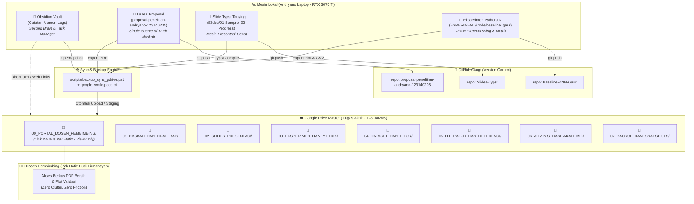
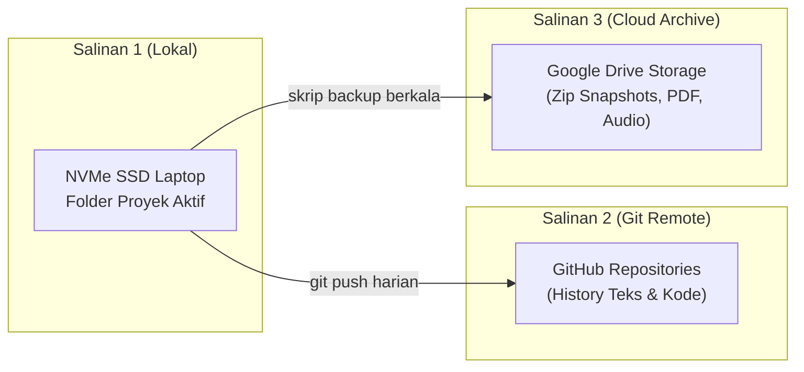

# 🌐 Panduan Arsitektur Google Drive, Naming Convention, & Sinkronisasi Terpadu (fix_gdrive.md)

> **Tujuan Dokumen:** Menjadi cetak biru (*blueprint*) dan panduan eksekusi operasional penataan seluruh folder dan berkas pada Google Drive, standardisasi tata nama berkas (*naming convention*), serta integrasi alur kerja sinkronisasi antara **Obsidian Vault (`Catatan-Memori-Logs`)**, **Naskah Proposal LaTeX (`proposal-penelitian-andryano-123140205`)**, **Slide Presentasi Typst (`Slides`)**, dan **Kode Eksperimen (`EXPERIMENT/Code`)**.
>
> **Sasaran Utama:** Terwujudnya sistem berkas Tugas Akhir yang **Sinkron**, **Aman** (Prinsip 3-2-1 Backup), **Enak Dipakai** (akses cepat 1-klik dari Obsidian & ramah dosen), serta **Gampang Dibackup** (otomatis via 1 perintah script).

---

## 🗺️ Arsitektur Alur Kerja Terpadu (The Unified Multi-Repo Ecosystem)



---

## 📂 1. Struktur & Taksonomi Folder Google Drive

Root Folder: **`Tugas Akhir - 123140205 Andryano Kadarisman`**  
*(ID Drive: `13i2Ww16FTgukID1djcfh5oTRfBqN7kb8`)*

Setiap folder diberi prefiks numerik dua digit (`00_` s/d `07_`) agar secara visual tersusun konsisten di peramban web Google Drive, aplikasi desktop Google Drive, maupun di terminal:

```text
📁 Tugas Akhir - 123140205 Andryano Kadarisman/
│
├── 📂 00_PORTAL_DOSEN_PEMBIMBING/              ⭐ [SHARED WITH LINK - VIEW ONLY KE DOSEN]
│   ├── 📄 README_PANDUAN_PEMBIMBING.pdf        # Panduan membaca deliverable & kontak mahasiswa
│   ├── 📄 Draf_Proposal_Terbaru.pdf            # Salinan naskah proposal terkini (UNESCO Format)
│   ├── 📄 Slide_Progres_Terbaru.pdf            # Slide presentasi progres bimbingan pekan ini
│   └── 📂 Lampiran_Hasil_Eksperimen/           # Plot utama 2D traversal DEAM & tabel perbandingan
│
├── 📂 01_NASKAH_DAN_DRAF_BAB/                  📝 [DOKUMEN TEKS & PROPOSAL]
│   ├── 📂 01_Milestone_Final_PDF/              # Arsip resmi: Sempro, Pasca-Revisi, Naskah Akhir
│   ├── 📂 02_Draf_Bab_Per_Sprint/              # Draf parsial: Bab_1_Pendahuluan, Bab_2, Bab_3
│   └── 📂 03_LaTeX_Source_Snapshots/           # Zip berkala source LaTeX proposal (thesis.tex dll)
│
├── 📂 02_SLIDES_PRESENTASI/                    📊 [PRESENTASI TOUYING / TYPST]
│   ├── 📂 01_Slide_Sempro/                     # Slide resmi Seminar Proposal (Durasi 10 Menit)
│   └── 📂 02_Slide_Progres_Mingguan/           # Arsip slide mingguan: Progres M01, M02, dst.
│
├── 📂 03_EKSPERIMEN_DAN_METRIK/                🧪 [HASIL RISET & ARTEFAK KODE]
│   ├── 📂 01_Visualisasi_Plot/                 # Gambar PNG: traversal kuadran, scatter V-A 2D
│   ├── 📂 02_Tabel_Metrik_Benchmark/           # CSV: Smoothness (PCC), Evenness (RMSE), jarak V-A
│   └── 📂 03_Snapshot_Codebase/                # Zip kode repositori baseline & trajectory usulan
│
├── 📂 04_DATASET_DAN_FITUR/                    📦 [DATA PRIMER & EKSTRAKSI AUDIO]
│   ├── 📂 01_DEAM_Corpus/                      # Audio MP3 (1.802 klip) & Anotasi kontinu 2 Hz
│   ├── 📂 02_Fitur_Akustik_Ekstraksi/          # CSV hasil librosa: 15 fitur akustik (MFCC, tempo, chroma)
│   └── 📊 PENJELASAN DATASET                   # Google Sheet: inventarisasi metadata dataset
│
├── 📂 05_LITERATUR_DAN_REFERENSI/              📚 [KAJIAN PUSTAKA & MATRIKS SINTESIS]
│   ├── 📂 01_Koleksi_PDF_Paper/                # 21 PDF paper primer (Shaurya Gaur, Delbouys, Aljanaki)
│   ├── 📂 02_Salinan_Teks_Markdown/            # Jurnal as Markdown (untuk penelusuran cepat AI/Obsidian)
│   └── 📊 STUDI LITERATUR                      # Google Sheet: Matriks Sintesis 21 Paper & Kamus Notasi
│
├── 📂 06_ADMINISTRASI_AKADEMIK/                📑 [SYARAT SEMPRO, NOTULENSI, & FORMULIR]
│   ├── 📂 01_Syarat_Pendaftaran_Sempro/        # Transkrip (min 100 SKS), form hadir sempro, kartu kendali
│   ├── 📂 02_Notulensi_Bimbingan_Dosen/        # Log konsultasi mingguan & persetujuan pembimbing
│   └── 📊 SEMPRO                               # Master Dashboard Sempro & Interactive Gantt Chart
│
└── 📂 07_BACKUP_DAN_SNAPSHOTS/                 💾 [ARSIP CADANGAN OTOMATIS (PRINSIP 3-2-1)]
    ├── 📂 Obsidian_Vault_Backups/              # Zip snapshot berkala Catatan-Memori-Logs
    └── 📂 Full_Workspace_Snapshots/            # Zip snapshot lingkungan riset non-audio
```

---

## 🏷️ 2. Standar Operasional Prosedur (SOP) Konvensi Penamaan Berkas

Seluruh berkas yang disinkronkan ke Google Drive wajib menggunakan format nama deterministik dengan pola:  
`[Kategori]_[NamaSubjek]_[Identitas]_[Versi/Milestone]_[Tanggal].[ekstensi]`

| Kategori Berkas | Pola Penamaan Standar | Contoh Riil Nama Berkas | Keterangan / Tujuan |
| :--- | :--- | :--- | :--- |
| **Naskah Proposal Utuh** | `Proposal_TA_[NIM]_[Nama]_[Milestone]_[Tanggal].pdf` | `Proposal_TA_123140205_Andryano_Sempro_v1.0_20261120.pdf` | Naskah resmi format UNESCO |
| **Draf Bab Parsial** | `Draf_Bab[X]_[Topik]_[NIM]_[Tanggal].pdf` | `Draf_Bab1_Pendahuluan_123140205_20261120.pdf` | Pembacaan per bab oleh pembimbing |
| **Slide Sempro** | `Slide_Sempro_TA_[NIM]_[Nama]_[Versi].pdf` | `Slide_Sempro_TA_123140205_Andryano_v1.0.pdf` | Bahan tayang sidang sempro 10 menit |
| **Slide Progres Pekanan** | `Slide_Progres_M[XX]_[Topik]_[NIM].pdf` | `Slide_Progres_M01_Baseline_DEAM_123140205.pdf` | Bahan konsultasi bimbingan rutin |
| **Plot Hasil Eksperimen** | `Plot_[Modul]_[DeskripsiVisual]_[Tanggal].png` | `Plot_Baseline_DEAM_Quadrant_Traversal_20261119.png` | Visualisasi 300 dpi siap sempro |
| **Tabel Metrik Kuantitatif**| `Metrics_[Modul]_[TipeMetrik]_[Tanggal].csv` | `Metrics_Baseline_DEAM_Smoothness_Evenness_20261119.csv` | Data empiris tabel Bab 4 |
| **Backup Vault Obsidian** | `Vault_Obsidian_Backup_[YYYYMMDD_HHmm].zip` | `Vault_Obsidian_Backup_20261120_2100.zip` | Cadangan snapshot vault catatan |
| **Snapshot Kode Sumber** | `SourceCode_[NamaModul]_Snapshot_[Tanggal].zip` | `SourceCode_Baseline_Gaur_Snapshot_20261120.zip` | Kesiapan Code Walkthrough (10%) |

---

## 🔄 3. Alur Kerja Sinkronisasi Terpadu (The 4-Way Workflow)

### 3.1. Obsidian sebagai Pusat Komando (*Mission Control*)
1. Tambahkan widget navigasi Google Drive langsung pada [Master-Dashboard.md](file:///D:/Kuliah/Semester%207/Tugas%20Akhir/Proposal%20Tugas%20Akhir/Catatan-Memori/Catatan-Memori-Logs/00-Dashboard/Master-Dashboard.md):
   * Tautan langsung ke folder `00_PORTAL_DOSEN_PEMBIMBING`.
   * Tautan ke spreadsheet SEMPRO dan Studi Literatur.
2. Setiap kali menulis catatan harian di `02-Daily-Logs/YYYY-MM-DD.md`, catat link deliverable yang telah di-upload ke Drive hari itu.

### 3.2. Naskah Proposal LaTeX ↔ Overleaf ↔ Google Drive
1. **Source Code:** Dikelola dengan Git pada repositori `cengkooo/proposal-penelitian-andryano-123140205`.
2. **Kompilasi:**
   * Di-build via Overleaf (disinkronkan dengan GitHub) atau compiler LaTeX.
3. **Penyimpanan Cloud:**
   * Hasil ekspor PDF diunggah ke Google Drive:
     * Salinan aktif ke: `00_PORTAL_DOSEN_PEMBIMBING/Draf_Proposal_Terbaru.pdf`.
     * Salinan arsip ke: `01_NASKAH_DAN_DRAF_BAB/01_Milestone_Final_PDF/Proposal_TA_123140205_Andryano_Sempro_v1.0_20261120.pdf`.

### 3.3. Slide Presentasi Typst ↔ Google Drive
1. Slide diedit pada `Slides/02-Progress/01-Minggu-01-Baseline-DEAM/progres_m01.typ` (atau folder `01-Sempro`).
2. Kompilasi via Typst CLI:
   ```powershell
   typst compile --root "Slides" "Slides\02-Progress\01-Minggu-01-Baseline-DEAM\progres_m01.typ" "Slides\02-Progress\01-Minggu-01-Baseline-DEAM\progres_m01.pdf"
   ```
3. Otomatis disalin ke `00_PORTAL_DOSEN_PEMBIMBING/Slide_Progres_Terbaru.pdf` dan `02_SLIDES_PRESENTASI/02_Slide_Progres_Mingguan/`.

### 3.4. Eksperimen Python/CUDA ↔ Google Drive
1. Skrip eksperimen berjalan di `EXPERIMENT/Code/baseline_gaur` menggunakan lingkungan `uv` dan CUDA GPU RTX 3070 Ti.
2. Artefak luaran (`baseline_deam_traversal_plot.png` dan `metrics_comparison_deam.csv`) diekspor ke:
   * `00_PORTAL_DOSEN_PEMBIMBING/Lampiran_Hasil_Eksperimen/`
   * `03_EKSPERIMEN_DAN_METRIK/`
3. Berkas audio biner mentah (MP3 DEAM) **tidak dimasukkan ke git**, melainkan tetap bersumber dari folder Drive `04_DATASET_DAN_FITUR/01_DEAM_Corpus/`.

---

## 🛡️ 4. Tata Kelola Keamanan & Strategi Backup 3-2-1

Untuk menjamin tidak akan ada data Tugas Akhir yang hilang akibat kerusakan laptop (*hardware failure*), salah *commit*, atau data korup:



* **Aturan Pemisahan Ukuran (Git vs Drive):**
  * File teks (`.tex`, `.py`, `.typ`, `.md`, `.bib`) $\rightarrow$ **GitHub Repositories**.
  * File biner/besar (`.pdf`, `.png`, `.csv`, `.mp3`, `.zip`) $\rightarrow$ **Google Drive**.
* **Keamanan Kredensial:**
  * Berkas `token.json`, `credentials.json`, dan `client_secret_*.json` dimasukkan ke `.gitignore` master dan **DILARANG KERAS** diunggah ke Google Drive publik.

---

## ⚡ 5. Skrip Otomasi Backup 1-Perintah: `scripts/backup_sync_gdrive.ps1`

Berikut adalah rancangan lengkap skrip PowerShell mandiri yang dapat dijalankan kapan saja untuk melakukan pengarsipan, pembuatan paket staging, dan pengunggahan otomatis:

```powershell
# ==============================================================================
# Master Backup & Staging Engine: backup_sync_gdrive.ps1
# Institut Teknologi Sumatera (ITERA) — Teknik Informatika
# Mahasiswa: Andryano Kadarisman (123140205)
# ==============================================================================
param(
    [switch]$DryRun,
    [switch]$OpenFolder
)

$ErrorActionPreference = "Stop"
$root = "D:\Kuliah\Semester 7\Tugas Akhir\Proposal Tugas Akhir"
$timestamp = Get-Date -Format "yyyyMMdd_HHmm"
$dateSimple = Get-Date -Format "yyyyMMdd"
$staging = Join-Path $root "GDrive_Sprint_1_Deliverables"

Write-Host "`n========================================================" -ForegroundColor Cyan
Write-Host " [BACKUP ENGINE] Menyiapkan Paket Deliverables & Backup TA " -ForegroundColor Green
Write-Host " Waktu: $(Get-Date -Format 'dd-MMM-yyyy HH:mm:ss WIB')" -ForegroundColor Gray
Write-Host "========================================================`n" -ForegroundColor Cyan

# 1. Pastikan folder staging bersih dan siap
$portalDir  = Join-Path $staging "00_PORTAL_DOSEN_PEMBIMBING"
$naskahDir  = Join-Path $staging "01_Naskah_Proposal"
$slideDir   = Join-Path $staging "02_Slide_Progres_Mingguan"
$expDir     = Join-Path $staging "03_Bukti_Eksperimen_DEAM"
$backupDir  = Join-Path $staging "07_Backup_Snapshots"

$dirs = @($portalDir, $naskahDir, $slideDir, $expDir, $backupDir)
foreach ($d in $dirs) {
    if (!(Test-Path $d)) { New-Item -ItemType Directory -Path $d -Force | Out-Null }
}

# 2. Kompilasi Slide Typst Terkini
Write-Host "• Mengompilasi Slide Progres Mingguan #01 via Typst..." -ForegroundColor Yellow
$typstSrc = Join-Path $root "Slides\02-Progress\01-Minggu-01-Baseline-DEAM\progres_m01.typ"
$typstPdf = Join-Path $slideDir "Slide_Progres_M01_Baseline_DEAM_123140205.pdf"
typst compile --root "$root\Slides" $typstSrc $typstPdf

# Salin juga ke Portal Dosen
Copy-Item $typstPdf (Join-Path $portalDir "Slide_Progres_Terbaru.pdf") -Force

# 3. Salin Naskah Bab 1 & Proposal
Write-Host "• Menyiapkan berkas naskah Bab 1..." -ForegroundColor Yellow
$chapter1Src = Join-Path $root "proposal-penelitian-andryano-123140205\chapters\chapter-1.tex"
$chapter1Dst = Join-Path $naskahDir "Draf_Bab1_Pendahuluan_123140205_$dateSimple.tex"
Copy-Item $chapter1Src $chapter1Dst -Force

$thesisPdfSrc = Join-Path $root "proposal-penelitian-andryano-123140205\thesis.pdf"
if (Test-Path $thesisPdfSrc) {
    Copy-Item $thesisPdfSrc (Join-Path $naskahDir "Proposal_TA_123140205_Andryano_Sempro_v1.0.pdf") -Force
    Copy-Item $thesisPdfSrc (Join-Path $portalDir "Draf_Proposal_Terbaru.pdf") -Force
}

# 4. Salin Hasil Eksperimen Baseline DEAM
Write-Host "• Mengumpulkan plot dan tabel metrik baseline DEAM..." -ForegroundColor Yellow
$plotSrc = Join-Path $root "EXPERIMENT\Code\baseline_gaur\experiments\results\baseline_deam_traversal_plot.png"
$csvSrc  = Join-Path $root "EXPERIMENT\Code\baseline_gaur\experiments\results\metrics_comparison_deam.csv"
$batchSrc = Join-Path $root "EXPERIMENT\Code\baseline_gaur\experiments\results\batch_quadrant_experiments_deam.csv"

if (Test-Path $plotSrc) {
    Copy-Item $plotSrc (Join-Path $expDir "Plot_Baseline_DEAM_Traversal_$dateSimple.png") -Force
    Copy-Item $plotSrc (Join-Path $portalDir "Plot_Traversal_DEAM_Terbaru.png") -Force
}
if (Test-Path $csvSrc) {
    Copy-Item $csvSrc (Join-Path $expDir "Metrics_Comparison_DEAM_$dateSimple.csv") -Force
}
if (Test-Path $batchSrc) {
    Copy-Item $batchSrc (Join-Path $expDir "Batch_Quadrant_DEAM_$dateSimple.csv") -Force
}

# 5. Zip Vault Obsidian Catatan-Memori-Logs (Kecuali cache)
Write-Host "• Membuat arsip ZIP cadangan Obsidian Vault..." -ForegroundColor Yellow
$vaultSrc = Join-Path $root "Catatan-Memori\Catatan-Memori-Logs"
$vaultZip = Join-Path $backupDir "Vault_Obsidian_Backup_$timestamp.zip"

Add-Type -AssemblyName System.IO.Compression.FileSystem
[System.IO.Compression.ZipFile]::CreateFromDirectory($vaultSrc, $vaultZip, [System.IO.Compression.CompressionLevel]::Optimal, $false)
Write-Host "  [✔] Vault berhasil di-zip: $(Split-Path $vaultZip -Leaf)" -ForegroundColor Green

# 6. Buat File Petunjuk untuk Dosen di Folder Portal
$readmeDosen = @"
================================================================================
PORTAL DOKUMEN TUGAS AKHIR — ANDRYANO KADARISMAN (NIM: 123140205)
Judul: Mood-Arc Playlist Generation Berbasis Dynamic Mood Trajectory Alignment
Dosen Pembimbing: Hafiz Budi Firmansyah, S.Kom., M.Sc.
Tanggal Pembaruan: $(Get-Date -Format 'dd MMMM yyyy')
================================================================================

Folder ini berisi ringkasan berkas terbaru untuk konsultasi bimbingan:
1. Draf_Proposal_Terbaru.pdf  : Naskah proposal standar UNESCO ITERA (Bab I terisi utuh).
2. Slide_Progres_Terbaru.pdf  : Slide bimbingan mingguan (rekapitulasi capaian dan kendala).
3. Plot_Traversal_DEAM_Terbaru.png : Bukti grafis replikasi baseline Gaur & Donnelly (2024).

Kontak Mahasiswa:
- WhatsApp : [Nomor Mahasiswa]
- Email    : 123140205@student.itera.ac.id / andryano.produktivitas@gmail.com
================================================================================
"@
Set-Content -Path (Join-Path $portalDir "README_PANDUAN_PEMBIMBING.txt") -Value $readmeDosen -Encoding UTF8

Write-Host "`n========================================================" -ForegroundColor Cyan
Write-Host " [SUKSES] Seluruh berkas telah tersusun di folder staging:" -ForegroundColor Green
Write-Host " Path: $staging" -ForegroundColor Yellow
Write-Host "========================================================`n" -ForegroundColor Cyan

if ($OpenFolder) {
    explorer $staging
}
```

---

## 🔑 6. Panduan Re-Autentikasi Google Workspace CLI

Jika token kedaluwarsa (`invalid_grant: Bad Request`), ikuti 2 langkah cepat berikut:

1. Jalankan perintah ini di PowerShell root workspace:
   ```powershell
   python google_workspace/connect_workspace.py
   ```
2. Jendela browser akan otomatis terbuka. Pilih akun Google: `andryano.produktivitas@gmail.com`, klik **Allow/Lanjutkan**, dan tunggu hingga muncul tulisan *Authentication Successful*. Token `token.json` akan otomatis diperbarui.

---

## ✅ 7. Action Checklist Implementasi (Dapat Dicentang)

- [x] **Langkah 1 — Standarisasi Folder Cloud di Google Drive:**
  - [x] Folder utama ditata via script: `00_PORTAL_DOSEN_PEMBIMBING`, `01_NASKAH_DAN_DRAF_BAB`, `02_SLIDES_PRESENTASI`, `03_EKSPERIMEN_DAN_METRIK`, `04_DATASET_DAN_FITUR`, `05_LITERATUR_DAN_REFERENSI`, `06_ADMINISTRASI_AKADEMIK`, `07_BACKUP_DAN_SNAPSHOTS`.
  - [x] Folder `00_PORTAL_DOSEN_PEMBIMBING` diaktifkan izin: **Anyone with the link can view** (ID: `1whfbLHNvW9IOjwj5CHuFqsYg13P3FhNq`).

- [x] **Langkah 2 — Eksekusi Skrip Staging Lokal:**
  - [x] Buat file `scripts/backup_sync_gdrive.ps1` sesuai formulasi di atas.
  - [x] Jalankan: `powershell -File "scripts/backup_sync_gdrive.ps1" -OpenFolder`. *(Selesai dieksekusi 20 Nov 20:48 WIB)*
  - [x] Periksa bahwa slide PDF terkompilasi, naskah Bab 1 tersalin, plot DEAM tersalin, dan zip vault Obsidian terbentuk rapi di `GDrive_Sprint_1_Deliverables/`.

- [x] **Langkah 3 — Upload Berkas ke Google Drive:**
  - [x] Seluruh berkas di `GDrive_Sprint_1_Deliverables/00_PORTAL_DOSEN_PEMBIMBING` terunggah otomatis via `sync_drive_structure.py` ke Google Drive.
  - [x] Berkas `Vault_Obsidian_Backup_*.zip` terunggah ke `07_BACKUP_DAN_SNAPSHOTS/Obsidian_Vault_Backups/` (ID: `1J8jX32kpQKSWqkiImh9eCHxl5FKFCWZB`).

- [ ] **Langkah 4 — Kirim Email Bimbingan ke Dosen Pembimbing:**
  - [ ] Buka Gmail, tempel draf email resmi untuk Pak Hafiz Budi Firmansyah, S.Kom., M.Sc.
  - [ ] Cantumkan link portal: `https://drive.google.com/drive/folders/1whfbLHNvW9IOjwj5CHuFqsYg13P3FhNq`.
  - [ ] Lampirkan langsung `Slide_Progres_Terbaru.pdf` pada badan email untuk kemudahan dosen membaca secara instan lewat smartphone.
