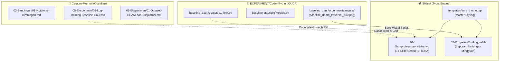

# 📽️ Slide Presentation Mission Engine (10-Slides)

> **Tujuan Sentral:** Mengelola seluruh produksi slide presentasi Tugas Akhir IF ITERA berbasis **Typst 0.15 + Shared Institutional Theme (Bentuk 1)**, menghubungkan secara dua arah (*bi-directional recall*) antara catatan konseptual di Obsidian dan implementasi kode di `EXPERIMENT/Code`.

---

## 🗺️ Peta Arsitektur Tiga Lapisan (Obsidian $\leftrightarrow$ Code $\leftrightarrow$ Slides)



---

## 📊 Matriks Silang Penelusuran Memori (*Cross-Reference Matrix*)

Tabel ini menjamin kesiapan mahasiswa pada sesi **Code Walkthrough (Bobot 10% Sidang ITERA)** dan menjawab pertanyaan kritis penguji:

| Nomor Slide | Topik Bahasan Slide | 🧠 Rujukan Catatan Obsidian | 💻 Berkas Kode Sumber | 📈 Artefak Data / Visual |
| :---: | :--- | :--- | :--- | :--- |
| **Slide 1** | Cover & Identitas Bentuk 1 | `[[02-Master-Blueprint-Slide-Sempro]]` | `AGENTS.md` (Aturan ITERA) | `branding/logo_itera.png` |
| **Slide 2** | Latar Belakang & Kesenjangan | `[[05-Eksperimen/1_TRAIN_BASELINE]]` | `PENJELASAN_KODE_DAN_GAP.md` | `DEAM Dynamic 2 Hz` |
| **Slide 3** | Penelitian Terdahulu (SOTA) | `[[04-Literatur-Review/Paper-Gaur]]` | `baseline_gaur/README.md` | Gaur & Donnelly (2024) |
| **Slide 4** | Rumusan Masalah & Tujuan (1:1) | `[[05-Eksperimen/4_BLUEPRINT_ARAH]]` | `run_experiment.py` | Indikator Keberhasilan |
| **Slide 5** | Metodologi Alur 2-Tahap | `[[05-Eksperimen/Dataset-DEAM]]` | `src/deam_loader.py` | `src/split_utils.py` |
| **Slide 6** | Bukti Eksperimen Baseline DEAM | `[[05-Eksperimen/1_TRAIN_BASELINE]]` | `run_quadrant_experiments.py`| `baseline_deam_traversal_plot.png`|
| **Slide 7** | Jadwal 3 Semester Aktif | `[[03-Bimbingan/Notulensi-Bimbingan]]`| Pedoman TA ITERA 5.8.1 | Form Kendali Bimbingan |
| **Slide 8** | Penutup & Sesi Q&A 30 Menit | `[[03-Bimbingan/Bank-Pertanyaan]]`| `Bank-Pertanyaan-Dosen.md` | Amunisi Tangkisan |

---

## ⚡ Eksekusi Cepat & Panduan Perintah

### 1. Sinkronisasi Plot Eksperimen Terbaru
Jalankan skrip ini setiap kali ada pembaruan grafik di `EXPERIMENT/Code`:
```powershell
powershell -File "Slides\scripts\sync_experiment_assets.ps1"
```

### 2. Kompilasi & Live-Watch Slide Seminar Proposal
```powershell
# Live watch otomatis dari root Slides
cd "Slides"
.\run_watch.ps1 -Target sempro
```

### 3. Kompilasi & Live-Watch Laporan Bimbingan Mingguan
```powershell
# Live watch progres minggu 01
cd "Slides"
.\run_watch.ps1 -Target 01
```

---

## 📑 Direktori Berkas Terkait
- **Folder Progress Mingguan (Obsidian):** [`10-Slides/Progress/00-Index-Progress-Mingguan.md`](file:///D:/Kuliah/Semester%207/Tugas%20Akhir/Proposal%20Tugas%20Akhir/Catatan-Memori/Catatan-Memori-Logs/10-Slides/Progress/00-Index-Progress-Mingguan.md) | [[Progress/01-Minggu-01-Baseline-DEAM]] | [[Progress/02-Minggu-02-Penguatan-Fundamental-dan-Skenario]]
- **Slide Sempro:** [`Slides/01-Sempro/sempro_slides.typ`](file:///D:/Kuliah/Semester%207/Tugas%20Akhir/Proposal%20Tugas%20Akhir/Slides/01-Sempro/sempro_slides.typ) | [PDF](file:///D:/Kuliah/Semester%207/Tugas%20Akhir/Proposal%20Tugas%20Akhir/Slides/01-Sempro/sempro_slides.pdf)
- **Slide Bimbingan #01:** [`Slides/02-Progress/01-Minggu-01-Baseline-DEAM/progres_m01.typ`](file:///D:/Kuliah/Semester%207/Tugas%20Akhir/Proposal%20Tugas%20Akhir/Slides/02-Progress/01-Minggu-01-Baseline-DEAM/progres_m01.typ) | [PDF](file:///D:/Kuliah/Semester%207/Tugas%20Akhir/Proposal%20Tugas%20Akhir/Slides/02-Progress/01-Minggu-01-Baseline-DEAM/progres_m01.pdf)
- **Template Bimbingan:** [`Slides/02-Progress/00-Template-Mingguan/template_mingguan.typ`](file:///D:/Kuliah/Semester%207/Tugas%20Akhir/Proposal%20Tugas%20Akhir/Slides/02-Progress/00-Template-Mingguan/template_mingguan.typ)
- **Shared Theme:** [`Slides/templates/itera_theme.typ`](file:///D:/Kuliah/Semester%207/Tugas%20Akhir/Proposal%20Tugas%20Akhir/Slides/templates/itera_theme.typ)
- **Template Catatan Obsidian:** [`Catatan-Memori/Catatan-Memori-Logs/99-Templates/Template-Slide-Bimbingan-Mingguan.md`](file:///D:/Kuliah/Semester%207/Tugas%20Akhir/Proposal%20Tugas%20Akhir/Catatan-Memori/Catatan-Memori-Logs/99-Templates/Template-Slide-Bimbingan-Mingguan.md)
