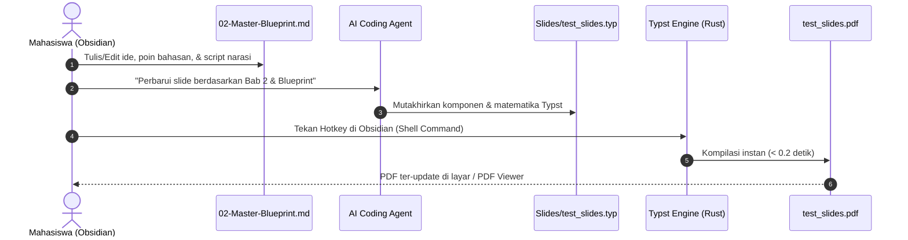

# ⚡ Panduan Alur Kerja Seamless (Obsidian $\rightarrow$ Typst Slides)

> **Prinsip Utama:** Anda menyusun ide, catatan narasi, dan outline di **Obsidian**. Agen AI atau skrip otomatisasi mentranslasikannya ke kode **Typst (`.typ`)**, dan dengan **satu pintasan keyboard (*hotkey*)** di Obsidian, berkas PDF vektor terkompilasi dan siap dipresentasikan.

---

## 🔄 1. Siklus Kerja Single Source of Truth



---

## 🛠️ 2. Integrasi Plugin `Obsidian Shell Commands`

Plugin **Obsidian Shell Commands** sudah terpasang di vault Anda pada `.obsidian/plugins/obsidian-shellcommands/`. Untuk mengaktifkan workflow 1-klik:

### Langkah Konfigurasi di Obsidian:
1. Buka **Settings** Obsidian (`Ctrl + ,`).
2. Masuk ke **Community Plugins** $\rightarrow$ **Shell Commands**.
3. Klik tombol **New Shell Command** dan tambahkan perintah berikut:

#### Perintah 1: Kompilasi Slide Sempro
- **Command:**
  ```powershell
  & "D:\Typst\typst-x86_64-pc-windows-msvc\typst.exe" compile "D:\Kuliah\Semester 7\Tugas Akhir\Proposal Tugas Akhir\Slides\test_slides.typ" "D:\Kuliah\Semester 7\Tugas Akhir\Proposal Tugas Akhir\Slides\test_slides.pdf"
  ```
- **Alias / Label:** `Typst: Compile Sempro Slides`
- **Hotkey Disarankan:** `Ctrl + Alt + B` (Build)
- **Notification:** Enable *"Display notification when command completes"*

#### Perintah 2: Buka Berkas PDF Hasil Kompilasi
- **Command:**
  ```powershell
  Start-Process "D:\Kuliah\Semester 7\Tugas Akhir\Proposal Tugas Akhir\Slides\test_slides.pdf"
  ```
- **Alias / Label:** `Typst: Open Slides PDF`
- **Hotkey Disarankan:** `Ctrl + Alt + P` (Preview)

#### Perintah 3: Jalankan Live Auto-Reload (Watch Mode)
- **Command:**
  ```powershell
  Start-Process powershell -ArgumentList "-NoExit", "-File", "D:\Kuliah\Semester 7\Tugas Akhir\Proposal Tugas Akhir\Slides\run_watch.ps1"
  ```
- **Alias / Label:** `Typst: Launch Watch Mode (External Window)`
- **Hotkey Disarankan:** `Ctrl + Alt + W` (Watch)

---

## 🤖 3. Protokol Kolaborasi dengan Agen AI

Ketika Anda ingin memperbarui slide melalui chat dengan Agen AI:
1. **Perbarui Blueprint di Obsidian:** Cukup ubah catatan di [[02-Master-Blueprint-Slide-Sempro]].
2. **Kirim Instruksi ke AI:**
   > *"Tolong update slide nomor 8 dan 9 di `Slides/test_slides.typ` sesuai rumus baru yang ada di [[02-Master-Blueprint-Slide-Sempro]]"*.
3. Agen AI akan langsung menyelaraskan kode Typst, memastikan tata letak 16:9 tidak mengalami *overflow*, dan menguji kompilasi secara otomatis.

---

## 🎯 4. Skrip Otomasi Terpadu: `sync_compile.ps1`

Di dalam folder `Slides/`, tersedia skrip pembantu `sync_compile.ps1` yang menjalankan validasi pra-kompilasi:
- Memverifikasi keberadaan compiler Typst.
- Mengompilasi naskah slide.
- Menghitung jumlah halaman (memastikan tidak ada halaman bocor/overflow).
- Menampilkan status keberhasilan berwarna hijau di terminal.
