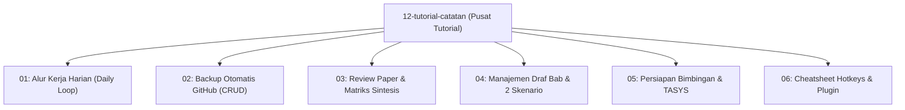

# 📖 Pusat Panduan & Indeks Tutorial Vault (12-Tutorial-Catatan)

Selamat datang di **Pusat Panduan Penggunaan Vault Catatan-Memori-Logs**! Folder ini dirancang khusus sebagai panduan operasional praktis (*how-to guides*) agar Anda dapat memanfaatkan seluruh fitur otomatisasi, integrasi Google Workspace, draf naskah, dan pencadangan GitHub secara maksimal tanpa kebingungan.

---

## 🗺️ Peta Navigasi Modul Tutorial

| Modul | Judul Panduan | Kapan Harus Membaca Modul Ini? |
| :-: | :--- | :--- |
| **[[01-Tutorial-Alur-Kerja-Harian]]** | **Alur Kerja Harian (*The Daily Loop*)** | Setiap pagi saat mulai bekerja: ritual membuka Daily Log, menarik agenda Google Calendar, dan to-do Google Tasks. |
| **[[02-Tutorial-Otomatisasi-Backup-GitHub]]** | **Pencadangan Otomatis GitHub (CRUD)** | Memahami cara kerja auto-commit/push 15 detik, pemicu manual `Ctrl+P`, dan background watcher PowerShell. |
| **[[03-Tutorial-Review-Paper-dan-Matriks-Sintesis]]** | **Review Paper & Matriks Sintesis Otomatis** | Saat membaca paper baru: cara memakai template review dan melihat tabel komparasi otomatis Dataview. |
| **[[04-Tutorial-Manajemen-Draf-dan-Skenario-Sempro]]** | **Manajemen Draf Naskah & 2 Skenario** | Saat menulis Bab 1–3: memilih antara Skenario 1 (Komputasional) vs Skenario 2 (User Study) serta cek Turnitin. |
| **[[05-Tutorial-Persiapan-Bimbingan-dan-TASYS]]** | **Persiapan Bimbingan Dosen & Syarat TASYS** | Sebelum & sesudah bimbingan: mencatat notulensi, membawa lembar diskusi, dan mengawal syarat 4 pertemuan TASYS. |
| **[[06-Tutorial-Hotkeys-dan-Cheatsheet-Plugin]]** | **Cheatsheet Tombol Pintas & Solusi Kendala** | Kartu contekan tombol cepat (`Alt+T`, `Alt+C`, `Alt+S`, `Alt+Y`, `Alt+K`) dan penanganan token expired. |

---

## 💡 Filosofi Sederhana Menggunakan Vault Ini

1. **Satu Catatan Harian per Hari:** Semua aktivitas riset, temuan eksperimen, dan catatan kilat cukup dimasukkan ke log tanggal hari ini di `02-Daily-Logs/`.
2. **Jangan Menulis Ulang Hal yang Sudah Otomatis:** Daftar tugas sudah ditarik otomatis dari Google Tasks via `Alt + T`, dan literatur otomatis terangkum di `Matriks-Sintesis.md`.
3. **Fokus Menulis, Biarkan Sistem Mengamankan Data:** Setiap ketikan Anda tersimpan aman secara lokal dan di-backup otomatis ke GitHub tanpa perlu memikirkan perintah terminal manual.
